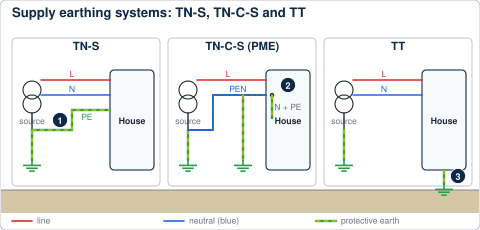
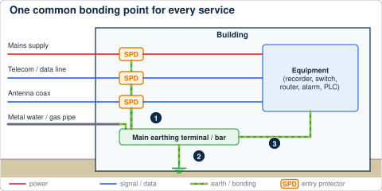

 

> Earthing, Bonding, Surge & Lightning Protection Library · **SHEET 01 · EARTHING** · content version 1.0

# Earthing and bonding fundamentals

*Earthing systems, the main earthing terminal, main bonding of services, earth electrodes and the conductor sizes stated in the sources*

**Applies to:** The earthing and protective bonding of a house: supply earthing system, main earthing terminal, bonding of incoming services, earth electrodes, and the earth references of connected equipment

> ℹ️ Information only. Every technical statement cites a source and PDF page; it does not replace the wiring code that applies at the site, the product manuals, or a qualified and registered person.

## 1  Earthing and bonding: two different jobs

ITU-T K.98 separates the two terms: earthing connects the earth bar to earth, usually through an installed electrode, while bonding interconnects earth electrodes and metallic parts to minimise the potential differences between them.[R25 p.27](#sources-cited-on-this-page)

| **< 1.5 m** | **1 kV/m** | **50 V a.c.** |
|---|---|---|
| bonding conductor length from services to the main earth terminal, ITU-T K.66[R18 p.19](#sources-cited-on-this-page) | voltage drop K.66 assumes along a bonding conductor during a direct strike[R18 p.19](#sources-cited-on-this-page) | typical limit for permanently permissible touch voltage (120 V d.c.)[R6 p.220](#sources-cited-on-this-page) |

- TP-Link (Lightning Protection Guide for rack-mountable devices): equipotential bonding is defined as intentionally connecting all earthed systems to the same grounding grid, or connecting their grounding grids together, to create an earthed equipotential zone.[R29 p.7](#sources-cited-on-this-page)
- Equipotential bonding removes potential differences and so prevents hazardous touch voltages, for example between the protective conductor of the installation and metal water, gas and heating pipes.[R6 p.178](#sources-cited-on-this-page)
- Per the South African WAPA high-site guideline, site earthing systems are needed both for the safety of personnel and for the protection of equipment.[R13 p.20](#sources-cited-on-this-page)
- One earth-termination system must serve all earthing tasks of a structure (protective, lightning protection and functional earthing); otherwise potential differences can arise between installations earthed on different earth-termination systems.[R6 p.142](#sources-cited-on-this-page)

> [!NOTE]
> **NOTE: Shock protection comes first**
>
> DEHN states that measures for protection against electric shock always take priority over surge protection measures.[R6 p.220](#sources-cited-on-this-page)

## 2  Earthing systems: TN-S, TN-C-S (PME) and TT

BS 7671 (UK) names five earthing systems: TN-S, TN-C-S, TT, TN-C and IT.[R8 p.2](#sources-cited-on-this-page) A UK public low-voltage supply is one of the first three.[R8 p.2](#sources-cited-on-this-page)

*Animated: the steps play in a loop. Click to open full size.* (1) In normal use the current returns on the neutral. (2) When a live conductor touches an earthed metal case, the fault current returns on the protective earth and the PEN to the transformer.[R64 p.4](#sources-cited-on-this-page) TN-C-S is used so that this fault current does not depend on soil resistivity.[R64 p.4](#sources-cited-on-this-page) (3) In TN systems, fault touch voltages in circuits with socket outlets must be disconnected automatically within 0.4 s.[R6 p.220](#sources-cited-on-this-page)

*Click the diagram to open it full size.* *Concept sketch of the three supply earthing systems a UK low-voltage supply will use[R8 p.2](#sources-cited-on-this-page); TN-C-S is the system known in the UK as protective multiple earthing (PME).[R8 p.5](#sources-cited-on-this-page) (3) TT: the consumer provides their own connection to earth with an earth electrode local to the installation.[R8 p.8](#sources-cited-on-this-page) No verified fact in this library describes the conductor arrangements at markers (1) and (2); the drawing shows them by system name only.*

- In the UK, a low-voltage supply given in accordance with the Electricity Safety, Quality and Continuity Regulations 2002 will be TN-S, TN-C-S (PME) or TT.[R8 p.2](#sources-cited-on-this-page)
- An IT system is not permitted for a low-voltage public supply in the UK because the source is not directly earthed; TN-C and IT systems are both very uncommon in the UK.[R8 p.2](#sources-cited-on-this-page)
- Protective multiple earthing (PME) is the supply system described in BS 7671 (UK) as TN-C-S.[R8 p.5](#sources-cited-on-this-page)
- Per UK guidance (IET), the maximum Ze specified by a distributor is 0.35 Ω for TN-C-S (PME) supplies compared with 0.8 Ω for TN-S supplies.[R8 p.5](#sources-cited-on-this-page)
- Per UK guidance (IET), with a TT system the consumer must provide their own connection to earth by installing a suitable earth electrode local to the installation.[R8 p.8](#sources-cited-on-this-page)
- Per UK guidance (IEE Wiring Matters), the ESQCR allows a supplier to refuse a means of earthing for a new connection where it reasonably concludes this is appropriate for safety, for example a countryside house supplied by an overhead line.[R9 p.1](#sources-cited-on-this-page)
- BRE PV guide (UK, 2nd ed. 2006): where the incoming supply is PME (the majority of UK domestic supplies), the PME earth cannot be taken outside the equipotential zone, to prevent a shock hazard should the supply neutral ever be lost.[R49 p.13](#sources-cited-on-this-page)

### What the sources recommend for equipment buildings

- ITU-T K.73 recommends a TN-S earthing system for the a.c. power distribution, noting it is specified in the EN 50174 series and EN 50310.[R23 p.9](#sources-cited-on-this-page)
- ITU-T K.27 recommends a TN-S mains installation inside a telecommunication building, with no combined PEN conductor within the building.[R24 p.15](#sources-cited-on-this-page)
- The power installation should be a TN-S system to prevent interference currents on the shields of data lines.[R6 p.322](#sources-cited-on-this-page)
- ITU-T K.66 Appendix II lists metal-free fibre optic cables for signal links between Class I equipment as a mitigation measure in existing TN-C or TN-C-S installations.[R18 p.60](#sources-cited-on-this-page)

### Automatic disconnection and touch voltage

- The limit for permanently permissible touch voltage is typically 50 V a.c. and 120 V d.c.[R6 p.220](#sources-cited-on-this-page)
- In TN systems, fault touch voltages in circuits with socket outlets must be automatically disconnected within 0.4 s; longer times apply to other circuits.[R6 p.220](#sources-cited-on-this-page)

### RCDs in TT systems: the RA × IΔn rule

- ABB OVR brochure: a residual current device is mandatory for TT systems, possible for TN-S, IT and TN-C-S systems, and not permitted for TN-C systems.[R52 p.10](#sources-cited-on-this-page)
- BS 7671:2001 Regulation 413-02-20 (UK) states that for TT systems the earth electrode resistance RA multiplied by the operating current of the protective device (rated residual operating current) must not exceed 50 V.[R9 p.5](#sources-cited-on-this-page)
- Per UK guidance (IEE Wiring Matters), for an RCD rated at 30 mA the 50 V rule equates to an earth electrode resistance limit of approximately 1666 Ω.[R9 p.5](#sources-cited-on-this-page)
- In TT systems type 1 and type 2 SPDs must always be installed upstream of the RCD.[R6 p.229](#sources-cited-on-this-page)
- In TN systems, type 1 and type 2 SPDs should be installed upstream of the RCD, because an RCD would see the discharged impulse current as residual current and could be mechanically damaged by partial lightning current.[R6 p.222](#sources-cited-on-this-page)
- Type 3 SPDs are installed downstream of the RCD.[R6 p.222](#sources-cited-on-this-page)
- ITU-T K.66 Annex A notes that a mains SPD may be installed before or after the earth leakage breaker, but installing it after may cause nuisance tripping, particularly if the breaker contains an RCD.[R18 p.33](#sources-cited-on-this-page)

> [!NOTE]
> **NOTE: Edition of the rule quoted here**
>
> The RA × IΔn ≤ 50 V rule above is quoted from BS 7671:2001 Regulation 413-02-20 as cited by IEE Wiring Matters (UK).[R9 p.5](#sources-cited-on-this-page) No public source in this library quotes the current edition of BS 7671 on this point; South African wiring-code requirements are handled in a separate document.

## 3  Main earthing terminal and main bonding of services

ITU-T K.66 requires overvoltage protection to start with bonding the metallic services and cable screens to the building earth and fitting SPDs at the building entry point on both the power and the telecommunication conductors.[R18 p.9](#sources-cited-on-this-page)

### Where the main earthing terminal goes

- ITU-T K.73 says a building should have a main earthing terminal located as close as possible to the a.c. power and telecommunication cable entrance facilities.[R23 p.8](#sources-cited-on-this-page)
- ITU-T K.27: the AC power entrance, the telecommunication cable entrance and the earthing conductor entry point should be close together.[R24 p.12](#sources-cited-on-this-page)
- ITU-T K.27: the main earthing terminal should be located as close as possible to the AC power and telecommunication cable entrance facilities.[R24 p.13](#sources-cited-on-this-page)
- ITU-T K.66 recommends that all metallic services (a.c. mains, telecommunication cables, gas and water pipes, CATV) and the earthing conductor enter the building at the same point, to shorten bonding conductors and reduce EMI.[R18 p.19](#sources-cited-on-this-page)
- Per IEC/BS EN 62305-3 as summarised by Furse, the equipotential bonding bar should be located close to the main distribution board and closely connected to the earth termination system with short conductors.[R12 p.12](#sources-cited-on-this-page)
- Where services enter at different points, ITU-T K.66 requires an earthed equipotential bonding bar or bonding terminal near each entry point, each connected to an earthing system, with all the bonding bars bonded together, for example by a ring conductor.[R18 p.19](#sources-cited-on-this-page)
- Lightning equipotential bonding of all incoming metal lines, power lines and data lines should be made centrally at one point; where that is not possible, a ring equipotential bonding bar is recommended.[R6 p.205](#sources-cited-on-this-page)

*Click the diagram to open it full size.* *Concept sketch, not an installation drawing. (1) SPDs at the service entries connected to the main earthing terminal with short conductors: K.66 gives under 0.5 m for the SPD connecting wires and under 1.5 m for connecting plus bonding wires to the terminal[R18 p.33](#sources-cited-on-this-page), which reduces surge voltage differences between telecom lines and the power protective conductor.[R18 p.22](#sources-cited-on-this-page) (2) Earthing: the earth bar connected to earth, usually via an installed electrode.[R25 p.27](#sources-cited-on-this-page) (3) All protective and functional earthing conductors connected to one single main earth terminal (IEC 60364-4-44 as cited by K.98).[R25 p.30](#sources-cited-on-this-page)*

### One earth for everything

- ITU-T K.98 cites IEC 60364-4-44 section 444.5 as recommending that all protective and functional earthing conductors connect to one single main earth terminal and that all earth electrodes associated with a building be interconnected.[R25 p.30](#sources-cited-on-this-page)
- ITU-T K.66 lists as good practice for all installations that every earth point is bonded to the main earth bar (possibly via added earth bars) and that nothing is connected to a separate earth electrode that is not bonded to the main earth bar.[R18 p.18](#sources-cited-on-this-page)
- BEAMA SPD guide (UK, 2018): all incoming services (metallic water and gas pipes, power and data cables) should be bonded to a single earth reference point, which may be the main earthing terminal or a bonding ring conductor.[R48 p.31](#sources-cited-on-this-page)
- IEC/BS EN 62305-3 recommends a single integrated earth termination system for a structure, combining lightning protection, power and telecommunication systems.[R12 p.11](#sources-cited-on-this-page)
- Per Motorola R56 (2005, US practice), a communications site shall have only one grounding electrode system: AC power, tower, lightning protection, telephone, structural steel and buried metallic piping grounds are all bonded together.[R5 p.99](#sources-cited-on-this-page)
- ITU-T K.66 says conducted energy entering on services is mitigated by connecting all services with low-impedance bonding conductors to the main earth terminal (MET), mesh bonding network or common bonding network, and that low impedance is obtained by keeping bonding conductors shorter than 1.5 m.[R18 p.19](#sources-cited-on-this-page)
- ITU-T K.66 Table 8-1 gives the maximum bonding conductor length as 1.5 m where direct strikes are the mechanism and 10 m for induced surges, and a maximum resistance of 1 ohm for power induction/power contact.[R18 p.19](#sources-cited-on-this-page)
- Lightning equipotential bonding requires all metal conductive parts of incoming lines, such as cable cores and shields, to be bonded at the point of entry into the building with as little impedance as possible.[R6 p.182](#sources-cited-on-this-page)
- To minimise induction loops inside a building, cables and metal pipes should enter the building at the same location.[R6 p.182](#sources-cited-on-this-page)
- Under IEC/BS EN 62305, 'live' electrical conductors (e.g. power, data, telecoms) are bonded to the main equipotential bonding bar via surge protective devices.[R12 p.1](#sources-cited-on-this-page)
- ITU-T K.66 says the shields of all cables entering the building should be bonded directly to the main earth terminal or equipotential bonding bar; an SPD may be used instead to give galvanic isolation if corrosion requires it.[R18 p.19](#sources-cited-on-this-page)
- Per IEC/BS EN 62305-3 as summarised by Furse, the screen of any antenna cable, and any shielded power supply to electronic appliances routed into the structure, should also be bonded at the equipotential bonding bar.[R12 p.12](#sources-cited-on-this-page)

### Water, gas and other metal pipes

- According to the IEC standards each installation needs its own earth-termination system that works fully without relying on metal water pipes or the earthed conductors of the electrical installation.[R6 p.127](#sources-cited-on-this-page)
- ITU-T K.98 notes that in structures relying on a bond to underground metallic services for their path to earth, that path may be missing if plastic pipes have been retrofitted or installed.[R25 p.39](#sources-cited-on-this-page)
- ITU-T K.66 warns that national safety regulations may prohibit using a metallic water pipe as the main earth terminal.[R18 p.19](#sources-cited-on-this-page)

> [!WARNING]
> **WARNING: A metal water pipe is not automatically an earth**
>
> K.66 warns that national safety regulations may prohibit a metallic water pipe as the main earth terminal[R18 p.19](#sources-cited-on-this-page), and K.98 notes that a path to earth through underground metal services may be missing where plastic pipes have been fitted.[R25 p.39](#sources-cited-on-this-page)

### Bonding between power and communication services (US practice)

- The US National Electrical Code requires the two incoming services (power and communications) to be properly bonded by a grounding conductor; NIST notes that the opposite-ends arrangement is often made worse by an unintentional violation of this.[R1 p.11](#sources-cited-on-this-page)
- The 1999 US NEC limits the separation between the points of entry of power and communications to 20 feet (given as 7 meters in the source) for new installations.[R1 p.20](#sources-cited-on-this-page)
- Per NIST (US), the situation is worse still when an incoming service, cable TV in particular, is not bonded to the power service ground, which is a clear violation of the NEC.[R1 p.20](#sources-cited-on-this-page)
- Per NIST (US), the shifting of reference potentials is reduced by inter-system bonding of all utilities serving a residence, with the usual components for each service connection installed next to each other.[R1 p.21](#sources-cited-on-this-page)
- Per NIST (US), a detached house with the power drop and the telephone and/or cable TV drops at opposite ends of the house is the worst possible arrangement of the utilities for surge problems.[R1 p.11](#sources-cited-on-this-page)

## 4  Earth electrodes

Most of an electrode's resistance arises in the soil immediately around it: in DEHN's example of a 20 cm sphere, 90 % of the total earth resistance is reached within 5 m of the electrode centre.[R6 p.121](#sources-cited-on-this-page)

- Per Motorola R56 (2005, US practice), 52 % of a ground rod's total resistance to earth arises within the first 152 mm (6 in.) of soil around the rod.[R5 p.105](#sources-cited-on-this-page)
- ITU-T K.98 says a customer-premises earth electrode could have a resistance to earth anywhere from tens of ohms to hundreds of ohms.[R25 p.30](#sources-cited-on-this-page)
- Per Motorola R56 (2005), for dispersing lightning energy the shape and dimensions of the grounding electrode system matter more than a specific resistance value, although low resistance is generally recommended.[R5 p.140](#sources-cited-on-this-page)
- InstMC Tech Talk 12 (UK, 2017): a soil resistivity test is the main factor in determining the type and extent of the earth electrode(s) required.[R43 p.3](#sources-cited-on-this-page)

### Types and minimum dimensions

- A foundation earth electrode is made of galvanised steel round wire of 10 mm diameter or strip of 30 mm x 3.5 mm.[R6 p.130](#sources-cited-on-this-page)
- A galvanised steel foundation earth electrode must be embedded in at least 5 cm of concrete on all sides to protect it against corrosion.[R6 p.131](#sources-cited-on-this-page)
- A ring earth electrode is to be buried at a depth greater than 0.5 m and about 1 m away from the building.[R6 p.141](#sources-cited-on-this-page)
- Per IEC 62305-3 Table 7, minimum dimensions for copper or tin-plated copper earth electrodes are 50 mm2 stranded, 15 mm diameter solid round earth rod, 50 mm2 solid round or tape earthing conductor, and 20 mm diameter pipe.[R6 p.149](#sources-cited-on-this-page)
- A type A earth electrode arrangement requires at least two earth electrodes, although a single earth electrode is sufficient for individually positioned air-termination rods or masts.[R6 p.129](#sources-cited-on-this-page)
- For class of LPS III and IV the minimum earth electrode length l1 is 5 m.[R6 p.129](#sources-cited-on-this-page)
- For type A arrangements, each vertical or inclined earth electrode must be at least 0.5 x l1 long, and each radial electrode at least l1 long.[R6 p.129](#sources-cited-on-this-page)
- Per Motorola R56 (2005, US practice), ground rods shall have a minimum length of 2.4 m (8 ft.).[R5 p.106](#sources-cited-on-this-page)
- Per Motorola R56 (2005, US practice), buried ground ring conductors shall be 35 mm2 (#2 AWG) or coarser bare solid copper, tinned or un-tinned.[R5 p.116](#sources-cited-on-this-page)
- Per Motorola R56 (2005, US practice), ground rings shall be buried in direct contact with earth 762 mm (30 in.) deep where possible, or below the frost line if deeper.[R5 p.117](#sources-cited-on-this-page)
- Per Motorola R56 (2005, US practice), a building ground ring shall be at least 914 mm (3 ft.) from the building foundation and should lie beyond the roof drip line.[R5 p.117](#sources-cited-on-this-page)
- Per UK guidance (IET), where rock or other impervious strata prevent deep driving of rods (or there is a deep layer of high resistivity), copper earth tapes, pipes or plates are most likely to give a satisfactory earth electrode resistance.[R8 p.3](#sources-cited-on-this-page)

### Installing an electrode

- Per UK guidance (IET), earth rods should be driven into virgin ground, not disturbed (backfilled) ground.[R8 p.3](#sources-cited-on-this-page)
- Per UK guidance (IEE Wiring Matters), in ground that has been backfilled or disturbed by building operations, earth electrodes should be driven down until stable ground is reached.[R9 p.3](#sources-cited-on-this-page)
- Per UK guidance (IEE Wiring Matters), earth rods penetrating to a depth of less than one metre should not be installed in ground susceptible to freezing.[R9 p.3](#sources-cited-on-this-page)
- It is recommended to treat the first metre of a vertical earth electrode as ineffective under frost conditions.[R6 p.129](#sources-cited-on-this-page)
- Per UK guidance (IET), whatever form an earth electrode takes, the possibility of soil drying and freezing, and of corrosion, must be taken into account.[R8 p.3](#sources-cited-on-this-page)
- Buried connection points of earth electrodes must be given a suitable corrosion-protective coating, for example a wrapping of anticorrosive tape.[R6 p.150](#sources-cited-on-this-page)
- Per Motorola R56 (2005), galvanic corrosion occurs when two dissimilar metals are electrically connected and coupled through an electrolyte such as soil.[R5 p.130](#sources-cited-on-this-page)
- Per Motorola R56 (2005, US practice, citing NFPA 70 Art. 250.64), grounding electrode conductors shall be one continuous length, spliced only with listed irreversible compression connectors or exothermic welds.[R5 p.123](#sources-cited-on-this-page)
- Per Motorola R56 (2005, US practice), all below-grade grounding electrode system connections shall be exothermically welded or made with listed irreversible high-compression fittings compressed to at least 13.3 tonnes (12 tons).[R5 p.134](#sources-cited-on-this-page)
- Per Motorola R56 (2005, US practice), the top of a ground rod shall not be cut off when rock prevents it being driven fully.[R5 p.107](#sources-cited-on-this-page)
- Per UK guidance (IEE Wiring Matters), it is sensible to check the distributor's network map before driving earth rods.[R9 p.3](#sources-cited-on-this-page)

### Several electrodes and their spacing

| **1 / n** | **≈ 40 %** | **≥ 1.8 m** |
|---|---|---|
| parallel rods: overall resistance virtually proportional to the reciprocal of the number of rods, each outside the others' resistance area[R9 p.3](#sources-cited-on-this-page) | lower resistance from doubling the rod length in homogeneous soil, Motorola R56[R5 p.142](#sources-cited-on-this-page) | minimum distance between rods, Motorola R56 citing NFPA 70 (US)[R5 p.107](#sources-cited-on-this-page) |

- Per UK guidance (IEE Wiring Matters), with multiple earth rods in parallel the overall resistance is virtually proportional to the reciprocal of the number of rods, provided each rod is outside the resistance area (sphere of influence) of any other.[R9 p.3](#sources-cited-on-this-page)
- Per UK guidance (IEE Wiring Matters, 2006), the resistance-area condition is generally deemed met by a rod separation equal to the driven depth of the rod, and a separation of more than twice the driven depth offers little benefit.[R9 p.3](#sources-cited-on-this-page)
- Per UK guidance (IET, 2011), where two or more earth rods are driven and connected together, the separation between rods should be at least equal to their combined driven depth to obtain maximum advantage from each rod.[R8 p.3](#sources-cited-on-this-page)
- Per Motorola R56 (2005, US practice), ground rods should be spaced apart by the sum of their lengths so that their spheres of influence do not overlap.[R5 p.105](#sources-cited-on-this-page)
- Per Motorola R56 (2005, US practice, citing NFPA 70 Art. 250.56), ground rods shall not be installed closer than 1.8 m (6 ft.) to other ground rods and grounding electrodes.[R5 p.107](#sources-cited-on-this-page)
- Per Motorola R56 (2005), doubling the length of a ground rod reduces its resistance by approximately 40 % in homogeneous soil.[R5 p.142](#sources-cited-on-this-page)
- InstMC Tech Talk 12 (UK, 2017): to avoid potential differences between multiple earth electrodes, accepted practice is to connect all earthing systems to a single earth electrode connection point.[R43 p.6](#sources-cited-on-this-page)

### Earth resistance values and what each is for

| Purpose | Value as published | Source |
|---|---|---|
| Earth-termination of a lightning protection system | 10 Ω overall (IEC/BS EN 62305, Type A or Type B arrangement)[R12 p.1](#sources-cited-on-this-page); 10 Ω or less at low frequency, generally recommended[R6 p.128](#sources-cited-on-this-page) | Furse (UK); DEHN |
| High-site earthing (South Africa) | preferably below 10 Ω[R13 p.22](#sources-cited-on-this-page); below 1 Ω for a single integrated lightning and safety earth[R13 p.22](#sources-cited-on-this-page) | WAPA |
| Communication sites (US practice) | 25 Ω or less, single electrode, light-duty Type A[R5 p.140](#sources-cited-on-this-page); not over 10 Ω, Type B[R5 p.141](#sources-cited-on-this-page); Motorola recommends 5 Ω or less for Type B[R5 p.141](#sources-cited-on-this-page) | Motorola R56 |
| Building grounding electrode system before telecom bonding (US DoD) | not over 25 Ω (5 Ω option), fall-of-potential, dry weather[R17 p.33](#sources-cited-on-this-page) | UFGS 27 05 26 |
| TT installation protected by a 30 mA RCD (UK) | approximately 1666 Ω, from RA × IΔn ≤ 50 V[R9 p.5](#sources-cited-on-this-page)[R9 p.5](#sources-cited-on-this-page) | IEE Wiring Matters |
| Measured loop impedance, TT (UK) | above 200 Ω requires further investigation[R9 p.5](#sources-cited-on-this-page) | IEE GN3 via Wiring Matters |
| Customer-premises electrode, as found | anywhere from tens to hundreds of ohms[R25 p.30](#sources-cited-on-this-page) | ITU-T K.98 |
| Maximum Ze specified by the distributor (UK) | 0.35 Ω TN-C-S (PME); 0.8 Ω TN-S[R8 p.5](#sources-cited-on-this-page) | IET |
| Outdoor camera (manufacturer) | below 4 Ω[R41 p.4](#sources-cited-on-this-page) | TP-Link Omada |

*Each value applies to the purpose and jurisdiction in its row and is not interchangeable with the others. Motorola R56 adds that for dispersing lightning energy the shape and dimensions of the electrode system matter more than a specific resistance value.[R5 p.140](#sources-cited-on-this-page)*

## 5  Protective and bonding conductor sizes stated in the sources

| Conductor | Minimum size as published | Source |
|---|---|---|
| Internal metal installations to the equipotential bonding bar, all classes of LPS | 6 mm² copper or 10 mm² aluminium[R6 p.181](#sources-cited-on-this-page) | IEC 62305-3 Table 9 via DEHN |
| Between two equipotential bonding bars | 16 mm² copper[R6 p.111](#sources-cited-on-this-page) | IEC 62305-3 Table 8 via DEHN |
| Earthing conductor where SPDs are used, power systems | 16 mm² copper[R6 p.288](#sources-cited-on-this-page) | DEHN |
| SPD connecting cables (UK, BS 7671:2018 via BEAMA) | BS 7671 Section 534 advises 16 mm² copper for Type 1; 4 mm² copper for Type 2 and Type 3[R48 p.48](#sources-cited-on-this-page) | BEAMA |
| Earthing conductor where SPDs are used, information technology systems | 6 mm² copper, or as the installation instructions specify[R6 p.288](#sources-cited-on-this-page) | DEHN |
| Copper earth electrode / earthing conductor | 50 mm² stranded; 15 mm solid rod; 50 mm² solid round or tape; 20 mm pipe[R6 p.149](#sources-cited-on-this-page) | IEC 62305-3 Table 7 via DEHN |
| Foundation earth electrode, galvanised steel | 10 mm round wire or 30 mm × 3.5 mm strip[R6 p.130](#sources-cited-on-this-page) | DEHN |
| Antenna mast earthing conductor | 16 mm² copper, 25 mm² insulated aluminium or 50 mm² steel[R6 p.296](#sources-cited-on-this-page) | DEHN |
| Antenna cable shields to the main earthing busbar | 4 mm² copper[R6 p.294](#sources-cited-on-this-page) | DEHN |
| Parallel bonding conductor between two buildings' earthing systems | 50 mm² copper, when the potential difference cannot be determined[R23 p.17](#sources-cited-on-this-page) | ITU-T K.73 |
| Buried ground ring (US practice) | 35 mm² bare solid copper[R5 p.116](#sources-cited-on-this-page) | Motorola R56 |
| Panel SPD connecting conductors (US practice) | 16 mm²[R5 p.343](#sources-cited-on-this-page) | Motorola R56 |
| Equipotential bonding of rack equipment | 10 AWG or larger, as short as possible[R29 p.7](#sources-cited-on-this-page) | TP-Link |
| PV mounting system, functional earthing | 6 mm² copper[R44 p.3](#sources-cited-on-this-page); 16 mm² copper when tied into a class III LPS[R44 p.3](#sources-cited-on-this-page) | DEHN WPX029 |

*Sizes are quoted with the jurisdiction and purpose of each source. They are not a sizing method for a particular installation; the wiring code that applies at the site decides.*

> [!NOTE]
> **NOTE: Not covered by the sources in this library**
>
> The sources in this library give no rule for sizing the main earthing conductor or the main protective bonding conductors of a house installation. Use the wiring code that applies at the site.

## 6  Why separate, unbonded earth electrodes harm equipment

ITU-T K.66 lists as good practice for every installation that every earth point is bonded to the main earth bar and that nothing is connected to a separate earth electrode that is not bonded to it.[R18 p.18](#sources-cited-on-this-page)

*Animated: the steps play in a loop. Click to open full size.* ITU-T K.66 example: without a common bonding point, a 50 A surge from the telecom line through a 300 Ω earth electrode raises the telecom equipment 15 kV above the power network.[R18 p.58](#sources-cited-on-this-page) Of the customer earthing practices K.66 examined, only the common earth bar with short bond wires protects equipment from surges entering on external cables without additional protection.[R18 p.56](#sources-cited-on-this-page)

> [!CAUTION]
> **DO NOT: Do not install a separate 'clean earth' for electronics**
>
> DEHN calls a separate clean earth for electronic equipment, kept apart from the lightning protection and protective earth, extremely unfavourable and possibly dangerous, because lightning can produce potential differences of up to some 100 kV in the earth-termination system.[R6 p.142](#sources-cited-on-this-page)

- One earth-termination system must serve all earthing tasks of a structure (protective, lightning protection and functional earthing); otherwise potential differences can arise between installations earthed on different earth-termination systems.[R6 p.142](#sources-cited-on-this-page)
- ITU-T K.85 notes that if two separate earth electrodes are not bonded together, a potential difference may arise between them and damage the ports of the equipment connected to each; a ring earth is offered as a solution.[R19 p.18](#sources-cited-on-this-page)
- ITU-T K.98 explains that an auxiliary earth electrode not bonded to the main earth terminal is a problem because surge current in it makes the external telecommunication port rise in potential relative to the MET, which can break down equipment insulation and cause damage and a safety hazard.[R25 p.30](#sources-cited-on-this-page)
- ITU-T K.66 warns that earthing telecommunication primary protectors only to a separate earth electrode is not compatible with protecting equipment and may even cause a fire in the premises or injury or death of a person using telecommunication equipment.[R18 p.22](#sources-cited-on-this-page)
- ITU-T K.85 says its earthing method 4 (a stand-alone earthing system/electrode) is most likely unsuitable for customer premises equipment because of the consequences of not being bonded to protective earth.[R19 p.14](#sources-cited-on-this-page)
- ITU-T K.66 gives the example that, without a common bonding point with short conductors, a 50 A surge from the telecom line discharging through a 300 ohm earth electrode raises the telecommunication equipment 15 kV above the power network.[R18 p.58](#sources-cited-on-this-page)
- In ITU-T K.98 Appendix II's example of earth potential rise around a single rod earth electrode, there can be 70 kV between a cable bonded to the main earth terminal and a point 20 m from the electrode, which the document uses to show the necessity of a ring earth for structures without a bonded reinforced concrete floor.[R25 p.156](#sources-cited-on-this-page)
- ITU-T K.66 notes that equipment without an earth connection in a building with a non-metallic floor can suffer a discharge during a direct strike, because the earth potential rise at the equipment location can differ from that at the main earth terminal.[R18 p.20](#sources-cited-on-this-page)
- Per NIST (US), equipment connected to both power and a communications system can be damaged by a surge on either system because of the voltage difference between the two systems during the surge, and this can happen even when each system has its own surge protector.[R1 p.14](#sources-cited-on-this-page)
- ITU-T K.85 Annex B states that when an internal port connects to associated equipment in the same building that is bonded to a separate earth system, all earth references must be bonded to the same point, usually the protective earth, to prevent damage.[R19 p.19](#sources-cited-on-this-page)
- ITU-T K.85 Annex B lists as a damaging practice an internal port connected to an internal cable that has a gas discharge tube bonded to a separate earth; the stated solution is to remove the GDT.[R19 p.19](#sources-cited-on-this-page)
- ITU-T K.85 notes that earthed equipment can suffer internal-port damage because surge current returning to the main earth terminal through the earth wire makes the equipment rise in potential.[R19 p.37](#sources-cited-on-this-page)

## 7  Where the sources disagree

The sources were written for different countries and kinds of site. Where they conflict, the wiring code that applies at the site decides; this table shows the conflict rather than choosing for you.

| Question | One source says | Other sources say |
|---|---|---|
| Spacing between parallel earth rods | IET (UK, 2011): at least equal to the rods' combined driven depth.[R8 p.3](#sources-cited-on-this-page) | IEE Wiring Matters (UK, 2006): a separation equal to the driven depth of the rod is generally deemed enough, more than twice gives little benefit[R9 p.3](#sources-cited-on-this-page); Motorola R56 (US): the sum of their lengths[R5 p.105](#sources-cited-on-this-page), and never closer than 1.8 m.[R5 p.107](#sources-cited-on-this-page) |
| Target earth resistance | DEHN and Furse (IEC 62305): 10 Ω for the lightning protection earth.[R6 p.128](#sources-cited-on-this-page)[R12 p.1](#sources-cited-on-this-page) | Motorola R56 (US): 25, 10 or 5 Ω by site type[R5 p.140](#sources-cited-on-this-page)[R5 p.141](#sources-cited-on-this-page)[R5 p.141](#sources-cited-on-this-page), with shape and dimensions mattering more than a value[R5 p.140](#sources-cited-on-this-page); WAPA (South Africa): below 1 Ω for an integrated earth.[R13 p.22](#sources-cited-on-this-page) |
| Separate earth for some equipment | TP-Link Omada: surveillance equipment earth separate from other electrical earths[R41 p.3](#sources-cited-on-this-page); ITU-T K.71: no need to bond a mast electrode to the building earth where lightning protection is not required.[R22 p.18](#sources-cited-on-this-page) | ITU-T K.66, K.98 and DEHN: bond every earth point to the main earth bar; an unbonded separate electrode is a problem for equipment and can be dangerous.[R18 p.18](#sources-cited-on-this-page)[R25 p.30](#sources-cited-on-this-page)[R6 p.142](#sources-cited-on-this-page) |
| Electric fence earth | Nemtek (South Africa): at least 2 m (security fence) or 10 m (agricultural fence) from any other earth system.[R30 p.12](#sources-cited-on-this-page) | ITU-T K.66: nothing connected to a separate electrode not bonded to the main earth bar.[R18 p.18](#sources-cited-on-this-page) |
| Earthing equipment through the power cord | TP-Link: in a normal environment, through the PE conductor of the AC supply.[R29 p.5](#sources-cited-on-this-page) | UFGS 27 05 26 (US DoD): earthing through the AC power cord does not meet the specification; a dedicated ground path is required.[R17 p.22](#sources-cited-on-this-page) |
| Conductor size for mains SPDs | DEHN: the copper earthing conductor for equipotential bonding is at least 16 mm² for SPDs in power supply systems.[R6 p.288](#sources-cited-on-this-page) | BEAMA (UK; advised by BS 7671:2018 Section 534) and Schneider (IEC 60364): 16 mm² copper for Type 1, 4 mm² copper for Type 2 connecting cables.[R48 p.48](#sources-cited-on-this-page)[R50 p.6](#sources-cited-on-this-page) |
| Braided bonding conductors | BRE (UK, 2006): bond a PV array frame with 10 mm² braid or equivalent.[R49 p.13](#sources-cited-on-this-page) | Motorola R56 (US): braided grounding conductors shall not be used under any circumstances.[R5 p.157](#sources-cited-on-this-page) |

## Sources cited on this page

`[R18 p.12]` = reference 18 below, PDF page 12 (page index of the PDF file). Each cited statement was checked against a verbatim quote from that page.

| Ref | Document | PDF pages cited |
|---|---|---|
| R1 | **Surges Happen! How to Protect the Appliances in Your Home (NIST Special Publication 960-6)** — National Institute of Standards and Technology (USA) · May 2001 · USA · [link](https://nvlpubs.nist.gov/nistpubs/Legacy/SP/nistspecialpublication960-6.pdf) | 11, 14, 20-21 |
| R5 | **Standards and Guidelines for Communication Sites (R56), 68P81089E50-B** — Motorola, Inc. · 9/1/05 (2005) · USA practice (AWG sizes) · [link](https://www.blm.gov/sites/blm.gov/files/Lands_ROW_Motorola_R56_2005_manual.pdf) | 99, 105-107, 116-117, 123, 130, 134, 140-142, 157, 343 |
| R6 | **Lightning Protection Guide, 3rd updated edition** — DEHN + SÖHNE · 2014 · IEC / EN 62305 (Germany) · [link](https://www.dehn-international.com/sites/default/files/media/files/lpg_en_complete.pdf) | 111, 121, 127-131, 141-142, 149-150, 178, 181-182, 205, 220, 222, 229, 288, 294, 296, 322 |
| R8 | **Earthing: your questions answered (IET Wiring Matters, Autumn 2011)** — The Institution of Engineering and Technology (UK) · Autumn 2011 · UK (BS 7671) · [link](https://electrical.theiet.org/media/1549/earthing.pdf) | 2-3, 5, 8 |
| R9 | **Multiple earth electrodes in a TT system for a dwelling (IET Wiring Matters, Winter 2006)** — The Institution of Engineering and Technology (UK) · Winter 2006 · UK (BS 7671) · [link](https://electrical.theiet.org/media/1659/multiple-earth-electrodes-in-a-tt-system-for-a-dwelling.pdf) | 1, 3, 5 |
| R12 | **IEC/BS EN 62305 parts 1-4: technical reference (Furse)** — ABB Furse · not stated in document · IEC / BS EN 62305 (UK) · [link](https://library.e.abb.com/public/ee4d371685e544e09e8d9712fbd716c9/IEC%20BS%20EN%2062305%201%20-%204.pdf) | 1, 11-12 |
| R13 | **Wireless High Site Engineering Guideline V1.0.0** — Wireless Access Providers' Association (South Africa) · V1.0.0, 2014-07-21 · South Africa · [link](https://wapa.org.za/sites/default/files/2018-08/WAPA%20Wireless%20High%20Site%20Engineering%20Guideline%20V1%200%200%2020140721.pdf) | 20, 22 |
| R17 | **UFGS-27 05 26 Grounding and Bonding for Communications Systems** — USACE / NAVFAC / AFCEC (US Department of Defense) · November 2025 · USA (guide specification with designer-selectable options) · [link](https://www.wbdg.org/FFC/DOD/UFGS/UFGS%2027%2005%2026.pdf) | 22, 33 |
| R18 | **Recommendation ITU-T K.66: Protection of customer premises from overvoltages** — International Telecommunication Union · 11/2019 · International · [link](https://www.itu.int/rec/T-REC-K.66-201911-I) | 9, 18-20, 22, 33, 56, 58, 60 |
| R19 | **Recommendation ITU-T K.85: Requirements for the mitigation of lightning effects on home networks installed in customer premises** — International Telecommunication Union · 11/2011 · International · [link](https://www.itu.int/rec/T-REC-K.85-201111-I) | 14, 18-19, 37 |
| R22 | **Recommendation ITU-T K.71: Protection of customer antenna installations** — International Telecommunication Union · 06/2011 · International · [link](https://www.itu.int/rec/T-REC-K.71-201106-I) | 18 |
| R23 | **Recommendation ITU-T K.73: Shielding and bonding for cables between buildings** — International Telecommunication Union · 11/2019 · International · [link](https://www.itu.int/rec/T-REC-K.73-201911-I) | 8-9, 17 |
| R24 | **Recommendation ITU-T K.27: Bonding configurations and earthing inside a telecommunication building** — International Telecommunication Union · 03/2015 · International · [link](https://www.itu.int/rec/T-REC-K.27-201503-I) | 12-13, 15 |
| R25 | **Recommendation ITU-T K.98: Overvoltage protection guide for telecommunication equipment installed in customer premises** — International Telecommunication Union · 08/2014 · International · [link](https://www.itu.int/rec/T-REC-K.98-201408-I) | 27, 30, 39, 156 |
| R29 | **Lightning Protection Guide: Rack-mountable Devices, 1910012320 REV1.0.1** — TP-Link Technologies Co., Ltd. · December 2017 · International · [link](https://static.tp-link.com/configurationguide/lightning_protection_guide.pdf) | 5, 7 |
| R30 | **DRUID LCD 2x Electric Fence Energizer: Installer Manual, Revision 1.2** — Nemtek Group · 25 September 2013 · South Africa · [link](https://nemtek.co.za/wp-content/uploads/2021/11/installer-manual-druid-2.pdf) | 12 |
| R41 | **Waterproof and Lightning Protection Installation Guide for Omada Security Devices** — TP-Link (Omada Network Support) · web page as fetched 2026-11-23 · International · [link](https://support.omadanetworks.com/za/document/44713/) | 3-4 |
| R43 | **Tech Talk (12) Down to Earth: A Discussion of the General Requirements for the Earthing of Control and Instrumentation Systems** — Institute of Measurement and Control; Measurement and Control 2017, Vol. 50(2) 39-44 · 2017 · UK · [link](https://www.instmc.org/_userfiles/pages/files/technical/tech_talk_12_down_to_earth.pdf) | 3, 6 |
| R44 | **White paper WPX029: Lightning and surge protection for rooftop photovoltaic systems** — DEHN SE · WPX029/EN/0422 (April 2022) · IEC / EN (Germany) · [link](https://www.dehn-africa.com/sites/default/files/media/files/photovoltaic-wpx029-en.pdf) | 3 |
| R48 | **BEAMA Guide to Surge Protection Devices (SPDs): selection, application and theory** — BEAMA Ltd (UK) · July 2018 · UK (BS 7671:2018) · [link](https://www.beama.org.uk/static/uploaded/0125b82e-8c76-4106-88bedb0f4fc85d52.pdf) | 31, 48 |
| R49 | **Photovoltaics in Buildings: Guide to the installation of PV systems, 2nd edition (DTI/Pub URN 06/1972)** — UK Department for Enterprise (DTI) / BRE · 2006 · UK · [link](https://files.bregroup.com/solar/Guide_to_the_installation_of_PV_systems_2nd_Edition.pdf) | 13 |
| R50 | **Electrical Installation Guide (wiki): Cabling rules of SPD; Connection of SPD; Common characteristics of SPDs according to the installation characteristics** — Schneider Electric · web pages as fetched 2026-11-23 · IEC 60364 / IEC 61643 · [link](https://www.electrical-installation.org/enwiki/Cabling_rules_of_Surge_Protection_Device) | 6 |
| R52 | **System pro M compact: OVR surge protective devices (main catalogue 1TXH000083C0201)** — ABB · 2011 · IEC · [link](https://library.e.abb.com/public/d614bdefa272767ac125784c005b65e8/1TXH000083C0201_ABB%20OVR%20%20RANGE%20SYSTEM%20proM_2011.pdf) | 10 |
| R64 | **An Alternative technique for the detection and mitigation of electricity theft in South Africa** — SAIEE Africa Research Journal (South African Institute of Electrical Engineers); authors Quentin Louw and Pitshou Bokoro · Vol.110 (4) December 2019 · South Africa · [link](https://scielo.org.za/pdf/arj/v110n4/03.pdf) | 4 |

*Generated from `content/docs/01_earthing_bonding_fundamentals.yaml` on 2026-11-25. Do not edit this page in the wiki; edit the content file.*
