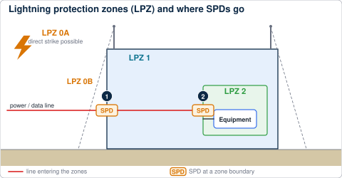

> Earthing, Bonding, Surge & Lightning Protection Library · **SHEET 02 · LIGHTNING** · content version 1.0

# Lightning and surge protection basics

*Lightning protection levels and zones, coupling mechanisms, external LPS, separation distance, SPD types, coordination, multiservice SPDs and risk*

**Applies to:** Houses and small buildings with or without an external lightning protection system, their power, telecom, antenna and data lines, and equipment connected to more than one service

📄 **PDF:** [02_lightning_and_surge_basics.pdf](https://github.com/Skynet1971/earthing/raw/HEAD/docs/pdf/02_lightning_and_surge_basics.pdf)

> ℹ️ Information only. Every technical statement cites a source and PDF page; it does not replace the wiring code that applies at the site, the product manuals, or a qualified and registered person.

## 1  Lightning parameters and protection levels

IEC/BS EN 62305 sets four lightning protection levels (LPL I to IV); their lightning current values are based on the 10/350 µs waveform.[R12 p.3](#sources-cited-on-this-page)[R12 p.3](#sources-cited-on-this-page)

| Level | Max. peak current | Min. peak current | Rolling sphere radius | Max. mesh size | Down-conductor spacing |
|---|---|---|---|---|---|
| I | 200 kA[R12 p.3](#sources-cited-on-this-page) | 3 kA | 20 m[R12 p.1](#sources-cited-on-this-page) | 5 m × 5 m[R12 p.1](#sources-cited-on-this-page) | 10 m[R12 p.1](#sources-cited-on-this-page) |
| II | 150 kA[R12 p.3](#sources-cited-on-this-page) | 5 kA | 30 m[R12 p.1](#sources-cited-on-this-page) | 10 m × 10 m[R12 p.1](#sources-cited-on-this-page) | 10 m[R12 p.1](#sources-cited-on-this-page) |
| III | 100 kA[R12 p.3](#sources-cited-on-this-page) | 10 kA | 45 m[R12 p.1](#sources-cited-on-this-page) | 15 m × 15 m[R12 p.1](#sources-cited-on-this-page) | 15 m[R12 p.1](#sources-cited-on-this-page) |
| IV | 100 kA[R12 p.3](#sources-cited-on-this-page) | 16 kA | 60 m[R12 p.1](#sources-cited-on-this-page) | 20 m × 20 m[R12 p.1](#sources-cited-on-this-page) | 20 m[R12 p.1](#sources-cited-on-this-page) |

*Current values per lightning protection level (LPL); rolling sphere, mesh and down-conductor values per class of LPS, as tabulated by Furse for IEC/BS EN 62305.[R12 p.3](#sources-cited-on-this-page)[R12 p.1](#sources-cited-on-this-page)[R12 p.1](#sources-cited-on-this-page)[R12 p.1](#sources-cited-on-this-page) DEHN gives the same currents and sphere radii per LPL.[R6 p.25](#sources-cited-on-this-page)*

- In IEC/BS EN 62305 the minimum lightning current values of each LPL are used to derive the rolling sphere radius for that level.[R12 p.3](#sources-cited-on-this-page)
- IEC/BS EN 62305 identifies four sources of lightning damage: S1 flashes to the structure, S2 flashes near the structure, S3 flashes to lines connected to the structure, S4 flashes near lines connected to the structure.[R12 p.2](#sources-cited-on-this-page)
- LEMP (Lightning Electromagnetic Impulse) is the overall electromagnetic effect of lightning, including conducted surges (transient overvoltages and currents) and radiated electromagnetic field effects.[R12 p.13](#sources-cited-on-this-page)

## 2  Lightning protection zones

Per IEC/BS EN 62305-4 as summarised by Furse, successive lightning protection zones (LPZ) use a combination of bonding, shielding and coordinated SPDs to reduce the severity of the lightning electromagnetic impulse (LEMP).[R12 p.14](#sources-cited-on-this-page)

*Animated: the steps play in a loop. Click to open full size.* LPZ 0 is exposed to direct strokes and may carry the full lightning current[R12 p.14](#sources-cited-on-this-page); LPZ 1 is subject to partial lightning currents[R12 p.14](#sources-cited-on-this-page); LPZ 2 sees only remnants of the impulse currents.[R12 p.14](#sources-cited-on-this-page) The SPD at the LPZ 0/1 boundary provides lightning current protection, the SPD at the LPZ 1/2 boundary overvoltage protection[R12 p.14](#sources-cited-on-this-page), and the zones combine bonding, shielding and coordinated SPDs.[R12 p.14](#sources-cited-on-this-page)

*Click the diagram to open it full size.* *Concept sketch of the zone concept. (1) SPD where lines cross the LPZ 0/1 boundary: it provides lightning current protection[R12 p.14](#sources-cited-on-this-page); DEHN's coaxial arresters for the 0A-1 boundary, for example, are lightning current arresters.[R27 p.14](#sources-cited-on-this-page) (2) SPD at the LPZ 1/2 boundary: it provides overvoltage protection[R12 p.14](#sources-cited-on-this-page); DEHN lists surge arresters for the 1-2 boundary.[R27 p.14](#sources-cited-on-this-page)*

- LPZ 0A is the zone exposed to direct lightning strikes and the full lightning electromagnetic field, where internal systems may be subjected to the full lightning current.[R6 p.188](#sources-cited-on-this-page)
- LPZ 0B is protected against direct lightning strikes but still exposed to the full lightning electromagnetic field; internal systems may carry partial lightning currents.[R6 p.188](#sources-cited-on-this-page)
- In IEC/BS EN 62305-4, LPZ 0 is the area subject to direct lightning strokes, which may therefore have to carry up to the full lightning current.[R12 p.14](#sources-cited-on-this-page)
- In IEC/BS EN 62305-4, LPZ 1 is the internal area that is subject to partial lightning currents.[R12 p.14](#sources-cited-on-this-page)
- In IEC/BS EN 62305-4, LPZ 2 is an internal area located further inside the structure, where only the remnants of lightning impulse currents are present.[R12 p.14](#sources-cited-on-this-page)
- Equipotential bonding must be established at the boundary of each inner lightning protection zone for the metal parts and supply lines entering it.[R6 p.190](#sources-cited-on-this-page)
- Per IEC/BS EN 62305-4 as summarised by Furse, appropriate SPDs should be fitted wherever services cross from one LPZ to another.[R12 p.15](#sources-cited-on-this-page)

## 3  How lightning reaches equipment

IEC/BS EN 62305 identifies four sources of damage: S1 flashes to the structure, S2 flashes near the structure, S3 flashes to connected lines and S4 flashes near connected lines.[R12 p.2](#sources-cited-on-this-page)

| **63 kV** | **70 kV** | **15 kV** |
|---|---|---|
| main earth terminal and equipment rise against remote earth in a K.98 simulation of a strike to the power system[R25 p.47](#sources-cited-on-this-page) | between a bonded cable and a point 20 m from a single rod, K.98 example[R25 p.156](#sources-cited-on-this-page) | telecom equipment above the power network: 50 A through a 300 Ω electrode, K.66 example[R18 p.58](#sources-cited-on-this-page) |

### Direct strike, induction and earth potential rise

- i-PRO (knowledge-base article 'Countermeasure for lightning surge'): three mechanisms of lightning surge are distinguished: direct lightning stroke, inductive lightning, and potential difference of ground (GND).[R39 p.1](#sources-cited-on-this-page)
- i-PRO (knowledge-base article 'Countermeasure for lightning surge'): nearby lightning strikes cause induced voltage that can damage electric equipment, and a lightning strike lets current flow into the ground, resulting in an increase in ground potential.[R39 p.1](#sources-cited-on-this-page)
- BRE PV guide (UK, 2nd ed. 2006): lightning can cause damage by a direct strike or by surges from a nearby strike, and induced surges are the more likely cause of lightning damage in the majority of installations.[R49 p.14](#sources-cited-on-this-page)
- DEHN (white paper WPX012, Surge protection for public address systems): exterior loudspeakers on a building roof can be damaged by indirect lightning effects (inductive / capacitive coupling) whether or not the building has external lightning protection.[R27 p.3](#sources-cited-on-this-page)
- With copper cabling of about 500 m (building backbone) or about 100 m (horizontal), a direct strike to the building can induce common-mode interference exceeding the insulation strength of a router or PC network card, so both the distributor (hub, switch, router) and the terminal equipment need protection.[R6 p.256](#sources-cited-on-this-page)
- i-PRO (knowledge-base article 'Countermeasure for lightning surge'): where the GND line is separated, a potential difference occurs in the GND that causes equipment breakdown, and i-PRO suspects inductive lightning on a ground loop as one cause of burnt circuit boards.[R39 p.2](#sources-cited-on-this-page)

### Potential differences between services and earths

- High potential differences can occur between the building installation and incoming telecommunication lines, because those lines extend beyond several buildings.[R6 p.336](#sources-cited-on-this-page)
- ITU-T K.66 notes that equipment without an earth connection in a building with a non-metallic floor can suffer a discharge during a direct strike, because the earth potential rise at the equipment location can differ from that at the main earth terminal.[R18 p.20](#sources-cited-on-this-page)
- ITU-T K.85 notes that earthed equipment can suffer internal-port damage because surge current returning to the main earth terminal through the earth wire makes the equipment rise in potential.[R19 p.37](#sources-cited-on-this-page)
- Per NIST (US), surge current flowing from the telephone entry protector to the common grounding point creates a magnetic field that couples into the loop formed by the power branch circuit, the telephone premises wiring and the bonding conductors, inducing a voltage between the power input and telephone input of the connected PC.[R1 p.20](#sources-cited-on-this-page)
- Per NIST (US), equipment connected to both power and a communications system can be damaged by a surge on either system because of the voltage difference between the two systems during the surge, and this can happen even when each system has its own surge protector.[R1 p.14](#sources-cited-on-this-page)

## 4  External lightning protection system

Per NIST (US), lightning rods protect the structure of the house and avoid fires; they do not prevent surges in the wiring.[R1 p.6](#sources-cited-on-this-page)

### Air-termination

Rolling sphere radii and mesh sizes for each class of LPS are in the table in chapter 1.[R12 p.1](#sources-cited-on-this-page)[R12 p.1](#sources-cited-on-this-page)

- DEHN (white paper WP007, Surge protection for CCTV systems): a direct lightning strike to a mast-mounted camera can be prevented if an air-termination rod is installed at the mast.[R26 p.3](#sources-cited-on-this-page)
- DEHN (white paper WPX012, Surge protection for public address systems): on a structure with an external lightning protection system, an exterior loudspeaker is protected from direct lightning strikes when it is located within the protected volume of an air-termination system.[R27 p.3](#sources-cited-on-this-page)
- DEHN rooftop-PV white paper (WPX029, 2022): on a building with external LPS the PV system must itself be protected from direct strikes, meaning it must be installed within the protected volume of the external lightning protection system.[R44 p.7](#sources-cited-on-this-page)
- An earthed antenna standpipe is no substitute for a lightning protection system.[R6 p.292](#sources-cited-on-this-page)

### Down conductors

- Per IEC/BS EN 62305-3 as summarised by Furse, there should always be a minimum of two down conductors distributed around the perimeter of the structure, wherever possible at each exposed corner.[R12 p.9](#sources-cited-on-this-page)
- Power and data lines must keep the safety (separation) distance from air-terminations and down conductors of an external LPS and must not be routed in parallel with down conductors.[R6 p.321](#sources-cited-on-this-page)
- BRE PV guide (UK, 2nd ed. 2006): an inverter should not be mounted on an inside wall that has an LPS down lead running just the other side of the brickwork on the outside of the building.[R49 p.14](#sources-cited-on-this-page)

### Earth-termination

- IEC/BS EN 62305 has a 10 Ω overall earthing requirement for the LPS, achieved by either a Type A arrangement (rods) or a Type B arrangement (ring conductor) (the words 'down conductors' in the quote belong to the BS 6651 column).[R12 p.1](#sources-cited-on-this-page)
- For a lightning protection earth-termination system a low earth resistance of 10 ohm or less (measured at low frequency) is generally recommended.[R6 p.128](#sources-cited-on-this-page)
- A type A earth electrode arrangement requires at least two earth electrodes, although a single earth electrode is sufficient for individually positioned air-termination rods or masts.[R6 p.129](#sources-cited-on-this-page)
- For class of LPS III and IV the minimum earth electrode length l1 is 5 m.[R6 p.129](#sources-cited-on-this-page)
- For type A arrangements, each vertical or inclined earth electrode must be at least 0.5 x l1 long, and each radial electrode at least l1 long.[R6 p.129](#sources-cited-on-this-page)
- IEC/BS EN 62305-3 recommends a single integrated earth termination system for a structure, combining lightning protection, power and telecommunication systems.[R12 p.11](#sources-cited-on-this-page)
- One earth-termination system must serve all earthing tasks of a structure (protective, lightning protection and functional earthing); otherwise potential differences can arise between installations earthed on different earth-termination systems.[R6 p.142](#sources-cited-on-this-page)

### Separation distance

- Per IEC/BS EN 62305-3 as summarised by Furse, the separation distance is achieved by placing lightning conductors far enough from conductive parts leading into the structure that a strike to the lightning conductor cannot flash over to the adjacent metalwork.[R12 p.11](#sources-cited-on-this-page)
- DEHN rooftop-PV white paper (WPX029, 2022): the separation distance s between a lightning protection system and a PV system is the distance needed to avoid uncontrolled flashover to adjacent metal parts when lightning strikes the external lightning protection system.[R44 p.3](#sources-cited-on-this-page)
- An isolated air termination system is achieved by calculating and maintaining a separation distance 's' between the protected equipment and the air terminal (South African trade article on SANS/IEC 62305).[R14 p.1](#sources-cited-on-this-page)
- Per SANS/IEC 62305 as quoted in a South African trade article, an isolated external LPS should be used when the flow of lightning current into bonded internal conductive parts may cause damage to the structure or its contents.[R14 p.1](#sources-cited-on-this-page)
- Because the potential difference increases with height, the longer the down conductor distance the larger the required separation distance (South African trade article on SANS/IEC 62305).[R14 p.2](#sources-cited-on-this-page)
- Per a South African trade article on SANS/IEC 62305, on tall structures a calculated separation distance could be as much as 300 cm or 400 cm, which may not be practical to install.[R14 p.3](#sources-cited-on-this-page)
- Per a South African trade article on SANS/IEC 62305, the required separation distance can be maintained by placing air terminals the required distance from conductive elements, by insulating material (GRP), or by High Voltage Impulse (HVI) conductors.[R14 p.3](#sources-cited-on-this-page)
- DEHN rooftop-PV white paper (WPX029, 2022): high-voltage-resistant insulated down conductors are an alternative way of keeping the separation distance, equivalent to a separation distance s of up to 0.9 m in air.[R44 p.9](#sources-cited-on-this-page)
- DEHN rooftop-PV white paper (WPX029, 2022): if the roofing is made of metal or is formed by the PV system itself, the separation distance s cannot be maintained.[R44 p.9](#sources-cited-on-this-page)

| Term | Meaning and value as published | Source |
|---|---|---|
| s | separation distance: s = ki × (kc / km) × l[R14 p.2](#sources-cited-on-this-page) | Crown (South Africa) on SANS/IEC 62305-3 |
| ki | 0,08 for LPL 1; 0,06 for LPL 2; 0,04 for LPL 3 and LPL 4[R14 p.2](#sources-cited-on-this-page); DEHN: 0.04 for class of LPS III and IV[R6 p.151](#sources-cited-on-this-page) | Crown; DEHN |
| km | material coefficient: 1 for air, 0,5 for bricks, masonry etc.[R14 p.2](#sources-cited-on-this-page) | Crown |
| kc | current-splitting coefficient: 1 for a single air terminal close to the structure[R14 p.2](#sources-cited-on-this-page); (h + c)/(2h + c) for roofs with two down conductors[R14 p.2](#sources-cited-on-this-page) | Crown |
| l | length in metres along the air-termination or down conductor from the point considered to the next point of equipotential bonding[R14 p.2](#sources-cited-on-this-page) | Crown |

*Terms of the separation-distance formula as presented in a South African trade article on SANS/IEC 62305-3.[R14 p.2](#sources-cited-on-this-page)*

## 5  Surge protective devices: types and test waveforms

Per NIST (US), surge protective devices neither suppress nor arrest a surge; they divert it to ground.[R1 p.8](#sources-cited-on-this-page)

| **10/350 µs** | **8/20 µs** | **1.5 kV** |
|---|---|---|
| lightning current waveform (IEC 61643-11 as cited)[R14 p.1](#sources-cited-on-this-page) | induced surge current waveform[R14 p.1](#sources-cited-on-this-page) | voltage protection level for overvoltage category I in a 230/400 V installation, IEC 60364-5-53[R6 p.219](#sources-cited-on-this-page) |

- Type 1 (IEC Class I) SPDs are lightning current/combined arresters, Type 2 (Class II) are surge arresters for distribution boards and fixed installations, and Type 3 (Class III) are surge arresters for socket outlets and terminal devices.[R6 p.219](#sources-cited-on-this-page)
- BEAMA SPD guide (UK, 2018): the Type 1 SPD is recommended to protect installations against partial lightning currents from direct lightning strokes and is characterised by a 10/350 µs current wave.[R48 p.10](#sources-cited-on-this-page)
- BEAMA SPD guide (UK, 2018): the Type 2 SPD is the main protection system for all low-voltage installations and is installed in each electrical switchboard to stop overvoltages spreading through the installation.[R48 p.10](#sources-cited-on-this-page)
- BEAMA SPD guide (UK, 2018): Type 3 SPDs have a low discharge capacity and must only be installed as a supplement to a Type 2 SPD, in the vicinity of sensitive loads.[R48 p.11](#sources-cited-on-this-page)
- BEAMA SPD guide (UK, 2018), quoting BS EN 62305-4: Type 1 SPDs alone provide no effective protection against failure of sensitive electrical or electronic systems; Type 2 and Type 3 SPDs are also needed.[R48 p.31](#sources-cited-on-this-page)
- i-PRO (knowledge-base article 'Countermeasure for lightning surge'): a surge protector (SPD) is normally open circuit, becomes a short circuit when high voltage is applied, and returns to open circuit after the high voltage has passed; it is said to offer 'some protection'.[R39 p.4](#sources-cited-on-this-page)
- Under IEC/BS EN 62305, 'live' electrical conductors (e.g. power, data, telecoms) are bonded to the main equipotential bonding bar via surge protective devices.[R12 p.1](#sources-cited-on-this-page)
- Per IEC/BS EN 62305-3 as summarised by Furse, an LPS can no longer be fitted without lightning current or equipotential bonding SPDs on incoming metallic services that have live cores, such as power and telecoms cables.[R12 p.13](#sources-cited-on-this-page)
- Type 1 SPDs at the service entrance need a lightning impulse current (10/350) capability of at least 100 kA/m for LPL I, 75 kA/m for LPL II and 50 kA/m for LPL III/IV, where m is the number of conductors (e.g. 5 for L1, L2, L3, N and PE).[R6 p.203](#sources-cited-on-this-page)
- Type 1 SPD sizing assumes the total lightning current is shared evenly between the building's earth-termination system and the conductors of the low-voltage supply (so half the current enters the supply conductors).[R6 p.205](#sources-cited-on-this-page)
- BEAMA SPD guide (UK, 2018): for a worst-case 200 kA strike with a single three-phase power service, 50% (100 kA) is assumed to flow through the power line and share equally over 4 conductors, so each L-E and N-E SPD sees 25 kA (10/350).[R48 p.33](#sources-cited-on-this-page)
- Information technology lines entering from LPZ 0A must be protected by lightning current arresters as close as possible to the point of entry, with a general discharge capacity of up to 2.5 kA (10/350) per core.[R6 p.206](#sources-cited-on-this-page)
- For lines passing from LPZ 0B to LPZ 1 (no direct-strike exposure), SPDs with an impulse discharge capacity of up to 20 kA (8/20) are sufficient because no galvanically coupled partial lightning current flows through them.[R6 p.206](#sources-cited-on-this-page)
- BEAMA SPD guide (UK, 2018): lightning transients are generally disturbances with respect to earth (common mode), whereas switching transients are disturbances between line and neutral (differential mode).[R48 p.8](#sources-cited-on-this-page)
- Per Furse, standard SPDs may only protect against common mode surges, i.e. surges between live conductors and earth.[R12 p.16](#sources-cited-on-this-page)
- Per Furse, terminal equipment such as computers tends to be more vulnerable to differential mode surges (between live conductors), so differential mode protection can be a vital consideration.[R12 p.16](#sources-cited-on-this-page)
- BEAMA SPD guide (UK, 2018): Type 1 (lightning current) SPDs protect against common-mode surges, connected line to earth and neutral to earth on TN systems.[R48 p.44](#sources-cited-on-this-page)
- BEAMA SPD guide (UK, 2018): terminal equipment is more vulnerable to differential-mode surges, and downstream overvoltage SPDs protect against both common- and differential-mode surges.[R48 p.44](#sources-cited-on-this-page)
- BEAMA SPD guide (UK, 2018): because electronic equipment has sensitive components connected between live conductors, SPDs with differential-mode (L-N) protection should be selected for it.[R48 p.38](#sources-cited-on-this-page)

### When a type 1 (lightning current) SPD is called for

- BEAMA SPD guide (UK, 2018): where a structural lightning protection system is required, lightning current (equipotential bonding) SPDs are always required on every metallic electrical service entering the structure: mains Type 1 and data/telecom Category D.[R48 p.32](#sources-cited-on-this-page)
- BEAMA SPD guide (UK, 2018): if the BS EN 62305 risk evaluation shows a structural LPS is not required but there is an indirect risk, services fed by an overhead line need lightning current SPDs: 12.5 kA 10/350 per mode for mains Type 1 and 2.5 kA 10/350 per mode for signal/telecom SPDs.[R48 p.34](#sources-cited-on-this-page)
- BEAMA SPD guide (UK, 2018): underground services without a structural LPS do not need lightning current SPDs; overvoltage (Type 2 / Category C) SPDs are sufficient.[R48 p.35](#sources-cited-on-this-page)
- BEAMA SPD guide (UK, BS 7671:2018 Section 443): if there is a risk of a direct lightning strike to the structure or to overhead lines feeding it, SPDs are required per BS EN 62305.[R48 p.63](#sources-cited-on-this-page)
- BEAMA SPD guide (UK, BS 7671:2018 534.4.1.3): where the structure has an external LPS or needs protection against direct lightning on overhead lines, Type 1 SPDs shall be installed as close as possible to the origin of the installation.[R48 p.68](#sources-cited-on-this-page)
- If a building has an external lightning protection system and a measuring/control or telecommunications cable runs outside the building, a type 1 lightning current arrester must be installed on that cable.[R6 p.249](#sources-cited-on-this-page)
- ABB solar brochure (Lightning and surge protective devices, 2011): for the AC-side SPD at the main board, a Type 1 SPD is mandatory when a lightning rod is present.[R51 p.2](#sources-cited-on-this-page)
- Outdoor lighting circuits located in LPZ 0A (exposed to direct strikes) need type 1 lightning current arresters where they enter the building.[R6 p.273](#sources-cited-on-this-page)
- SMA technical information (Overvoltage Protection, v1.3): type I SPDs are needed where lightning or partial lightning currents can flow via electrical cables, for example if the protected system is directly connected to the external LPS or the distance between the DC cables and the external lightning protection is too small.[R45 p.3](#sources-cited-on-this-page)
- DEHN rooftop-PV white paper (WPX029, 2022): on a building with external LPS the grid connection point must be protected by a multipole type 1 SPD (for example a spark-gap-based combined arrester).[R44 p.9](#sources-cited-on-this-page)
- DEHN (white paper WP007, Surge protection for CCTV systems): for a building without an external lightning protection system, the white paper states that installing surge arresters provides sufficient protection.[R26 p.3](#sources-cited-on-this-page)
- For CCTV on buildings without an external lightning protection system the direct/nearby strike risk is taken as low, and surge arresters (rather than lightning current arresters) provide sufficient protection.[R6 p.303](#sources-cited-on-this-page)
- DEHN rooftop-PV white paper (WPX029, 2022): according to IEC 60364-4-44, surge protective devices must also be installed for buildings that have no external lightning protection system.[R44 p.2](#sources-cited-on-this-page)

### Connecting the SPD

- At surge rates of current change of some 10 kA per microsecond, the voltage drop along SPD connecting leads is mainly inductive, which is why lead length must be kept as short as possible.[R6 p.238](#sources-cited-on-this-page)
- BEAMA SPD guide (UK, 2018): lead inductance is taken as 1 µH/m, so an impulse current rising at 1 kA/µs adds approximately 1 kV per metre of SPD connecting lead.[R48 p.40](#sources-cited-on-this-page)
- IEC 60364-5-53 recommends that the total connecting cable length of an SPD installed in a cable branch should not exceed 0.5 m.[R6 p.238](#sources-cited-on-this-page)
- According to IEC 60364-5-53 a maximum SPD connecting cable length of 1 m is mandatory (0.5 m being the recommendation).[R6 p.238](#sources-cited-on-this-page)
- ITU-T K.66 recommends that mains SPDs (primary protectors) be placed where their connecting leads to the mains conductors, including the neutral, are as short as possible, with lead lengths below 0.5 m.[R18 p.22](#sources-cited-on-this-page)
- BEAMA SPD guide (UK, 2018): SPD connecting leads shall be as short as possible, preferably not exceeding 0.5 m total lead length (l1 + l2).[R48 p.40](#sources-cited-on-this-page)
- BEAMA SPD guide (UK, 2018): SPD connecting leads should also be tightly bound together over as much of their length as possible (cable ties or spiral wrap) to cancel inductance.[R48 p.40](#sources-cited-on-this-page)
- BEAMA SPD guide (UK, 2018): in a 6 kV/3 kA test an SPD with Up 600 V fitted with its recommended 25 cm of bound connecting lead gave 630 V overall.[R48 p.41](#sources-cited-on-this-page)
- BEAMA SPD guide (UK, 2018): with unbound connecting leads the same SPD let through 810 V with 25 cm leads and 2,300 V with 2 m leads.[R48 p.41](#sources-cited-on-this-page)
- IEC 60364-5-53 suggests connecting SPDs in series (through-wiring, V-shaped connection) so that the voltage at the protected equipment equals the SPD's voltage protection level.[R6 p.235](#sources-cited-on-this-page)
- If the next upstream fuse in the installation is larger than the maximum backup fuse permitted for the SPD, the SPD's cable branch must have its own backup fuse (or an SPD with integrated backup fuse must be used).[R6 p.236](#sources-cited-on-this-page)
- BEAMA SPD guide (UK, BS 7671:2018): Section 534 requires installed SPDs to be protected against short-circuit by overcurrent protective devices (OCPDs).[R48 p.48](#sources-cited-on-this-page)
- BEAMA SPD guide (UK, BS 7671:2018 Section 534): Section 534 advises minimum SPD connecting-cable cross-sections of 16 mm2 copper for Type 1 SPDs and 4 mm2 copper for Type 2 and Type 3 SPDs (or not less than the line conductor where that is below 4 mm2).[R48 p.48](#sources-cited-on-this-page)
- In TN systems, type 1 and type 2 SPDs should be installed upstream of the RCD, because an RCD would see the discharged impulse current as residual current and could be mechanically damaged by partial lightning current.[R6 p.222](#sources-cited-on-this-page)
- Type 3 SPDs are installed downstream of the RCD.[R6 p.222](#sources-cited-on-this-page)
- In TT systems type 1 and type 2 SPDs must always be installed upstream of the RCD.[R6 p.229](#sources-cited-on-this-page)
- BEAMA SPD guide (UK, 2018): SPDs should wherever possible be installed upstream of RCDs to prevent unwanted RCD tripping caused by transient overvoltages.[R48 p.50](#sources-cited-on-this-page)
- BEAMA SPD guide (UK, 2018): if the SPD is downstream of the RCD, the RCD should be a time-delayed type with surge immunity of at least 3 kA 8/20.[R48 p.50](#sources-cited-on-this-page)

### Failure and end of life

- ABB solar brochure (Lightning and surge protective devices, 2011): every SPD using MOVs must have an internal thermal disconnection so that it can be disconnected at end of life.[R51 p.3](#sources-cited-on-this-page)
- BEAMA SPD guide (UK, 2018): mains SPDs have internal overload (typically thermal) disconnection, so their connecting conductors need only short-circuit protection by an OCPD in line with the connecting cables.[R48 p.48](#sources-cited-on-this-page)
- ABB OVR brochure: the SPD's mechanical end-of-life indicator changes from white to red at end of life, after which the SPD must be changed as protection is no longer guaranteed.[R52 p.8](#sources-cited-on-this-page)
- ABB OVR brochure: a faulty SPD wired for continuity of service simply disconnects itself without interrupting the supply, but the equipment is then no longer protected.[R52 p.8](#sources-cited-on-this-page)
- Per NIST (US), when the protective element of a surge protector fails, the internal disconnect works in one of two ways depending on the design: some protectors cut off the output power completely, others disconnect the failed element but keep the output powered.[R1 p.9](#sources-cited-on-this-page)
- Per NIST (US), specialists consider that most of the (rare) catastrophic failures of surge protectors are caused by excessively high line voltage occurring during a power-system fault, rather than by very large surges.[R1 p.18](#sources-cited-on-this-page)

## 6  Energy coordination

Per IEC/BS EN 62305-4 as summarised by Furse, in a coordinated (cascaded) SPD system the lightning current SPD at the service entrance handles the majority of the surge energy, relieving the downstream overvoltage SPDs so that they can control the overvoltage.[R12 p.15](#sources-cited-on-this-page)

- BEAMA SPD guide (UK, 2018): poor coordination can expose a downstream overvoltage SPD to excess surge energy; appropriate SPDs should be fitted wherever services cross from one lightning protection zone to another.[R48 p.35](#sources-cited-on-this-page)
- BEAMA SPD guide (UK, 2018) Table 5 (as BS 7671 Table 443.2) for 230/240 V: category IV 6 kV (electricity meter), III 4 kV (distribution board), II 2.5 kV (sub-distribution board / electrical equipment), I 1.5 kV (socket outlet / electronic equipment).[R48 p.36](#sources-cited-on-this-page)
- BEAMA SPD guide (UK, 2018): terminal equipment at socket outlets is category I (1.5 kV), and a Type 3 SPD (Class III test, 6 kV 1.2/50 and 3 kA 8/20) is typically employed at that location.[R48 p.39](#sources-cited-on-this-page)
- IEC 60364-5-53 requires a voltage protection level of 1.5 kV for consumers of overvoltage category I in a 230/400 V installation, achievable with coordinated type 1 and type 2 SPDs or a type 1 combined arrester.[R6 p.219](#sources-cited-on-this-page)
- BEAMA SPD guide (UK, 2018): on a 230 V supply a service-entrance Type 1 SPD should have a voltage protection level of no more than 1600 V.[R48 p.46](#sources-cited-on-this-page)
- BEAMA SPD guide (UK, 2018): to allow for lead voltage and possible doubling, overvoltage SPDs should have a voltage protection level of no more than 600 V (1.5 kV x 0.8 / 2) in the Class III test.[R48 p.46](#sources-cited-on-this-page)
- BEAMA SPD guide (UK, 2018): if the distance from an SPD to the protected equipment is over 10 m, oscillations could double the voltage at the equipment.[R48 p.36](#sources-cited-on-this-page)
- BEAMA SPD guide (UK, 2018): oscillation (voltage doubling) may be disregarded for cable runs of less than 10 m from the SPD.[R48 p.44](#sources-cited-on-this-page)
- ABB OVR brochure: the incoming SPD alone does not protect the whole installation; residual voltage can double if cable lengths exceed 10 m.[R52 p.9](#sources-cited-on-this-page)
- ABB OVR brochure: an additional Type 2 SPD close to the equipment is recommended when it is more than 10 m from the upstream SPD and compulsory above 30 m; below 10 m it is not necessary and shall not be installed for coordination reasons.[R52 p.25](#sources-cited-on-this-page)
- ABB OVR brochure: ABB Type 2 SPDs coordinate with each other when at least 1 m of cable separates them (e.g. 70 kA followed by 40 kA).[R52 p.9](#sources-cited-on-this-page)
- ABB OVR brochure: a 25 kA Type 1 spark gap with Ifi 7 kA needs at least 5 m of cable between it and a downstream 40 kA Type 2 SPD, while the Ifi 50 kA version needs 0 m.[R52 p.9](#sources-cited-on-this-page)
- BEAMA SPD guide (UK, 2018) Figure 40: if the cable length between SPD types is short (per manufacturer's data), a decoupling element is used to provide inductance for correct coordination.[R48 p.52](#sources-cited-on-this-page)
- DEHN (white paper WP007, Surge protection for CCTV systems): the combined arrester listed for single-phase supplies is a type 1 + type 2 (class I + II) SPD with Uc 255 V a.c. and a total lightning impulse current of 25 kA (10/350 µs, L+N-PE), stated to give type 1 + 2 + 3 energy coordination with terminal equipment within 5 m.[R26 p.4](#sources-cited-on-this-page)
- Where short bond wires cannot be installed, ITU-T K.66 allows using the shortest possible bond wires plus additional SPDs at the equipment to achieve bonding there, and these additional SPDs must be coordinated with the upstream SPDs.[R18 p.20](#sources-cited-on-this-page)
- ITU-T K.85 summarises the two-stage scheme as: the MSPD protects the equipment and the primary (point-of-entry) protection protects the MSPD, both installed according to ITU-T K.66 when the risk assessment requires.[R19 p.15](#sources-cited-on-this-page)
- ITU-T K.98 says that, as a result of the coordination requirement in ITU-T K.21, the external telecommunication port only requires a gas discharge tube bonded to the main earth terminal.[R25 p.34](#sources-cited-on-this-page)
- ITU-T K.98 notes that protecting internal ports is not as simple as protecting external ports because internal ports have no coordination requirement; such ports must be protected in accordance with IEC 61643-21 and IEC 61643-22.[R25 p.35](#sources-cited-on-this-page)
- The a.c. output of a PV inverter is sufficiently protected by the type 2 arrester at the grid connection point if the cable distance between them is less than 10 m; beyond that an additional type 2 SPD is needed at the inverter.[R6 p.371](#sources-cited-on-this-page)
- DEHN rooftop-PV white paper (WPX029, 2022): PV inverters and other electronics such as AC-coupled battery storage are sufficiently protected if they are no further than 10 m from the arrester at the grid connection point; with greater cable lengths an additional type 2 SPD must be installed.[R44 p.7](#sources-cited-on-this-page)
- A signal-line SPD should be installed as close as possible to the terminal device, which has a positive effect on the residual voltage.[R6 p.261](#sources-cited-on-this-page)
- If there is no low-impedance bonding between the SPD and the protected device, voltage drops of up to some kV along the bonding path add to the SPD's protection level and can destroy the device.[R6 p.262](#sources-cited-on-this-page)
- Unprotected cable upstream of an SPD must be strictly separated or shielded from the protected cable downstream of it, otherwise interference is coupled onto the protected side.[R6 p.262](#sources-cited-on-this-page)

## 7  Equipment with mains and data ports

Per NIST (US), equipment connected to both power and a communications system can be damaged by a surge on either system because of the voltage difference between the two systems during the surge, even when each system has its own surge protector.[R1 p.14](#sources-cited-on-this-page)

- Per NIST (US), a surge protector at the service entrance is sufficient for appliances with a single (power-only) connection but not for appliances connected to two systems (power plus communications).[R1 p.18](#sources-cited-on-this-page)
- Per NIST (US), surge current flowing from the telephone entry protector to the common grounding point creates a magnetic field that couples into the loop formed by the power branch circuit, the telephone premises wiring and the bonding conductors, inducing a voltage between the power input and telephone input of the connected PC.[R1 p.20](#sources-cited-on-this-page)
- Per NIST (US), the presence or absence of a surge protector on the AC side has no effect on this power/telephone loop coupling; an effective solution is a combined protector installed by the consumer.[R1 p.20](#sources-cited-on-this-page)
- Per NIST (US), the situation is worse still when an incoming service, cable TV in particular, is not bonded to the power service ground, which is a clear violation of the NEC.[R1 p.20](#sources-cited-on-this-page)
- Per NIST (US), the shifting of reference potentials is reduced by inter-system bonding of all utilities serving a residence, with the usual components for each service connection installed next to each other.[R1 p.21](#sources-cited-on-this-page)
- ITU-T K.85 notes that earthed equipment can suffer internal-port damage because surge current returning to the main earth terminal through the earth wire makes the equipment rise in potential.[R19 p.37](#sources-cited-on-this-page)
- ITU-T K.85 says that for earthed equipment the risk of internal-port damage from mains surge current requires either a mains primary protector or connecting all ports, external and internal, through an MSPD.[R19 p.38](#sources-cited-on-this-page)
- In an ITU-T K.98 simulation (strike to a TN-S power system, earthed equipment without primary protection) with the earth connection missing from the power outlet, the Ethernet port saw a 3.3 kV peak, exceeding its nominal 2.5 kV breakdown voltage.[R25 p.48](#sources-cited-on-this-page)
- ITU-T K.66 notes that associated equipment whose ports have a low surge impedance to ground and that is connected by short cables (example given: printers on USB cables) may be damaged by circulating earth currents.[R18 p.18](#sources-cited-on-this-page)
- ITU-T K.85 Annex B lists connecting an internal port to an external cable as a damaging practice; the remedies are to use an external interface, install an SPD to IEC 61643-21/-22, or use an isolation box.[R19 p.19](#sources-cited-on-this-page)
- ITU-T K.98 says it is imperative to connect inter-building cables only to external ports and intra-building cables only to internal ports.[R25 p.29](#sources-cited-on-this-page)

> [!WARNING]
> **WARNING: Unplugging only the power cord can make it worse**
>
> Per NIST (US), pulling out the power cord of an appliance that stays connected to a telephone line or cable TV might not be the best idea, because the appliance loses the grounding normally provided by the power cord.[R1 p.13](#sources-cited-on-this-page)

## 8  Multiservice SPDs

ITU-T K.85 defines a multiservice surge protective device (MSPD) as an SPD containing both telecommunications and mains protection, which may also include port protection for video or Ethernet.[R19 p.11](#sources-cited-on-this-page)

- Per NIST (US), the simple solution for equipment with both power and communications connections is a special surge protector that combines, in one package, input/output connections for both systems.[R1 p.14](#sources-cited-on-this-page)
- Per NIST (US), with a combined protector each link (power and communications) is fed through the protector, which is inserted between the wall receptacles and the inputs of the appliance to be protected.[R1 p.14](#sources-cited-on-this-page)
- ITU-T K.66 describes multiservice surge protective devices (MSPDs) as containing the SPDs for all ports, achieving the short-bond-wire requirement, being installed near the equipment so they also protect against overvoltages arising in internal wiring, and requiring coordination with the primary protector.[R18 p.29](#sources-cited-on-this-page)
- ITU-T K.66 says additional SPDs such as multiservice SPDs are sometimes installed at the terminal equipment to limit surges coupled inside the building, and their common terminal should be connected to the protective conductor near the protected equipment.[R18 p.22](#sources-cited-on-this-page)
- Per ITU-T K.66, a single MSPD suits one piece of equipment or interconnected equipment in close proximity, and in that case only the ports connected to external cables need protection.[R18 p.29](#sources-cited-on-this-page)
- Per ITU-T K.66, multiple MSPDs are needed when interconnected equipment is too far apart to share one MSPD (or it has too few outlets), and in that case all ports require protection.[R18 p.30](#sources-cited-on-this-page)
- ITU-T K.85 says adding an MSPD with protection for all ports provides equipotential bonding for non-earthed equipment, and protection of equipment and users should be effective if the MSPD is plugged into an earthed power point.[R19 p.37](#sources-cited-on-this-page)
- ITU-T K.85 says an MSPD protects equipment against surges magnetically coupled into building wiring and service lines, and may give some protection against direct strikes to the service plant only if the strike point is more than a few hundred metres from the building.[R19 p.18](#sources-cited-on-this-page)
- For residential buildings, ITU-T K.98 recommends, when protection is required, an MSPD or equivalent to protect equipment clusters plus primary protection at the building entry point to protect the downstream protection and the equipment wiring.[R25 p.31](#sources-cited-on-this-page)
- ITU-T K.98 concludes that the ideal installation is class II equipment, with equipment clusters protected by an MSPD and the MSPD protected by primary protection when necessary.[R25 p.35](#sources-cited-on-this-page)
- Per NIST (US), another way to reduce the shift in reference potentials is an integrated multi-utility surge protection device at the breaker panel covering AC power, telephone and cable TV with minimum bonding length.[R1 p.21](#sources-cited-on-this-page)

> [!CAUTION]
> **DO NOT: An MSPD needs an earthed power point**
>
> ITU-T K.85 warns that MSPDs rely on a protective earth connection for safety; without it, users may be exposed to surges exceeding a few hundred volts.[R19 p.15](#sources-cited-on-this-page) If the power point feeding an MSPD is not earthed, equipment damage may not be reduced and users face a possible lightning safety risk.[R19 p.37](#sources-cited-on-this-page)

- ITU-T K.66 cautions that indiscriminate use of MSPDs may allow damage to the protected equipment and to associated equipment.[R18 p.29](#sources-cited-on-this-page)
- Per NIST (US), some combined power/communications plug-in protectors might not work very well if plugged into a 2-blade (ungrounded) receptacle through a 'cheater' plug.[R1 p.14](#sources-cited-on-this-page)

## 9  Risk assessment and the IEC 62305 edition

- For external cable interfaces, ITU-T K.85 says to install an MSPD if the risk from flashes near the service line is unacceptable, and also SPDs at the point of entry if the risk from flashes to the service line is unacceptable.[R19 p.15](#sources-cited-on-this-page)
- ITU-T K.85 says that, regardless of the risk assessment result, a building with a lightning protection system should have primary protection bonded to protective earth at the point of entry for all services, and all metallic pipes bonded to protective earth at the point of entry.[R19 p.15](#sources-cited-on-this-page)
- Per ITU-T K.71, when the risk of loss of human life for the building with its antenna is below the tolerable risk, the site is considered inherently protected against direct lightning and the antenna need only be protected against mains contact.[R22 p.11](#sources-cited-on-this-page)
- For an antenna on a mast near the building where lightning protection is not required (R1 ≤ RT1), ITU-T K.71 says protection may only be needed for electrical safety and it is not necessary to bond the tower earth electrode system to the building electrical installation earth.[R22 p.18](#sources-cited-on-this-page)
- Per Motorola R56 (2005, US practice), any communications facility with a tower shall be considered exposed to lightning, regardless of thunderstorm activity and soil resistivity.[R5 p.99](#sources-cited-on-this-page)
- DEHN (white paper WP007, Surge protection for CCTV systems): where a building has no external lightning protection system, the risk resulting from a direct or nearby strike to the building is assumed to be low and thus acceptable.[R26 p.3](#sources-cited-on-this-page)
- ITU-T K.85 notes that if protection is needed for ports on long internal cables it may also be needed for ports on short cables, and suggests always assuming a 10 m² loop area for Ethernet ports in the risk assessment.[R19 p.38](#sources-cited-on-this-page)
- In the ITU-T K.85 worked risk example, the Ethernet-port damage calculation was based on a vertical loop and a 1 kV withstand voltage, which the document calls most likely a worst case, so it assumed the Ethernet port would not need protection.[R19 p.35](#sources-cited-on-this-page)

### SPD risk assessment for a dwelling (UK, BS 7671:2018 as described by BEAMA)

- BEAMA SPD guide (UK, BS 7671:2018 Section 443): if there is a risk of a direct lightning strike to the structure or to overhead lines feeding it, SPDs are required per BS EN 62305.[R48 p.63](#sources-cited-on-this-page)
- BEAMA SPD guide (UK, BS 7671:2018 443.4): for a single dwelling unit the designer should complete a documented assessment of whether the installation and equipment value justifies SPDs or the consequential losses are tolerable.[R48 p.63](#sources-cited-on-this-page)
- BEAMA SPD guide (UK, 2018), citing IEC 60364-4-44: overvoltage protection is not required for a single dwelling where the total economic value of the installation is less than five times the value of the SPD at the origin.[R48 p.63](#sources-cited-on-this-page)
- BEAMA SPD guide (UK, BS 7671:2018 443.5): if the calculated risk level CRL is less than 1000 SPD protection shall be installed; at 1000 or higher it is not required.[R48 p.65](#sources-cited-on-this-page)
- BEAMA SPD guide (UK, BS 7671:2018): in CRL = fenv / (Lp x Ng) the environmental factor fenv is 85 for rural and suburban and 850 for urban locations.[R48 p.65](#sources-cited-on-this-page)
- BEAMA SPD guide (UK, BS 7671:2018): the risk assessment length is Lp = 2 LPAL + LPCL + 0.4 LPAH + 0.2 LPCH (km), weighting low-voltage overhead line most heavily.[R48 p.65](#sources-cited-on-this-page)

### Roof-mounted PV and strike risk

- DEHN rooftop-PV white paper (WPX029, 2022): according to the state of scientific and technical knowledge, installing PV modules does not increase the risk of a lightning strike, so the need for lightning protection cannot be derived from the mere existence of a PV system.[R44 p.2](#sources-cited-on-this-page)
- BRE PV guide (UK, 2nd ed. 2006): it is generally accepted that a typical roof-mounted PV system presents a very small increased risk of a direct lightning strike.[R49 p.14](#sources-cited-on-this-page)
- BRE PV guide (UK, 2nd ed. 2006): the very small increased strike risk may not hold where the PV system is particularly large, is on top of a tall building, becomes the tallest structure in the vicinity, or is in an open area such as a field.[R49 p.14](#sources-cited-on-this-page)
- DEHN rooftop-PV white paper (WPX029, 2022): citing Supplement 5 of the German DIN EN 62305-3, a lightning protection system designed for class of LPS III (LPL III) meets the usual requirements for PV systems.[R44 p.2](#sources-cited-on-this-page)

> [!NOTE]
> **NOTE: Not covered by the sources in this library**
>
> The sources quote the IEC/BS EN 62305 sources of damage[R12 p.2](#sources-cited-on-this-page) and BEAMA describes the BS 7671:2018 (UK) calculated risk level for SPDs[R48 p.65](#sources-cited-on-this-page), but none sets out the full risk-assessment method of IEC 62305-2, and none describes the newest edition of IEC 62305 or what that edition changed. Check the edition that applies at the site.

## 10  Where the sources disagree

The sources were written for different countries and kinds of site. Where they conflict, the wiring code that applies at the site decides; this table shows the conflict rather than choosing for you.

| Question | One source says | Other sources say |
|---|---|---|
| Length of SPD connecting leads | ITU-T K.66: below 0.5 m[R18 p.22](#sources-cited-on-this-page); IEC 60364-5-53 via DEHN: 0.5 m recommended, 1 m mandatory[R6 p.238](#sources-cited-on-this-page)[R6 p.238](#sources-cited-on-this-page); BEAMA (UK) and Schneider: preferably not over 0.5 m total.[R48 p.40](#sources-cited-on-this-page)[R50 p.1](#sources-cited-on-this-page) | NIST (US): panel protector less than about 30 cm from the panel[R1 p.19](#sources-cited-on-this-page); Motorola R56 (US): 610 mm most desirable.[R5 p.343](#sources-cited-on-this-page) |
| SPD before or after the RCD | DEHN: in TN systems type 1 and type 2 SPDs should be installed upstream of the RCD[R6 p.222](#sources-cited-on-this-page); in TT systems they must always be upstream of it[R6 p.229](#sources-cited-on-this-page); BEAMA (UK): upstream wherever possible.[R48 p.50](#sources-cited-on-this-page) | ITU-T K.66 Annex A: a mains SPD may go before or after the earth leakage breaker; after may cause nuisance tripping[R18 p.33](#sources-cited-on-this-page); BEAMA (UK, BS 7671:2018): on the load side the RCD needs at least 3 kA 8/20 surge-current immunity.[R48 p.50](#sources-cited-on-this-page) |
| Common-mode protection on the mains | Furse: standard SPDs may protect only against common-mode surges; differential-mode protection can be vital for terminal equipment[R12 p.16](#sources-cited-on-this-page)[R12 p.16](#sources-cited-on-this-page); BEAMA (UK): select SPDs with differential-mode (L-N) protection for electronic equipment.[R48 p.38](#sources-cited-on-this-page) | Motorola R56 (US): common-mode AC power surge suppression devices shall not be used, because they may fail short-circuit.[R5 p.315](#sources-cited-on-this-page) |
| Does a roof PV array raise the strike risk? | DEHN: installing PV modules does not increase the risk of a lightning strike.[R44 p.2](#sources-cited-on-this-page)[R6 p.364](#sources-cited-on-this-page) | BRE (UK, 2006): a typical roof-mounted array presents a very small increased risk[R49 p.14](#sources-cited-on-this-page), which may not hold for large, tall or exposed arrays.[R49 p.14](#sources-cited-on-this-page) |
| Separation distance cannot be kept | Crown (South Africa): consider lightning current arresters, but only for rooftop structures fed only with electrical or data cables.[R14 p.5](#sources-cited-on-this-page) | DEHN PV: connect the mounting system to the LPS with at least 16 mm² copper and protect the d.c. lines with type 1 SPDs[R44 p.9](#sources-cited-on-this-page)[R44 p.9](#sources-cited-on-this-page); SMA: adapting the LPS to increase the separation distance is often the most economical solution.[R45 p.3](#sources-cited-on-this-page) |

## Sources cited on this page

`[R18 p.12]` = reference 18 below, PDF page 12 (page index of the PDF file). Each cited statement was checked against a verbatim quote from that page.

| Ref | Document | PDF pages cited |
|---|---|---|
| R1 | **Surges Happen! How to Protect the Appliances in Your Home (NIST Special Publication 960-6)** — National Institute of Standards and Technology (USA) · May 2001 · USA · [link](https://nvlpubs.nist.gov/nistpubs/Legacy/SP/nistspecialpublication960-6.pdf) | 6, 8-9, 13-14, 18-21 |
| R5 | **Standards and Guidelines for Communication Sites (R56), 68P81089E50-B** — Motorola, Inc. · 9/1/05 (2005) · USA practice (AWG sizes) · [link](https://www.blm.gov/sites/blm.gov/files/Lands_ROW_Motorola_R56_2005_manual.pdf) | 99, 315, 343 |
| R6 | **Lightning Protection Guide, 3rd updated edition** — DEHN + SÖHNE · 2014 · IEC / EN 62305 (Germany) · [link](https://www.dehn-international.com/sites/default/files/media/files/lpg_en_complete.pdf) | 25, 128-129, 142, 151, 188, 190, 203, 205-206, 219, 222, 229, 235-236, 238, 249, 256, 261-262, 273, 292, 303, 321, 336, 364, 371 |
| R12 | **IEC/BS EN 62305 parts 1-4: technical reference (Furse)** — ABB Furse · not stated in document · IEC / BS EN 62305 (UK) · [link](https://library.e.abb.com/public/ee4d371685e544e09e8d9712fbd716c9/IEC%20BS%20EN%2062305%201%20-%204.pdf) | 1-3, 9, 11, 13-16 |
| R14 | **Lightning protection: 'Separation Distance' concept (Electricity+Control, January 2016)** — Crown Publications (South Africa); author Trevor Manas · January 2016 · IEC 62305 (South Africa) · [link](https://www.crown.co.za/images/magazines/electricity-control/FaceValue/Lightning_protection_Separation_Distance_concept.pdf) | 1-3, 5 |
| R18 | **Recommendation ITU-T K.66: Protection of customer premises from overvoltages** — International Telecommunication Union · 11/2019 · International · [link](https://www.itu.int/rec/T-REC-K.66-201911-I) | 18, 20, 22, 29-30, 33, 58 |
| R19 | **Recommendation ITU-T K.85: Requirements for the mitigation of lightning effects on home networks installed in customer premises** — International Telecommunication Union · 11/2011 · International · [link](https://www.itu.int/rec/T-REC-K.85-201111-I) | 11, 15, 18-19, 35, 37-38 |
| R22 | **Recommendation ITU-T K.71: Protection of customer antenna installations** — International Telecommunication Union · 06/2011 · International · [link](https://www.itu.int/rec/T-REC-K.71-201106-I) | 11, 18 |
| R25 | **Recommendation ITU-T K.98: Overvoltage protection guide for telecommunication equipment installed in customer premises** — International Telecommunication Union · 08/2014 · International · [link](https://www.itu.int/rec/T-REC-K.98-201408-I) | 29, 31, 34-35, 47-48, 156 |
| R26 | **White paper WP007: Surge protection for CCTV systems** — DEHN + SÖHNE · WP007/E/0615 (June 2015) · IEC / EN (Germany) · [link](https://www.dehn-international.com/sites/default/files/media/files/cctv-wp007-e.pdf) | 3-4 |
| R27 | **White paper WPX012: Surge protection for public address systems** — DEHN SE · WPX012/EN/0122 (January 2022) · IEC / EN (Germany) · [link](https://www.dehn-international.com/sites/default/files/media/files/public-address-systems-wpx012-en.pdf) | 3, 14 |
| R39 | **Countermeasure for lightning surge (knowledge base article)** — i-PRO Co., Ltd. · updated May 2025 · International · [link](https://i-pro.com/products_and_solutions/en/surveillance/learning-and-support/knowledge-base/technical-information/surge-protection) | 1-2, 4 |
| R44 | **White paper WPX029: Lightning and surge protection for rooftop photovoltaic systems** — DEHN SE · WPX029/EN/0422 (April 2022) · IEC / EN (Germany) · [link](https://www.dehn-africa.com/sites/default/files/media/files/photovoltaic-wpx029-en.pdf) | 2-3, 7, 9 |
| R45 | **Technical Information: Overvoltage Protection. Lightning Protection and Overvoltage Protection for Sunny Boy and Sunny Tripower (U_Schutz-TI-en-13)** — SMA Solar Technology AG · version 1.3 · International · [link](https://files.sma.de/downloads/U_Schutz-TI-en-13.pdf) | 3 |
| R48 | **BEAMA Guide to Surge Protection Devices (SPDs): selection, application and theory** — BEAMA Ltd (UK) · July 2018 · UK (BS 7671:2018) · [link](https://www.beama.org.uk/static/uploaded/0125b82e-8c76-4106-88bedb0f4fc85d52.pdf) | 8, 10-11, 31-36, 38-41, 44, 46, 48, 50, 52, 63, 65, 68 |
| R49 | **Photovoltaics in Buildings: Guide to the installation of PV systems, 2nd edition (DTI/Pub URN 06/1972)** — UK Department for Enterprise (DTI) / BRE · 2006 · UK · [link](https://files.bregroup.com/solar/Guide_to_the_installation_of_PV_systems_2nd_Edition.pdf) | 14 |
| R50 | **Electrical Installation Guide (wiki): Cabling rules of SPD; Connection of SPD; Common characteristics of SPDs according to the installation characteristics** — Schneider Electric · web pages as fetched 2026-11-23 · IEC 60364 / IEC 61643 · [link](https://www.electrical-installation.org/enwiki/Cabling_rules_of_Surge_Protection_Device) | 1 |
| R51 | **Solar energy: lightning and surge protective devices (brochure 1TXH 000 118 B0201)** — ABB · 2011 · IEC · [link](https://library.e.abb.com/public/77266805bb3868adc12578f10033b12b/1TXH%20000%20118%20B0201_Solar%20energy%20Lightning%20and%20overvoltage%20protection_br.pdf) | 2-3 |
| R52 | **System pro M compact: OVR surge protective devices (main catalogue 1TXH000083C0201)** — ABB · 2011 · IEC · [link](https://library.e.abb.com/public/d614bdefa272767ac125784c005b65e8/1TXH000083C0201_ABB%20OVR%20%20RANGE%20SYSTEM%20proM_2011.pdf) | 8-9, 25 |

*Generated from `content/docs/02_lightning_surge_basics.yaml` on 2026-11-25. Do not edit this page in the wiki; edit the content file.*
