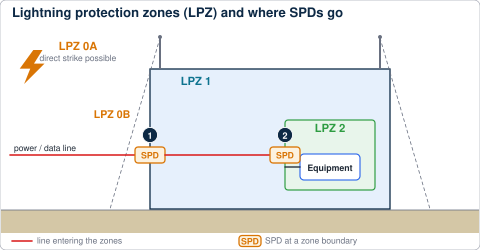
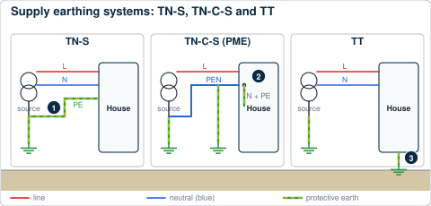
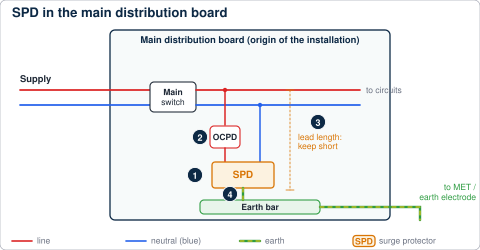

> Earthing, Bonding, Surge & Lightning Protection Library · **SHEET 03 · DB SURGE** · content version 1.0

# Surge protective devices in the distribution board

*SPD types, when they are required, connection modes and types per earthing system, RCD position, connecting leads, backup protection, selection, coordination, inspection and point-of-use protectors*

**Applies to:** Main and sub-distribution boards of houses and small buildings on TN-S, TN-C-S (PME) and TT supplies, socket-outlet and plug-in protectors, equipment connected to power and communication lines

📄 **PDF:** [03_distribution_board_surge_protection.pdf](https://github.com/Skynet1971/earthing/raw/HEAD/docs/pdf/03_distribution_board_surge_protection.pdf)

> ℹ️ Information only. Every technical statement cites a source and PDF page; it does not replace the wiring code that applies at the site, the product manuals, or a qualified and registered person.

## 1  SPD types and where each is installed

Per NIST (US), surge protective devices neither suppress nor arrest a surge; they simply divert it to ground.[R1 p.8](#sources-cited-on-this-page) Type 1 (IEC Class I) SPDs are lightning current or combined arresters, Type 2 (Class II) are surge arresters for distribution boards and fixed installations, and Type 3 (Class III) are surge arresters for socket outlets and terminal devices.[R6 p.219](#sources-cited-on-this-page)

| **25 kA** | **40 kA** | **3 kA / 6 kV** |
|---|---|---|
| 10/350 per mode, Type 1 at the service entrance / main board, BEAMA Table 2 (UK)[R48 p.29](#sources-cited-on-this-page) | 8/20 per mode, Type 2 at sub-distribution, BEAMA Table 2 (UK)[R48 p.29](#sources-cited-on-this-page) | combination wave, Type 3 at socket outlets, BEAMA Table 2 (UK)[R48 p.29](#sources-cited-on-this-page) |

| Type | Purpose and test waveform | Where it is installed | Zone boundary |
|---|---|---|---|
| Type 1 | Recommended against partial lightning currents from direct lightning strokes; characterised by a 10/350 µs current wave.[R48 p.10](#sources-cited-on-this-page) | Service entrance / main distribution board[R48 p.29](#sources-cited-on-this-page) | LPZ 0/1[R48 p.29](#sources-cited-on-this-page) |
| Type 2 | The main protection system for all low-voltage installations; stops overvoltages spreading through the installation.[R48 p.10](#sources-cited-on-this-page) | Each electrical switchboard[R48 p.10](#sources-cited-on-this-page); sub-distribution[R48 p.29](#sources-cited-on-this-page) | LPZ 1/2[R48 p.29](#sources-cited-on-this-page) |
| Type 3 | Low discharge capacity; only as a supplement to a Type 2 SPD.[R48 p.11](#sources-cited-on-this-page) | In the vicinity of sensitive loads[R48 p.11](#sources-cited-on-this-page); socket outlets and terminal equipment[R48 p.29](#sources-cited-on-this-page) | LPZ 2/3[R48 p.29](#sources-cited-on-this-page) |

*Summary of BEAMA (UK, 2018); the zone boundaries and typical test currents are those of BEAMA Table 2.[R48 p.29](#sources-cited-on-this-page)*

*Concept sketch of the zone concept, not a wiring diagram. (1) SPD where lines enter LPZ 1: at the LPZ 0/1 boundary the SPD provides lightning current protection[R12 p.14](#sources-cited-on-this-page); BEAMA places the Type 1 SPD at the service entrance / main distribution board on this boundary.[R48 p.29](#sources-cited-on-this-page) (2) SPD at the LPZ 1/2 boundary: it provides overvoltage protection[R12 p.14](#sources-cited-on-this-page); BEAMA places Type 2 at sub-distribution on this boundary.[R48 p.29](#sources-cited-on-this-page)*

- Per a South African trade article citing IEC 61643-11, a lightning current has a 10/350 microsecond waveform and an induced surge current an 8/20 microsecond waveform.[R14 p.1](#sources-cited-on-this-page)
- BEAMA SPD guide (UK, 2018), quoting BS EN 62305-4: Type 1 SPDs alone provide no effective protection against failure of sensitive electrical or electronic systems; Type 2 and Type 3 SPDs are also needed.[R48 p.31](#sources-cited-on-this-page)
- BEAMA SPD guide (UK, 2018): transient overvoltage SPDs (Type 2/3) protect against indirect lightning and switching transients and should be installed at sub-distribution boards and at equipment level for critical equipment.[R48 p.30](#sources-cited-on-this-page)
- Per IEC/BS EN 62305-4 as summarised by Furse, appropriate SPDs should be fitted wherever services cross from one LPZ to another.[R12 p.15](#sources-cited-on-this-page)
- i-PRO (knowledge-base article 'Countermeasure for lightning surge'): a surge protector (SPD) is normally open circuit, becomes a short circuit when high voltage is applied, and returns to open circuit after the high voltage has passed; it is said to offer 'some protection'.[R39 p.4](#sources-cited-on-this-page)

> ℹ️ **NOTE** — **Lightning rods do not stop surges in the wiring**
>
> Per NIST (US), lightning rods protect the structure of the house and avoid fires; they do not prevent surges from happening in the wiring.[R1 p.6](#sources-cited-on-this-page)

## 2  When SPDs are required (UK, BS 7671:2018)

The rules in this chapter are UK rules from BS 7671:2018 Sections 443 and 534, as presented in the BEAMA guide.[R48 p.63](#sources-cited-on-this-page)[R48 p.65](#sources-cited-on-this-page)[R48 p.68](#sources-cited-on-this-page) The SANS 10142-1 wiring code is not covered by this public sheet.

### Section 443: protection against transient overvoltages

- BEAMA SPD guide (UK, BS 7671:2018 Section 443): if there is a risk of a direct lightning strike to the structure or to overhead lines feeding it, SPDs are required per BS EN 62305.[R48 p.63](#sources-cited-on-this-page)
- BEAMA SPD guide (UK, BS 7671:2018 443.5): if the calculated risk level CRL is less than 1000 SPD protection shall be installed; at 1000 or higher it is not required.[R48 p.65](#sources-cited-on-this-page)
- BEAMA SPD guide (UK, BS 7671:2018): in CRL = fenv / (Lp x Ng) the environmental factor fenv is 85 for rural and suburban and 850 for urban locations.[R48 p.65](#sources-cited-on-this-page)
- BEAMA SPD guide (UK, BS 7671:2018): the risk assessment length is Lp = 2 LPAL + LPCL + 0.4 LPAH + 0.2 LPCH (km), weighting low-voltage overhead line most heavily.[R48 p.65](#sources-cited-on-this-page)
- BEAMA SPD guide (UK, BS 7671:2018 443.4): for a single dwelling unit the designer should complete a documented assessment of whether the installation and equipment value justifies SPDs or the consequential losses are tolerable.[R48 p.63](#sources-cited-on-this-page)
- BEAMA SPD guide (UK, 2018), citing IEC 60364-4-44: overvoltage protection is not required for a single dwelling where the total economic value of the installation is less than five times the value of the SPD at the origin.[R48 p.63](#sources-cited-on-this-page)
- BEAMA SPD guide (UK, 2018), citing BS 7671 443.1.1 Note 4: transient overvoltages transmitted by the supply system are not significantly attenuated downstream in most installations.[R48 p.38](#sources-cited-on-this-page)
- BEAMA SPD guide (UK, BS 7671:2018 443.6.2): Category I equipment connected to the fixed installation must be protected against transient overvoltages, e.g. by an SPD installed external to the equipment.[R48 p.38](#sources-cited-on-this-page)

### Which type, depending on the lightning exposure

- BEAMA SPD guide (UK, BS 7671:2018 534.4.1.3): where the structure has an external LPS or needs protection against direct lightning on overhead lines, Type 1 SPDs shall be installed as close as possible to the origin of the installation.[R48 p.68](#sources-cited-on-this-page)
- BEAMA SPD guide (UK, 2018): where a structural lightning protection system is required, lightning current (equipotential bonding) SPDs are always required on every metallic electrical service entering the structure: mains Type 1 and data/telecom Category D.[R48 p.32](#sources-cited-on-this-page)
- BEAMA SPD guide (UK, 2018): if the BS EN 62305 risk evaluation shows a structural LPS is not required but there is an indirect risk, services fed by an overhead line need lightning current SPDs: 12.5 kA 10/350 per mode for mains Type 1 and 2.5 kA 10/350 per mode for signal/telecom SPDs.[R48 p.34](#sources-cited-on-this-page)
- BEAMA SPD guide (UK, 2018): underground services without a structural LPS do not need lightning current SPDs; overvoltage (Type 2 / Category C) SPDs are sufficient.[R48 p.35](#sources-cited-on-this-page)
- BEAMA SPD guide (UK, BS 7671:2018 534.4.1.1): SPDs installed close to sensitive equipment against internally generated switching transients shall be Type 2 or Type 3.[R48 p.68](#sources-cited-on-this-page)

> ℹ️ **NOTE** — **Outside BS 7671**
>
> DEHN cites IEC 60364-4-44 as requiring SPDs also for buildings that have no external lightning protection system.[R44 p.2](#sources-cited-on-this-page) ITU-T K.85: regardless of the risk assessment result, a building with a lightning protection system should have primary protection bonded to protective earth at the point of entry for all services.[R19 p.15](#sources-cited-on-this-page)

> ℹ️ **NOTE** — **Calculated risk level: the inputs**
>
> In CRL = fenv / (Lp × Ng), fenv is 85 for rural and suburban and 850 for urban locations[R48 p.65](#sources-cited-on-this-page), and Lp weights low-voltage overhead line most heavily.[R48 p.65](#sources-cited-on-this-page) SPD protection shall be installed if CRL is less than 1000.[R48 p.65](#sources-cited-on-this-page) The ground flash density Ng for a South African site is not covered by this sheet.

## 3  Connection modes and connection types

BEAMA (UK) distinguishes lightning transients, generally disturbances with respect to earth (common mode), from switching transients, generally disturbances between line and neutral (differential mode).[R48 p.8](#sources-cited-on-this-page)

### Common mode and differential mode

- BEAMA SPD guide (UK, 2018): Type 1 (lightning current) SPDs protect against common-mode surges, connected line to earth and neutral to earth on TN systems.[R48 p.44](#sources-cited-on-this-page)
- BEAMA SPD guide (UK, 2018): terminal equipment is more vulnerable to differential-mode surges, and downstream overvoltage SPDs protect against both common- and differential-mode surges.[R48 p.44](#sources-cited-on-this-page)
- BEAMA SPD guide (UK, 2018): because electronic equipment has sensitive components connected between live conductors, SPDs with differential-mode (L-N) protection should be selected for it.[R48 p.38](#sources-cited-on-this-page)
- Per Furse, standard SPDs may only protect against common mode surges, i.e. surges between live conductors and earth.[R12 p.16](#sources-cited-on-this-page)
- Per Furse, terminal equipment such as computers tends to be more vulnerable to differential mode surges (between live conductors), so differential mode protection can be a vital consideration.[R12 p.16](#sources-cited-on-this-page)
- ABB OVR brochure: differential-mode overvoltages concern TT earthing systems, and also TN-S systems where there is a significant difference in length between the neutral and the PE conductor.[R52 p.6](#sources-cited-on-this-page)

### Connection types CT1 and CT2 (UK, BS 7671:2018 Section 534)

- BEAMA SPD guide (UK, BS 7671:2018 534.2.2): connection type CT1 is used for TN-C-S/TN-S systems and for TT systems where the SPD is downstream of the RCD.[R48 p.50](#sources-cited-on-this-page)
- BEAMA SPD guide (UK, BS 7671:2018): connection type CT2 is required on a TT system if the SPD is upstream of the RCD, because the downstream RCD would not operate if the SPD became defective.[R48 p.50](#sources-cited-on-this-page)
- BEAMA SPD guide (UK, 2018): a defective CT2 line-to-neutral SPD creates a short-circuit rather than an earth-fault current, so its in-line OCPD operates within the required disconnection time.[R48 p.51](#sources-cited-on-this-page)
- BEAMA SPD guide (UK, 2018): in CT2 a higher-energy SPD, typically a spark gap for Type 1, is used between neutral and the protective conductor because it sees up to 4 times the surge current of the line-to-neutral SPDs.[R48 p.51](#sources-cited-on-this-page)
- BEAMA SPD guide (UK, BS 7671:2018): if Iimp cannot be calculated, the N-PE SPD in a 3-phase CT2 installation is at least 50 kA 10/350 (4 x 12.5 kA of the L-N SPDs); CT2 is often called the '3+1' arrangement.[R48 p.51](#sources-cited-on-this-page)

> ℹ️ **NOTE** — **Single-phase arrangement designations**
>
> BEAMA names CT2 the '3+1' arrangement for a three-phase supply.[R48 p.51](#sources-cited-on-this-page) No verified fact in this library gives the designation used for a single-phase CT1 or CT2 arrangement.

### Which arrangement for TT, TN-S and TN-C-S

| Earthing system | BEAMA (UK, BS 7671:2018) | Schneider EIG (IEC 60364) | DEHN / ABB (IEC) |
|---|---|---|---|
| TN-S | CT1.[R48 p.50](#sources-cited-on-this-page) | Phase-to-earth and neutral-to-earth protection needed, phase-to-neutral recommended[R50 p.11](#sources-cited-on-this-page); 1P+N and 3P+N SPDs, common and differential mode.[R50 p.12](#sources-cited-on-this-page) | ABB: differential-mode overvoltages concern TN-S where neutral and PE lengths differ significantly.[R52 p.6](#sources-cited-on-this-page) |
| TN-C-S (PME) | CT1[R48 p.50](#sources-cited-on-this-page); treated the same as TN-S[R48 p.52](#sources-cited-on-this-page); an N-PE SPD is needed because the board is normally more than 0.5 m from the PEN split.[R48 p.52](#sources-cited-on-this-page) | 2P/3P/4P SPDs, common mode only, suit TN-C-S.[R50 p.12](#sources-cited-on-this-page) | No TN-C-S-specific arrangement among the verified DEHN and ABB facts. |
| TT | CT1 if the SPD is downstream of the RCD[R48 p.50](#sources-cited-on-this-page); CT2 required if the SPD is upstream of the RCD.[R48 p.50](#sources-cited-on-this-page) | Phase-to-earth and neutral-to-earth protection needed, phase-to-neutral recommended[R50 p.11](#sources-cited-on-this-page); 1P+N and 3P+N SPDs.[R50 p.12](#sources-cited-on-this-page) | DEHN '3+1' circuit: phase-to-neutral Uc ≥ 253 V a.c., neutral-to-PE Uc ≥ 230 V a.c.[R6 p.229](#sources-cited-on-this-page); ABB: differential mode concerns TT.[R52 p.6](#sources-cited-on-this-page) |

*Each column restates one source. BEAMA and Schneider differ on TN-C-S; see the chapter on where the sources disagree.*

*Concept sketch of the three supply earthing systems; a UK low-voltage supply will be TN-S, TN-C-S (PME) or TT.[R8 p.2](#sources-cited-on-this-page) (2) TN-C-S: per BEAMA, if SPDs are within 0.5 m of the PEN split into N and PE no N-PE mode is needed[R48 p.52](#sources-cited-on-this-page); in the UK they are normally at the main board more than 0.5 m from the split, so an N-PE SPD is needed as in TN-S.[R48 p.52](#sources-cited-on-this-page) (3) TT: the consumer provides their own connection to earth with an earth electrode local to the installation.[R8 p.8](#sources-cited-on-this-page) Marker (1) is not explained: no verified fact in this library describes the TN-S conductor arrangement.*

## 4  SPD position relative to the RCD

BEAMA (UK) recommends installing SPDs upstream of RCDs wherever possible, to prevent unwanted RCD tripping caused by transient overvoltages.[R48 p.50](#sources-cited-on-this-page)

- BEAMA SPD guide (UK, BS 7671:2018 534.2.1): where SPDs are on the load side of an RCD, the RCD shall have a surge-current immunity of at least 3 kA 8/20; S-type RCDs satisfy this.[R48 p.50](#sources-cited-on-this-page)
- BEAMA SPD guide (UK, 2018): if the SPD is downstream of the RCD, the RCD should be a time-delayed type with surge immunity of at least 3 kA 8/20.[R48 p.50](#sources-cited-on-this-page)
- In TN systems, type 1 and type 2 SPDs should be installed upstream of the RCD, because an RCD would see the discharged impulse current as residual current and could be mechanically damaged by partial lightning current.[R6 p.222](#sources-cited-on-this-page)
- Type 3 SPDs are installed downstream of the RCD.[R6 p.222](#sources-cited-on-this-page)
- In TT systems type 1 and type 2 SPDs must always be installed upstream of the RCD.[R6 p.229](#sources-cited-on-this-page)
- ITU-T K.66 Annex A notes that a mains SPD may be installed before or after the earth leakage breaker, but installing it after may cause nuisance tripping, particularly if the breaker contains an RCD.[R18 p.33](#sources-cited-on-this-page)
- ABB OVR brochure: if a residual current device is used with SPDs a type S device is preferable; nuisance tripping may interrupt the circuit but does not make the SPD less effective.[R52 p.10](#sources-cited-on-this-page)
- ABB OVR brochure: SPDs must be associated with a backup (overcurrent) protection and with residual current protection against indirect contact.[R52 p.10](#sources-cited-on-this-page)
- ABB OVR brochure: a residual current device is mandatory for TT systems, possible for TN-S, IT and TN-C-S systems, and not permitted for TN-C systems.[R52 p.10](#sources-cited-on-this-page)

> ⚠️ **WARNING** — **TT: the RCD does not protect against a defective SPD upstream of it**
>
> BEAMA (UK): CT2 is required on a TT system if the SPD is upstream of the RCD, because the downstream RCD would not operate if the SPD became defective.[R48 p.50](#sources-cited-on-this-page) A defective CT2 line-to-neutral SPD creates a short-circuit rather than an earth-fault current, so its in-line OCPD operates within the required disconnection time.[R48 p.51](#sources-cited-on-this-page)

## 5  Connecting leads and conductor sizes

Schneider takes about 1 µH/m for SPD connection conductors, so an 8 kA 8/20 µs current creates a voltage rise of 1000 V per metre of cable[R50 p.4](#sources-cited-on-this-page); with 50 cm of total connections the voltage across the equipment terminals is Up + 500 V.[R50 p.5](#sources-cited-on-this-page)

| **0.5 m** | **≈ 1 kV/m** | **16 mm²** | **4 mm²** |
|---|---|---|---|
| total connecting lead length l1 + l2, preferably not exceeded, BEAMA (UK)[R48 p.40](#sources-cited-on-this-page) | added per metre of lead at 1 kA/µs, BEAMA[R48 p.40](#sources-cited-on-this-page) | copper, Type 1 connecting cables, minimum advised by BS 7671 Section 534 (via BEAMA)[R48 p.48](#sources-cited-on-this-page) | copper, Type 2 and Type 3 connecting cables, minimum advised by BS 7671 Section 534 (via BEAMA)[R48 p.48](#sources-cited-on-this-page) |

*Concept sketch of a cited rule, not a product wiring diagram. (1) SPD at the origin: where the structure has an external LPS or needs protection against direct lightning on overhead lines, BS 7671 requires Type 1 SPDs as close as possible to the origin of the installation[R48 p.68](#sources-cited-on-this-page); supply-authority rules often keep them off the meter side, so they are fitted at the main distribution board.[R48 p.39](#sources-cited-on-this-page) (2) backup OCPD in series with the SPD: Section 534 requires installed SPDs to be protected against short-circuit by OCPDs[R48 p.48](#sources-cited-on-this-page), and BEAMA gives an SPD at the main intake panel or a distribution board a separate OCPD, depending on the prospective fault current there.[R48 p.53](#sources-cited-on-this-page) (3) short connecting leads, preferably not exceeding 0.5 m in total[R48 p.40](#sources-cited-on-this-page), tightly bound together.[R48 p.40](#sources-cited-on-this-page) (4) SPD earth to the earth bar / MET: ITU-T K.66 gives under 1.5 m for bonding plus connecting wires from the SPD to the main earth terminal.[R18 p.33](#sources-cited-on-this-page)*

### Lead length

- BEAMA SPD guide (UK, 2018): the total length L1 + L2 + L3 of SPD connections to the network and the earth terminal block should not exceed 50 cm.[R48 p.53](#sources-cited-on-this-page)
- Schneider Electrical Installation Guide: the length of the SPD connections between the network (via the external short-circuit protective device) and the earthing terminal block should not exceed 50 cm.[R50 p.1](#sources-cited-on-this-page)
- IEC 60364-5-53 recommends that the total connecting cable length of an SPD installed in a cable branch should not exceed 0.5 m.[R6 p.238](#sources-cited-on-this-page)
- According to IEC 60364-5-53 a maximum SPD connecting cable length of 1 m is mandatory (0.5 m being the recommendation).[R6 p.238](#sources-cited-on-this-page)
- ITU-T K.66 recommends that mains SPDs (primary protectors) be placed where their connecting leads to the mains conductors, including the neutral, are as short as possible, with lead lengths below 0.5 m.[R18 p.22](#sources-cited-on-this-page)
- ITU-T K.66 Annex A figure notes specify that the total length of SPD connecting wires should be under 0.5 m and the total length of bonding plus connecting wires from the SPD to the main earth terminal should be under 1.5 m.[R18 p.33](#sources-cited-on-this-page)
- At surge rates of current change of some 10 kA per microsecond, the voltage drop along SPD connecting leads is mainly inductive, which is why lead length must be kept as short as possible.[R6 p.238](#sources-cited-on-this-page)
- BEAMA SPD guide (UK, 2018): SPD connecting leads should also be tightly bound together over as much of their length as possible (cable ties or spiral wrap) to cancel inductance.[R48 p.40](#sources-cited-on-this-page)

### Measured effect of lead length and binding (BEAMA test)

| Connecting leads | Let-through voltage | Source |
|---|---|---|
| 25 cm, bound (SPD with Up 600 V, 6 kV / 3 kA test) | 630 V[R48 p.41](#sources-cited-on-this-page) | BEAMA (UK) |
| 25 cm, unbound | 810 V[R48 p.41](#sources-cited-on-this-page) | BEAMA (UK) |
| 2 m, unbound | 2,300 V[R48 p.41](#sources-cited-on-this-page) | BEAMA (UK) |

*Values measured by BEAMA on one SPD; they show the effect of lead length and binding, not a rating.*

### V-shape (through-wiring) and in-line connection

- IEC 60364-5-53 suggests connecting SPDs in series (through-wiring, V-shaped connection) so that the voltage at the protected equipment equals the SPD's voltage protection level.[R6 p.235](#sources-cited-on-this-page)
- BEAMA SPD guide (UK, 2018): series (in-line) SPDs, used for low-current power (typically 16 A or less), telecom, data and signal lines, are not affected by connecting lead length, but their earthing conductor must be kept as short as possible.[R48 p.42](#sources-cited-on-this-page)

### Earth connection and conductor cross-sections

- BEAMA SPD guide (UK, 2018): where the SPD earth lead would be long, in metal enclosures use two earth conductors: one closely connected to the enclosure metalwork and one to the earth bar, which is itself connected directly to the metal of the assembly.[R48 p.42](#sources-cited-on-this-page)
- Schneider Electrical Installation Guide: in a metal switchgear enclosure it may be wise to connect the SPD directly to the enclosure, using the enclosure as the protective conductor (the assembly manufacturer must confirm this per IEC 61439-2).[R50 p.5](#sources-cited-on-this-page)
- BEAMA SPD guide (UK, BS 7671:2018 Section 534): Section 534 advises minimum SPD connecting-cable cross-sections of 16 mm2 copper for Type 1 SPDs and 4 mm2 copper for Type 2 and Type 3 SPDs (or not less than the line conductor where that is below 4 mm2).[R48 p.48](#sources-cited-on-this-page)
- Schneider Electrical Installation Guide (IEC 60364): minimum SPD connection cross-section at the incoming end is 4 mm2 copper for a Type 2 SPD and 16 mm2 copper for a Type 1 SPD (lightning protection system present).[R50 p.6](#sources-cited-on-this-page)
- Where SPDs are used, the copper earthing conductor for equipotential bonding must be at least 16 mm2 for SPDs in power supply systems.[R6 p.288](#sources-cited-on-this-page)
- BEAMA SPD guide (UK, 2018): a typical Type 2 SPD rated 40 kA 8/20 is likely to state a maximum OCPD of 125 A and may recommend 10 mm2 connecting cables.[R48 p.49](#sources-cited-on-this-page)

## 6  Backup overcurrent protection and coordination

BEAMA (UK): mains SPDs have internal overload (typically thermal) disconnection, so their connecting conductors need only short-circuit protection by an OCPD in line with the connecting cables.[R48 p.48](#sources-cited-on-this-page)

- BEAMA SPD guide (UK, BS 7671:2018): Section 534 requires installed SPDs to be protected against short-circuit by overcurrent protective devices (OCPDs).[R48 p.48](#sources-cited-on-this-page)
- BEAMA SPD guide (UK, 2018): an SPD at the main intake panel or a distribution board should have a separate overcurrent protective device, depending on the prospective fault current there.[R48 p.53](#sources-cited-on-this-page)
- If the next upstream fuse in the installation is larger than the maximum backup fuse permitted for the SPD, the SPD's cable branch must have its own backup fuse (or an SPD with integrated backup fuse must be used).[R6 p.236](#sources-cited-on-this-page)
- BEAMA SPD guide (UK, 2018) Figure 37: the preferred position for a parallel SPD with its dedicated OCPD is the outgoing way closest to the incomer.[R48 p.48](#sources-cited-on-this-page)
- BEAMA SPD guide (UK, 2018): where upstream OCPD characteristics are not available (e.g. retrofit), the SPD's OCPD may be rated at half the nominal value of the immediate upstream OCPD to achieve discrimination.[R48 p.49](#sources-cited-on-this-page)
- ABB OVR brochure: the follow-current interrupting rating Ifi of a spark-gap SPD should be equal to or higher than the prospective short-circuit current at the installation point, otherwise the upstream fuse will melt each time the spark gap ignites.[R52 p.6](#sources-cited-on-this-page)

> ⛔ **DO NOT** — **Never exceed the maximum backup rating**
>
> BEAMA (UK): the maximum OCPD rating declared by the SPD manufacturer must never be exceeded.[R48 p.49](#sources-cited-on-this-page) A typical Type 2 SPD rated 40 kA 8/20 is likely to state a maximum OCPD of 125 A.[R48 p.49](#sources-cited-on-this-page)

### Backup ratings published by one manufacturer

| SPD (ABB OVR T2 pluggable, T2 & T3 non-pluggable) | Prospective short-circuit current | Maximum backup |
|---|---|---|
| Type 2 | 0.3-2 kA | 25 A C-curve MCB or 16 A gG fuse[R52 p.10](#sources-cited-on-this-page) |
| Type 2 | 2-6 kA | 32 A MCB / 25 A fuse[R52 p.10](#sources-cited-on-this-page) |
| Type 2 | above 6 kA | 50 A MCB / 50 A fuse[R52 p.10](#sources-cited-on-this-page) |
| Type 1, 25 kA (10/350) | - | 125 A gG fuse[R52 p.10](#sources-cited-on-this-page) |

*Values printed by ABB for its own products; the SPD manufacturer's declared maximum applies to any other product.*

## 7  Selecting Up, Uc, In and Iimp

### Protection level Up against equipment impulse withstand

| Overvoltage category | Rated impulse voltage (230/240 V) | Typical equipment |
|---|---|---|
| IV | 6 kV[R48 p.36](#sources-cited-on-this-page) | Electricity meter |
| III | 4 kV[R48 p.36](#sources-cited-on-this-page) | Distribution board |
| II | 2.5 kV[R48 p.36](#sources-cited-on-this-page) | Sub-distribution board / electrical equipment |
| I | 1.5 kV[R48 p.36](#sources-cited-on-this-page) | Socket outlet / electronic equipment |

*BEAMA Table 5, as BS 7671 Table 443.2 (UK).[R48 p.36](#sources-cited-on-this-page)*

- BEAMA SPD guide (UK, 2018): a Type 1 SPD at the main distribution board (category III) must keep the voltage protection level well below the 4 kV rated impulse voltage to prevent flashover.[R48 p.39](#sources-cited-on-this-page)
- BEAMA SPD guide (UK, 2018): on a 230 V supply a service-entrance Type 1 SPD should have a voltage protection level of no more than 1600 V.[R48 p.46](#sources-cited-on-this-page)
- BEAMA SPD guide (UK, 2018): to allow for lead voltage and possible doubling, overvoltage SPDs should have a voltage protection level of no more than 600 V (1.5 kV x 0.8 / 2) in the Class III test.[R48 p.46](#sources-cited-on-this-page)
- BEAMA SPD guide (UK, 2018): terminal equipment at socket outlets is category I (1.5 kV), and a Type 3 SPD (Class III test, 6 kV 1.2/50 and 3 kA 8/20) is typically employed at that location.[R48 p.39](#sources-cited-on-this-page)
- IEC 60364-5-53 requires a voltage protection level of 1.5 kV for consumers of overvoltage category I in a 230/400 V installation, achievable with coordinated type 1 and type 2 SPDs or a type 1 combined arrester.[R6 p.219](#sources-cited-on-this-page)
- Schneider Electrical Installation Guide: the installed voltage protection level generally adopted to protect sensitive equipment in 230/400 V installations is 2.5 kV (overvoltage category II).[R50 p.11](#sources-cited-on-this-page)
- ABB OVR brochure: whatever overvoltage protection is used, the maximum protection level corresponds to category II: Up max = 2500 V for Un = 230 V.[R52 p.7](#sources-cited-on-this-page)

> ℹ️ **NOTE** — **The sources set different Up targets**
>
> BEAMA (UK) works from the 1.5 kV category I withstand with allowance for lead voltage and possible doubling[R48 p.46](#sources-cited-on-this-page)[R48 p.36](#sources-cited-on-this-page); Schneider and ABB name 2.5 kV (category II).[R50 p.11](#sources-cited-on-this-page)[R52 p.7](#sources-cited-on-this-page) See the chapter on where the sources disagree.

### Maximum continuous operating voltage Uc

- Schneider Electrical Installation Guide (IEC 60364-5-53 Table 534.2): in TN and TT systems the minimum Uc is 1.1 U/√3 for L-N and L-PE SPDs and U/√3 for N-PE SPDs (U = line-to-line voltage).[R50 p.8](#sources-cited-on-this-page)
- Schneider Electrical Installation Guide: the most common SPD Uc values are 260, 320, 340 or 350 V for TT and TN systems and 440 or 460 V for IT systems.[R50 p.8](#sources-cited-on-this-page)
- In a 230/400 V TT system '3+1' circuit, the three phase-to-neutral arresters need Uc of at least 253 V a.c. (1.1 x 230 V) and the neutral-to-PE arrester Uc of at least 230 V a.c.[R6 p.229](#sources-cited-on-this-page)

### Discharge currents In and Iimp

- BEAMA SPD guide (UK, BS 7671:2018 534.2.3.4.1): Section 534 requires a minimum nominal discharge current In of 5 kA 8/20 for each mode of protection in the common CT1 configuration.[R48 p.50](#sources-cited-on-this-page)
- BEAMA SPD guide (UK, 2018): for a worst-case 200 kA strike with a single three-phase power service, 50% (100 kA) is assumed to flow through the power line and share equally over 4 conductors, so each L-E and N-E SPD sees 25 kA (10/350).[R48 p.33](#sources-cited-on-this-page)
- Type 1 SPD sizing assumes the total lightning current is shared evenly between the building's earth-termination system and the conductors of the low-voltage supply (so half the current enters the supply conductors).[R6 p.205](#sources-cited-on-this-page)

| Situation | Value as published | Source |
|---|---|---|
| Service by overhead line, no structural LPS required but an indirect risk shown by the risk evaluation (UK) | Mains Type 1: 12.5 kA 10/350 per mode[R48 p.34](#sources-cited-on-this-page) | BEAMA (UK) |
| Structural LPS, worst case 200 kA, single three-phase service (UK) | 25 kA 10/350 per L-E and N-E SPD[R48 p.33](#sources-cited-on-this-page) | BEAMA (UK) |
| N-PE SPD in a three-phase CT2 installation, Iimp not calculated (UK) | At least 50 kA 10/350[R48 p.51](#sources-cited-on-this-page) | BEAMA (UK) |
| Type 2, each mode, CT1 (UK) | In at least 5 kA 8/20[R48 p.50](#sources-cited-on-this-page) | BS 7671 via BEAMA |
| Type 1 per pole | Minimum Iimp 25 kA, based on a 200 kA strike, half to ground[R52 p.7](#sources-cited-on-this-page) | ABB |
| Type 1 at the service entrance, LPL III/IV | 50 kA/m, m = number of conductors[R6 p.203](#sources-cited-on-this-page) | DEHN (IEC) |
| Type 2 by ground flash density Ng | Ng < 2: In 5 kA / Imax 15 kA; 2-3: 20/40 kA; 3-4: 30/70 kA; above 4: 60/120 kA[R52 p.7](#sources-cited-on-this-page) | ABB |

*Each row restates one source for the situation it names; the rows are not interchangeable.*

## 8  Protective distance and coordination of several SPDs

BEAMA (UK): if the distance from an SPD to the protected equipment is over 10 m, oscillations could double the voltage at the equipment.[R48 p.36](#sources-cited-on-this-page)

| **10 m** | **30 m** | **5 m** |
|---|---|---|
| beyond this, oscillation could double the voltage at the equipment, BEAMA[R48 p.36](#sources-cited-on-this-page) | beyond this, ABB makes an additional Type 2 SPD compulsory[R52 p.25](#sources-cited-on-this-page) | DEHN combined arrester: coordination with terminal equipment within this distance[R26 p.4](#sources-cited-on-this-page) |

- BEAMA SPD guide (UK, 2018): oscillation (voltage doubling) may be disregarded for cable runs of less than 10 m from the SPD.[R48 p.44](#sources-cited-on-this-page)
- ABB OVR brochure: the incoming SPD alone does not protect the whole installation; residual voltage can double if cable lengths exceed 10 m.[R52 p.9](#sources-cited-on-this-page)
- ABB OVR brochure: an additional Type 2 SPD close to the equipment is recommended when it is more than 10 m from the upstream SPD and compulsory above 30 m; below 10 m it is not necessary and shall not be installed for coordination reasons.[R52 p.25](#sources-cited-on-this-page)

### Coordination between SPD stages

- Per IEC/BS EN 62305-4 as summarised by Furse, in a coordinated (cascaded) SPD system the lightning current SPD at the service entrance should handle the majority of the surge energy, relieving the downstream overvoltage SPDs so they can control the overvoltage.[R12 p.15](#sources-cited-on-this-page)
- BEAMA SPD guide (UK, 2018): poor coordination can expose a downstream overvoltage SPD to excess surge energy; appropriate SPDs should be fitted wherever services cross from one lightning protection zone to another.[R48 p.35](#sources-cited-on-this-page)
- BEAMA SPD guide (UK, 2018) Figure 40: if the cable length between SPD types is short (per manufacturer's data), a decoupling element is used to provide inductance for correct coordination.[R48 p.52](#sources-cited-on-this-page)
- ABB OVR brochure: ABB Type 2 SPDs coordinate with each other when at least 1 m of cable separates them (e.g. 70 kA followed by 40 kA).[R52 p.9](#sources-cited-on-this-page)
- ABB OVR brochure: a 25 kA Type 1 spark gap with Ifi 7 kA needs at least 5 m of cable between it and a downstream 40 kA Type 2 SPD, while the Ifi 50 kA version needs 0 m.[R52 p.9](#sources-cited-on-this-page)
- Where short bond wires cannot be installed, ITU-T K.66 allows using the shortest possible bond wires plus additional SPDs at the equipment to achieve bonding there, and these additional SPDs must be coordinated with the upstream SPDs.[R18 p.20](#sources-cited-on-this-page)

### Additional Type 2 and Type 3 SPDs at sub-boards and equipment

- BEAMA SPD guide (UK, 2018): transient overvoltage SPDs (Type 2/3) protect against indirect lightning and switching transients and should be installed at sub-distribution boards and at equipment level for critical equipment.[R48 p.30](#sources-cited-on-this-page)
- BEAMA SPD guide (UK, BS 7671:2018 534.4.1.1): SPDs installed close to sensitive equipment against internally generated switching transients shall be Type 2 or Type 3.[R48 p.68](#sources-cited-on-this-page)
- ITU-T K.66 says additional SPDs such as multiservice SPDs are sometimes installed at the terminal equipment to limit surges coupled inside the building, and their common terminal should be connected to the protective conductor near the protected equipment.[R18 p.22](#sources-cited-on-this-page)

## 9  Status indication, end of life and inspection

- ABB solar brochure (Lightning and surge protective devices, 2011): every SPD using MOVs must have an internal thermal disconnection so that it can be disconnected at end of life.[R51 p.3](#sources-cited-on-this-page)
- ABB OVR brochure: the SPD's mechanical end-of-life indicator changes from white to red at end of life, after which the SPD must be changed as protection is no longer guaranteed.[R52 p.8](#sources-cited-on-this-page)
- ABB OVR brochure: a faulty SPD wired for continuity of service simply disconnects itself without interrupting the supply, but the equipment is then no longer protected.[R52 p.8](#sources-cited-on-this-page)
- Per NIST (US), when the protective element of a surge protector fails, the internal disconnect works in one of two ways depending on the design: some protectors cut off the output power completely, others disconnect the failed element but keep the output powered.[R1 p.9](#sources-cited-on-this-page)
- Per NIST (US), specialists consider that most of the (rare) catastrophic failures of surge protectors are caused by excessively high line voltage occurring during a power-system fault, rather than by very large surges.[R1 p.18](#sources-cited-on-this-page)

> ⚠️ **WARNING** — **A disconnected SPD can leave the supply on and the equipment unprotected**
>
> ABB: a faulty SPD wired for continuity of service disconnects itself without interrupting the supply, but the equipment is then no longer protected.[R52 p.8](#sources-cited-on-this-page) BEAMA's periodic inspection first checks that the SPD's OCPD has not operated and that the SPD's fault indicator shows it serviceable.[R48 p.56](#sources-cited-on-this-page)

### Inspection and testing (UK, BS 7671:2018)

- BEAMA SPD guide (UK, 2018): periodic inspection first checks that the SPD's OCPD has not operated and that the SPD's fault indicator shows it serviceable.[R48 p.56](#sources-cited-on-this-page)
- BEAMA SPD guide (UK, 2018): during periodic testing, with the SPD's OCPD open a 500 V insulation resistance test is applied between live conductors and earth, expecting more than 1 megohm (BS 7671 Table 61).[R48 p.56](#sources-cited-on-this-page)
- BEAMA SPD guide (UK, 2018): SPDs should be isolated during insulation resistance testing because they may operate on the test voltage.[R48 p.56](#sources-cited-on-this-page)
- BEAMA SPD guide (UK, BS 7671:2018 612.3.2): where an SPD cannot practically be disconnected (e.g. a fixed surge-protected socket outlet), insulation resistance is tested at 250 V between live conductors and earth.[R48 p.56](#sources-cited-on-this-page)
- BEAMA SPD guide (UK, 2018): provision should be made for readily disconnecting the neutral conductors for testing, by 2-pole or 4-pole means of isolation.[R48 p.53](#sources-cited-on-this-page)
- BEAMA SPD guide (UK, BS 7671:2018): where SPDs are installed, a durable notice complying with BS 7671 should be fixed adjacent to the distribution board(s).[R48 p.55](#sources-cited-on-this-page)
- BEAMA SPD guide (UK, 2018): visual inspection of a surge protection system should verify that bonding conductors and cable shields are intact and cable segregation is maintained.[R48 p.57](#sources-cited-on-this-page)
- BEAMA SPD guide (UK, 2018): inspection should catch later additions such as a power line to external CCTV cameras or car-park lighting that crosses a lightning protection zone and needs an SPD.[R48 p.57](#sources-cited-on-this-page)
- Per the South African WAPA high-site guideline, immediately after lightning damage, all earthing points, earth straps and surge protection devices should be inspected and repaired.[R13 p.30](#sources-cited-on-this-page)

> ℹ️ **NOTE** — **Not covered**
>
> The sources in this library give no inspection interval specific to SPDs in a distribution board, and no verified fact describes remote signalling contacts.

## 10  Separating protected and unprotected cables

DEHN: unprotected cable upstream of an SPD must be strictly separated or shielded from the protected cable downstream of it, otherwise interference is coupled onto the protected side.[R6 p.262](#sources-cited-on-this-page)

- Schneider Electrical Installation Guide: protected outgoing feeders should be connected to the terminals of the external SCPD or the SPD and physically separated from the polluted incoming conductors.[R50 p.1](#sources-cited-on-this-page)
- Schneider Electrical Installation Guide: the SPD's incoming conductors should be kept remote from the protected outgoing conductors to avoid polluting them by coupling.[R50 p.2](#sources-cited-on-this-page)
- Schneider Electrical Installation Guide: the incoming phase, neutral and PE conductors should run beside one another to reduce loop area.[R50 p.2](#sources-cited-on-this-page)
- Schneider Electrical Installation Guide: cables should be pinned against the metal parts of the enclosure to minimise loop area, and switchboard and enclosure frames must be earthed via very short connections.[R50 p.2](#sources-cited-on-this-page)

## 11  Point-of-use protectors and two-port equipment

Per NIST (US), a surge protector at the service entrance is sufficient for appliances with a single (power-only) connection but not for appliances connected to two systems (power plus communications).[R1 p.18](#sources-cited-on-this-page)

### Plug-in protectors on the power side

- Per NIST (US), a surge protector at the service (breaker) panel is intended to protect all appliances in the house with one device, perhaps supplemented by a few plug-in protectors next to the most sensitive appliances.[R1 p.10](#sources-cited-on-this-page)
- Per NIST (US), a plug-in surge protector may benefit other receptacles on the same branch circuit, but the benefit is much less on other branch circuits.[R1 p.18](#sources-cited-on-this-page)
- Per NIST (US, 120 V systems), many plug-in protector specifications show a 330 V clamping voltage, which is not a requirement; somewhat higher clamping voltages such as 400 V or more may be sufficient for protecting electronic appliances.[R1 p.17](#sources-cited-on-this-page)
- DEHN (white paper WPX012, Surge protection for public address systems): the plug-in adapter listed for socket-outlet protection is a type 3 (class III) SPD for 230 V with Uc 255 V a.c., 16 A nominal load current and 3 kA nominal discharge current (8/20 µs).[R27 p.5](#sources-cited-on-this-page)
- BEAMA SPD guide (UK, 2018): terminal equipment at socket outlets is category I (1.5 kV), and a Type 3 SPD (Class III test, 6 kV 1.2/50 and 3 kA 8/20) is typically employed at that location.[R48 p.39](#sources-cited-on-this-page)

### Equipment connected to power and a communication line

- Per NIST (US), equipment connected to both power and a communications system can be damaged by a surge on either system because of the voltage difference between the two systems during the surge, and this can happen even when each system has its own surge protector.[R1 p.14](#sources-cited-on-this-page)
- Per NIST (US), surge current flowing from the telephone entry protector to the common grounding point creates a magnetic field that couples into the loop formed by the power branch circuit, the telephone premises wiring and the bonding conductors, inducing a voltage between the power input and telephone input of the connected PC.[R1 p.20](#sources-cited-on-this-page)
- Per NIST (US), the presence or absence of a surge protector on the AC side has no effect on this power/telephone loop coupling; an effective solution is a combined protector installed by the consumer.[R1 p.20](#sources-cited-on-this-page)
- Per NIST (US), the simple solution for equipment with both power and communications connections is a special surge protector that combines, in one package, input/output connections for both systems.[R1 p.14](#sources-cited-on-this-page)
- Per NIST (US), with a combined protector each link (power and communications) is fed through the protector, which is inserted between the wall receptacles and the inputs of the appliance to be protected.[R1 p.14](#sources-cited-on-this-page)
- Per NIST (US), some combined power/communications plug-in protectors might not work very well if plugged into a 2-blade (ungrounded) receptacle through a 'cheater' plug.[R1 p.14](#sources-cited-on-this-page)
- Per NIST (US), pulling out the power cord of an appliance that stays connected to a telephone line or cable TV might not be the best idea, because the appliance loses the grounding normally provided by the power cord.[R1 p.13](#sources-cited-on-this-page)

### Multiservice SPDs (ITU-T)

- ITU-T K.85 defines a multiservice surge protective device (MSPD) as an SPD containing both telecommunications and mains protection, which may also include port protection for video or Ethernet.[R19 p.11](#sources-cited-on-this-page)
- ITU-T K.66 describes multiservice surge protective devices (MSPDs) as containing the SPDs for all ports, achieving the short-bond-wire requirement, being installed near the equipment so they also protect against overvoltages arising in internal wiring, and requiring coordination with the primary protector.[R18 p.29](#sources-cited-on-this-page)
- Per ITU-T K.66, a single MSPD suits one piece of equipment or interconnected equipment in close proximity, and in that case only the ports connected to external cables need protection.[R18 p.29](#sources-cited-on-this-page)
- Per ITU-T K.66, multiple MSPDs are needed when interconnected equipment is too far apart to share one MSPD (or it has too few outlets), and in that case all ports require protection.[R18 p.30](#sources-cited-on-this-page)
- ITU-T K.66 cautions that indiscriminate use of MSPDs may allow damage to the protected equipment and to associated equipment.[R18 p.29](#sources-cited-on-this-page)
- ITU-T K.85 summarises the two-stage scheme as: the MSPD protects the equipment and the primary (point-of-entry) protection protects the MSPD, both installed according to ITU-T K.66 when the risk assessment requires.[R19 p.15](#sources-cited-on-this-page)
- For residential buildings, ITU-T K.98 recommends, when protection is required, an MSPD or equivalent to protect equipment clusters plus primary protection at the building entry point to protect the downstream protection and the equipment wiring.[R25 p.31](#sources-cited-on-this-page)
- ITU-T K.85 says an MSPD protects equipment against surges magnetically coupled into building wiring and service lines, and may give some protection against direct strikes to the service plant only if the strike point is more than a few hundred metres from the building.[R19 p.18](#sources-cited-on-this-page)
- ITU-T K.85 says adding an MSPD with protection for all ports provides equipotential bonding for non-earthed equipment, and protection of equipment and users should be effective if the MSPD is plugged into an earthed power point.[R19 p.37](#sources-cited-on-this-page)

> ⛔ **DO NOT** — **Do not rely on a multiservice protector on an unearthed socket**
>
> ITU-T K.85: the MSPDs it refers to rely on a protective earth connection for safety[R19 p.15](#sources-cited-on-this-page); if the power point feeding an MSPD is not earthed, equipment damage may not be reduced and users face a possible lightning safety risk.[R19 p.37](#sources-cited-on-this-page)

## 12  Where the sources disagree

The sources were written for different countries and purposes. The wiring code that applies at the site decides; this table shows each conflict without choosing a winner.

| Question | One source says | Other sources say |
|---|---|---|
| TN-C-S: N-PE protection and SPD type | BEAMA (UK, BS 7671:2018): TN-C-S (PME) is treated the same as TN-S[R48 p.52](#sources-cited-on-this-page); an N-PE SPD is needed at a main board more than 0.5 m from the PEN split.[R48 p.52](#sources-cited-on-this-page) | Schneider EIG (IEC 60364): 2P/3P/4P SPDs, common mode only, suit TN-C-S; 1P+N and 3P+N suit TT and TN-S.[R50 p.12](#sources-cited-on-this-page) |
| Up design target | BEAMA (UK): Type 1 Up no more than 1600 V on 230 V[R48 p.46](#sources-cited-on-this-page); overvoltage SPDs no more than 600 V in the Class III test.[R48 p.46](#sources-cited-on-this-page) | Schneider: installed Up of 2.5 kV generally adopted for sensitive equipment[R50 p.11](#sources-cited-on-this-page); ABB: Up max 2500 V for Un 230 V.[R52 p.7](#sources-cited-on-this-page) DEHN (IEC 60364-5-53): 1.5 kV for category I consumers.[R6 p.219](#sources-cited-on-this-page) |
| SPD downstream of the RCD on TT | BEAMA (UK): CT1 is used on TT where the SPD is downstream of the RCD[R48 p.50](#sources-cited-on-this-page), with a time-delayed RCD of at least 3 kA 8/20 surge immunity.[R48 p.50](#sources-cited-on-this-page) | DEHN: in TT systems Type 1 and Type 2 SPDs must always be installed upstream of the RCD.[R6 p.229](#sources-cited-on-this-page) |
| SPD downstream of an RCD in general | ITU-T K.66: a mains SPD may be installed before or after the earth leakage breaker; after may cause nuisance tripping.[R18 p.33](#sources-cited-on-this-page) ABB: nuisance tripping does not make the SPD less effective.[R52 p.10](#sources-cited-on-this-page) | DEHN (TN): Type 1 and Type 2 SPDs should be upstream, because the RCD could be mechanically damaged by partial lightning current.[R6 p.222](#sources-cited-on-this-page) |
| Connecting lead length | BEAMA (UK): preferably not exceeding 0.5 m total[R48 p.40](#sources-cited-on-this-page); IEC 60364-5-53 via DEHN: 0.5 m recommended, 1 m mandatory[R6 p.238](#sources-cited-on-this-page)[R6 p.238](#sources-cited-on-this-page); ITU-T K.66: SPD connecting wires under 0.5 m, up to the MET under 1.5 m.[R18 p.33](#sources-cited-on-this-page) | NIST (US): panel protector less than about 30 cm from the panel[R1 p.19](#sources-cited-on-this-page); Motorola R56 (US): 610 mm most desirable.[R5 p.343](#sources-cited-on-this-page) |
| Common-mode mains SPDs | BEAMA (UK): Type 1 SPDs protect against common-mode surges, line to earth and neutral to earth on TN systems.[R48 p.44](#sources-cited-on-this-page) | Motorola R56 (US communication-site practice): common-mode AC power surge suppression devices shall not be used, because they may fail short-circuit.[R5 p.315](#sources-cited-on-this-page) |
| Second SPD less than 10 m downstream | ABB: below 10 m an additional Type 2 SPD is not necessary and shall not be installed, for coordination reasons[R52 p.25](#sources-cited-on-this-page); yet ABB Type 2 SPDs coordinate with at least 1 m of cable between them.[R52 p.9](#sources-cited-on-this-page) | BEAMA (UK): where the cable between SPD types is short, a decoupling element provides inductance for correct coordination.[R48 p.52](#sources-cited-on-this-page) |

## 13  Installation checklist

- [ ] UK: documented Section 443 assessment made; CRL calculated, SPD installed if CRL is less than 1000.[R48 p.63](#sources-cited-on-this-page)[R48 p.65](#sources-cited-on-this-page)
- [ ] Type 1 SPD as close as possible to the origin where the structure has an external LPS or needs protection against direct lightning on overhead lines; for underground services without a structural LPS, Type 2 SPDs are sufficient.[R48 p.68](#sources-cited-on-this-page)[R48 p.35](#sources-cited-on-this-page)
- [ ] Connection type matches the earthing system and the RCD position: CT1 on TN-S and TN-C-S, CT2 on TT with the SPD upstream of the RCD.[R48 p.50](#sources-cited-on-this-page)[R48 p.50](#sources-cited-on-this-page)
- [ ] SPD upstream of RCDs where possible; otherwise an RCD with surge-current immunity of at least 3 kA 8/20 (S-type RCDs satisfy this).[R48 p.50](#sources-cited-on-this-page)[R48 p.50](#sources-cited-on-this-page)
- [ ] Connecting leads preferably not over 0.5 m in total and bound together.[R48 p.40](#sources-cited-on-this-page)[R48 p.40](#sources-cited-on-this-page)
- [ ] Connecting conductors checked against the minimum cross-sections advised by BS 7671 Section 534: 16 mm² copper for Type 1 and 4 mm² for Type 2 and Type 3.[R48 p.48](#sources-cited-on-this-page)
- [ ] ITU-T K.66: SPD connecting wires under 0.5 m in total, bonding plus connecting wires from the SPD to the MET under 1.5 m.[R18 p.33](#sources-cited-on-this-page)
- [ ] Backup OCPD in series with the SPD, not above the manufacturer's maximum rating.[R48 p.48](#sources-cited-on-this-page)[R48 p.49](#sources-cited-on-this-page)
- [ ] Uc at least 1.1 U/√3 for L-N and L-PE modes and U/√3 for N-PE.[R50 p.8](#sources-cited-on-this-page)
- [ ] Up of the Type 1 SPD at the main board well below the 4 kV rated impulse voltage of category III; equipment categories checked against BEAMA Table 5.[R48 p.39](#sources-cited-on-this-page)[R48 p.36](#sources-cited-on-this-page)
- [ ] Equipment more than 10 m of cable from the upstream SPD: additional Type 2 SPD close to it (ABB: recommended, compulsory above 30 m); coordination per the manufacturer's data.[R52 p.25](#sources-cited-on-this-page)[R48 p.36](#sources-cited-on-this-page)[R48 p.52](#sources-cited-on-this-page)
- [ ] Protected outgoing conductors separated from unprotected incoming conductors.[R50 p.1](#sources-cited-on-this-page)[R6 p.262](#sources-cited-on-this-page)
- [ ] Equipment with power and communication connections protected by a combined protector or MSPD on an earthed socket.[R1 p.14](#sources-cited-on-this-page)[R19 p.37](#sources-cited-on-this-page)
- [ ] Durable SPD notice fixed next to the distribution board.[R48 p.55](#sources-cited-on-this-page)
- [ ] Periodic check: OCPD not operated, status indicator serviceable; SPDs isolated before insulation testing.[R48 p.56](#sources-cited-on-this-page)[R48 p.56](#sources-cited-on-this-page)

## Sources cited on this page

`[R18 p.12]` = reference 18 below, PDF page 12 (page index of the PDF file). Each cited statement was checked against a verbatim quote from that page.

| Ref | Document | PDF pages cited |
|---|---|---|
| R1 | **Surges Happen! How to Protect the Appliances in Your Home (NIST Special Publication 960-6)** — National Institute of Standards and Technology (USA) · May 2001 · USA · [link](https://nvlpubs.nist.gov/nistpubs/Legacy/SP/nistspecialpublication960-6.pdf) | 6, 8-10, 13-14, 17-20 |
| R5 | **Standards and Guidelines for Communication Sites (R56), 68P81089E50-B** — Motorola, Inc. · 9/1/05 (2005) · USA practice (AWG sizes) · [link](https://www.blm.gov/sites/blm.gov/files/Lands_ROW_Motorola_R56_2005_manual.pdf) | 315, 343 |
| R6 | **Lightning Protection Guide, 3rd updated edition** — DEHN + SÖHNE · 2014 · IEC / EN 62305 (Germany) · [link](https://www.dehn-international.com/sites/default/files/media/files/lpg_en_complete.pdf) | 203, 205, 219, 222, 229, 235-236, 238, 262, 288 |
| R8 | **Earthing: your questions answered (IET Wiring Matters, Autumn 2011)** — The Institution of Engineering and Technology (UK) · Autumn 2011 · UK (BS 7671) · [link](https://electrical.theiet.org/media/1549/earthing.pdf) | 2, 8 |
| R12 | **IEC/BS EN 62305 parts 1-4: technical reference (Furse)** — ABB Furse · not stated in document · IEC / BS EN 62305 (UK) · [link](https://library.e.abb.com/public/ee4d371685e544e09e8d9712fbd716c9/IEC%20BS%20EN%2062305%201%20-%204.pdf) | 14-16 |
| R13 | **Wireless High Site Engineering Guideline V1.0.0** — Wireless Access Providers' Association (South Africa) · V1.0.0, 2014-07-21 · South Africa · [link](https://wapa.org.za/sites/default/files/2018-08/WAPA%20Wireless%20High%20Site%20Engineering%20Guideline%20V1%200%200%2020140721.pdf) | 30 |
| R14 | **Lightning protection: 'Separation Distance' concept (Electricity+Control, January 2016)** — Crown Publications (South Africa); author Trevor Manas · January 2016 · IEC 62305 (South Africa) · [link](https://www.crown.co.za/images/magazines/electricity-control/FaceValue/Lightning_protection_Separation_Distance_concept.pdf) | 1 |
| R18 | **Recommendation ITU-T K.66: Protection of customer premises from overvoltages** — International Telecommunication Union · 11/2019 · International · [link](https://www.itu.int/rec/T-REC-K.66-201911-I) | 20, 22, 29-30, 33 |
| R19 | **Recommendation ITU-T K.85: Requirements for the mitigation of lightning effects on home networks installed in customer premises** — International Telecommunication Union · 11/2011 · International · [link](https://www.itu.int/rec/T-REC-K.85-201111-I) | 11, 15, 18, 37 |
| R25 | **Recommendation ITU-T K.98: Overvoltage protection guide for telecommunication equipment installed in customer premises** — International Telecommunication Union · 08/2014 · International · [link](https://www.itu.int/rec/T-REC-K.98-201408-I) | 31 |
| R26 | **White paper WP007: Surge protection for CCTV systems** — DEHN + SÖHNE · WP007/E/0615 (June 2015) · IEC / EN (Germany) · [link](https://www.dehn-international.com/sites/default/files/media/files/cctv-wp007-e.pdf) | 4 |
| R27 | **White paper WPX012: Surge protection for public address systems** — DEHN SE · WPX012/EN/0122 (January 2022) · IEC / EN (Germany) · [link](https://www.dehn-international.com/sites/default/files/media/files/public-address-systems-wpx012-en.pdf) | 5 |
| R39 | **Countermeasure for lightning surge (knowledge base article)** — i-PRO Co., Ltd. · updated May 2025 · International · [link](https://i-pro.com/products_and_solutions/en/surveillance/learning-and-support/knowledge-base/technical-information/surge-protection) | 4 |
| R44 | **White paper WPX029: Lightning and surge protection for rooftop photovoltaic systems** — DEHN SE · WPX029/EN/0422 (April 2022) · IEC / EN (Germany) · [link](https://www.dehn-africa.com/sites/default/files/media/files/photovoltaic-wpx029-en.pdf) | 2 |
| R48 | **BEAMA Guide to Surge Protection Devices (SPDs): selection, application and theory** — BEAMA Ltd (UK) · July 2018 · UK (BS 7671:2018) · [link](https://www.beama.org.uk/static/uploaded/0125b82e-8c76-4106-88bedb0f4fc85d52.pdf) | 8, 10-11, 29-36, 38-42, 44, 46, 48-53, 55-57, 63, 65, 68 |
| R50 | **Electrical Installation Guide (wiki): Cabling rules of SPD; Connection of SPD; Common characteristics of SPDs according to the installation characteristics** — Schneider Electric · web pages as fetched 2026-11-23 · IEC 60364 / IEC 61643 · [link](https://www.electrical-installation.org/enwiki/Cabling_rules_of_Surge_Protection_Device) | 1-2, 4-6, 8, 11-12 |
| R51 | **Solar energy: lightning and surge protective devices (brochure 1TXH 000 118 B0201)** — ABB · 2011 · IEC · [link](https://library.e.abb.com/public/77266805bb3868adc12578f10033b12b/1TXH%20000%20118%20B0201_Solar%20energy%20Lightning%20and%20overvoltage%20protection_br.pdf) | 3 |
| R52 | **System pro M compact: OVR surge protective devices (main catalogue 1TXH000083C0201)** — ABB · 2011 · IEC · [link](https://library.e.abb.com/public/d614bdefa272767ac125784c005b65e8/1TXH000083C0201_ABB%20OVR%20%20RANGE%20SYSTEM%20proM_2011.pdf) | 6-10, 25 |

*Generated from `content/docs/03_db_surge_protection.yaml` on 2026-11-23. Do not edit this page in the wiki; edit the content file.*
