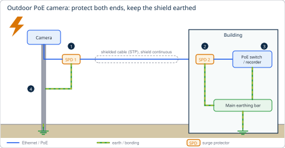

> Earthing, Bonding, Surge & Lightning Protection Library · **SHEET 04 · CCTV** · content version 1.0

# CCTV cameras, recorders and PoE switches

*Earthing, bonding and surge protection of IP / PoE cameras on walls and poles, their cables, recorders and switches*

**Applies to:** IP and PoE cameras on buildings and poles, coaxial and RS-485 camera lines, network video recorders, PoE switches and midspans

📄 **PDF:** [04_cctv_cameras_recorders.pdf](https://github.com/Skynet1971/earthing/raw/HEAD/docs/pdf/04_cctv_cameras_recorders.pdf)

> ℹ️ Information only. Every technical statement cites a source and PDF page; it does not replace the wiring code that applies at the site, the product manuals, or a qualified and registered person.

## 1  How cameras are damaged

Outdoor cameras sit at the end of long cables that leave the building. The sources name three ways a lightning flash reaches them: a direct strike, voltage induced into the cable by a nearby strike, and a difference in earth potential between the two ends of the cable.[R39 p.1](#sources-cited-on-this-page)

| **3** | **2 ends** | **≤ 0.91 m** |
|---|---|---|
| damage mechanisms: direct strike, induction, earth-potential difference[R39 p.1](#sources-cited-on-this-page) | surge protectors at the camera and at the building end of the cable[R26 p.3](#sources-cited-on-this-page) | outdoor PoE suppressor from the device, Southwest Microwave rule[R10 p.1](#sources-cited-on-this-page) |

- Axis defines a power surge as a transient voltage spike in a power or data line; lightning is the most familiar cause but only one of several.[R20 p.1](#sources-cited-on-this-page)
- According to Axis, more frequent surge causes than lightning include the switching on and off of high-powered machinery such as elevator motors or air conditioners.[R20 p.1](#sources-cited-on-this-page)
- Axis explains that the network cable between a camera and its switch can pick up strong magnetic and electric fields nearby, producing voltage transients that travel along the cable.[R20 p.2](#sources-cited-on-this-page)
- i-PRO (knowledge-base article 'Countermeasure for lightning surge'): nearby lightning strikes cause induced voltage that can damage electric equipment, and a lightning strike lets current flow into the ground, resulting in an increase in ground potential.[R39 p.1](#sources-cited-on-this-page)
- i-PRO (knowledge-base article 'Countermeasure for lightning surge'): where the GND line is separated, a potential difference occurs in the GND that causes equipment breakdown, and i-PRO suspects inductive lightning on a ground loop as one cause of burnt circuit boards.[R39 p.2](#sources-cited-on-this-page)
- i-PRO (knowledge-base article 'Countermeasure for lightning surge'): damage to electric equipment from the high voltage and current of a direct lightning stroke cannot be prevented by surge protectors.[R39 p.1](#sources-cited-on-this-page)
- If lightning hits external equipment such as a camera mast, partial lightning currents flow into the building through the equipment's earth electrode and the connecting cables, and must not overload the SPD installed in the building.[R6 p.428](#sources-cited-on-this-page)

> ℹ️ **NOTE** — **A surge protector reduces risk; it does not guarantee survival**
>
> i-PRO states that surge protectors cannot prevent damage from a direct strike[R39 p.1](#sources-cited-on-this-page) and does not guarantee protection even when its examples are followed.[R39 p.5](#sources-cited-on-this-page)

## 2  The protection scheme

The sources read for this sheet describe the same basic layout: a protector near the camera, a second protector where the cable enters the building, and earthed equipment at both ends. The section on where the sources disagree lists the exceptions.

*Click the diagram to open it full size.* *Concept sketch, not a product wiring diagram. (1) protector near the camera[R34 p.2](#sources-cited-on-this-page)[R10 p.1](#sources-cited-on-this-page) (2) protector at the building entry, bonded to the main earthing bar with a short conductor[R10 p.1](#sources-cited-on-this-page)[R18 p.22](#sources-cited-on-this-page) (3) the PoE switch or recorder is earthed so that the cable shield has a path to earth[R20 p.2](#sources-cited-on-this-page)[R20 p.3](#sources-cited-on-this-page) (4) the camera pole or pipe is earthed and the camera is bonded to it.[R41 p.4](#sources-cited-on-this-page)*

### Protect both ends of the cable

- DEHN (white paper WP007, Surge protection for CCTV systems): for a camera connected to a building that has an external lightning protection system, the example installation (Figure 1) uses lightning current carrying surge protective devices at both ends of the camera cabling.[R26 p.2](#sources-cited-on-this-page)
- DEHN (white paper WP007, Surge protection for CCTV systems): for a camera connected to a building without an external lightning protection system, the example installation (Figure 2) uses surge protective devices at both ends.[R26 p.2](#sources-cited-on-this-page)
- DEHN (white paper WP007, Surge protection for CCTV systems): for an IP camera on a LAN cable, the example installation (Figure 3) uses surge protective devices at both ends.[R26 p.3](#sources-cited-on-this-page)
- For a camera connected to a building without external lightning protection, DEHN's scheme places surge protective devices at both ends of the camera cabling (camera end and building/monitor end).[R6 p.302](#sources-cited-on-this-page)
- An IP camera is protected with surge protective devices at both ends of its LAN cable.[R6 p.303](#sources-cited-on-this-page)
- Per Motorola R56 (2005, US practice), it is highly recommended to protect pan-tilt-zoom (PTZ) cameras with SPDs at both ends of the cable run.[R5 p.354](#sources-cited-on-this-page)
- Per Motorola R56 (2005, US practice), SPDs should be installed on both ends of Ethernet, Power-over-Ethernet and AC cable runs serving pole-mounted access points and ground-based cabinets.[R5 p.354](#sources-cited-on-this-page)
- Ubiquiti (ETH-SP-G2 Ethernet surge protector datasheet): two surge protectors should be installed on an outdoor Ethernet run: one near the outdoor device (CPE) and the other at the entry point to the building.[R34 p.2](#sources-cited-on-this-page)
- At the switch end, Southwest Microwave shows a field distribution box containing an outdoor PoE network switch with shielded ports and its own outdoor-rated surge suppressor, in addition to the suppressor at the PoE device.[R10 p.1](#sources-cited-on-this-page)
- If the PoE switch is mounted indoors, Southwest Microwave requires a surge suppressor on the outside of the building before the cable enters the building.[R10 p.1](#sources-cited-on-this-page)
- Axis shows that indoor network devices can be protected by a further surge protector placed where the Ethernet cable is about to enter the building.[R20 p.3](#sources-cited-on-this-page)

### Cameras on a pole or mast

- DEHN (white paper WP007, Surge protection for CCTV systems): a direct lightning strike to a mast-mounted camera can be prevented if an air-termination rod is installed at the mast.[R26 p.3](#sources-cited-on-this-page)
- DEHN (white paper WP007, Surge protection for CCTV systems): if the camera cable cannot run inside the metal mast it must be routed in a metal tube conductively connected to the mast; in that case surge protective devices are not needed in the junction box provided the cable length does not exceed some metres.[R26 p.3](#sources-cited-on-this-page)
- If the camera cable runs inside the metal mast (or in a bonded metal tube), no SPDs are needed in the junction box at the mast provided the cable length does not exceed some metres.[R6 p.303](#sources-cited-on-this-page)
- DEHN (white paper WP007, Surge protection for CCTV systems): lightning equipotential bonding must be established at the building entrance point for all cables routed from the junction box at the mast to a building with an external lightning protection system.[R26 p.3](#sources-cited-on-this-page)
- For a building with an external lightning protection system, lightning equipotential bonding (lightning-current-carrying SPDs) is required at the building entry for all cables coming from the junction box at the camera mast.[R6 p.303](#sources-cited-on-this-page)

### Cameras on a building wall

- DEHN (white paper WP007, Surge protection for CCTV systems): a camera mounted on the outer facade of a building should be located in the protected volume or be protected from direct lightning strikes by an air-termination system.[R26 p.3](#sources-cited-on-this-page)
- Cameras mounted on a building facade should be located within the protected volume, or protected from direct strikes by an air-termination system.[R6 p.303](#sources-cited-on-this-page)
- DEHN (white paper WP007, Surge protection for CCTV systems): where a building has no external lightning protection system, the risk resulting from a direct or nearby strike to the building is assumed to be low and thus acceptable.[R26 p.3](#sources-cited-on-this-page)
- DEHN (white paper WP007, Surge protection for CCTV systems): for a building without an external lightning protection system, the white paper states that installing surge arresters provides sufficient protection.[R26 p.3](#sources-cited-on-this-page)
- For CCTV on buildings without an external lightning protection system the direct/nearby strike risk is taken as low, and surge arresters (rather than lightning current arresters) provide sufficient protection.[R6 p.303](#sources-cited-on-this-page)

## 3  Cable, shield and routing

> ✅ **DO** — **Use shielded cable and keep the shield continuous to an earthed switch**
>
> Axis advises shielded (STP) cable throughout[R20 p.1](#sources-cited-on-this-page); the shield only works with an unbroken path to earth through the PoE switch or midspan[R20 p.2](#sources-cited-on-this-page), and every cable, patch panel and coupling in the path must be shielded.[R20 p.3](#sources-cited-on-this-page)

- With shielded (STP) network cable, Axis says the induced energy is captured by the shield and diverted to ground without reaching the camera.[R20 p.2](#sources-cited-on-this-page)
- Axis warns that a camera on unshielded network cable can be adversely affected by surges caused by strong electromagnetic fields near the cable.[R20 p.2](#sources-cited-on-this-page)
- Axis states that most PoE surge protectors need shielded network cable in order to function properly.[R20 p.3](#sources-cited-on-this-page)
- Southwest Microwave specifies Cat5e or Cat6 shielded twisted Ethernet cable with shielded RJ45 connectors, not longer than 100 m (328 ft), routed through a permanently earthed metal conduit.[R10 p.1](#sources-cited-on-this-page)
- A cable shield must be earthed at least at both ends; only a shield connected at both ends can reduce inductive and capacitive coupling.[R6 p.197](#sources-cited-on-this-page)
- Earthing a cable shield at only one end attenuates capacitive interference fields but gives no protection against the electromagnetic induction caused by lightning strikes.[R6 p.198](#sources-cited-on-this-page)
- Shielded data cables must be earthed at both ends.[R6 p.321](#sources-cited-on-this-page)
- For a cable shield to be credited with carrying lightning current, the shield must be connected at both cable ends to the main equipotential bonding system in a lightning-current-carrying manner.[R6 p.184](#sources-cited-on-this-page)
- Lightning equipotential bonding requires all metal conductive parts of incoming lines, such as cable cores and shields, to be bonded at the point of entry into the building with as little impedance as possible.[R6 p.182](#sources-cited-on-this-page)
- ITU-T K.66 says the shields of all cables entering the building should be bonded directly to the main earth terminal or equipotential bonding bar; an SPD may be used instead to give galvanic isolation if corrosion requires it.[R18 p.19](#sources-cited-on-this-page)

### Earth the switch or midspan

- Axis calls proper grounding of the PSE (PoE switch or midspan) imperative for the cable shield to protect the camera.[R20 p.3](#sources-cited-on-this-page)
- Axis says its PoE midspan should always be plugged into a grounded socket so that the cable shield can function. (The extracted text contains the stray page-header words 'White papers' inside this sentence.)[R20 p.3](#sources-cited-on-this-page)
- Axis notes that a desktop switch may have no ground connection through its power lead, in which case the switch must be grounded separately.[R20 p.3](#sources-cited-on-this-page)

### Routing outdoors

- TP-Link (Omada security devices waterproof and lightning protection installation guide): outdoor cables should generally be buried; overhead wiring is prohibited.[R41 p.4](#sources-cited-on-this-page)
- TP-Link (Omada security devices waterproof and lightning protection installation guide): cables must not be run along building exteriors to connect devices on different floors.[R41 p.5](#sources-cited-on-this-page)
- TP-Link (Omada security devices waterproof and lightning protection installation guide): overhead outdoor wiring should run through a grounded metal pipe at least 15 m long before entering the building, with both ends of the pipe grounded.[R41 p.5](#sources-cited-on-this-page)
- TP-Link (Omada security devices waterproof and lightning protection installation guide): for underground cable routes it is recommended to bury a steel wire along the pipeline and connect one end to the building's lightning protection ground for shielding.[R41 p.5](#sources-cited-on-this-page)
- TP-Link (Omada security devices waterproof and lightning protection installation guide): signal transmission lines must be kept at least 50 m away from high-voltage equipment or cables.[R41 p.4](#sources-cited-on-this-page)
- Unprotected cable upstream of an SPD must be strictly separated or shielded from the protected cable downstream of it, otherwise interference is coupled onto the protected side.[R6 p.262](#sources-cited-on-this-page)
- To minimise induction loops inside a building, power and data lines should be laid spatially close together, but shielded.[R6 p.182](#sources-cited-on-this-page)
- Shielded data cables and power lines should share the same riser duct, no more than 20 cm apart; separate opposing riser ducts must be avoided (to limit induction loops).[R6 p.321](#sources-cited-on-this-page)

> ⚠️ **WARNING** — **Shields bonded at both ends can carry current between two earths**
>
> DEHN notes that a shield earthed at both ends on earth systems at different potentials can carry equalising currents of up to a few amperes[R6 p.199](#sources-cited-on-this-page); it describes indirect earthing of the far end through a spark gap as one way to avoid this.[R6 p.199](#sources-cited-on-this-page)

## 4  Earthing the camera itself

- TP-Link (Omada security devices waterproof and lightning protection installation guide): direct grounding: for a camera with a metal case, the case is connected to the grounding wire via the camera's grounding terminal.[R41 p.4](#sources-cited-on-this-page)
- TP-Link (Omada security devices waterproof and lightning protection installation guide): alternatively the camera can be installed directly on a metal pipe, provided the metal pipe is grounded.[R41 p.4](#sources-cited-on-this-page)
- TP-Link (Omada security devices waterproof and lightning protection installation guide): grounding wires should be as short as possible and have a sufficiently large cross-sectional area to minimise grounding resistance.[R41 p.3](#sources-cited-on-this-page)
- TP-Link (Omada security devices waterproof and lightning protection installation guide): the camera grounding wire or cable should be copper-core insulated with a cross-section of not less than 6 mm2.[R41 p.4](#sources-cited-on-this-page)
- TP-Link (Omada security devices waterproof and lightning protection installation guide): the burial depth for the camera grounding should be at least 0.5 m.[R41 p.4](#sources-cited-on-this-page)
- TP-Link (Omada security devices waterproof and lightning protection installation guide): the camera grounding resistance should be less than 4 ohms (the extracted text reads '44' because every word is printed twice).[R41 p.4](#sources-cited-on-this-page)
- TP-Link (Omada security devices waterproof and lightning protection installation guide): the grounding terminal of the lightning arrester must be connected to the grounding system with a grounding wire.[R41 p.6](#sources-cited-on-this-page)
- Per Motorola R56 (2005, US practice), CCTV, cable television and security system cables entering a facility shall have SPDs installed within 610 mm (2 ft.) of the cable's point of entry, with the cable shield bonded to the MGB.[R5 p.354](#sources-cited-on-this-page)
- Per Motorola R56 (2005, US practice), the ground terminal of a CCTV/cable TV SPD shall be bonded to the MGB with 16 mm2 (#6 AWG) or coarser green-jacketed stranded copper.[R5 p.354](#sources-cited-on-this-page)

### Protector ratings quoted in the sources

| Line | Rating as published | Source |
|---|---|---|
| LAN / PoE (DEHN) | Ethernet and PoE+ to 57 V, Cat. 6; 1 kA per line (10/350 µs), 2.5 kA line-to-ground and 10 kA total (8/20 µs)[R26 p.12](#sources-cited-on-this-page)[R26 p.12](#sources-cited-on-this-page) | DEHN WP007 |
| Two-wire video / RS-485 (DEHN) | 9 kA total lightning impulse current (10/350 µs), 20 kA total nominal discharge current (8/20 µs)[R26 p.8](#sources-cited-on-this-page) | DEHN WP007 |
| Power supply (DEHN) | Type 1 + 2 combined arrester, Uc 255 V a.c., 25 kA total (10/350 µs); coordinated with terminal equipment within 5 m[R26 p.4](#sources-cited-on-this-page) | DEHN WP007 |
| Ethernet (Ubiquiti ETH-SP-G2) | spark-over 90 V d.c. and 700 V impulse; 10 kA+ discharge; 802.3af PoE[R34 p.3](#sources-cited-on-this-page)[R34 p.3](#sources-cited-on-this-page)[R34 p.3](#sources-cited-on-this-page) | Ubiquiti |

*Values are those printed by each manufacturer for its own products; they are listed to show the order of magnitude, not as a specification.*

## 5  Where the sources disagree

The sources were written for different countries and kinds of site. Where they conflict, the wiring code that applies at the site decides; this table shows the conflict rather than choosing for you.

| Question | One source says | Other sources say |
|---|---|---|
| Separate earth for CCTV? | TP-Link Omada: the surveillance earth should be separate from other electrical earths.[R41 p.3](#sources-cited-on-this-page) | TP-Link rack guide, ITU-T K.66 and DEHN: bond all earths to one point.[R29 p.7](#sources-cited-on-this-page)[R18 p.18](#sources-cited-on-this-page)[R6 p.182](#sources-cited-on-this-page) |
| Use the lightning protection earth? | TP-Link Omada: using lightning rods or down conductors for equipment earthing is prohibited.[R41 p.3](#sources-cited-on-this-page) | The same guide connects a buried shielding wire to the lightning protection earth.[R41 p.5](#sources-cited-on-this-page) |
| Earth resistance target for the camera | TP-Link Omada: below 4 ohm.[R41 p.4](#sources-cited-on-this-page) | No resistance value is given for cameras in DEHN, Axis or i-PRO; DEHN's general LPS recommendation is 10 ohm or less (see the fundamentals sheet). |
| Protector at the mast junction box | DEHN: not needed if the cable runs inside the bonded metal mast or tube and is only a few metres long.[R26 p.3](#sources-cited-on-this-page) | Ubiquiti and Southwest Microwave always fit one near the outdoor device.[R34 p.2](#sources-cited-on-this-page)[R10 p.1](#sources-cited-on-this-page) |

## 6  Installation checklist

- [ ] Surge protector fitted near each outdoor camera and earthed to the pole, pipe or building metalwork.[R34 p.2](#sources-cited-on-this-page)[R34 p.2](#sources-cited-on-this-page)[R41 p.6](#sources-cited-on-this-page)
- [ ] Second protector at the point where each camera cable enters the building, bonded with a short conductor to the main earthing bar.[R10 p.1](#sources-cited-on-this-page)[R18 p.22](#sources-cited-on-this-page)
- [ ] Shielded cable, shielded connectors, shielded patch panels and couplers along the whole path.[R20 p.1](#sources-cited-on-this-page)[R20 p.3](#sources-cited-on-this-page)
- [ ] PoE switch or midspan earthed (earthed socket, or a separate earth conductor for desktop switches).[R20 p.3](#sources-cited-on-this-page)[R20 p.3](#sources-cited-on-this-page)
- [ ] Camera pole or mounting pipe earthed; camera case connected to it.[R41 p.4](#sources-cited-on-this-page)[R41 p.4](#sources-cited-on-this-page)
- [ ] Cables buried or in earthed metal conduit; no cables run down the outside of the building.[R41 p.4](#sources-cited-on-this-page)[R41 p.5](#sources-cited-on-this-page)[R10 p.1](#sources-cited-on-this-page)
- [ ] Signal and power cables kept apart, protected and unprotected cables kept apart.[R6 p.262](#sources-cited-on-this-page)
- [ ] After any lightning damage: inspect and repair earth points, earth straps and surge protectors.[R13 p.30](#sources-cited-on-this-page)

## Sources cited on this page

`[R18 p.12]` = reference 18 below, PDF page 12 (page index of the PDF file). Each cited statement was checked against a verbatim quote from that page.

| Ref | Document | PDF pages cited |
|---|---|---|
| R5 | **Standards and Guidelines for Communication Sites (R56), 68P81089E50-B** — Motorola, Inc. · 9/1/05 (2005) · USA practice (AWG sizes) · [link](https://www.blm.gov/sites/blm.gov/files/Lands_ROW_Motorola_R56_2005_manual.pdf) | 354 |
| R6 | **Lightning Protection Guide, 3rd updated edition** — DEHN + SÖHNE · 2014 · IEC / EN 62305 (Germany) · [link](https://www.dehn-international.com/sites/default/files/media/files/lpg_en_complete.pdf) | 182, 184, 197-199, 262, 302-303, 321, 428 |
| R10 | **Technical Note #1003: Best Practices for Surge and Lightning Suppression of POE Devices** — Southwest Microwave, Inc. · not stated in document · USA · [link](https://southwestmicrowave.com/pdfs/1003-Best-Practices-for-Surge-and-Lightning-Suppression.pdf) | 1 |
| R13 | **Wireless High Site Engineering Guideline V1.0.0** — Wireless Access Providers' Association (South Africa) · V1.0.0, 2014-07-21 · South Africa · [link](https://wapa.org.za/sites/default/files/2018-08/WAPA%20Wireless%20High%20Site%20Engineering%20Guideline%20V1%200%200%2020140721.pdf) | 30 |
| R18 | **Recommendation ITU-T K.66: Protection of customer premises from overvoltages** — International Telecommunication Union · 11/2019 · International · [link](https://www.itu.int/rec/T-REC-K.66-201911-I) | 18-19, 22 |
| R20 | **Power surges (white paper, web page)** — Axis Communications · web page as fetched 2026-11-23 · International · [link](https://whitepapers.axis.com/en/power-surges) | 1-3 |
| R26 | **White paper WP007: Surge protection for CCTV systems** — DEHN + SÖHNE · WP007/E/0615 (June 2015) · IEC / EN (Germany) · [link](https://www.dehn-international.com/sites/default/files/media/files/cctv-wp007-e.pdf) | 2-4, 8, 12 |
| R29 | **Lightning Protection Guide: Rack-mountable Devices, 1910012320 REV1.0.1** — TP-Link Technologies Co., Ltd. · December 2017 · International · [link](https://static.tp-link.com/configurationguide/lightning_protection_guide.pdf) | 7 |
| R34 | **Ethernet Surge Protector ETH-SP-G2: datasheet** — Ubiquiti Networks, Inc. · 2017 · International · [link](https://dl.ubnt.com/datasheets/ETH-SP/ETH-SP-G2_DS.pdf) | 2-3 |
| R39 | **Countermeasure for lightning surge (knowledge base article)** — i-PRO Co., Ltd. · updated May 2025 · International · [link](https://i-pro.com/products_and_solutions/en/surveillance/learning-and-support/knowledge-base/technical-information/surge-protection) | 1-2, 5 |
| R41 | **Waterproof and Lightning Protection Installation Guide for Omada Security Devices** — TP-Link (Omada Network Support) · web page as fetched 2026-11-23 · International · [link](https://support.omadanetworks.com/za/document/44713/) | 3-6 |

*Generated from `content/docs/04_cctv.yaml` on 2026-11-23. Do not edit this page in the wiki; edit the content file.*
