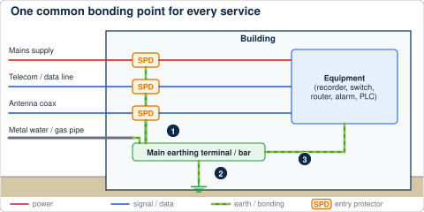
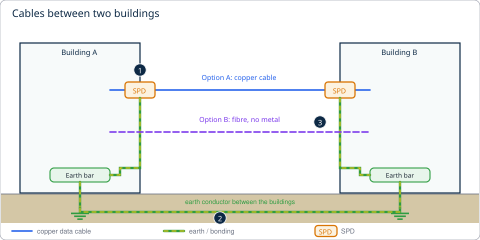

> Earthing, Bonding, Surge & Lightning Protection Library · **SHEET 05 · DATA** · content version 1.0

# Data networks, telecom entry and PoE

*Bonding of telephone, ADSL and fibre entries, multiservice surge protectors, Ethernet and PoE ports, cable shields, outdoor radios and cabling between buildings*

**Applies to:** Telephone and ADSL lines, fibre entries, routers and modems, Ethernet switches and PoE midspans, shielded and unshielded twisted-pair cabling, outdoor radios and access points, data links between buildings

📄 **PDF:** [05_data_network_poe.pdf](https://github.com/Skynet1971/earthing/raw/HEAD/docs/pdf/05_data_network_poe.pdf)

> ℹ️ Information only. Every technical statement cites a source and PDF page; it does not replace the wiring code that applies at the site, the product manuals, or a qualified and registered person.

## 1  How network equipment is damaged

NIST (US) explains that equipment connected to both power and a communications system can be damaged by a surge on either system because of the voltage difference between the two systems during the surge, and that this can happen even when each system has its own surge protector.[R1 p.14](#sources-cited-on-this-page)

| **under 1.5 m** | **10 m²** | **15 kV** |
|---|---|---|
| earthing conductor from the telecom primary protector to the main earth terminal, ITU-T K.66[R18 p.22](#sources-cited-on-this-page) | loop area ITU-T K.85 suggests always assuming for Ethernet ports in the risk assessment[R19 p.38](#sources-cited-on-this-page) | rise of telecom equipment above the power network in the ITU-T K.66 example without a common bonding point[R18 p.58](#sources-cited-on-this-page) |

- Per NIST (US), surge current flowing from the telephone entry protector to the common grounding point creates a magnetic field that couples into the loop formed by the power branch circuit, the telephone premises wiring and the bonding conductors, inducing a voltage between the power input and telephone input of the connected PC.[R1 p.20](#sources-cited-on-this-page)
- Per NIST (US), the presence or absence of a surge protector on the AC side has no effect on this power/telephone loop coupling; an effective solution is a combined protector installed by the consumer.[R1 p.20](#sources-cited-on-this-page)
- ITU-T K.66 gives the example that, without a common bonding point with short conductors, a 50 A surge from the telecom line discharging through a 300 ohm earth electrode raises the telecommunication equipment 15 kV above the power network.[R18 p.58](#sources-cited-on-this-page)
- ITU-T K.85 notes that earthed equipment can suffer internal-port damage because surge current returning to the main earth terminal through the earth wire makes the equipment rise in potential.[R19 p.37](#sources-cited-on-this-page)
- ITU-T K.98 explains that an auxiliary earth electrode not bonded to the main earth terminal is a problem because surge current in it makes the external telecommunication port rise in potential relative to the MET, which can break down equipment insulation and cause damage and a safety hazard.[R25 p.30](#sources-cited-on-this-page)
- High potential differences can occur between the building installation and incoming telecommunication lines, because those lines extend beyond several buildings.[R6 p.336](#sources-cited-on-this-page)
- In an ITU-T K.98 simulation (lightning strike to a TN-S power system, earthed equipment without primary protection, 100 ohm customer earth), the main earth terminal and the equipment SELV circuit both rose to 63 kV with respect to remote earth, a magnitude that may result in flashovers.[R25 p.47](#sources-cited-on-this-page)
- ITU-T K.85 states that if an internal equipment port is subjected to conducted lightning surges or a.c. surges there will be equipment damage and human safety issues, so correct classification of ports matters.[R19 p.12](#sources-cited-on-this-page)
- ITU-T K.66 notes that associated equipment whose ports have a low surge impedance to ground and that is connected by short cables (example given: printers on USB cables) may be damaged by circulating earth currents.[R18 p.18](#sources-cited-on-this-page)

### Where the services enter the house

- Per NIST (US), a detached house with the power drop and the telephone and/or cable TV drops at opposite ends of the house is the worst possible arrangement of the utilities for surge problems.[R1 p.11](#sources-cited-on-this-page)
- The US National Electrical Code requires the two incoming services (power and communications) to be properly bonded by a grounding conductor; NIST notes that the opposite-ends arrangement is often made worse by an unintentional violation of this.[R1 p.11](#sources-cited-on-this-page)
- Per NIST (US), the situation is worse still when an incoming service, cable TV in particular, is not bonded to the power service ground, which is a clear violation of the NEC.[R1 p.20](#sources-cited-on-this-page)

## 2  Telephone, ADSL and fibre entry

ITU-T K.66 says that locating the telecommunication primary protectors near the power mains entrance lets the earthing conductor from protector to main earth terminal be kept under 1.5 m, and that this short, low-impedance conductor reduces surge voltage differences between the telecom lines and the power system protective conductor.[R18 p.22](#sources-cited-on-this-page)

*Click the diagram to open it full size.* *Concept sketch, not a wiring diagram. (1) all services connected with low-impedance bonding conductors to the main earth terminal, low impedance being obtained by keeping them shorter than 1.5 m (ITU-T K.66)[R18 p.19](#sources-cited-on-this-page) (2) earthing connects the earth bar to earth, usually via an installed electrode (ITU-T K.98)[R25 p.27](#sources-cited-on-this-page) (3) every earth point bonded to the main earth bar, with nothing connected to a separate electrode that is not bonded to it (ITU-T K.66).[R18 p.18](#sources-cited-on-this-page)*

### One entry point, one main earth terminal

- ITU-T K.66 states that overvoltage protection requires bonding metallic services and cable screens to the building earth and installing SPDs at the building entry point on both the power and the telecommunication conductors.[R18 p.9](#sources-cited-on-this-page)
- ITU-T K.66 recommends that all metallic services (a.c. mains, telecommunication cables, gas and water pipes, CATV) and the earthing conductor enter the building at the same point, to shorten bonding conductors and reduce EMI.[R18 p.19](#sources-cited-on-this-page)
- Where services enter at different points, ITU-T K.66 requires an earthed equipotential bonding bar or bonding terminal near each entry point, each connected to an earthing system, with all the bonding bars bonded together, for example by a ring conductor.[R18 p.19](#sources-cited-on-this-page)
- ITU-T K.27: the AC power entrance, the telecommunication cable entrance and the earthing conductor entry point should be close together.[R24 p.12](#sources-cited-on-this-page)
- ITU-T K.73 says a building should have a main earthing terminal located as close as possible to the a.c. power and telecommunication cable entrance facilities.[R23 p.8](#sources-cited-on-this-page)
- ITU-T K.66 explains that its 1.5 m limit for bonding conductors is based on an assumed voltage drop of 1 kV per metre of conductor length during direct lightning strikes.[R18 p.19](#sources-cited-on-this-page)
- ITU-T K.66 Table 8-1 gives the maximum bonding conductor length as 1.5 m where direct strikes are the mechanism and 10 m for induced surges, and a maximum resistance of 1 ohm for power induction/power contact.[R18 p.19](#sources-cited-on-this-page)
- ITU-T K.85 lists non-bonded earths, difficulty installing SPDs at the building entry, and bonding wires longer than 10 m as examples of non-compliance with ITU-T K.66.[R19 p.13](#sources-cited-on-this-page)
- The 1999 US NEC limits the separation between the points of entry of power and communications to 20 feet (given as 7 meters in the source) for new installations.[R1 p.20](#sources-cited-on-this-page)
- Per NIST (US), the shifting of reference potentials is reduced by inter-system bonding of all utilities serving a residence, with the usual components for each service connection installed next to each other.[R1 p.21](#sources-cited-on-this-page)
- Per NIST (US), another way to reduce the shift in reference potentials is an integrated multi-utility surge protection device at the breaker panel covering AC power, telephone and cable TV with minimum bonding length.[R1 p.21](#sources-cited-on-this-page)
- ITU-T K.98 cites IEC 60364-4-44 section 444.5 as recommending that all protective and functional earthing conductors connect to one single main earth terminal and that all earth electrodes associated with a building be interconnected.[R25 p.30](#sources-cited-on-this-page)

### The telecom primary protector

- Per NIST (US), telephone companies generally provide a surge protector at the point where the telephone line enters the house.[R1 p.16](#sources-cited-on-this-page)
- ITU-T K.98 calls it essential that the telecommunication primary protector be bonded to the main earth terminal, preferably by a short bonding conductor.[R25 p.30](#sources-cited-on-this-page)
- ITU-T K.98 says that, as a result of the coordination requirement in ITU-T K.21, the external telecommunication port only requires a gas discharge tube bonded to the main earth terminal.[R25 p.34](#sources-cited-on-this-page)
- ITU-T K.66 warns that a telecommunication primary protector installed inside the premises creates a fire risk from overheated wiring, SPD or SPD housing if lightning strikes the telecom service line directly or the line contacts a power conductor.[R18 p.29](#sources-cited-on-this-page)
- Per Motorola R56 (2005, US practice), the primary telephone/data SPD shall be installed at the point of entry into the building, close to the electrical service entrance and the master ground bus bar.[R5 p.345](#sources-cited-on-this-page)
- Per Motorola R56 (2005, US practice), the primary telephone/data SPD ground conductor shall be as short as possible, routed as directly as possible to the ground bus or MGB, and as free of bends as possible.[R5 p.345](#sources-cited-on-this-page)
- Per US DoD guide spec UFGS 27 05 26, the primary (telecom) protector grounding conductor is bonded to the PBB and kept at least 30 cm (1 ft) from DC power cables, switchboard cable or high-frequency cables, even when in metal conduit.[R17 p.26](#sources-cited-on-this-page)

> ⛔ **DO NOT** — **Do not earth the primary protector to its own electrode**
>
> ITU-T K.66 warns that earthing telecommunication primary protectors only to a separate earth electrode is not compatible with protecting equipment and may even cause a fire in the premises or injury or death of a person using telecommunication equipment.[R18 p.22](#sources-cited-on-this-page)

> ℹ️ **NOTE** — **ADSL modems and fibre terminals**
>
> No verified fact in this library gives a rule for the ADSL modem or the fibre network terminal itself. This sheet quotes the general rules for telecommunication lines, ports and equipment; fibre is treated in the chapter on fibre and wireless.

## 3  Equipment with both a mains and a data port

NIST (US) gives as the simple solution for equipment with both power and communications connections a special surge protector that combines, in one package, input/output connections for both systems.[R1 p.14](#sources-cited-on-this-page)

- Per NIST (US), with a combined protector each link (power and communications) is fed through the protector, which is inserted between the wall receptacles and the inputs of the appliance to be protected.[R1 p.14](#sources-cited-on-this-page)
- Per NIST (US), pulling out the power cord of an appliance that stays connected to a telephone line or cable TV might not be the best idea, because the appliance loses the grounding normally provided by the power cord.[R1 p.13](#sources-cited-on-this-page)

### Multiservice surge protective devices (MSPDs)

- ITU-T K.85 defines a multiservice surge protective device (MSPD) as an SPD containing both telecommunications and mains protection, which may also include port protection for video or Ethernet.[R19 p.11](#sources-cited-on-this-page)
- ITU-T K.66 describes multiservice surge protective devices (MSPDs) as containing the SPDs for all ports, achieving the short-bond-wire requirement, being installed near the equipment so they also protect against overvoltages arising in internal wiring, and requiring coordination with the primary protector.[R18 p.29](#sources-cited-on-this-page)
- ITU-T K.66 says additional SPDs such as multiservice SPDs are sometimes installed at the terminal equipment to limit surges coupled inside the building, and their common terminal should be connected to the protective conductor near the protected equipment.[R18 p.22](#sources-cited-on-this-page)
- Per ITU-T K.66, a single MSPD suits one piece of equipment or interconnected equipment in close proximity, and in that case only the ports connected to external cables need protection.[R18 p.29](#sources-cited-on-this-page)
- Per ITU-T K.66, multiple MSPDs are needed when interconnected equipment is too far apart to share one MSPD (or it has too few outlets), and in that case all ports require protection.[R18 p.30](#sources-cited-on-this-page)
- ITU-T K.66 cautions that indiscriminate use of MSPDs may allow damage to the protected equipment and to associated equipment.[R18 p.29](#sources-cited-on-this-page)
- ITU-T K.85 says adding an MSPD with protection for all ports provides equipotential bonding for non-earthed equipment, and protection of equipment and users should be effective if the MSPD is plugged into an earthed power point.[R19 p.37](#sources-cited-on-this-page)
- ITU-T K.85 says that for earthed equipment the risk of internal-port damage from mains surge current requires either a mains primary protector or connecting all ports, external and internal, through an MSPD.[R19 p.38](#sources-cited-on-this-page)
- ITU-T K.85 says an MSPD protects equipment against surges magnetically coupled into building wiring and service lines, and may give some protection against direct strikes to the service plant only if the strike point is more than a few hundred metres from the building.[R19 p.18](#sources-cited-on-this-page)
- ITU-T K.85 summarises the two-stage scheme as: the MSPD protects the equipment and the primary (point-of-entry) protection protects the MSPD, both installed according to ITU-T K.66 when the risk assessment requires.[R19 p.15](#sources-cited-on-this-page)
- Where short bond wires cannot be installed, ITU-T K.66 allows using the shortest possible bond wires plus additional SPDs at the equipment to achieve bonding there, and these additional SPDs must be coordinated with the upstream SPDs.[R18 p.20](#sources-cited-on-this-page)

> ⚠️ **WARNING** — **An MSPD depends on an earthed socket**
>
> ITU-T K.85 warns that the MSPDs it refers to rely on a protective earth connection for safety[R19 p.15](#sources-cited-on-this-page), and that if the power point feeding an MSPD is not earthed, equipment damage may not be reduced and users face a possible lightning safety risk.[R19 p.37](#sources-cited-on-this-page)

### What ITU-T K.98 concludes for homes

- For residential buildings, ITU-T K.98 recommends, when protection is required, an MSPD or equivalent to protect equipment clusters plus primary protection at the building entry point to protect the downstream protection and the equipment wiring.[R25 p.31](#sources-cited-on-this-page)
- ITU-T K.98 concludes that the ideal installation is class II equipment, with equipment clusters protected by an MSPD and the MSPD protected by primary protection when necessary.[R25 p.35](#sources-cited-on-this-page)
- ITU-T K.98 concludes from its direct-strike simulations that telecommunication equipment not protected by primary protection will always be damaged, except for the combination of a direct strike to a TN-C power system with floating equipment.[R25 p.36](#sources-cited-on-this-page)
- In ITU-T K.98's simulations, floating (class II) equipment was always protected once primary protection was installed, regardless of the power system type and the earth resistance at the premises.[R25 p.36](#sources-cited-on-this-page)
- In ITU-T K.98 Table 2, for a strike to the telecommunication line with a TN-S power system, earthed equipment with primary protection is listed as protected only for the combination of a 100 ohm customer premises earth and a 1.5 m telecommunication bond wire.[R25 p.36](#sources-cited-on-this-page)

## 4  Ethernet and PoE ports

ITU-T K.98 says most Ethernet ports have a signal transformer that is generally sufficient against line-to-earth surges, but Power over Ethernet equipment may be more susceptible to damage, and where off-the-shelf protection is not available an engineering solution may be needed.[R25 p.35](#sources-cited-on-this-page)

### Internal and external ports

- ITU-T K.98 says it is imperative to connect inter-building cables only to external ports and intra-building cables only to internal ports.[R25 p.29](#sources-cited-on-this-page)
- ITU-T K.85 Annex B lists connecting an internal port to an external cable as a damaging practice; the remedies are to use an external interface, install an SPD to IEC 61643-21/-22, or use an isolation box.[R19 p.19](#sources-cited-on-this-page)
- ITU-T K.85 warns that extending a service to an outbuilding is a problem because equipment designed for intra-building cabling may have insufficient safety isolation and insufficient overvoltage resistibility when connected to inter-building cables.[R19 p.12](#sources-cited-on-this-page)
- For internal cable interfaces, ITU-T K.85 considers the risk quite low when the equipment at one end of the cable has a level of insulation, i.e. no earth and no power connection.[R19 p.15](#sources-cited-on-this-page)
- ITU-T K.98 notes that protecting internal ports is not as simple as protecting external ports because internal ports have no coordination requirement; such ports must be protected in accordance with IEC 61643-21 and IEC 61643-22.[R25 p.35](#sources-cited-on-this-page)
- In the ITU-T K.85 worked risk example, the Ethernet-port damage calculation was based on a vertical loop and a 1 kV withstand voltage, which the document calls most likely a worst case, so it assumed the Ethernet port would not need protection.[R19 p.35](#sources-cited-on-this-page)
- ITU-T K.85 notes that if protection is needed for ports on long internal cables it may also be needed for ports on short cables, and suggests always assuming a 10 m² loop area for Ethernet ports in the risk assessment.[R19 p.38](#sources-cited-on-this-page)
- With copper cabling of about 500 m (building backbone) or about 100 m (horizontal), a direct strike to the building can induce common-mode interference exceeding the insulation strength of a router or PC network card, so both the distributor (hub, switch, router) and the terminal equipment need protection.[R6 p.256](#sources-cited-on-this-page)
- ITU-T K.85 Annex B states that when an internal port connects to associated equipment in the same building that is bonded to a separate earth system, all earth references must be bonded to the same point, usually the protective earth, to prevent damage.[R19 p.19](#sources-cited-on-this-page)
- ITU-T K.85 Annex B lists as a damaging practice an internal port connected to an internal cable that has a gas discharge tube bonded to a separate earth; the stated solution is to remove the GDT.[R19 p.19](#sources-cited-on-this-page)

### Ethernet and PoE surge protectors

- Axis describes PoE-compatible surge protectors as diverting surges to ground before they reach the camera while still passing both data and power.[R20 p.3](#sources-cited-on-this-page)
- Axis states that most PoE surge protectors need shielded network cable in order to function properly.[R20 p.3](#sources-cited-on-this-page)
- For an outdoor PoE security device, Southwest Microwave requires an outdoor-rated surge suppressor with shielded RJ45 connections mounted within 3 feet (0.91 m) of the PoE device; it may need its own enclosure.[R10 p.1](#sources-cited-on-this-page)
- If the PoE switch is mounted indoors, Southwest Microwave requires a surge suppressor on the outside of the building before the cable enters the building.[R10 p.1](#sources-cited-on-this-page)
- TP-Link (Lightning Protection Guide for rack-mountable devices): the port rate of a signal lightning arrester must match the rate of the device port, otherwise the arrester will not work.[R29 p.8](#sources-cited-on-this-page)
- TP-Link (Lightning Protection Guide for rack-mountable devices): a signal lightning arrester should be installed near the protected device and connected to ground by a short ground cable.[R29 p.8](#sources-cited-on-this-page)
- A signal-line SPD should be installed as close as possible to the terminal device, which has a positive effect on the residual voltage.[R6 p.261](#sources-cited-on-this-page)
- If there is no low-impedance bonding between the SPD and the protected device, voltage drops of up to some kV along the bonding path add to the SPD's protection level and can destroy the device.[R6 p.262](#sources-cited-on-this-page)
- Where SPDs are used, the copper earthing conductor for equipotential bonding must be at least 6 mm2 for SPDs in information technology systems (or as the installation instructions specify).[R6 p.288](#sources-cited-on-this-page)
- TP-Link (Lightning Protection Guide for rack-mountable devices): a power lightning arrester should be used if an outdoor AC power cord is connected directly to the device.[R29 p.7](#sources-cited-on-this-page)

> ⛔ **DO NOT** — **PoE source with its positive terminal on protective earth**
>
> MikroTik warns against powering its devices from PoE power sourcing equipment whose positive terminal is connected to protective earth, because it may cause a short circuit and harm the person and the device.[R21 p.2](#sources-cited-on-this-page)

Published ratings of LAN and PoE protectors from DEHN and Ubiquiti are tabulated in the CCTV sheet of this library.

## 5  Shielded cable and shield bonding

DEHN states that a cable shield must be earthed at least at both ends, and that only a shield connected at both ends can reduce inductive and capacitive coupling.[R6 p.197](#sources-cited-on-this-page)

- Earthing a cable shield at only one end attenuates capacitive interference fields but gives no protection against the electromagnetic induction caused by lightning strikes.[R6 p.198](#sources-cited-on-this-page)
- Shielded data cables must be earthed at both ends.[R6 p.321](#sources-cited-on-this-page)
- For a cable shield to be credited with carrying lightning current, the shield must be connected at both cable ends to the main equipotential bonding system in a lightning-current-carrying manner.[R6 p.184](#sources-cited-on-this-page)
- ITU-T K.66 says the shields of all cables entering the building should be bonded directly to the main earth terminal or equipotential bonding bar; an SPD may be used instead to give galvanic isolation if corrosion requires it.[R18 p.19](#sources-cited-on-this-page)
- MikroTik advises using shielded cables with devices that have shielded connectors, because they give better immunity.[R21 p.1](#sources-cited-on-this-page)
- Per the South African WAPA high-site guideline, data connections should be made using only screened twisted pair cable.[R13 p.28](#sources-cited-on-this-page)
- Per the South African WAPA high-site guideline, only metal-bodied cable-end connectors should be used on RJ45 cabled connections.[R13 p.28](#sources-cited-on-this-page)
- Southwest Microwave specifies Cat5e or Cat6 shielded twisted Ethernet cable with shielded RJ45 connectors, not longer than 100 m (328 ft), routed through a permanently earthed metal conduit.[R10 p.1](#sources-cited-on-this-page)
- Axis states the shield only works if it has an unbroken path to ground through the power sourcing equipment (PSE).[R20 p.2](#sources-cited-on-this-page)
- Where several network cables are joined to reach a camera, Axis requires every cable, patch panel and coupling in the path to be shielded.[R20 p.3](#sources-cited-on-this-page)
- Twisting a cable shield into a 'pig tail' for connection in a terminal block is particularly critical for low-impedance shield earthing.[R6 p.200](#sources-cited-on-this-page)
- ITU-T K.27: the CBN makes it practical to bond cable shields and coaxial outer conductors at both ends, because the CBN's parallel low-impedance path carries most of the current driven by potential differences.[R24 p.13](#sources-cited-on-this-page)
- ITU-T K.27: surge coupling into indoor signal or power cabling is generally reduced by running the cables close to CBN elements.[R24 p.13](#sources-cited-on-this-page)

### Both ends, one end, or isolated

| Arrangement | What the source says | Source |
|---|---|---|
| Earthed at both ends | Connection of both ends of metallic cable screens to the main earthing terminal is required if high unbalanced currents are expected due to different earthing potentials, with precautions taken to limit such currents.[R23 p.6](#sources-cited-on-this-page) | ITU-T K.73 |
| Earthed at both ends on a CBN | The common bonding network makes it practical to bond shields and coaxial outer conductors at both ends, because its parallel low-impedance path carries most of the current.[R24 p.13](#sources-cited-on-this-page) | ITU-T K.27 |
| Earthed at one end only | Attenuates capacitive interference fields but gives no protection against the electromagnetic induction caused by lightning strikes.[R6 p.198](#sources-cited-on-this-page) | DEHN |
| One end earthed, other end insulated | The non-earthed end is protected against direct contact and labelled to warn of a potential electric shock risk.[R23 p.9](#sources-cited-on-this-page) | ITU-T K.73 |
| Direct at one point, indirect at the far ends | Shields earthed directly at one central point and indirectly at the far ends through isolating spark gaps, which block equalising currents in surge-free operation.[R6 p.199](#sources-cited-on-this-page) | DEHN |
| Screen isolated from earth (between buildings) | Galvanic isolation: the cable covering must then withstand the screen-to-earth potential difference[R23 p.9](#sources-cited-on-this-page); an SPD between screen and earth is required if the insulation cannot withstand the expected lightning overvoltage.[R23 p.9](#sources-cited-on-this-page) | ITU-T K.73 |
| Shield bonded through an SPD | An SPD may be used instead of a direct bond to give galvanic isolation if corrosion requires it.[R18 p.19](#sources-cited-on-this-page) | ITU-T K.66 |

*Each row is the arrangement as the cited source describes it; the sources do not rank these arrangements against each other.*

> ⚠️ **WARNING** — **Equalising currents on shields bonded at both ends**
>
> DEHN notes that where a shield is earthed at both ends on earth-termination systems at different potentials, low-frequency equalising currents of up to a few amperes can flow in the shield, in extreme cases causing cable fires.[R6 p.199](#sources-cited-on-this-page) ITU-T K.73 uses a parallel bonding conductor to reduce the current on an inter-building cable screen.[R23 p.10](#sources-cited-on-this-page)

## 6  Earthing switches, routers and midspans

Axis calls proper grounding of the PSE (PoE switch or midspan) imperative for the cable shield to protect the camera.[R20 p.3](#sources-cited-on-this-page)

- Axis says its PoE midspan should always be plugged into a grounded socket so that the cable shield can function.[R20 p.3](#sources-cited-on-this-page)[R20 p.3](#sources-cited-on-this-page)
- Axis notes that a desktop switch may have no ground connection through its power lead, in which case the switch must be grounded separately.[R20 p.3](#sources-cited-on-this-page)
- TP-Link (Lightning Protection Guide for rack-mountable devices): in a normal environment the device can be grounded via the PE (protective earth) conductor of its AC power supply.[R29 p.5](#sources-cited-on-this-page)
- TP-Link (Lightning Protection Guide for rack-mountable devices): before relying on the power cord's PE conductor for grounding, make sure the PE in the electrical outlet is itself well grounded.[R29 p.6](#sources-cited-on-this-page)
- TP-Link (Lightning Protection Guide for rack-mountable devices): in an equipment room where a grounding bar is available, connecting the device's grounding terminal to the grounding bar is recommended.[R29 p.6](#sources-cited-on-this-page)
- TP-Link (Lightning Protection Guide for rack-mountable devices): for equipotential bonding use a 10 AWG or larger ground cable, as short as possible, and a grounding bar to establish the equipotential bonding point.[R29 p.7](#sources-cited-on-this-page)
- ITU-T K.85 identifies four equipment earthing methods: no earthing, earthing via the mains plug, hard-wired bonding to protective earth, and connection to a stand-alone earthing system/electrode.[R19 p.14](#sources-cited-on-this-page)
- ITU-T K.85 says its earthing method 4 (a stand-alone earthing system/electrode) is most likely unsuitable for customer premises equipment because of the consequences of not being bonded to protective earth.[R19 p.14](#sources-cited-on-this-page)
- Per US DoD guide spec UFGS 27 05 26, plugging equipment in is not enough: earthing through the AC power cord does not meet the specification, and IT equipment must have a supplementary, dedicated ground path in addition to its power ground.[R17 p.22](#sources-cited-on-this-page)

Bonding of equipment racks and rack-mounted switches is treated in the racks and cabinets sheet of this library.

## 7  Outdoor radios and access points

MikroTik requires that towers and masts carrying the shielded cable installation, the antennas and the router itself are all properly grounded.[R21 p.1](#sources-cited-on-this-page)

### MikroTik

- MikroTik requires lightning arresters on all external antenna cables, near or on the antennas, to prevent equipment damage and human injury.[R21 p.1](#sources-cited-on-this-page)
- MikroTik notes that lightning arresters are not effective unless they are properly grounded.[R21 p.1](#sources-cited-on-this-page)
- MikroTik specifies 2.5-4 mm2 copper wire (AWG 12-14) with corrosion-resistant connectors for grounding its outdoor routers.[R21 p.1](#sources-cited-on-this-page)
- MikroTik says the grounding wire should go from the RouterBOARD's grounding attachment point (where provided) to the base of the tower.[R21 p.1](#sources-cited-on-this-page)
- MikroTik allows the antenna's grounding wire to be connected near the RouterBOARD outdoor case and joined to the same grounding wire as the RouterBOARD.[R21 p.1](#sources-cited-on-this-page)
- MikroTik tells installers to make sure the grounding infrastructure they connect to is fully functional and not merely decorative.[R21 p.1](#sources-cited-on-this-page)

### Ubiquiti (Ethernet surge protector datasheet)

- Ubiquiti (ETH-SP-G2 Ethernet surge protector datasheet): two surge protectors should be installed on an outdoor Ethernet run: one near the outdoor device (CPE) and the other at the entry point to the building.[R34 p.2](#sources-cited-on-this-page)
- Ubiquiti (ETH-SP-G2 Ethernet surge protector datasheet): installation method: attach the protector to a grounded pole, drill a pilot hole into the pole, fasten the ground screw, then connect the Ethernet cables.[R34 p.2](#sources-cited-on-this-page)
- Ubiquiti (ETH-SP-G2 Ethernet surge protector datasheet): the protector is for PoE or non-PoE devices at connection speeds up to 1 Gbps and has two passive surge-protected RJ45 connections.[R34 p.2](#sources-cited-on-this-page)

### WAPA high-site guideline (South Africa)

- Per the South African WAPA high-site guideline, where outdoor radio equipment connects to high-value indoor systems, galvanic isolation by an optical fibre link between outdoor and indoor equipment should be seriously considered to stop lightning-induced surges reaching the indoor equipment.[R13 p.22](#sources-cited-on-this-page)
- Per the South African WAPA high-site guideline, surge suppressors and earthing clamps should be fitted to RF, IF, data and power cables and connected by the shortest path to a common site earthing system.[R13 p.28](#sources-cited-on-this-page)
- Per the South African WAPA high-site guideline, all indoor and outdoor equipment, including antennas, must have individual earthing connections; daisy-chaining of earthing connections is not permitted.[R13 p.21](#sources-cited-on-this-page)
- Per the South African WAPA high-site guideline, all lightning protection units (surge protectors) must be earthed at the point of entry into the equipment shelter.[R13 p.21](#sources-cited-on-this-page)

### Motorola R56 (US practice)

- Per Motorola R56 (2005, US practice), access points and wireless routers mounted on the side of a building shall be bonded directly to the building's common grounding electrode system with 16 mm2 (#6 AWG) or coarser copper.[R5 p.179](#sources-cited-on-this-page)
- Per Motorola R56 (2005, US practice), SPDs should be installed on both ends of Ethernet, Power-over-Ethernet and AC cable runs serving pole-mounted access points and ground-based cabinets.[R5 p.354](#sources-cited-on-this-page)

> ℹ️ **NOTE** — **Radio product manuals**
>
> Of Ubiquiti's documents, only the Ethernet surge protector datasheet is among the sources of this library; no Ubiquiti radio installation manual is. Masts and antenna cables are treated in the antennas sheet.

## 8  Cabling between buildings

ITU-T K.73 explains that when equipment in different buildings is interconnected, current can flow on the cable screen because of the potential difference between the buildings' earthing systems, damaging the cable or equipment and injuring people.[R23 p.9](#sources-cited-on-this-page)

*Click the diagram to open it full size.* *Concept sketch, not a wiring diagram. Option A, copper: (1) Motorola R56 (US practice): in lightning-prone areas a primary SPD on each end of an inter-building telephone/data cable run[R5 p.345](#sources-cited-on-this-page); ITU-T K.66: the telecommunications equipment of each building earthed and protected as for an individual building[R18 p.32](#sources-cited-on-this-page) (2) ITU-T K.73: a parallel bonding conductor routed close to the cable if the fault-condition current through the screen is unacceptable[R23 p.10](#sources-cited-on-this-page); Motorola R56 (US practice): buildings less than 61 m apart linked by metallic-shielded cables should share one grounding electrode system or have their systems interconnected by two buried conductors[R5 p.177](#sources-cited-on-this-page). Option B: (3) DEHN: optical fibre cables should be used between different buildings.[R6 p.322](#sources-cited-on-this-page)*

- ITU-T K.73 notes that if lightning strikes a building, part of the lightning current flows through the screen of a cable to another building and can damage the cable, the equipment and people.[R23 p.9](#sources-cited-on-this-page)
- ITU-T K.73 does not recommend connecting a metallic cable between two buildings for privately owned telecommunication equipment (e.g. ADSL modem and computer), as it may cause safety or electrical problems.[R23 p.10](#sources-cited-on-this-page)
- ITU-T K.85 warns that extending a service to an outbuilding is a problem because equipment designed for intra-building cabling may have insufficient safety isolation and insufficient overvoltage resistibility when connected to inter-building cables.[R19 p.12](#sources-cited-on-this-page)
- ITU-T K.98 says it is imperative to connect inter-building cables only to external ports and intra-building cables only to internal ports.[R25 p.29](#sources-cited-on-this-page)
- ITU-T K.98 warns that particular problems may occur where equipment is connected to equipment in another building on the same site, and refers to ITU-T K.73 for solutions.[R25 p.34](#sources-cited-on-this-page)
- ITU-T K.73 states that the cable screen generally cannot act as the parallel bonding conductor because it is not designed to cope with a large current.[R23 p.10](#sources-cited-on-this-page)
- In ITU-T K.73's appendix on medium-voltage earth faults, a copper parallel bonding conductor of at least 50 mm2 is recommended between the buildings' earthing systems when the potential difference cannot be determined.[R23 p.17](#sources-cited-on-this-page)
- A bus cable run between buildings in a lightning-current-carrying shielded duct or metal pipe earthed at both ends does not need lightning equipotential bonding; surge arresters are then sufficient.[R6 p.315](#sources-cited-on-this-page)
- Telecommunication lines are best installed in electrically connected, completely enclosed metal ducts that are earthed with low impedance as frequently as possible, at least at the beginning and the end.[R6 p.264](#sources-cited-on-this-page)
- ITU-T K.85 notes that if two separate earth electrodes are not bonded together, a potential difference may arise between them and damage the ports of the equipment connected to each; a ring earth is offered as a solution.[R19 p.18](#sources-cited-on-this-page)

> ℹ️ **NOTE** — **Different earthing and power feeding**
>
> For buildings with different earthing and power feeding, ITU-T K.73 calls for the cable screen to be connected to the main earthing terminal at the entrance of each building and for measurement of the possible current between the two METs.[R23 p.10](#sources-cited-on-this-page)

## 9  Fibre and wireless as isolation

ITU-T K.85 names wireless links within the home network as a method of protection and says an optical fibre solution could also be used.[R19 p.16](#sources-cited-on-this-page)

- Optical fibre cables should be used for information technology cabling between different buildings (campus backbone).[R6 p.322](#sources-cited-on-this-page)
- Where optical fibre is used between campus and building distributors, no SPDs are needed on the field side, but any metal rodent protection on the fibre cable must be integrated into the lightning protection system.[R6 p.256](#sources-cited-on-this-page)
- ITU-T K.66 Appendix II lists metal-free fibre optic cables for signal links between Class I equipment as a mitigation measure in existing TN-C or TN-C-S installations.[R18 p.60](#sources-cited-on-this-page)
- Per the South African WAPA high-site guideline, where outdoor radio equipment connects to high-value indoor systems, galvanic isolation by an optical fibre link between outdoor and indoor equipment should be seriously considered to stop lightning-induced surges reaching the indoor equipment.[R13 p.22](#sources-cited-on-this-page)
- Metal elements of optical fibre cables (sheath, core members) must be connected to the equipotential bonding bar either directly or via an SPD.[R6 p.183](#sources-cited-on-this-page)
- Per Motorola R56 (2005, US practice), no primary SPD is required for fibre circuits entering a building, but any metallic shield, jacket or drain conductor of the fibre cable shall be bonded to the master ground bus bar (MGB).[R5 p.346](#sources-cited-on-this-page)
- ITU-T K.85 notes that in an optical fibre service, a lightning strike to the fibre cable's metallic tracer/locate wire may damage equipment, depending on how that wire is terminated.[R19 p.29](#sources-cited-on-this-page)

## 10  Routing and separation of data and power cables

To minimise induction loops inside a building, DEHN says cables and metal pipes should enter the building at the same location[R6 p.182](#sources-cited-on-this-page), and power and data lines should be laid spatially close together, but shielded.[R6 p.182](#sources-cited-on-this-page)

### Inside the building

- Shielded data cables and power lines should share the same riser duct, no more than 20 cm apart; separate opposing riser ducts must be avoided (to limit induction loops).[R6 p.321](#sources-cited-on-this-page)
- Unprotected cable upstream of an SPD must be strictly separated or shielded from the protected cable downstream of it, otherwise interference is coupled onto the protected side.[R6 p.262](#sources-cited-on-this-page)
- Power and data lines must keep the safety (separation) distance from air-terminations and down conductors of an external LPS and must not be routed in parallel with down conductors.[R6 p.321](#sources-cited-on-this-page)
- TP-Link (Lightning Protection Guide for rack-mountable devices): the main cable should be laid in the metal raceway of the access shaft and the loop area formed by the cable kept as small as possible.[R29 p.4](#sources-cited-on-this-page)
- Telecommunication lines are best installed in electrically connected, completely enclosed metal ducts that are earthed with low impedance as frequently as possible, at least at the beginning and the end.[R6 p.264](#sources-cited-on-this-page)
- Per US DoD guide spec UFGS 27 05 26, the primary (telecom) protector grounding conductor is bonded to the PBB and kept at least 30 cm (1 ft) from DC power cables, switchboard cable or high-frequency cables, even when in metal conduit.[R17 p.26](#sources-cited-on-this-page)
- Per Motorola R56 (2005, US practice), all ground conductors shall be kept at least 51 mm (2 in.) away from conductors of other cable groups.[R5 p.216](#sources-cited-on-this-page)
- DEHN rooftop-PV white paper (WPX029, 2022): data or sensor lines must not be routed across several strings where they would form large conductor loops with the string lines.[R44 p.2](#sources-cited-on-this-page)

### Distances in TP-Link's rack-device guide

- TP-Link (Lightning Protection Guide for rack-mountable devices): where no metal raceway is used, the table gives the minimum distance between an Ethernet cable and a lightning down-conductor as a parallel net length L of 1000 mm and a parallel-overlapping net height H of 300 mm; for a PE conductor 50 mm and 20 mm, and for a service pipe 150 mm and 20 mm.[R29 p.4](#sources-cited-on-this-page)
- TP-Link (Lightning Protection Guide for rack-mountable devices): in the table of distances between Ethernet cable and high-power lines, for a power line below 2 kVA the minimum value (column 'Min Parallel Length') is 130 mm for parallel cabling, 70 mm if one of the two is in a grounded metal raceway or pipe, and 10 mm if both are.[R29 p.4](#sources-cited-on-this-page)

### Outdoor runs (TP-Link)

- TP-Link (Lightning Protection Guide for rack-mountable devices): using Ethernet cables outdoors is not recommended; when cabling outdoors a signal lightning arrester should be used.[R29 p.3](#sources-cited-on-this-page)
- TP-Link (Lightning Protection Guide for rack-mountable devices): aerial cabling without safeguard is not allowed.[R29 p.3](#sources-cited-on-this-page)
- TP-Link (Lightning Protection Guide for rack-mountable devices): cabling down the outside of a building to connect network devices on different floors is not allowed.[R29 p.3](#sources-cited-on-this-page)
- TP-Link (Lightning Protection Guide for rack-mountable devices): outdoor cables should be buried and brought indoors through the basement, with a steel wire laid underground along the pipe and connected to the building's lightning protection terminal for shielding.[R29 p.3](#sources-cited-on-this-page)
- TP-Link (Lightning Protection Guide for rack-mountable devices): an aerial cable should pass through a metal pipe at least 15 m long before entering the building, with both ends of the pipe grounded, and a signal lightning arrester installed on the port before connecting the cable.[R29 p.3](#sources-cited-on-this-page)
- TP-Link (Lightning Protection Guide for rack-mountable devices): STP cables need not be laid in pipes, but the shield of the STP cable should be well grounded and a signal lightning arrester installed on the port.[R29 p.4](#sources-cited-on-this-page)

## 11  Where the sources disagree

The sources were written for different countries and kinds of site. Where they conflict, the wiring code that applies at the site decides; this table shows the conflict rather than choosing for you.

| Question | One source says | Other sources say |
|---|---|---|
| Power and data cables: together or apart? | DEHN: power and data lines laid spatially close together, but shielded[R6 p.182](#sources-cited-on-this-page); shielded data cables and power lines in the same riser duct, no more than 20 cm apart.[R6 p.321](#sources-cited-on-this-page) | TP-Link rack guide: minimum distances between Ethernet cable and power lines, smaller when the cables are in grounded metal raceways[R29 p.4](#sources-cited-on-this-page); TP-Link Omada: signal lines at least 50 m from high-voltage equipment or cables.[R41 p.4](#sources-cited-on-this-page) |
| Does an Ethernet port need a protector? | ITU-T K.98: the signal transformer is generally sufficient against line-to-earth surges; PoE equipment may need an engineering solution where off-the-shelf protection is not available[R25 p.35](#sources-cited-on-this-page); the ITU-T K.85 worked example assumed the Ethernet port would not need protection.[R19 p.35](#sources-cited-on-this-page) | DEHN: with copper cabling of about 100 m (horizontal) a direct strike to the building can exceed the insulation strength of a network card, so distributor and terminal equipment need protection[R6 p.256](#sources-cited-on-this-page); ITU-T K.85 suggests always assuming a 10 m² loop for Ethernet ports.[R19 p.38](#sources-cited-on-this-page) |
| Ethernet cable outdoors? | TP-Link: using Ethernet cables outdoors is not recommended; when cabling outdoors a signal lightning arrester should be used.[R29 p.3](#sources-cited-on-this-page) | Southwest Microwave specifies shielded outdoor Ethernet in permanently earthed metal conduit[R10 p.1](#sources-cited-on-this-page); Ubiquiti fits one protector near the outdoor device and one at the building entry.[R34 p.2](#sources-cited-on-this-page) |
| Shield earthed at both ends? | DEHN: a cable shield must be earthed at least at both ends.[R6 p.197](#sources-cited-on-this-page) | ITU-T K.73 also describes a screen bonded at one end with the other end insulated[R23 p.9](#sources-cited-on-this-page), and galvanic isolation of the screen between buildings.[R23 p.9](#sources-cited-on-this-page) |
| Copper cable between buildings? | ITU-T K.73 does not recommend a metallic cable between two buildings for privately owned telecommunication equipment[R23 p.10](#sources-cited-on-this-page); DEHN: optical fibre should be used between buildings.[R6 p.322](#sources-cited-on-this-page) | Motorola R56 (US practice): primary SPD on each end of the run in lightning-prone areas[R5 p.345](#sources-cited-on-this-page); DEHN: a bus cable in a shielded duct or metal pipe earthed at both ends needs only surge arresters.[R6 p.315](#sources-cited-on-this-page) |
| Separate earth for surveillance network equipment? | TP-Link Omada: the grounding system for surveillance equipment should be separate from the grounding systems of other electrical equipment.[R41 p.3](#sources-cited-on-this-page) | ITU-T K.66: every earth point bonded to the main earth bar[R18 p.18](#sources-cited-on-this-page); ITU-T K.85: a stand-alone earth electrode is most likely unsuitable for customer premises equipment.[R19 p.14](#sources-cited-on-this-page) |

## 12  Installation checklist

- [ ] Telecom primary protector near the mains entrance, bonded to the main earth terminal with a conductor under 1.5 m.[R18 p.22](#sources-cited-on-this-page)
- [ ] No separate earth electrode for the primary protector; every earth point bonded to the main earth bar.[R18 p.22](#sources-cited-on-this-page)[R18 p.18](#sources-cited-on-this-page)
- [ ] Equipment with mains and data ports fed through a combined (multiservice) protector plugged into an earthed power point.[R1 p.14](#sources-cited-on-this-page)[R19 p.37](#sources-cited-on-this-page)
- [ ] Inter-building cables connected only to external ports, intra-building cables only to internal ports.[R25 p.29](#sources-cited-on-this-page)
- [ ] Signal lightning arrester matches the port rate, is installed near the protected device and has a short ground cable.[R29 p.8](#sources-cited-on-this-page)[R29 p.8](#sources-cited-on-this-page)
- [ ] Shielded cable with shielded or metal-bodied connectors; shield earthing arrangement chosen with equalising currents in mind.[R13 p.28](#sources-cited-on-this-page)[R13 p.28](#sources-cited-on-this-page)[R6 p.199](#sources-cited-on-this-page)
- [ ] Switch or PoE midspan earthed: earthed socket, or a separate earth conductor for a switch without one.[R20 p.3](#sources-cited-on-this-page)[R20 p.3](#sources-cited-on-this-page)
- [ ] Outdoor radio, antennas and mast grounded; lightning arresters on all external antenna cables.[R21 p.1](#sources-cited-on-this-page)[R21 p.1](#sources-cited-on-this-page)
- [ ] Between buildings: optical fibre, or copper with an SPD on each end and a parallel bonding conductor where screen current is unacceptable.[R6 p.322](#sources-cited-on-this-page)[R5 p.345](#sources-cited-on-this-page)[R23 p.10](#sources-cited-on-this-page)
- [ ] Power and data lines laid close together and shielded; protected and unprotected cables kept apart.[R6 p.182](#sources-cited-on-this-page)[R6 p.262](#sources-cited-on-this-page)
- [ ] No cables run down the outside of the building to connect devices on different floors.[R29 p.3](#sources-cited-on-this-page)

## Sources cited on this page

`[R18 p.12]` = reference 18 below, PDF page 12 (page index of the PDF file). Each cited statement was checked against a verbatim quote from that page.

| Ref | Document | PDF pages cited |
|---|---|---|
| R1 | **Surges Happen! How to Protect the Appliances in Your Home (NIST Special Publication 960-6)** — National Institute of Standards and Technology (USA) · May 2001 · USA · [link](https://nvlpubs.nist.gov/nistpubs/Legacy/SP/nistspecialpublication960-6.pdf) | 11, 13-14, 16, 20-21 |
| R5 | **Standards and Guidelines for Communication Sites (R56), 68P81089E50-B** — Motorola, Inc. · 9/1/05 (2005) · USA practice (AWG sizes) · [link](https://www.blm.gov/sites/blm.gov/files/Lands_ROW_Motorola_R56_2005_manual.pdf) | 177, 179, 216, 345-346, 354 |
| R6 | **Lightning Protection Guide, 3rd updated edition** — DEHN + SÖHNE · 2014 · IEC / EN 62305 (Germany) · [link](https://www.dehn-international.com/sites/default/files/media/files/lpg_en_complete.pdf) | 182-184, 197-200, 256, 261-262, 264, 288, 315, 321-322, 336 |
| R10 | **Technical Note #1003: Best Practices for Surge and Lightning Suppression of POE Devices** — Southwest Microwave, Inc. · not stated in document · USA · [link](https://southwestmicrowave.com/pdfs/1003-Best-Practices-for-Surge-and-Lightning-Suppression.pdf) | 1 |
| R13 | **Wireless High Site Engineering Guideline V1.0.0** — Wireless Access Providers' Association (South Africa) · V1.0.0, 2014-07-21 · South Africa · [link](https://wapa.org.za/sites/default/files/2018-08/WAPA%20Wireless%20High%20Site%20Engineering%20Guideline%20V1%200%200%2020140721.pdf) | 21-22, 28 |
| R17 | **UFGS-27 05 26 Grounding and Bonding for Communications Systems** — USACE / NAVFAC / AFCEC (US Department of Defense) · November 2025 · USA (guide specification with designer-selectable options) · [link](https://www.wbdg.org/FFC/DOD/UFGS/UFGS%2027%2005%2026.pdf) | 22, 26 |
| R18 | **Recommendation ITU-T K.66: Protection of customer premises from overvoltages** — International Telecommunication Union · 11/2019 · International · [link](https://www.itu.int/rec/T-REC-K.66-201911-I) | 9, 18-20, 22, 29-30, 32, 58, 60 |
| R19 | **Recommendation ITU-T K.85: Requirements for the mitigation of lightning effects on home networks installed in customer premises** — International Telecommunication Union · 11/2011 · International · [link](https://www.itu.int/rec/T-REC-K.85-201111-I) | 11-16, 18-19, 29, 35, 37-38 |
| R20 | **Power surges (white paper, web page)** — Axis Communications · web page as fetched 2026-11-23 · International · [link](https://whitepapers.axis.com/en/power-surges) | 2-3 |
| R21 | **Grounding (RouterOS documentation, hardware section)** — MikroTik · page last updated 23 September 2025 · International · [link](https://help.mikrotik.com/docs/display/ROS/Grounding) | 1-2 |
| R23 | **Recommendation ITU-T K.73: Shielding and bonding for cables between buildings** — International Telecommunication Union · 11/2019 · International · [link](https://www.itu.int/rec/T-REC-K.73-201911-I) | 6, 8-10, 17 |
| R24 | **Recommendation ITU-T K.27: Bonding configurations and earthing inside a telecommunication building** — International Telecommunication Union · 03/2015 · International · [link](https://www.itu.int/rec/T-REC-K.27-201503-I) | 12-13 |
| R25 | **Recommendation ITU-T K.98: Overvoltage protection guide for telecommunication equipment installed in customer premises** — International Telecommunication Union · 08/2014 · International · [link](https://www.itu.int/rec/T-REC-K.98-201408-I) | 27, 29-31, 34-36, 47 |
| R29 | **Lightning Protection Guide: Rack-mountable Devices, 1910012320 REV1.0.1** — TP-Link Technologies Co., Ltd. · December 2017 · International · [link](https://static.tp-link.com/configurationguide/lightning_protection_guide.pdf) | 3-8 |
| R34 | **Ethernet Surge Protector ETH-SP-G2: datasheet** — Ubiquiti Networks, Inc. · 2017 · International · [link](https://dl.ubnt.com/datasheets/ETH-SP/ETH-SP-G2_DS.pdf) | 2 |
| R41 | **Waterproof and Lightning Protection Installation Guide for Omada Security Devices** — TP-Link (Omada Network Support) · web page as fetched 2026-11-23 · International · [link](https://support.omadanetworks.com/za/document/44713/) | 3-4 |
| R44 | **White paper WPX029: Lightning and surge protection for rooftop photovoltaic systems** — DEHN SE · WPX029/EN/0422 (April 2022) · IEC / EN (Germany) · [link](https://www.dehn-africa.com/sites/default/files/media/files/photovoltaic-wpx029-en.pdf) | 2 |

*Generated from `content/docs/05_data_network_poe.yaml` on 2026-11-23. Do not edit this page in the wiki; edit the content file.*
