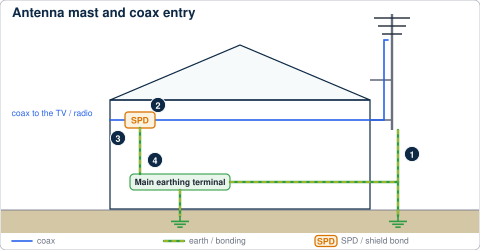

> Earthing, Bonding, Surge & Lightning Protection Library · **SHEET 06 · ANTENNAS** · content version 1.0

# Antennas, masts and dishes

*Earthing of antenna masts and towers, bonding of coaxial cable shields and surge protection at the building entry*

**Applies to:** Roof and wall antennas, antenna masts near the building, radio towers and high sites, coaxial antenna cables, satellite dishes, outdoor radios and cameras on masts

📄 **PDF:** [06_antennas_masts_dishes.pdf](https://github.com/Skynet1971/earthing/raw/HEAD/docs/pdf/06_antennas_masts_dishes.pdf)

> ℹ️ Information only. Every technical statement cites a source and PDF page; it does not replace the wiring code that applies at the site, the product manuals, or a qualified and registered person.

## 1  Scope and risk

ITU-T K.71 covers two antenna cases when direct-strike protection is required: an antenna on the building, and an antenna on a mast near the building at a maximum distance of about ten metres.[R22 p.7](#sources-cited-on-this-page)

| **under 1.5 m** | **16 mm²** | **2 m** |
|---|---|---|
| bond wire from cable screen and SPD to the main earth terminal, ITU-T K.71[R22 p.24](#sources-cited-on-this-page) | minimum copper antenna mast earthing conductor, DEHN[R6 p.296](#sources-cited-on-this-page) | clearance from LPS components for an antenna not bonded to the LPS, one- or two-storey buildings, ITU-T K.71[R22 p.18](#sources-cited-on-this-page) |

- Per ITU-T K.71, when the risk of loss of human life for the building with its antenna is below the tolerable risk, the site is considered inherently protected against direct lightning and the antenna need only be protected against mains contact.[R22 p.11](#sources-cited-on-this-page)
- One prerequisite of ITU-T K.71's generic low-risk roof-antenna assessment is that the top of the antenna is attached to the outside of the building, less than 2.5 m above the gutter line and below the peak of the roof.[R22 p.27](#sources-cited-on-this-page)
- Antenna systems inside a building, or located at least 2 m below the roof and protruding no more than 1.5 m from the wall, do not need an earthing conductor, although equipotential bonding is still required.[R6 p.293](#sources-cited-on-this-page)
- An earthed antenna standpipe is no substitute for a lightning protection system.[R6 p.292](#sources-cited-on-this-page)
- ITU-T K.71 prohibits installing antennas on buildings whose roofs are covered with highly flammable materials such as thatch or reed-like material.[R22 p.16](#sources-cited-on-this-page)

### Contact with mains conductors

- ITU-T K.71 warns that contact between an antenna or its cabling and a phase conductor can cause fire from overheating or electric shock; protection is by bonding the antenna system to the main earthing bar or by adequate isolation.[R22 p.16](#sources-cited-on-this-page)
- ITU-T K.71 treats a minimum 3 m horizontal clearance between an antenna installation (and its lead-in cable) and aerial power line conductors as conservative.[R22 p.16](#sources-cited-on-this-page)
- ITU-T K.71 says the antenna lead-in cable should not cross over or under overhead mains power service lines.[R22 p.16](#sources-cited-on-this-page)
- ITU-T K.71 says that where adequate isolation of an antenna installation from mains conductors cannot be maintained, the installation should be bonded to the building earthing system.[R22 p.16](#sources-cited-on-this-page)
- ITU-T K.71 notes that, for the protective conductor bonding an antenna system to the main earth terminal against mains contact, compliance with IEC 60364-5-54 can in most cases be achieved with at least 2.5 mm2 copper (16 mm2 aluminium) if mechanically protected, or 4 mm2 copper (16 mm2 aluminium) if not.[R22 p.21](#sources-cited-on-this-page)

## 2  Earthing the mast

On a building without a lightning protection system, DEHN states that the antenna mast must be earthed.[R6 p.294](#sources-cited-on-this-page)

*Click the diagram to open it full size.* *Concept sketch, not a product installation drawing. (1) antenna mast earthed (DEHN)[R6 p.294](#sources-cited-on-this-page); ITU-T K.71 requires the mast bonding conductor to be installed straight and vertical, giving the shortest, most direct path[R22 p.20](#sources-cited-on-this-page) (2) coaxial cable outer conductor bonded to the bonding bar at the entrance of the building (ITU-T K.71)[R22 p.19](#sources-cited-on-this-page) (3) SPD at the point of entry, with the bond wire from cable screen and SPD to the main earth terminal shorter than 1.5 m (ITU-T K.71)[R22 p.24](#sources-cited-on-this-page) (4) lowest point of the antenna cable shields connected to the main earthing busbar by copper bonding conductors of at least 4 mm² (DEHN).[R6 p.294](#sources-cited-on-this-page)*

### Buildings with and without a lightning protection system

- ITU-T K.71 requires that where a building has a lightning protection system, the antenna system is either bonded to the LPS or adequately isolated or insulated from it.[R22 p.17](#sources-cited-on-this-page)
- Where an antenna is to be bonded to an existing LPS, ITU-T K.71 says to bond the antenna mast to the building's LPS and electrical safety earthing system.[R22 p.17](#sources-cited-on-this-page)
- ITU-T K.71 says that for an antenna not bonded to the LPS, a 2 m clearance from LPS components including down conductors should be adequate for buildings of one or two storeys.[R22 p.18](#sources-cited-on-this-page)
- For an antenna on a mast near the building where lightning protection is not required (R1 ≤ RT1), ITU-T K.71 says protection may only be needed for electrical safety and it is not necessary to bond the tower earth electrode system to the building electrical installation earth.[R22 p.18](#sources-cited-on-this-page)
- ITU-T K.71 requires an antenna mast bonding conductor to be installed straight and vertical so that it gives the shortest, most direct path to the LPS or building earthing system.[R22 p.20](#sources-cited-on-this-page)

> [!CAUTION]
> **DO NOT: No borrowed conductors for antenna bonding**
>
> ITU-T K.71 forbids using the electricity supply's protective earth and/or neutral conductors, or the outer conductor of any coaxial cable, as the antenna bonding conductor; a dedicated bonding conductor must be used.[R22 p.21](#sources-cited-on-this-page)

### Conductor sizes as published

| Conductor | Minimum size as published | Source |
|---|---|---|
| Antenna bonding conductor for the full lightning current, bare | 14 mm² copper, 22 mm² aluminium or 50 mm² steel[R22 p.21](#sources-cited-on-this-page) | ITU-T K.71 |
| The same, insulated, enclosed or close to flammable material | 35 mm² copper, 55 mm² aluminium or 125 mm² steel[R22 p.21](#sources-cited-on-this-page) | ITU-T K.71 |
| Antenna bonding conductor for a partial lightning current | 5 mm² copper, 8 mm² aluminium or 16 mm² steel[R22 p.21](#sources-cited-on-this-page) | ITU-T K.71 |
| Protective conductor to the main earth terminal against mains contact | 2.5 mm² copper (16 mm² aluminium) if mechanically protected, 4 mm² copper (16 mm² aluminium) if not, in most cases[R22 p.21](#sources-cited-on-this-page) | ITU-T K.71 (IEC 60364-5-54) |
| Antenna mast earthing conductor | 16 mm² copper, 25 mm² insulated aluminium or 50 mm² steel, vertical and straight[R6 p.296](#sources-cited-on-this-page) | DEHN |
| Antenna earth electrode | 50 mm² copper or 90 mm² galvanised or stainless steel[R6 p.292](#sources-cited-on-this-page) | DEHN |
| Antenna cable shields to the main earthing busbar | 4 mm² copper[R6 p.294](#sources-cited-on-this-page) | DEHN |
| Down-conductor from a roof-mounted antenna mast, buildings up to 22.9 m | 35 mm² (#2 AWG) copper[R5 p.169](#sources-cited-on-this-page) | Motorola R56 (US, citing NFPA 780) |
| Tower leg to tower ground ring | 35 mm² (#2 AWG) bare solid tinned copper[R5 p.146](#sources-cited-on-this-page) | Motorola R56 (US) |
| Coaxial cable shields at the building entry / inside | No. 2 AWG to the external grounding system, No. 6 AWG to the interior grounding system[R17 p.32](#sources-cited-on-this-page) | UFGS 27 05 26 (US) |
| Outdoor router grounding wire | 2.5-4 mm² copper (AWG 12-14) with corrosion-resistant connectors[R21 p.1](#sources-cited-on-this-page) | MikroTik |
| Earthing cable for individual equipment units | typically 16 mm² yellow/green[R13 p.28](#sources-cited-on-this-page) | WAPA (South Africa) |

*Each value applies to the scope its source states; AWG sizes are US sizes as printed by the source.*

### Earth electrodes

- Per IEC 60728-11, one permitted earth electrode for an antenna earth-termination system is a vertical earth rod 2.5 m long.[R6 p.292](#sources-cited-on-this-page)
- Where an LPS is required, ITU-T K.71 (citing IEC 62305-3) gives one acceptable earth electrode arrangement as at least two horizontal electrodes each at least 2.5 m long, at an angle larger than 60°, buried at least 0.5 m deep and no closer than 1 m to the foundation.[R22 p.21](#sources-cited-on-this-page)
- Where an LPS is required, ITU-T K.71 (citing IEC 62305-3) alternatively accepts one vertical or inclined earth electrode at least 2.5 m long, or two vertical electrodes at least 1.5 m long spaced 3 m apart, not closer than 1 m to the foundation.[R22 p.22](#sources-cited-on-this-page)
- Per US DoD guide spec UFGS 27 05 26, a tower ring electrode is installed at least 760 mm (30 in) below grade and at least 610 mm (24 in) from the tower base, and each tower base and dish frame is bonded to it with conductors buried at least 460 mm (18 in) below grade.[R17 p.31](#sources-cited-on-this-page)

## 3  Coaxial cable: shield bonding and SPD at the entry

ITU-T K.71 requires the outer conductors of all coaxial cables from the antenna to be connected to the antenna mast or the building earthing system through an equipotential bonding conductor of specified minimum cross-section, avoiding loops.[R22 p.20](#sources-cited-on-this-page)

- For an antenna mast near the building where lightning protection is required (R1 > RT1), ITU-T K.71 lists among the required measures that the coaxial cable outer conductor is bonded to the bonding bar at the entrance of the building.[R22 p.19](#sources-cited-on-this-page)
- ITU-T K.71 lists installing one or two parallel earthing conductors (PEC), in general connected to the mast and building earthing systems, as a measure whose resistance must reduce the lightning current flowing into the coaxial-cable SPD to the required value.[R22 p.19](#sources-cited-on-this-page)
- ITU-T K.71 requires SPDs on mains and telecommunication conductors to be located at their entrance into the building, for example at the main electrical board, connected between the conductors and the bonding bar.[R22 p.23](#sources-cited-on-this-page)
- ITU-T K.71 Appendix I says that when the antenna mast serves as an LPS air termination, the coaxial cable outer conductor shall be bonded to the antenna mast at one end and to the main earthing terminal at the other end.[R22 p.26](#sources-cited-on-this-page)
- Per IEC/BS EN 62305-3 as summarised by Furse, the screen of any antenna cable, and any shielded power supply to electronic appliances routed into the structure, should also be bonded at the equipotential bonding bar.[R12 p.12](#sources-cited-on-this-page)
- Per the South African WAPA high-site guideline, all antenna feeders should be bonded to the tower at the upper and lower ends and earthed at the point of entry into the equipment shelter.[R13 p.21](#sources-cited-on-this-page)
- MikroTik requires lightning arresters on all external antenna cables, near or on the antennas, to prevent equipment damage and human injury.[R21 p.1](#sources-cited-on-this-page)

### Motorola R56 and UFGS (US practice)

- Per Motorola R56 (2005, US practice), coaxial transmission line ground kits shall be installed at the first point of contact near the antenna.[R5 p.157](#sources-cited-on-this-page)
- Per Motorola R56 (2005, US practice), coaxial transmission line ground kits shall also be installed near the building, shelter, equipment housing or cabinet entry point (bonded to the external ground bus bar if one is installed).[R5 p.157](#sources-cited-on-this-page)
- Per Motorola R56 (2005, US practice), all RF transmission lines shall pass through coaxial RF SPDs located inside the shelter no more than 610 mm (2 ft.) from the transmission line entrance.[R5 p.346](#sources-cited-on-this-page)

### Coaxial arresters by zone boundary (DEHN)

- DEHN (white paper WPX012, Surge protection for public address systems): coaxial TV arresters are offered in three types by lightning protection zone boundary: combined lightning current and surge arresters for 0A-2, lightning current arresters for 0A-1, and surge arresters for 1-2.[R27 p.14](#sources-cited-on-this-page)

## 4  Satellite dishes and TV coax

> [!NOTE]
> **NOTE: Not covered as a separate subject**
>
> No verified fact in this library deals with domestic satellite dishes as such. The only dish-specific fact is the US guide specification's bonding of a dish frame to a tower ring electrode, quoted below; the facts on cable television coax that follow are general.

- Per US DoD guide spec UFGS 27 05 26, a tower ring electrode is installed at least 760 mm (30 in) below grade and at least 610 mm (24 in) from the tower base, and each tower base and dish frame is bonded to it with conductors buried at least 460 mm (18 in) below grade.[R17 p.31](#sources-cited-on-this-page)
- Per Motorola R56 (2005, US practice), CCTV, cable television and security system cables entering a facility shall have SPDs installed within 610 mm (2 ft.) of the cable's point of entry, with the cable shield bonded to the MGB.[R5 p.354](#sources-cited-on-this-page)
- Per Motorola R56 (2005, US practice), the ground terminal of a CCTV/cable TV SPD shall be bonded to the MGB with 16 mm2 (#6 AWG) or coarser green-jacketed stranded copper.[R5 p.354](#sources-cited-on-this-page)
- Per NIST (US), the situation is worse still when an incoming service, cable TV in particular, is not bonded to the power service ground, which is a clear violation of the NEC.[R1 p.20](#sources-cited-on-this-page)

## 5  Outdoor radio masts and high sites

Per Motorola R56 (US practice), any communications facility with a tower shall be considered exposed to lightning, regardless of thunderstorm activity and soil resistivity.[R5 p.99](#sources-cited-on-this-page)

### WAPA high-site guideline (South Africa)

- Per the South African WAPA high-site guideline, site earthing systems are needed both for the safety of personnel and for the protection of equipment.[R13 p.20](#sources-cited-on-this-page)
- Per the South African WAPA high-site guideline, earthing systems must comply with SANS 10142-1 (wiring of premises, low-voltage installations) and be carried out and certified by competent registered persons.[R13 p.20](#sources-cited-on-this-page)
- Per the South African WAPA high-site guideline, the supply transformer's earth system must be connected to the high-site earth system.[R13 p.20](#sources-cited-on-this-page)
- Per the South African WAPA high-site guideline, a lightning finial may be needed to protect equipment on top of the structure and should extend at least 1 m above the highest equipment.[R13 p.21](#sources-cited-on-this-page)
- Per the South African WAPA high-site guideline, all indoor and outdoor equipment, including antennas, must have individual earthing connections; daisy-chaining of earthing connections is not permitted.[R13 p.21](#sources-cited-on-this-page)
- Per the South African WAPA high-site guideline, antennas must be specified with an earthing lug so the antenna can be securely earthed.[R13 p.27](#sources-cited-on-this-page)
- Per the South African WAPA high-site guideline, all cables entering a shelter should pass through a common metallic bulkhead earthed to the site earthing system, with surge arrestors fitted to the bulkhead.[R13 p.28](#sources-cited-on-this-page)
- Per the South African WAPA high-site guideline, all cables should be installed in metallic cable trays that are well earthed.[R13 p.28](#sources-cited-on-this-page)
- Per the South African WAPA high-site guideline, all lightning protection units (surge protectors) must be earthed at the point of entry into the equipment shelter.[R13 p.21](#sources-cited-on-this-page)
- Per the South African WAPA high-site guideline, surge suppressors and earthing clamps should be fitted to RF, IF, data and power cables and connected by the shortest path to a common site earthing system.[R13 p.28](#sources-cited-on-this-page)
- Per the South African WAPA high-site guideline, a low-resistance earthing system, preferably less than 10 ohms, is recommended to minimise dangerous overvoltages.[R13 p.22](#sources-cited-on-this-page)
- Per the South African WAPA high-site guideline, a single integrated earthing system serving both lightning protection and safety earthing is preferable, and its resistance should then be less than 1 ohm.[R13 p.22](#sources-cited-on-this-page)
- Per the South African WAPA high-site guideline, LPS design is complex, needs specialist knowledge and LPS and earthing specialists should be consulted.[R13 p.21](#sources-cited-on-this-page)
- Per the South African WAPA high-site guideline, nobody should be allowed onto exposed areas of the site or to climb support structures when there is lightning, or lightning is expected, in the area.[R13 p.21](#sources-cited-on-this-page)

### Motorola R56 (US practice)

- Per Motorola R56 (2005, US practice), a communications site shall have only one grounding electrode system: AC power, tower, lightning protection, telephone, structural steel and buried metallic piping grounds are all bonded together.[R5 p.99](#sources-cited-on-this-page)
- Per Motorola R56 (2005, US practice), access points and wireless routers mounted on the side of a building shall be bonded directly to the building's common grounding electrode system with 16 mm2 (#6 AWG) or coarser copper.[R5 p.179](#sources-cited-on-this-page)
- Per Motorola R56 (2005, US practice), standard-duty 'Type B' sites (e.g. sites with a tower, dispatch centres, repeater sites) have a grounding electrode system resistance design goal as low as practical and not over 10 ohms.[R5 p.141](#sources-cited-on-this-page)
- Per Motorola R56 (2005, US practice), Motorola recommends a grounding electrode system resistance design goal of 5 ohms or less for standard-duty 'Type B' sites.[R5 p.141](#sources-cited-on-this-page)
- Per Motorola R56 (2005), for dispersing lightning energy the shape and dimensions of the grounding electrode system matter more than a specific resistance value, although low resistance is generally recommended.[R5 p.140](#sources-cited-on-this-page)
- Per Motorola R56 (2005, US practice), braided grounding conductors shall not be used under any circumstances.[R5 p.157](#sources-cited-on-this-page)
- Per Motorola R56 (2005, US practice), grounding conductors of all sizes shall keep a minimum bending radius of 203 mm (8 in.).[R5 p.123](#sources-cited-on-this-page)

### MikroTik outdoor routers

- MikroTik requires that towers and masts carrying the shielded cable installation, the antennas and the router itself are all properly grounded.[R21 p.1](#sources-cited-on-this-page)
- MikroTik says the grounding wire should go from the RouterBOARD's grounding attachment point (where provided) to the base of the tower.[R21 p.1](#sources-cited-on-this-page)
- MikroTik allows the antenna's grounding wire to be connected near the RouterBOARD outdoor case and joined to the same grounding wire as the RouterBOARD.[R21 p.1](#sources-cited-on-this-page)
- MikroTik notes that lightning arresters are not effective unless they are properly grounded.[R21 p.1](#sources-cited-on-this-page)
- MikroTik tells installers to make sure the grounding infrastructure they connect to is fully functional and not merely decorative.[R21 p.1](#sources-cited-on-this-page)

### Inspection (WAPA, South Africa)

- Per the South African WAPA high-site guideline, the earthing system should be checked once a year to confirm it is intact and its earth impedance has not risen unreasonably.[R13 p.30](#sources-cited-on-this-page)
- Per the South African WAPA high-site guideline, all earthing points and earth straps should be inspected once a year for damage, arcing or corrosion and repaired.[R13 p.30](#sources-cited-on-this-page)
- Per the South African WAPA high-site guideline, immediately after lightning damage, all earthing points, earth straps and surge protection devices should be inspected and repaired.[R13 p.30](#sources-cited-on-this-page)

## 6  Cameras on masts

Cameras on poles and masts are treated in full in the CCTV sheet of this library; the facts below concern the mast.

- DEHN (white paper WP007, Surge protection for CCTV systems): a direct lightning strike to a mast-mounted camera can be prevented if an air-termination rod is installed at the mast.[R26 p.3](#sources-cited-on-this-page)
- DEHN (white paper WP007, Surge protection for CCTV systems): if the camera cable cannot run inside the metal mast it must be routed in a metal tube conductively connected to the mast; in that case surge protective devices are not needed in the junction box provided the cable length does not exceed some metres.[R26 p.3](#sources-cited-on-this-page)
- DEHN (white paper WP007, Surge protection for CCTV systems): lightning equipotential bonding must be established at the building entrance point for all cables routed from the junction box at the mast to a building with an external lightning protection system.[R26 p.3](#sources-cited-on-this-page)
- If lightning hits external equipment such as a camera mast, partial lightning currents flow into the building through the equipment's earth electrode and the connecting cables, and must not overload the SPD installed in the building.[R6 p.428](#sources-cited-on-this-page)
- External equipment at points where direct strikes are likely (LPZ 0A), such as masts with video cameras and lamp posts, must be connected directly to earth electrodes to reduce lightning currents.[R6 p.428](#sources-cited-on-this-page)
- The earth electrodes of such external equipment must be interconnected (with the building's earth-termination system).[R6 p.428](#sources-cited-on-this-page)

## 7  Where the sources disagree

The sources were written for different countries and kinds of site. Where they conflict, the wiring code that applies at the site decides; this table shows the conflict rather than choosing for you.

| Question | One source says | Other sources say |
|---|---|---|
| Copper size of the mast earthing or down conductor | ITU-T K.71: full lightning current, bare, at least 14 mm²; partial lightning current at least 5 mm².[R22 p.21](#sources-cited-on-this-page)[R22 p.21](#sources-cited-on-this-page) DEHN: mast earthing conductor at least 16 mm².[R6 p.296](#sources-cited-on-this-page) | Motorola R56 (US, citing NFPA 780): down-conductors from roof-mounted antenna masts 35 mm² (#2 AWG) or coarser for buildings up to 22.9 m.[R5 p.169](#sources-cited-on-this-page) |
| Bond the mast earth to the building earth? | ITU-T K.71: where lightning protection is not required, it is not necessary to bond the tower earth electrode system to the building electrical installation earth.[R22 p.18](#sources-cited-on-this-page) | Motorola R56 (US): a communications site shall have only one grounding electrode system, all grounds bonded together[R5 p.99](#sources-cited-on-this-page); DEHN: earth electrodes of external equipment at exposed points must be interconnected.[R6 p.428](#sources-cited-on-this-page) |
| Coax shield bonding conductor | DEHN: at least 4 mm² copper from the lowest point of the shields to the main earthing busbar.[R6 p.294](#sources-cited-on-this-page) | UFGS 27 05 26 (US): at least No. 2 AWG at the building entry and No. 6 AWG inside.[R17 p.32](#sources-cited-on-this-page) |
| Earth resistance target | WAPA (South Africa): preferably less than 10 ohms; less than 1 ohm for a single integrated system.[R13 p.22](#sources-cited-on-this-page)[R13 p.22](#sources-cited-on-this-page) | Motorola R56 (US): not over 10 ohms for Type B sites[R5 p.141](#sources-cited-on-this-page), Motorola recommending 5 ohms or less[R5 p.141](#sources-cited-on-this-page); R56 also says shape and dimensions matter more than a specific resistance value.[R5 p.140](#sources-cited-on-this-page) |

## 8  Installation checklist

- [ ] Antenna mast earthed on a building without a lightning protection system; on a building with one, the antenna system bonded to it or adequately isolated or insulated from it.[R6 p.294](#sources-cited-on-this-page)[R22 p.17](#sources-cited-on-this-page)
- [ ] Mast bonding conductor straight and vertical, sized for full or partial lightning current as applicable.[R22 p.20](#sources-cited-on-this-page)[R22 p.21](#sources-cited-on-this-page)[R22 p.21](#sources-cited-on-this-page)
- [ ] Dedicated bonding conductor; not the PE, the neutral or a coaxial outer conductor.[R22 p.21](#sources-cited-on-this-page)
- [ ] Coaxial outer conductors bonded to the bonding bar at the building entrance.[R22 p.19](#sources-cited-on-this-page)
- [ ] SPD at the point of entry; bond wire from cable screen and SPD to the main earth terminal shorter than 1.5 m.[R22 p.24](#sources-cited-on-this-page)
- [ ] Lightning arresters on all external antenna cables, near or on the antennas.[R21 p.1](#sources-cited-on-this-page)
- [ ] Antenna and lead-in kept clear of overhead power lines; lead-in not crossing over or under them.[R22 p.16](#sources-cited-on-this-page)[R22 p.16](#sources-cited-on-this-page)
- [ ] Each equipment unit and antenna on its own earthing connection, no daisy-chaining.[R13 p.21](#sources-cited-on-this-page)
- [ ] Earthing points, straps and surge protectors inspected yearly and after lightning damage.[R13 p.30](#sources-cited-on-this-page)[R13 p.30](#sources-cited-on-this-page)

## Sources cited on this page

`[R18 p.12]` = reference 18 below, PDF page 12 (page index of the PDF file). Each cited statement was checked against a verbatim quote from that page.

| Ref | Document | PDF pages cited |
|---|---|---|
| R1 | **Surges Happen! How to Protect the Appliances in Your Home (NIST Special Publication 960-6)** — National Institute of Standards and Technology (USA) · May 2001 · USA · [link](https://nvlpubs.nist.gov/nistpubs/Legacy/SP/nistspecialpublication960-6.pdf) | 20 |
| R5 | **Standards and Guidelines for Communication Sites (R56), 68P81089E50-B** — Motorola, Inc. · 9/1/05 (2005) · USA practice (AWG sizes) · [link](https://www.blm.gov/sites/blm.gov/files/Lands_ROW_Motorola_R56_2005_manual.pdf) | 99, 123, 140-141, 146, 157, 169, 179, 346, 354 |
| R6 | **Lightning Protection Guide, 3rd updated edition** — DEHN + SÖHNE · 2014 · IEC / EN 62305 (Germany) · [link](https://www.dehn-international.com/sites/default/files/media/files/lpg_en_complete.pdf) | 292-294, 296, 428 |
| R12 | **IEC/BS EN 62305 parts 1-4: technical reference (Furse)** — ABB Furse · not stated in document · IEC / BS EN 62305 (UK) · [link](https://library.e.abb.com/public/ee4d371685e544e09e8d9712fbd716c9/IEC%20BS%20EN%2062305%201%20-%204.pdf) | 12 |
| R13 | **Wireless High Site Engineering Guideline V1.0.0** — Wireless Access Providers' Association (South Africa) · V1.0.0, 2014-07-21 · South Africa · [link](https://wapa.org.za/sites/default/files/2018-08/WAPA%20Wireless%20High%20Site%20Engineering%20Guideline%20V1%200%200%2020140721.pdf) | 20-22, 27-28, 30 |
| R17 | **UFGS-27 05 26 Grounding and Bonding for Communications Systems** — USACE / NAVFAC / AFCEC (US Department of Defense) · November 2025 · USA (guide specification with designer-selectable options) · [link](https://www.wbdg.org/FFC/DOD/UFGS/UFGS%2027%2005%2026.pdf) | 31-32 |
| R21 | **Grounding (RouterOS documentation, hardware section)** — MikroTik · page last updated 23 September 2025 · International · [link](https://help.mikrotik.com/docs/display/ROS/Grounding) | 1 |
| R22 | **Recommendation ITU-T K.71: Protection of customer antenna installations** — International Telecommunication Union · 06/2011 · International · [link](https://www.itu.int/rec/T-REC-K.71-201106-I) | 7, 11, 16-24, 26-27 |
| R26 | **White paper WP007: Surge protection for CCTV systems** — DEHN + SÖHNE · WP007/E/0615 (June 2015) · IEC / EN (Germany) · [link](https://www.dehn-international.com/sites/default/files/media/files/cctv-wp007-e.pdf) | 3 |
| R27 | **White paper WPX012: Surge protection for public address systems** — DEHN SE · WPX012/EN/0122 (January 2022) · IEC / EN (Germany) · [link](https://www.dehn-international.com/sites/default/files/media/files/public-address-systems-wpx012-en.pdf) | 14 |

*Generated from `content/docs/06_antennas_masts.yaml` on 2026-11-25. Do not edit this page in the wiki; edit the content file.*
