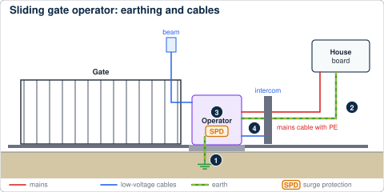

> Earthing, Bonding, Surge & Lightning Protection Library · **SHEET 07 · GATES** · content version 1.0

# Gate motors, intercoms and public-address lines

*Earthing, surge protection, mains isolation and cabling of sliding gate operators, their intercom and accessory cables, and intercom / public-address lines*

**Applies to:** Centurion D5-Evo and D6 SMART sliding gate operators, gate intercoms, safety beams, keypads, access control devices, pillar lights, public-address and intercom connecting cables

📄 **PDF:** [07_gate_motors_intercoms.pdf](https://github.com/Skynet1971/earthing/raw/HEAD/docs/pdf/07_gate_motors_intercoms.pdf)

> ℹ️ Information only. Every technical statement cites a source and PDF page; it does not replace the wiring code that applies at the site, the product manuals, or a qualified and registered person.

## 1  Why a gate operator is exposed

A gate operator is outdoor equipment connected to the house by its mains and signal cables. DEHN lists barrier (gate) systems among the equipment that partial lightning currents can reach along those cables, and Centurion makes the surge protection of its operators depend on a proper earth.[R6 p.431](#sources-cited-on-this-page)[R33 p.9](#sources-cited-on-this-page)[R38 p.8](#sources-cited-on-this-page)

| **> 1 m** | **40 kA** | **30 mA** | **≥ 3 mm** |
|---|---|---|---|
| copper earth rod in the D5-Evo earthing diagram[R33 p.37](#sources-cited-on-this-page) | optional surge arrestor at the D5-Evo mains input[R33 p.37](#sources-cited-on-this-page) | earth leakage breaker upstream of the D5-Evo[R33 p.6](#sources-cited-on-this-page) | contact opening of the all-pole mains switch (D5-Evo, D6 SMART)[R33 p.6](#sources-cited-on-this-page)[R38 p.6](#sources-cited-on-this-page) |

*Concept sketch, not a product wiring diagram. (1) earth spike next to the operator: in the D5-Evo earthing diagram a copper rod longer than 1 m[R33 p.9](#sources-cited-on-this-page)[R33 p.37](#sources-cited-on-this-page); for the D6 SMART not supplied, its cable connected by a ring lug to the gearbox mounting bolt[R38 p.55](#sources-cited-on-this-page)[R38 p.55](#sources-cited-on-this-page) (2) the mains supply earth is the other earth return for the controller's surge protection; the mains cable is 3 core (L, N, E) SWA[R33 p.9](#sources-cited-on-this-page)[R38 p.8](#sources-cited-on-this-page)[R33 p.17](#sources-cited-on-this-page)[R38 p.16](#sources-cited-on-this-page) (3) surge protection in the operator: the controller's own surge protection, plus the optional 40 kA surge arrestor at the mains input in the D5-Evo earthing diagram[R33 p.9](#sources-cited-on-this-page)[R33 p.37](#sources-cited-on-this-page) (4) low-voltage cables for intercom, safety beams and accessories, SWA recommended with one end of the screening earthed.[R33 p.17](#sources-cited-on-this-page)[R33 p.17](#sources-cited-on-this-page)[R33 p.17](#sources-cited-on-this-page)[R38 p.16](#sources-cited-on-this-page)*

- When lightning hits the external LPS of the main building, partial lightning currents can travel along the cables to outdoor equipment at a remote earth potential, such as EV charging stations, outdoor socket outlets and barrier (gate) systems.[R6 p.431](#sources-cited-on-this-page)
- External equipment at points where direct strikes are likely (LPZ 0A), such as masts with video cameras and lamp posts, must be connected directly to earth electrodes to reduce lightning currents.[R6 p.428](#sources-cited-on-this-page)
- The earth electrodes of such external equipment must be interconnected (with the building's earth-termination system).[R6 p.428](#sources-cited-on-this-page)

## 2  Earthing the operator

### Centurion D5-Evo

- Centurion (D5-Evo sliding gate operator installation manual): the earth return for the controller's surge protection is provided via the mains power supply earth and/or an earth spike located next to the operator.[R33 p.9](#sources-cited-on-this-page)
- Centurion (D5-Evo sliding gate operator installation manual): for the surge protection to be effective it is essential that the unit is properly earthed.[R33 p.9](#sources-cited-on-this-page)
- Centurion (D5-Evo sliding gate operator installation manual): both the controller and the charger must be effectively earthed for improved lightning protection.[R33 p.31](#sources-cited-on-this-page)
- Centurion (D5-Evo sliding gate operator installation manual): the earthing diagram specifies the earth spike as a copper rod longer than 1 m hammered into the ground.[R33 p.37](#sources-cited-on-this-page)
- Centurion (D5-Evo sliding gate operator installation manual): the earthing diagram shows an optional 40 kA surge arrestor at the 220 V mains input (E, N, L).[R33 p.37](#sources-cited-on-this-page)
- Centurion (D5-Evo sliding gate operator installation manual): the 'Earthing for effective lightning protection' diagram labels a spade connection, an earth harness, a ring lug and an earth spike.[R33 p.37](#sources-cited-on-this-page)
- Centurion (D5-Evo sliding gate operator installation manual): the earthing system must be correctly constructed and all metal parts of the system suitably earthed.[R33 p.7](#sources-cited-on-this-page)

### Centurion D6 SMART

- Centurion (D6 SMART sliding gate operator installation manual): the earth return for the controller's surge protection is provided via the mains power supply earth and/or an earth spike located next to the operator.[R38 p.8](#sources-cited-on-this-page)
- Centurion (D6 SMART sliding gate operator installation manual): for the surge protection to be effective it is essential that the unit is properly earthed.[R38 p.8](#sources-cited-on-this-page)
- Centurion (D6 SMART sliding gate operator installation manual): for further surge protection an earth spike can be installed; its earth cable is routed under the gearbox and connected by a ring lug to the mounting bolt on the right of the gearbox, where the charger earth is located.[R38 p.55](#sources-cited-on-this-page)
- Centurion (D6 SMART sliding gate operator installation manual): the earth spike is not supplied with the operator.[R38 p.55](#sources-cited-on-this-page)
- Centurion (D6 SMART sliding gate operator installation manual): the ring-lug end of the earth harness is placed on the mounting bolt on the right-hand side of the gearbox.[R38 p.41](#sources-cited-on-this-page)
- Centurion (D6 SMART sliding gate operator installation manual): the other end of the earth harness is connected into the right-hand side of the charger.[R38 p.46](#sources-cited-on-this-page)

### Gate posts and leaves: US communication-site practice

Motorola R56 is a standard for communication sites (US practice), not for domestic gates; its rules for gate posts and gates are listed for reference only.[R5 p.164](#sources-cited-on-this-page)[R5 p.164](#sources-cited-on-this-page)

- Per Motorola R56 (2005, US practice), all gate posts on both sides of a gate shall be bonded to the nearest point of the building ground ring with 35 mm2 (#2 AWG) or coarser tinned copper.[R5 p.164](#sources-cited-on-this-page)
- Per Motorola R56 (2005, US practice), each gate shall be bonded to its supporting fence post with a flexible 16 mm2 (#6 AWG) or coarser stranded copper jumper.[R5 p.164](#sources-cited-on-this-page)

> ℹ️ **NOTE** — **Not covered for domestic sliding gates**
>
> The facts extracted from the Centurion manuals do not say whether the gate leaf, the rack or the steel track is to be bonded to the operator earth, and they give no earth resistance value for the earth spike.

## 3  Mains supply, isolation and protection

Both operators are fed through a double-pole mains isolator with three-core SWA cable; the protective devices recommended differ between the two manuals.[R33 p.17](#sources-cited-on-this-page)[R38 p.16](#sources-cited-on-this-page)

| Item | Centurion D5-Evo | Centurion D6 SMART |
|---|---|---|
| Mains switching | All-pole switch, contact opening 3 mm or greater[R33 p.6](#sources-cited-on-this-page) | All-pole switch, contact opening 3 mm or greater[R38 p.6](#sources-cited-on-this-page) |
| Recommended breaker | 5 A thermal breaker with all-pole circuit break[R33 p.6](#sources-cited-on-this-page) | 5 A hydraulic breaker with all-pole circuit break[R38 p.6](#sources-cited-on-this-page) |
| Earth leakage | Earth leakage circuit breaker with a 30 mA threshold must be fitted upstream[R33 p.6](#sources-cited-on-this-page) | Not stated in the facts extracted from this manual |
| Mains cable | 220 V AC via a double pole mains isolator switch, 3 core (L, N, E) 1.5 mm² SWA[R33 p.17](#sources-cited-on-this-page) | 90-240 V AC via a double-pole mains isolator switch, 3 core (L, N, E) 1.5 mm² SWA[R38 p.16](#sources-cited-on-this-page) |
| Input rating | Not stated in the facts extracted from this manual | 110-240 V AC 50/60 Hz, 430 mA mains current consumption[R38 p.9](#sources-cited-on-this-page) |
| Surge arrestor at the mains input | Optional 40 kA surge arrestor at the 220 V input (E, N, L) shown in the earthing diagram[R33 p.37](#sources-cited-on-this-page) | Not stated in the facts extracted from this manual |

*Values as printed in each manufacturer's installation manual for its own product. The two manuals quote different mains voltages for the same cable specification.*

> ✅ **DO** — **Earth the controller and the charger**
>
> Centurion requires both the controller and the charger of the D5-Evo to be effectively earthed for improved lightning protection.[R33 p.31](#sources-cited-on-this-page) In the D6 SMART the earth harness runs from the mounting bolt on the right-hand side of the gearbox into the right-hand side of the charger.[R38 p.41](#sources-cited-on-this-page)[R38 p.46](#sources-cited-on-this-page)

## 4  Intercom, beam and accessory cables

Cable types and core counts for the low-voltage cables that leave the operator, as printed in each Centurion manual.

| Cable | Centurion D5-Evo | Centurion D6 SMART |
|---|---|---|
| Intercom, motor to dwelling | (n1 + 6) core 0.5 mm² multi-stranded[R33 p.17](#sources-cited-on-this-page) | n1 + 6 core 0.22 mm² multi-strand shielded[R38 p.16](#sources-cited-on-this-page) |
| Intercom, motor to entry panel | n2 core 0.5 mm² multi-stranded[R33 p.17](#sources-cited-on-this-page) | n2 core 0.22 mm² multi-strand shielded[R38 p.16](#sources-cited-on-this-page) |
| Safety beams, access control, keypad, external receiver | 3 core 0.5 mm² multi-stranded each[R33 p.17](#sources-cited-on-this-page) | 3 core 0.22 mm² multi-stranded each[R38 p.16](#sources-cited-on-this-page) |
| Pedestrian key-switch | 2 core[R33 p.17](#sources-cited-on-this-page) | 2 core[R38 p.16](#sources-cited-on-this-page) |
| Pillar lights | 3 core (L, N, E) SWA sized to the load[R33 p.17](#sources-cited-on-this-page) | Not stated in the facts extracted from this manual |
| Free-exit ground loop | 1 core 0.5 mm² multi-stranded silicone-coated[R33 p.17](#sources-cited-on-this-page) | Not stated in the facts extracted from this manual |

*n1 and n2 are the numbers of cores the intercom itself requires.[R33 p.17](#sources-cited-on-this-page)[R38 p.16](#sources-cited-on-this-page) Sizes are those printed in each manufacturer's manual; they differ between the two products.*

- Centurion (D5-Evo sliding gate operator installation manual): SWA (steel wire armoured) cable is typically recommended; the armouring gives screening for better lightning protection, and one end of the screening is to be earthed.[R33 p.17](#sources-cited-on-this-page)
- Centurion (D6 SMART sliding gate operator installation manual): SWA (steel wire armoured) cable is typically recommended; the armouring gives screening for better lightning protection, and one end of the screening is to be earthed.[R38 p.16](#sources-cited-on-this-page)

> ⚠️ **WARNING** — **One-end screen earthing is a product instruction, not a universal rule**
>
> DEHN states that only a shield connected at both ends can reduce inductive and capacitive coupling[R6 p.197](#sources-cited-on-this-page) and that a shield earthed at one end gives no protection against induction caused by lightning strikes.[R6 p.198](#sources-cited-on-this-page) The conflict is tabled in the chapter on where the sources disagree.

## 5  Intercom and public-address lines (DEHN WPX012)

DEHN's white paper WPX012 covers public address systems and their connecting cables to a PC or intercom; its rules are written for that equipment.[R27 p.3](#sources-cited-on-this-page)

### When arresters are needed on the PC / intercom cable

- DEHN (white paper WPX012, Surge protection for public address systems): for a public address system near a permanently manned workstation, the length of the connecting cable to the PC or intercom decides whether surge arresters must be installed on it.[R27 p.3](#sources-cited-on-this-page)

> ⚠️ **WARNING** — **Two DEHN publications give different cable lengths**
>
> White paper WPX012 requires surge protective devices on the PC / intercom connecting cable above 10 m[R27 p.3](#sources-cited-on-this-page), while the DEHN Lightning Protection Guide gives 5 m for the same cable.[R6 p.307](#sources-cited-on-this-page)

### Common potential point

- DEHN (white paper WPX012, Surge protection for public address systems): all earth connections of the surge arresters in the vicinity of the public address system must be connected to a nearby common potential point.[R27 p.3](#sources-cited-on-this-page)

### Loudspeaker lines and exterior loudspeakers

- DEHN (white paper WPX012, Surge protection for public address systems): exterior loudspeakers on a building roof can be damaged by indirect lightning effects (inductive / capacitive coupling) whether or not the building has external lightning protection.[R27 p.3](#sources-cited-on-this-page)
- DEHN (white paper WPX012, Surge protection for public address systems): on a structure with an external lightning protection system, an exterior loudspeaker is protected from direct lightning strikes when it is located within the protected volume of an air-termination system.[R27 p.3](#sources-cited-on-this-page)
- DEHN (white paper WPX012, Surge protection for public address systems): to dimension the surge arrester for a loudspeaker line, the maximum current in the branch is determined from I = P/U (amplifier or loudspeaker-group power divided by the carrier voltage).[R27 p.3](#sources-cited-on-this-page)
- DEHN (white paper WPX012, Surge protection for public address systems): the combined arrester listed for 100 V loudspeaker lines protects one galvanically isolated pair of an electroacoustic system (e.g. voice alarm, loudspeaker systems), with direct or indirect shield earthing.[R27 p.6](#sources-cited-on-this-page)
- DEHN (white paper WPX012, Surge protection for public address systems): the 100 V loudspeaker-line arrester has a nominal voltage of 100 V a.c., maximum continuous operating voltage 110 V a.c. / 150 V d.c., and nominal current 10 A at 70 °C.[R27 p.6](#sources-cited-on-this-page)
- DEHN (white paper WPX012, Surge protection for public address systems): the plug-in adapter listed for socket-outlet protection is a type 3 (class III) SPD for 230 V with Uc 255 V a.c., 16 A nominal load current and 3 kA nominal discharge current (8/20 µs).[R27 p.5](#sources-cited-on-this-page)

## 6  Safety warnings

- Centurion (D5-Evo sliding gate operator installation manual): all electrical work must follow applicable local electrical codes, and a licensed electrical contractor is recommended.[R33 p.31](#sources-cited-on-this-page)
- Centurion (D5-Evo sliding gate operator installation manual): an earth leakage circuit breaker with a 30 mA threshold must be fitted upstream of the system.[R33 p.6](#sources-cited-on-this-page)
- Centurion (D5-Evo sliding gate operator installation manual): the earthing system must be correctly constructed and all metal parts of the system suitably earthed.[R33 p.7](#sources-cited-on-this-page)
- Personal protection (protection against electric shock) measures always take priority over surge protection measures.[R6 p.220](#sources-cited-on-this-page)

> ⛔ **DO NOT** — **Never work on the operator with the mains connected**
>
> Before electrical work on the D5-Evo, Centurion requires a check that the circuit breaker is OFF and that all high voltage circuits (more than 42.4 V) are completely isolated from the mains supply.[R33 p.31](#sources-cited-on-this-page)

> ℹ️ **NOTE** — **Lightning damage and the warranty**
>
> Centurion states that the D6 SMART warranty may be voidable for damage caused by atmospheric conditions including lightning, or by power surges.[R38 p.64](#sources-cited-on-this-page)

## 7  Where the sources disagree

The sources were written for different equipment and countries. Where they conflict, the wiring code that applies at the site decides; this table shows the conflict rather than choosing for you.

| Question | One source says | Other sources say |
|---|---|---|
| Cable length above which the PC / intercom cable needs SPDs | DEHN white paper WPX012: SPDs required when the cable exceeds 10 m.[R27 p.3](#sources-cited-on-this-page) | DEHN Lightning Protection Guide (3rd ed.): SPDs required when the cable is longer than 5 m.[R6 p.307](#sources-cited-on-this-page) |
| Earth the cable screen at one end or both? | Centurion D5-Evo and D6 SMART: one end of the SWA screening is to be earthed.[R33 p.17](#sources-cited-on-this-page)[R38 p.16](#sources-cited-on-this-page) | DEHN: a shield must be earthed at least at both ends; one-end earthing gives no protection against lightning induction.[R6 p.197](#sources-cited-on-this-page)[R6 p.198](#sources-cited-on-this-page) DEHN also notes equalising currents in shields earthed at both ends on systems at different potentials.[R6 p.199](#sources-cited-on-this-page) |
| Earth spike at the operator | Centurion: surge-protection earth return via the mains supply earth and/or an earth spike next to the operator.[R33 p.9](#sources-cited-on-this-page)[R38 p.8](#sources-cited-on-this-page) | ITU-T K.66: nothing connected to a separate earth electrode that is not bonded to the main earth bar.[R18 p.18](#sources-cited-on-this-page) DEHN: earth electrodes of external equipment in LPZ 0A must be interconnected with the building's earth-termination system.[R6 p.428](#sources-cited-on-this-page)[R6 p.428](#sources-cited-on-this-page) |

## 8  Installation checklist

- [ ] Operator earthed through the mains supply earth and/or an earth spike next to the operator (Centurion D5-Evo, D6 SMART).[R33 p.9](#sources-cited-on-this-page)[R38 p.8](#sources-cited-on-this-page)
- [ ] D5-Evo: controller and charger both effectively earthed; earth spike a copper rod longer than 1 m.[R33 p.31](#sources-cited-on-this-page)[R33 p.37](#sources-cited-on-this-page)
- [ ] D6 SMART: earth harness ring lug on the right-hand gearbox mounting bolt and the other end into the charger; any earth spike cable on the same bolt.[R38 p.41](#sources-cited-on-this-page)[R38 p.46](#sources-cited-on-this-page)[R38 p.55](#sources-cited-on-this-page)
- [ ] All-pole mains switch with a contact opening of 3 mm or greater (D5-Evo, D6 SMART).[R33 p.6](#sources-cited-on-this-page)[R38 p.6](#sources-cited-on-this-page)
- [ ] D5-Evo: earth leakage circuit breaker with a 30 mA threshold upstream.[R33 p.6](#sources-cited-on-this-page)
- [ ] Mains via a double-pole isolator, 3 core (L, N, E) 1.5 mm² SWA (D5-Evo, D6 SMART).[R33 p.17](#sources-cited-on-this-page)[R38 p.16](#sources-cited-on-this-page)
- [ ] Intercom, beam and accessory cables sized as the operator manual states; SWA screening earthed as the manual states.[R33 p.17](#sources-cited-on-this-page)[R38 p.16](#sources-cited-on-this-page)[R33 p.17](#sources-cited-on-this-page)[R38 p.16](#sources-cited-on-this-page)
- [ ] PC / intercom connecting cable of a public address system checked against the DEHN length threshold that applies.[R27 p.3](#sources-cited-on-this-page)[R6 p.307](#sources-cited-on-this-page)
- [ ] All surge-arrester earth connections near a public address system taken to one nearby common potential point.[R27 p.3](#sources-cited-on-this-page)
- [ ] Breaker OFF and all circuits above 42.4 V isolated before working on the D5-Evo.[R33 p.31](#sources-cited-on-this-page)

## Sources cited on this page

`[R18 p.12]` = reference 18 below, PDF page 12 (page index of the PDF file). Each cited statement was checked against a verbatim quote from that page.

| Ref | Document | PDF pages cited |
|---|---|---|
| R5 | **Standards and Guidelines for Communication Sites (R56), 68P81089E50-B** — Motorola, Inc. · 9/1/05 (2005) · USA practice (AWG sizes) · [link](https://www.blm.gov/sites/blm.gov/files/Lands_ROW_Motorola_R56_2005_manual.pdf) | 164 |
| R6 | **Lightning Protection Guide, 3rd updated edition** — DEHN + SÖHNE · 2014 · IEC / EN 62305 (Germany) · [link](https://www.dehn-international.com/sites/default/files/media/files/lpg_en_complete.pdf) | 197-199, 220, 307, 428, 431 |
| R18 | **Recommendation ITU-T K.66: Protection of customer premises from overvoltages** — International Telecommunication Union · 11/2019 · International · [link](https://www.itu.int/rec/T-REC-K.66-201911-I) | 18 |
| R27 | **White paper WPX012: Surge protection for public address systems** — DEHN SE · WPX012/EN/0122 (January 2022) · IEC / EN (Germany) · [link](https://www.dehn-international.com/sites/default/files/media/files/public-address-systems-wpx012-en.pdf) | 3, 5-6 |
| R33 | **D5-Evo light-industrial sliding gate operator: installation manual** — Centurion Systems (Pty) Ltd · not stated on the pages read · South Africa · [link](https://cdn.shopify.com/s/files/1/0398/4615/0189/files/D5-Evo_Installation_Manual.pdf) | 6-7, 9, 17, 31, 37 |
| R38 | **D6 SMART sliding gate operator: installation manual, doc number 1401.D.01.0012** — Centurion Systems (Pty) Ltd · 02 April 2024 · South Africa · [link](https://cdn.shopify.com/s/files/1/1794/9761/files/Centurion_D6_Smart_Installation_Manual.pdf) | 6, 8-9, 16, 41, 46, 55, 64 |

*Generated from `content/docs/07_gate_motors_intercoms.yaml` on 2026-11-23. Do not edit this page in the wiki; edit the content file.*
