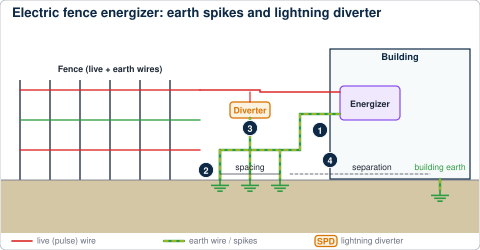

> Earthing, Bonding, Surge & Lightning Protection Library · **SHEET 08 · ALARMS & FENCES** · content version 1.0

# Electric fences and intruder alarms

*Energizer earthing, earth spikes, lightning diverters, separation from other earth systems, and the wiring of alarm and fence circuits*

**Applies to:** Nemtek Druid electric fence energizers, Nemtek lightning inhibitor / diverter and Super Earthing Kit, fence earth systems, IDS X-Series intruder alarm panels, keypad bus and sensor wiring

📄 **PDF:** [08_alarms_electric_fences.pdf](https://github.com/Skynet1971/earthing/raw/HEAD/docs/pdf/08_alarms_electric_fences.pdf)

> ℹ️ Information only. Every technical statement cites a source and PDF page; it does not replace the wiring code that applies at the site, the product manuals, or a qualified and registered person.

## 1  Earthing the fence energizer

Nemtek's Druid installer manual makes the fence earth a set of earth electrodes close to the energizer, at a minimum distance from any other earth system.[R30 p.12](#sources-cited-on-this-page)[R30 p.12](#sources-cited-on-this-page) In South Africa it refers fence installation to the latest edition of SANS 10222-3.[R30 p.9](#sources-cited-on-this-page)

| **3** | **≥ 2 m** | **≥ 10 m** | **≤ 2 m** |
|---|---|---|---|
| earth electrodes close to the energizer (Nemtek Druid)[R30 p.12](#sources-cited-on-this-page) | fence earth to any other earth system, security fence (Nemtek Druid)[R30 p.12](#sources-cited-on-this-page) | fence earth to any other earth system, agricultural fence (Nemtek Druid)[R30 p.12](#sources-cited-on-this-page) | lightning diverter from the earth spike (Nemtek LIDii)[R31 p.2](#sources-cited-on-this-page) |

*Click the diagram to open it full size.* *Concept sketch, not a product wiring diagram. (1) The main earth spikes are installed close to the energizer, and the fence earth wire is connected to the main earth spike, not directly to the energizer[R30 p.9](#sources-cited-on-this-page)[R30 p.9](#sources-cited-on-this-page) (3) the lightning inhibitor / diverter sits between the energizer and the start of the fence, closer to the fence, and as close as possible to the earth spike, no more than 2 m away[R31 p.2](#sources-cited-on-this-page)[R31 p.2](#sources-cited-on-this-page) (4) the fence earth electrode is not less than 2 m (security fence) or 10 m (agricultural fence) from any other earth system.[R30 p.12](#sources-cited-on-this-page) Marker (2), the spacing between the spikes, is not given in any source in this library.*

### Fence earth wiring (Nemtek Druid)

- Nemtek (Druid LCD 2x installer manual): the fence earth wire is to be connected to the main earth spike and not directly to the energizer.[R30 p.9](#sources-cited-on-this-page)
- Nemtek (Druid LCD 2x installer manual): the main earth spikes are to be installed close to the energizer.[R30 p.9](#sources-cited-on-this-page)
- Nemtek (Druid LCD 2x installer manual): the fence must be earthed properly with three earth electrodes close to the energizer.[R30 p.12](#sources-cited-on-this-page)
- Nemtek (Druid LCD 2x installer manual): earth wire connection with earth loop monitoring is the preferred fence earthing arrangement.[R30 p.9](#sources-cited-on-this-page)
- Nemtek (Druid LCD 2x installer manual): with earth loop monitoring, all earth spikes are connected to one wire of the fence only, and that wire is connected to the rest of the fence at the main earth spike only.[R30 p.9](#sources-cited-on-this-page)
- Nemtek (Druid LCD 2x installer manual): the distance between the fence earth electrode and any other earth system shall be not less than 2 m for a security fence (typically suburban) and 10 m for an agricultural fence (typically rural).[R30 p.12](#sources-cited-on-this-page)
- Nemtek (Druid LCD 2x installer manual): exposed conductive parts of the physical barrier of an electric security fence shall be effectively earthed.[R30 p.26](#sources-cited-on-this-page)
- Nemtek (Druid LCD 2x installer manual): where an electric security fence passes below bare power line conductors, its highest metallic element shall be effectively earthed for not less than 5 m on either side of the crossing point.[R30 p.25](#sources-cited-on-this-page)

## 2  Earth spikes

Nemtek's Super Earthing Kit is offered for fences where earthing is poor or earth spikes alone are not sufficient.[R32 p.2](#sources-cited-on-this-page)

| **1.2 m** | **6 kg** | **6-8 cm** | **≥ 24 h** |
|---|---|---|---|
| galvanised earth spike in the Nemtek Super Earthing Kit[R32 p.2](#sources-cited-on-this-page) | bentonite sleeve per kit[R32 p.2](#sources-cited-on-this-page) | hole diameter, drilled just under 1.2 m deep[R32 p.2](#sources-cited-on-this-page) | bentonite cure time before testing[R32 p.2](#sources-cited-on-this-page) |

- Nemtek (Super Earthing Kit instruction manual): the kit is for electric fences where earthing is poor or earth spikes alone are not sufficient; it helps improve earthing but will not necessarily solve all problems.[R32 p.2](#sources-cited-on-this-page)
- Nemtek (Super Earthing Kit instruction manual): one kit is stated to be the equivalent of 3 earth spikes.[R32 p.2](#sources-cited-on-this-page)
- Nemtek (Super Earthing Kit instruction manual): the kit consists of a 1.2 m galvanised earth spike with clamp and a 6 kg bentonite sleeve; bentonite enhances soil conductivity by attracting and retaining moisture.[R32 p.2](#sources-cited-on-this-page)
- Nemtek (Super Earthing Kit instruction manual): the hole for the spike is drilled 6-8 cm in diameter and just under 1.2 m deep.[R32 p.2](#sources-cited-on-this-page)
- Nemtek (Super Earthing Kit instruction manual): the 1.2 m spike is inserted vertically in the centre of the hole with 50 mm left above ground for future maintenance.[R32 p.2](#sources-cited-on-this-page)
- Nemtek (Super Earthing Kit instruction manual): the bentonite backfill should cure for at least 24 hours before testing.[R32 p.2](#sources-cited-on-this-page)

> [!NOTE]
> **NOTE: Spike spacing for fences is not covered**
>
> The Nemtek manuals in this library do not state the spacing between fence earth spikes or a target earth resistance for the fence earth. The rules below are written for earth rods in general, not for fence energizers.

### General earth-rod spacing (not written for electric fences)

- Per UK guidance (IET, 2011), where two or more earth rods are driven and connected together, the separation between rods should be at least equal to their combined driven depth to obtain maximum advantage from each rod.[R8 p.3](#sources-cited-on-this-page)
- Per UK guidance (IEE Wiring Matters, 2006), the resistance-area condition is generally deemed met by a rod separation equal to the driven depth of the rod, and a separation of more than twice the driven depth offers little benefit.[R9 p.3](#sources-cited-on-this-page)
- Per Motorola R56 (2005, US practice), ground rods should be spaced apart by the sum of their lengths so that their spheres of influence do not overlap.[R5 p.105](#sources-cited-on-this-page)

## 3  Lightning inhibitor and diverter (Nemtek LIDii)

Nemtek's lightning inhibitor / diverter protects the energizer against surges arriving from the fence; surges arriving through the mains need a separate product.[R31 p.2](#sources-cited-on-this-page)[R31 p.2](#sources-cited-on-this-page)

- Nemtek (Lightning Inhibitor and Diverter LIDii instruction manual): the device both inhibits the lightning surge from damaging the energizer and diverts it away from the energizer into the ground through the earth spikes.[R31 p.2](#sources-cited-on-this-page)
- Nemtek (Lightning Inhibitor and Diverter LIDii instruction manual): protection from surges arriving through the mains (as opposed to the fence) is a separate product.[R31 p.2](#sources-cited-on-this-page)
- Nemtek (Lightning Inhibitor and Diverter LIDii instruction manual): the inhibitor/diverter is installed between the energizer and the beginning of the electric fence, closer to the fence than to the energizer.[R31 p.2](#sources-cited-on-this-page)
- Nemtek (Lightning Inhibitor and Diverter LIDii instruction manual): the diverter should be installed as close to the earth spike as possible and no more than 2 m away.[R31 p.2](#sources-cited-on-this-page)
- Nemtek (Lightning Inhibitor and Diverter LIDii instruction manual): one inhibitor/diverter is required for a single zone security energizer and two for a dual zone energizer.[R31 p.3](#sources-cited-on-this-page)
- Nemtek (Lightning Inhibitor and Diverter LIDii instruction manual): the arc gap has three settings (14.5 kV, 16.0 kV, 18.5 kV); position 1 (14.5 kV) is recommended for most applications.[R31 p.3](#sources-cited-on-this-page)

> [!TIP]
> **DO: Place the diverter at the earth spike, on the fence side**
>
> Install it between the energizer and the beginning of the fence, closer to the fence than to the energizer[R31 p.2](#sources-cited-on-this-page), as close to the earth spike as possible and no more than 2 m away.[R31 p.2](#sources-cited-on-this-page)

## 4  Mains, battery and fence wiring

- Nemtek (Druid LCD 2x installer manual): the energizer is battery operated (12 V 7 Ah nominal) and suitable for connection to mains of 100-240 V AC, 50-60 Hz.[R30 p.3](#sources-cited-on-this-page)
- Nemtek (Druid LCD 2x installer manual): ancillary equipment connected to the electric security fence circuit must provide isolation between the fence circuit and the supply mains equivalent to that provided by the energizer.[R30 p.26](#sources-cited-on-this-page)

### Keep fence wiring away from other wiring

- Nemtek (Druid LCD 2x installer manual): wires to the fence must be kept separate from the keypad, gate, siren, strobe and mains wiring.[R30 p.12](#sources-cited-on-this-page)
- Nemtek (Druid LCD 2x installer manual): connecting leads run underground shall be in a conduit of insulating material, or insulated high voltage cable shall be used.[R30 p.25](#sources-cited-on-this-page)
- Nemtek (Druid LCD 2x installer manual): fence connecting leads shall not be installed in the same conduit as mains supply wiring, communication cables or data cables.[R30 p.25](#sources-cited-on-this-page)

> [!CAUTION]
> **DO NOT: Never share a conduit or hole with low-voltage wiring**
>
> Nemtek requires HT wire between fence and energizer, including the earth wire, and these wires must never share a conduit or hole with low voltage wiring.[R30 p.12](#sources-cited-on-this-page)

## 5  Safety warnings

- Nemtek (Druid LCD 2x installer manual): electric fencing can be lethal; entanglement / entrapment hazards must be avoided and users warned to avoid head contact with the fence.[R30 p.3](#sources-cited-on-this-page)
- Nemtek (Druid LCD 2x installer manual): barbed wire or razor wire shall not be electrified by an energizer or placed physically close to an electric fence.[R30 p.24](#sources-cited-on-this-page)
- Nemtek (Druid LCD 2x installer manual): after installation the fence must always be tested for correct short-circuit and open-circuit alarming at various points along the fence.[R30 p.12](#sources-cited-on-this-page)

## 6  Intruder alarm panels and their wiring

For optimum lightning protection the IDS X-Series installer manual connects a low-resistance earth to the telephone communicator's earth input.[R53 p.9](#sources-cited-on-this-page)

> [!NOTE]
> **NOTE: Not covered in the IDS facts**
>
> The facts extracted from the IDS manuals do not cover earthing of the panel enclosure, the mains transformer or the screens of keypad-bus and zone cables, and give no earth resistance value.

### Supply and battery

- IDS X-Series installer manual: the panel must be powered from a 16 V AC ±10% transformer of at least 32 VA; 40 VA is recommended.[R53 p.9](#sources-cited-on-this-page)
- IDS X-Series installer manual: a 12 V 7 Ah sealed lead-acid battery must be used; backup time after mains failure depends on the keypads, sensors and bus-wired devices connected.[R53 p.9](#sources-cited-on-this-page)
- IDS XSeries serial installer manual: the serial X-Series panel uses an IDS 24 V 1.5 A DC power supply and a 12 V 7 Ah sealed lead-acid battery.[R54 p.9](#sources-cited-on-this-page)
- IDS X-Series installer manual: the panel supplies at most 750 mA continuous in total from its Aux 12 V terminals to bus-wired peripherals (keypads, receivers, passives).[R53 p.9](#sources-cited-on-this-page)
- IDS XSeries serial installer manual: the serial panel supplies at most 1 A continuous in total from its Aux 12 V terminals to bus-wired peripherals.[R54 p.9](#sources-cited-on-this-page)
- IDS X-Series installer manual: a GSM transmitter is powered from the panel's TX terminal, protected by a 4 A fuse, and must not draw more than 1.5 A.[R53 p.9](#sources-cited-on-this-page)

### Keypad bus and zones

- IDS X-Series installer manual: when extra power supplies power any peripheral on the keypad bus, an IDS RS485 isolator must be used.[R53 p.8](#sources-cited-on-this-page)
- IDS X-Series installer manual: no more than 8 keypads may be connected to the keypad bus.[R53 p.10](#sources-cited-on-this-page)
- IDS X-Series installer manual: up to 4 IDS remote receivers may be connected to the keypad bus.[R53 p.9](#sources-cited-on-this-page)
- IDS X-Series installer manual: the panel raises a bus-wired peripheral low-power trouble when the supply voltage at a peripheral drops below the recommended limit.[R53 p.19](#sources-cited-on-this-page)
- IDS X-Series installer manual: every zone, used or unused, is terminated with a 3k3 end-of-line resistor, placed inside or as close to the sensor as possible.[R53 p.9](#sources-cited-on-this-page)
- IDS X-Series installer manual: the siren output drives a 12 V self-driven or piezo siren, not a horn speaker.[R53 p.9](#sources-cited-on-this-page)
- IDS X-Series installer manual: the telephone communicator is connected in line-seizure mode, never in parallel with the telephone.[R53 p.9](#sources-cited-on-this-page)

### Sensor, bus and signal lines: other sources

- Per NIST (US), the sensor wiring of a wired intruder alarm runs to all points of the house and acts as an antenna collecting energy from the field of a nearby lightning strike; protection should be part of the system design rather than added later by the owner.[R1 p.16](#sources-cited-on-this-page)
- Per Motorola R56 (2005, US practice), SPDs shall be installed on alarm circuits entering the site, within 610 mm (2 ft.) of the cable entry port, with the cable shields bonded to the MGB.[R5 p.354](#sources-cited-on-this-page)
- Nemtek (Druid LCD 2x installer manual): wires to the fence must be kept separate from the keypad, gate, siren, strobe and mains wiring.[R30 p.12](#sources-cited-on-this-page)
- A bus cable run between buildings in a lightning-current-carrying shielded duct or metal pipe earthed at both ends does not need lightning equipotential bonding; surge arresters are then sufficient.[R6 p.315](#sources-cited-on-this-page)
- A signal-line SPD should be installed as close as possible to the terminal device, which has a positive effect on the residual voltage.[R6 p.261](#sources-cited-on-this-page)

> [!WARNING]
> **WARNING: Installer and warranty**
>
> IDS states that the serial X-Series panel should only be installed by an accredited professional alarm installer[R54 p.48](#sources-cited-on-this-page), and that its 24-month warranty excludes lightning damage.[R54 p.48](#sources-cited-on-this-page)

## 7  Where the sources disagree

The energizer manual keeps the fence earth away from other earths; the general bonding sources join all earths into one system. Where they conflict, the wiring code that applies at the site decides; this table shows the conflict rather than choosing for you.[R30 p.12](#sources-cited-on-this-page)[R6 p.142](#sources-cited-on-this-page)

| Question | Fence energizer source | Other sources say |
|---|---|---|
| Bond the fence earth to the building earth? | Nemtek Druid: the fence earth electrode shall be not less than 2 m (security fence) or 10 m (agricultural fence) from any other earth system.[R30 p.12](#sources-cited-on-this-page) | DEHN: one earth-termination system must serve all earthing tasks of a structure.[R6 p.142](#sources-cited-on-this-page) ITU-T K.66: nothing connected to a separate earth electrode that is not bonded to the main earth bar.[R18 p.18](#sources-cited-on-this-page) ITU-T K.98, citing IEC 60364-4-44: all earth electrodes associated with a building interconnected.[R25 p.30](#sources-cited-on-this-page) |
| Separate earths and lightning | Nemtek Druid: separation from other earth systems as above.[R30 p.12](#sources-cited-on-this-page) | DEHN: a separate earth kept apart from the lightning protection and protective earth can see potential differences of up to some 100 kV.[R6 p.142](#sources-cited-on-this-page) ITU-T K.85: unbonded separate electrodes can damage the ports of equipment connected to each.[R19 p.18](#sources-cited-on-this-page) |
| Metal near an earth electrode | Nemtek Druid: fence earth at least 2 m from any other earth system.[R30 p.12](#sources-cited-on-this-page) | Motorola R56 (US communication-site practice): metallic objects within 1.8 m of the external grounding electrode system shall be bonded to it.[R5 p.161](#sources-cited-on-this-page) |

*The Nemtek rule is specific to electric fence energizers; the DEHN, ITU-T and Motorola statements are general bonding rules that do not mention electric fences.[R30 p.12](#sources-cited-on-this-page)[R6 p.142](#sources-cited-on-this-page)[R18 p.18](#sources-cited-on-this-page)[R5 p.161](#sources-cited-on-this-page)*

## 8  Installation checklist

- [ ] Three earth electrodes close to the energizer (Nemtek Druid).[R30 p.12](#sources-cited-on-this-page)
- [ ] Fence earth wire connected to the main earth spike, not directly to the energizer.[R30 p.9](#sources-cited-on-this-page)
- [ ] Fence earth electrode not less than 2 m (security) or 10 m (agricultural) from any other earth system, or the conflict with the site's bonding rules resolved under the applicable wiring code.[R30 p.12](#sources-cited-on-this-page)[R6 p.142](#sources-cited-on-this-page)
- [ ] Lightning inhibitor / diverter between energizer and fence, closer to the fence, no more than 2 m from the earth spike; one per zone.[R31 p.2](#sources-cited-on-this-page)[R31 p.2](#sources-cited-on-this-page)[R31 p.3](#sources-cited-on-this-page)
- [ ] Arc gap set; Nemtek recommends position 1 (14.5 kV) for most applications.[R31 p.3](#sources-cited-on-this-page)
- [ ] Surges arriving through the mains handled by a separate product; the LIDii does not cover them.[R31 p.2](#sources-cited-on-this-page)
- [ ] HT cable for fence and earth leads; never in the same conduit or hole as low-voltage, mains, communication or data cables.[R30 p.12](#sources-cited-on-this-page)[R30 p.25](#sources-cited-on-this-page)
- [ ] Underground leads in insulating conduit or insulated high voltage cable.[R30 p.25](#sources-cited-on-this-page)
- [ ] Exposed conductive parts of the physical barrier effectively earthed.[R30 p.26](#sources-cited-on-this-page)
- [ ] Super Earthing Kit bentonite cured for at least 24 hours before testing.[R32 p.2](#sources-cited-on-this-page)
- [ ] Fence tested for short-circuit and open-circuit alarming at various points.[R30 p.12](#sources-cited-on-this-page)
- [ ] IDS X-Series: low-resistance earth on the telephone communicator's earth input.[R53 p.9](#sources-cited-on-this-page)
- [ ] IDS X-Series: RS485 isolator fitted where extra power supplies power peripherals on the keypad bus.[R53 p.8](#sources-cited-on-this-page)
- [ ] IDS X-Series: every zone terminated with a 3k3 end-of-line resistor at or near the sensor.[R53 p.9](#sources-cited-on-this-page)

## Sources cited on this page

`[R18 p.12]` = reference 18 below, PDF page 12 (page index of the PDF file). Each cited statement was checked against a verbatim quote from that page.

| Ref | Document | PDF pages cited |
|---|---|---|
| R1 | **Surges Happen! How to Protect the Appliances in Your Home (NIST Special Publication 960-6)** — National Institute of Standards and Technology (USA) · May 2001 · USA · [link](https://nvlpubs.nist.gov/nistpubs/Legacy/SP/nistspecialpublication960-6.pdf) | 16 |
| R5 | **Standards and Guidelines for Communication Sites (R56), 68P81089E50-B** — Motorola, Inc. · 9/1/05 (2005) · USA practice (AWG sizes) · [link](https://www.blm.gov/sites/blm.gov/files/Lands_ROW_Motorola_R56_2005_manual.pdf) | 105, 161, 354 |
| R6 | **Lightning Protection Guide, 3rd updated edition** — DEHN + SÖHNE · 2014 · IEC / EN 62305 (Germany) · [link](https://www.dehn-international.com/sites/default/files/media/files/lpg_en_complete.pdf) | 142, 261, 315 |
| R8 | **Earthing: your questions answered (IET Wiring Matters, Autumn 2011)** — The Institution of Engineering and Technology (UK) · Autumn 2011 · UK (BS 7671) · [link](https://electrical.theiet.org/media/1549/earthing.pdf) | 3 |
| R9 | **Multiple earth electrodes in a TT system for a dwelling (IET Wiring Matters, Winter 2006)** — The Institution of Engineering and Technology (UK) · Winter 2006 · UK (BS 7671) · [link](https://electrical.theiet.org/media/1659/multiple-earth-electrodes-in-a-tt-system-for-a-dwelling.pdf) | 3 |
| R18 | **Recommendation ITU-T K.66: Protection of customer premises from overvoltages** — International Telecommunication Union · 11/2019 · International · [link](https://www.itu.int/rec/T-REC-K.66-201911-I) | 18 |
| R19 | **Recommendation ITU-T K.85: Requirements for the mitigation of lightning effects on home networks installed in customer premises** — International Telecommunication Union · 11/2011 · International · [link](https://www.itu.int/rec/T-REC-K.85-201111-I) | 18 |
| R25 | **Recommendation ITU-T K.98: Overvoltage protection guide for telecommunication equipment installed in customer premises** — International Telecommunication Union · 08/2014 · International · [link](https://www.itu.int/rec/T-REC-K.98-201408-I) | 30 |
| R30 | **DRUID LCD 2x Electric Fence Energizer: Installer Manual, Revision 1.2** — Nemtek Group · 25 September 2013 · South Africa · [link](https://nemtek.co.za/wp-content/uploads/2021/11/installer-manual-druid-2.pdf) | 3, 9, 12, 24-26 |
| R31 | **Lightning Inhibitor and Diverter, Dual Pole Protection: Instruction Manual** — Nemtek Group · file dated September 2025 · South Africa · [link](https://www.nemtek.co.za/wp-content/uploads/2021/09/NemtekEA-LIDiiManual250925.pdf) | 2-3 |
| R32 | **Super Earthing Kit EA-CEC/KIT: Instruction Manual** — Nemtek Group · file dated November 2025 · South Africa · [link](https://www.nemtek.co.za/wp-content/uploads/2025/03/SuperEarthingKit111125.pdf) | 2 |
| R53 | **IDS X-Series Installer Manual 700-398-02O** — Inhep Digital Security (IDS) · 700-398-02O · South Africa · [link](https://www.idsprotect.co.za/site-documents/product-download/intrusion/xseries/IDS%20X-Series%20Installer%20Manual.pdf) | 8-10, 19 |
| R54 | **IDS XSeries Serial Installer Manual 700-678-02A** — Inhep Digital Security (IDS) · 700-678-02A · South Africa · [link](https://www.idsprotect.co.za/za/en/product-assets/xseries/control-panels/860-1-864-xs-ids-x64-control-panel/assets/documents/IDS%20XSeries%20Serial%20Installer%20Manual.pdf) | 9, 48 |

*Generated from `content/docs/08_alarms_electric_fences.yaml` on 2026-11-24. Do not edit this page in the wiki; edit the content file.*
