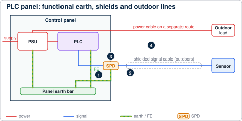

> Earthing, Bonding, Surge & Lightning Protection Library · **SHEET 09 · PLC & CONTROL** · content version 1.0

# PLCs, instrumentation and control cabling

*Supply, functional earth, isolation, cable lengths, shields and surge immunity of the Siemens LOGO! 8, and the earthing and surge protection of instrumentation, control and bus lines*

**Applies to:** Siemens LOGO! 8 base modules, expansion modules, TDE and CSM, their power supplies and I/O cabling; instrumentation and control cables, cable screens and armour; measuring, control, bus and RS-485 lines

📄 **PDF:** [09_plc_control_cabling.pdf](https://github.com/Skynet1971/earthing/raw/HEAD/docs/pdf/09_plc_control_cabling.pdf)

> ℹ️ Information only. Every technical statement cites a source and PDF page; it does not replace the wiring code that applies at the site, the product manuals, or a qualified and registered person.

## 1  LOGO! 8 supply and its protection

Siemens builds LOGO! 8 in mains (230 V) and low-voltage (24 V and 12 V) versions; the supply limits and the protection of the supply lines differ between them.[R28 p.45](#sources-cited-on-this-page)

| **+20 %** | **100 m** | **10 m** | **B16** |
|---|---|---|---|
| varistor operating voltage above the rated voltage, LOGO! AC supplies[R28 p.46](#sources-cited-on-this-page) | max. unshielded digital input line, LOGO! 24CE and 230RCE[R28 p.351](#sources-cited-on-this-page)[R28 p.347](#sources-cited-on-this-page) | max. shielded, twisted analog input line, LOGO! 24CE and AM2[R28 p.351](#sources-cited-on-this-page)[R28 p.361](#sources-cited-on-this-page) | max. protection of an output relay, LOGO! 230 V versions[R28 p.348](#sources-cited-on-this-page) |

### Supply ranges

- Siemens LOGO! 8 system manual: the 230 V versions are suitable for rated voltages of 115 VAC/VDC and 240 VAC/VDC, and the 24 V and 12 V versions can be operated with a 24 VDC, 24 VAC or 12 VDC power supply.[R28 p.45](#sources-cited-on-this-page)
- Siemens LOGO! 8 system manual: LOGO! 230RCE/230RCEo accept 115 VAC/VDC to 240 VAC/VDC with a permissible range of 85 VAC to 265 VAC and 100 VDC to 253 VDC.[R28 p.346](#sources-cited-on-this-page)
- Siemens LOGO! 8 system manual: LOGO! 24CE/24CEo operate from 24 VDC with a permissible range of 20.4 VDC to 28.8 VDC.[R28 p.350](#sources-cited-on-this-page)
- Siemens LOGO! 8 system manual: LOGO! 24RCE/24RCEo operate from 24 VAC/VDC with a permissible range of 20.4 VAC to 26.4 VAC and 20.4 VDC to 28.8 VDC.[R28 p.354](#sources-cited-on-this-page)
- Siemens LOGO! 8 system manual: LOGO! 12/24 base modules and DM8 12/24R operate from 12/24 VDC with a permissible range of 10.8 VDC to 28.8 VDC and have reverse polarity protection.[R28 p.357](#sources-cited-on-this-page)
- Siemens LOGO! 8 system manual: the LOGO! Power 24 V supply provides primary/secondary electrical isolation as SELV (to EN 60950 and EN 50178), is safety class II, and has IP20 degree of protection.[R28 p.365](#sources-cited-on-this-page)

### Protecting the supply lines

- Siemens LOGO! 8 system manual: for AC supplies, a metal oxide varistor (MOV) can be installed to suppress voltage peaks on the power supply lines, with a varistor operating voltage at least 20% above the rated voltage.[R28 p.46](#sources-cited-on-this-page)
- Siemens LOGO! 8 system manual: for DC supplies, the manual instructs installing a protection device to suppress voltage peaks on the power supply lines.[R28 p.46](#sources-cited-on-this-page)
- Siemens LOGO! 8 system manual: on the LOGO! TDE text display power connector, pin 3 must be connected to ground, and Siemens recommends protecting the TDE with a 0.5 A safety fuse on the power supply.[R28 p.47](#sources-cited-on-this-page)

### Outputs

- Siemens LOGO! 8 system manual: an external power supply must not be connected in parallel to the output load of a DC output, because a reverse current could develop at the output without a diode or similar barrier device.[R28 p.31](#sources-cited-on-this-page)
- Siemens LOGO! 8 system manual: if protection of an output relay is desired on the 230 V versions, the maximum is 16 A, characteristic B16.[R28 p.348](#sources-cited-on-this-page)
- Siemens LOGO! 8 system manual: relay contacts may be damaged by the high inrush current of low-energy or LED lamps, and an inrush current limiter should be used to protect them.[R28 p.55](#sources-cited-on-this-page)

## 2  Functional earth

Siemens describes LOGO! as double-insulated switchgear whose FE (functional earth) terminal must still be connected to earth ground.[R28 p.46](#sources-cited-on-this-page)

*Click the diagram to open it full size.* *Concept sketch, not a product wiring diagram. (1) The LOGO! FE terminal is connected to earth ground[R28 p.46](#sources-cited-on-this-page) (2) shield termination: Siemens clamps the shield of a LOGO! analog encoder wire on one side only, to the FE terminal of the expansion module[R28 p.54](#sources-cited-on-this-page), whereas DEHN requires shields to be earthed at least at both ends; see the chapter on where the sources disagree[R6 p.197](#sources-cited-on-this-page) (3) DEHN: where a building has an external lightning protection system, a measuring/control cable running outside it needs a type 1 lightning current arrester[R6 p.249](#sources-cited-on-this-page), and a signal-line SPD should be as close as possible to the terminal device[R6 p.261](#sources-cited-on-this-page) (4) Siemens keeps AC wiring, switched high-voltage DC circuits and low-voltage signal wiring separate[R28 p.31](#sources-cited-on-this-page); DEHN separates or shields unprotected cable upstream of an SPD from the protected cable downstream.[R6 p.262](#sources-cited-on-this-page)*

- Siemens LOGO! 8 system manual: LOGO! 8 modules include an FE (Functional Earth) terminal for connecting to earth ground.[R28 p.16](#sources-cited-on-this-page)
- Siemens LOGO! 8 system manual: LOGO! is described as double-insulated switchgear, and its FE terminal must be connected to earth ground.[R28 p.46](#sources-cited-on-this-page)
- Siemens LOGO! 8 system manual: the LOGO! AM2 analog module has an FE terminal for connecting earth and the shielding of the analog measuring cable.[R28 p.22](#sources-cited-on-this-page)
- Siemens LOGO! 8 system manual: the LOGO! AM2 analog input module's power supply has no electrical isolation, has reverse polarity protection, and has a ground terminal for connecting ground and the shielding of the analog measuring line.[R28 p.361](#sources-cited-on-this-page)
- Siemens LOGO! 8 system manual: when connecting the Ethernet interface, the FE terminal is connected to earth ground and the network cable to the Ethernet interface.[R28 p.57](#sources-cited-on-this-page)
- Siemens LOGO! 8 system manual: on the LOGO! CSM12/24 switch module, functional grounding can be achieved by a cable from terminal 3 (for example to the DIN rail) kept as short as possible, although grounding is stated as not necessary for interference-free operation.[R28 p.368](#sources-cited-on-this-page)

> ✅ **DO** — **Connect FE even though the device is double-insulated**
>
> The LOGO! FE terminal must be connected to earth ground[R28 p.46](#sources-cited-on-this-page); on the AM2 analog module the same terminal takes the shield of the analog measuring cable.[R28 p.22](#sources-cited-on-this-page)

### Reference potential and ungrounded supplies

- Siemens LOGO! 8 system manual: the inputs of LOGO! 12/24 and LOGO! 24 devices are not isolated and therefore require a common reference potential (chassis ground).[R28 p.51](#sources-cited-on-this-page)
- Siemens LOGO! 8 system manual: operating the AM2 RTD module from an ungrounded (potential-free) power supply should be avoided; if unavoidable, the supply's negative/ground output is connected to the shielding of the resistance thermometer's measuring wires.[R28 p.54](#sources-cited-on-this-page)

## 3  Isolation and voltage classes

Which LOGO! interfaces are galvanically isolated decides which devices may share a voltage class and a reference potential.[R28 p.17](#sources-cited-on-this-page)[R28 p.36](#sources-cited-on-this-page)

- Siemens LOGO! 8 system manual: the interface on the left side of an analog module or communications module is galvanically isolated, which is why such modules can be connected to devices of a different voltage class.[R28 p.17](#sources-cited-on-this-page)
- Siemens LOGO! 8 system manual: digital expansion modules can only be connected to devices of the same voltage class, whereas analog and communications modules can be connected to devices of any voltage class.[R28 p.36](#sources-cited-on-this-page)
- Siemens LOGO! 8 system manual: the eight digital inputs of LOGO! 230RCE/230RCEo have no electrical isolation.[R28 p.346](#sources-cited-on-this-page)
- Siemens LOGO! 8 system manual: the LOGO! AM2 analog inputs are not electrically isolated and have a maximum shielded-and-twisted line length of 10 m.[R28 p.361](#sources-cited-on-this-page)
- Siemens LOGO! 8 system manual: in relay-output (R) versions, the potential of the relay contacts is isolated from the power supply and the inputs.[R28 p.55](#sources-cited-on-this-page)
- Siemens LOGO! 8 system manual: on LOGO! 230RCE/230RCEo the four relay outputs are electrically isolated, in groups of 1.[R28 p.347](#sources-cited-on-this-page)

> ⛔ **DO NOT** — **Do not mix phases on an input group**
>
> Siemens states that current safety regulations do not permit connecting different phases to a LOGO! AC input group (I1 to I4 or I5 to I8) or to the inputs of a digital module.[R28 p.52](#sources-cited-on-this-page)

## 4  Cable lengths, shields and routing (LOGO! 8)

| Line | Cable | Maximum length | Source |
|---|---|---|---|
| Digital inputs, LOGO! 24CE / 24CEo | Unshielded | 100 m[R28 p.351](#sources-cited-on-this-page) | LOGO! manual |
| Digital inputs, LOGO! 230RCE / 230RCEo | Unshielded | 100 m[R28 p.347](#sources-cited-on-this-page) | LOGO! manual |
| Analog inputs, LOGO! 24CE / 24CEo and AM2 | Shielded and twisted | 10 m[R28 p.351](#sources-cited-on-this-page)[R28 p.361](#sources-cited-on-this-page) | LOGO! manual |
| Analog encoder wire, AM2 / AM2 RTD | Shielded only | 10 m[R28 p.54](#sources-cited-on-this-page) | LOGO! manual |
| Base module to base module | CAT5e shielded network cable | 100 m[R28 p.346](#sources-cited-on-this-page) | LOGO! manual |
| LOGO! TDE Ethernet interfaces | Not stated in the facts | 30 m[R28 p.366](#sources-cited-on-this-page) | LOGO! manual |

*Lengths as printed in the Siemens LOGO! system manual for its own modules.*

### General wiring rules

- Siemens LOGO! 8 system manual: cabling should be kept as short as possible, shielded cables used if longer cables are necessary, and cables always routed in pairs (one neutral conductor plus one phase conductor or signal line).[R28 p.31](#sources-cited-on-this-page)
- Siemens LOGO! 8 system manual: the AC wiring, high-voltage DC circuits with high-frequency switching cycles, and low-voltage signal wiring must always be kept separate.[R28 p.31](#sources-cited-on-this-page)
- Siemens LOGO! 8 system manual: twisted and shielded cables must always be used for analog signals and kept as short as possible.[R28 p.50](#sources-cited-on-this-page)
- Siemens LOGO! 8 system manual: a shielded Ethernet cable must be used on the Ethernet interface: a standard Category 5 shielded twisted-pair cable with a shielded RJ45 connector on each end, to minimize electromagnetic interference.[R28 p.57](#sources-cited-on-this-page)
- Siemens LOGO! 8 system manual: the terminals accept copper conductors of up to 1 x 2.5 mm2, or 2 x 1.5 mm2 for each second terminal chamber, with an insulation temperature rating of 75 degC.[R28 p.44](#sources-cited-on-this-page)
- Siemens LOGO! 8 system manual: LOGO! can be wired with cable conductor cross-sections from 1.5 mm2 to 2.5 mm2, and the general guidelines give a terminal screw torque range of 0.5 Nm to 0.6 Nm.[R28 p.31](#sources-cited-on-this-page)

### Analog shields

- Siemens LOGO! 8 system manual: to avoid fluctuating analog values on AM2 / AM2 RTD modules, only shielded encoder wires should be used and the encoder wire must not be more than 10 metres long.[R28 p.54](#sources-cited-on-this-page)
- Siemens LOGO! 8 system manual: the shield of the analog encoder wire is to be clamped on one side only, and only to the FE terminal on the AM2/AM2 AQ/AM2 RTD expansion module; the ground of the encoder supply is also connected to that FE terminal.[R28 p.54](#sources-cited-on-this-page)

## 5  Surge and interference immunity (LOGO! 8)

Siemens publishes the immunity levels to which LOGO! is tested. They show how much a surge arrester adds for the low-voltage modules.[R28 p.345](#sources-cited-on-this-page)

| Test | Level as published | Source |
|---|---|---|
| Electrostatic discharge (IEC 61000-4-2) | 2 kV, 4 kV and 8 kV air discharge; 6 kV contact discharge[R28 p.344](#sources-cited-on-this-page) | LOGO! manual |
| Fast transient burst (IEC 61000-4-4) | Power port 2 kV; signal lines under 30 m 1 kV, over 30 m 2 kV[R28 p.345](#sources-cited-on-this-page) | LOGO! manual |
| Surge (IEC 61000-4-5), LOGO! 230 and DM8/16 230R | 1 kV line-to-line, 2 kV line-to-earth[R28 p.345](#sources-cited-on-this-page) | LOGO! manual |
| Surge, 12 V / 24 V modules with a surge arrester | 1 kV line-to-line, 2 kV line-to-earth[R28 p.345](#sources-cited-on-this-page) | LOGO! manual |
| Surge, 12 V / 24 V modules without a surge arrester | 0.5 kV line-to-line, 1 kV line-to-earth[R28 p.345](#sources-cited-on-this-page) | LOGO! manual |
| Ethernet port insulation, LOGO! CSM12/24 | 1.5 kV[R28 p.367](#sources-cited-on-this-page) | LOGO! manual |

*Test levels printed by Siemens for its own products; they are not installation requirements.*

- Siemens LOGO! 8 system manual: LOGO! 24CE, DM8 24, DM16 24, AM2, AM2 RTD, AM2 AQ and the TDE are listed as overvoltage category II, whereas relay-output modules such as LOGO! 12/24RCE, 24RCE (AC/DC) and 230RCE (AC/DC) are listed as overvoltage category III.[R28 p.345](#sources-cited-on-this-page)
- Siemens LOGO! 8 system manual: the general guidelines call for a suitable lightning surge arrester for cables installed in hazardous areas.[R28 p.31](#sources-cited-on-this-page)
- Siemens LOGO! 8 system manual: under the special conditions for safe operation attached to the Chinese CCCEx (explosive atmosphere) approval, transient protection shall be provided that is set at a level not exceeding 140% of the peak rated voltage value at the supply terminals to the equipment.[R28 p.30](#sources-cited-on-this-page)

## 6  Instrumentation and control cable earthing

Two sources in this library deal with instrument earthing: a UK InstMC article and an Indian cable manufacturer's article (RR Kabel). They describe a reference (clean) earth and screen earthing practices for analogue loops.[R43 p.4](#sources-cited-on-this-page)[R42 p.2](#sources-cited-on-this-page)

### Clean (reference) earth: InstMC (UK)

- InstMC Tech Talk 12 (UK, 2017): a fundamental requirement for earthing IS zener barriers is that the IS earth, the control-signal 0 V reference earth and the electrical power earth are independent of each other and only meet at the 'body of earth'.[R43 p.4](#sources-cited-on-this-page)
- InstMC Tech Talk 12 (UK, 2017): in practice the single clean earth cable is connected at one point only to the general earth, as close as practical to the general earth electrode connection.[R43 p.4](#sources-cited-on-this-page)
- InstMC Tech Talk 12 (UK, 2017): cable armouring and any electrical equipment safety earth connections should be connected to the power supply safety earth point, not to the clean earth.[R43 p.4](#sources-cited-on-this-page)
- InstMC Tech Talk 12 (UK, 2017): to avoid contaminating the clean earth, only ELV 0 V DC supplies, cable screens and cable drain wires should be connected to it.[R43 p.4](#sources-cited-on-this-page)
- InstMC Tech Talk 12 (UK, 2017): 0 V earth connections must be individually wired and not daisy-chained to the reference (clean) earth busbar.[R43 p.4](#sources-cited-on-this-page)
- InstMC Tech Talk 12 (UK, 2017): a separate clean earth electrode should be avoided because it may increase the system's susceptibility to electromagnetic coupling (EMC) problems.[R43 p.4](#sources-cited-on-this-page)
- InstMC Tech Talk 12 (UK, 2017): to avoid potential differences between multiple earth electrodes, accepted practice is to connect all earthing systems to a single earth electrode connection point.[R43 p.6](#sources-cited-on-this-page)
- InstMC Tech Talk 12 (UK, 2017): a soil resistivity test is the main factor in determining the type and extent of the earth electrode(s) required.[R43 p.3](#sources-cited-on-this-page)

### Intrinsic-safety earth: InstMC (UK)

- InstMC Tech Talk 12 (UK, 2017): the generally accepted earth loop impedance for an intrinsic-safety (IS) earth is 1 ohm, with 0.1 ohm preferable and often achievable.[R43 p.4](#sources-cited-on-this-page)
- InstMC Tech Talk 12 (UK, 2017): IS barrier busbars are connected to the supply transformer neutral star point via a low-impedance earth path so that fault current is kept outside the hazardous area.[R43 p.4](#sources-cited-on-this-page)

### Instrument cable screens

- InstMC Tech Talk 12 (UK, 2017): theoretically an ELV signal cable screen need not be earthed, but it is common practice to bond it to a clean earth, or to the IS earth for hazardous-area systems.[R43 p.4](#sources-cited-on-this-page)
- InstMC Tech Talk 12 (UK, 2017): unless the equipment manufacturer advises otherwise, instrument cable screens should only be earthed at one point.[R43 p.5](#sources-cited-on-this-page)
- InstMC Tech Talk 12 (UK, 2017): instrument cable screens are commonly earthed via the screen drain wire at the control system input/output marshalling cubicle.[R43 p.5](#sources-cited-on-this-page)
- InstMC Tech Talk 12 (UK, 2017): the screen at the field-device end is left un-earthed and insulated.[R43 p.5](#sources-cited-on-this-page)
- InstMC Tech Talk 12 (UK, 2017): earthing a screen at both ends lets plant-structure earth return current flow in it, and this earth loop current becomes a noise source on the signal conductors.[R43 p.5](#sources-cited-on-this-page)
- RR Kabel article: for low-frequency analogue instrumentation loops, earthing the shield at both ends often creates a ground loop that picks up interference and causes unstable readings.[R42 p.2](#sources-cited-on-this-page)
- RR Kabel article: for such analogue loops the shield is earthed at one end, typically the control panel or receiving end, to prevent circulating currents while keeping shielding effective.[R42 p.2](#sources-cited-on-this-page)
- RR Kabel article: for high-frequency or digital signals, bonding the shield at both ends may reduce impedance to high-frequency noise and improve performance.[R42 p.2](#sources-cited-on-this-page)
- RR Kabel article: the drain wire of a screened instrument cable should be connected to the designated earth terminal, not to random metal parts of the panel.[R42 p.2](#sources-cited-on-this-page)

### Data cables, armour and cable trays: RR Kabel

- RR Kabel article: unshielded twisted pair (UTP) cables do not require earthing, and earthing them externally can introduce imbalance and noise.[R42 p.2](#sources-cited-on-this-page)
- RR Kabel article: shielded STP, FTP and SF/UTP cables are earthed through connectors, patch panels and racks; arbitrary earthing at field points can increase interference.[R42 p.2](#sources-cited-on-this-page)
- RR Kabel article: on low-voltage systems cable armour is typically bonded at both ends so that fault current can return to the source and protective devices operate.[R42 p.2](#sources-cited-on-this-page)
- RR Kabel article: armour bonded tightly at one end but loose or floating at the other can produce induced voltages or circulating currents.[R42 p.2](#sources-cited-on-this-page)
- RR Kabel article: in medium- and high-voltage systems, single-point bonding or cross-bonding of sheaths is used to control induced sheath voltages.[R42 p.2](#sources-cited-on-this-page)
- RR Kabel article: bonding jumpers across cable-tray joints and earthing at defined intervals keep the cable infrastructure at one potential.[R42 p.3](#sources-cited-on-this-page)

### Shared earth paths: RR Kabel

- RR Kabel article: when everything shares one common earth path, drives and switching loads turn that common path into a highway for unwanted currents, making instrumentation fluctuate and networks show intermittent errors.[R42 p.1](#sources-cited-on-this-page)
- RR Kabel article: in well-designed systems power, instrumentation and communication earthing are conceptually separate and bonded together at an equipotential point, not mixed randomly.[R42 p.2](#sources-cited-on-this-page)

## 7  Measuring, control and bus lines: surge protection

For a measuring/control cable that runs outside a building with an external lightning protection system, DEHN requires a type 1 lightning current arrester on that cable.[R6 p.249](#sources-cited-on-this-page)

- Information technology lines entering from LPZ 0A must be protected by lightning current arresters as close as possible to the point of entry, with a general discharge capacity of up to 2.5 kA (10/350) per core.[R6 p.206](#sources-cited-on-this-page)
- For lines passing from LPZ 0B to LPZ 1 (no direct-strike exposure), SPDs with an impulse discharge capacity of up to 20 kA (8/20) are sufficient because no galvanically coupled partial lightning current flows through them.[R6 p.206](#sources-cited-on-this-page)
- A bus cable run between buildings in a lightning-current-carrying shielded duct or metal pipe earthed at both ends does not need lightning equipotential bonding; surge arresters are then sufficient.[R6 p.315](#sources-cited-on-this-page)
- A signal-line SPD should be installed as close as possible to the terminal device, which has a positive effect on the residual voltage.[R6 p.261](#sources-cited-on-this-page)
- If there is no low-impedance bonding between the SPD and the protected device, voltage drops of up to some kV along the bonding path add to the SPD's protection level and can destroy the device.[R6 p.262](#sources-cited-on-this-page)
- Unprotected cable upstream of an SPD must be strictly separated or shielded from the protected cable downstream of it, otherwise interference is coupled onto the protected side.[R6 p.262](#sources-cited-on-this-page)
- Where SPDs are used, the copper earthing conductor for equipotential bonding must be at least 6 mm2 for SPDs in information technology systems (or as the installation instructions specify).[R6 p.288](#sources-cited-on-this-page)

### Shields of control and data lines (DEHN)

- A cable shield must be earthed at least at both ends; only a shield connected at both ends can reduce inductive and capacitive coupling.[R6 p.197](#sources-cited-on-this-page)
- Earthing a cable shield at only one end attenuates capacitive interference fields but gives no protection against the electromagnetic induction caused by lightning strikes.[R6 p.198](#sources-cited-on-this-page)
- Where a shield is earthed at both ends on earth-termination systems at different potentials, low-frequency equalising currents of up to a few amperes can flow in the shield, in extreme cases causing cable fires.[R6 p.199](#sources-cited-on-this-page)
- To avoid equalising currents, shields can be earthed directly at one central point and indirectly at the far ends through isolating spark gaps, whose resistance of around 10 gigaohm blocks equalising currents in surge-free operation.[R6 p.199](#sources-cited-on-this-page)
- Twisting a cable shield into a 'pig tail' for connection in a terminal block is particularly critical for low-impedance shield earthing.[R6 p.200](#sources-cited-on-this-page)

### Routing and entry of control and data lines (DEHN)

- Lightning equipotential bonding of all incoming metal lines, power lines and data lines should be made centrally at one point; where that is not possible, a ring equipotential bonding bar is recommended.[R6 p.205](#sources-cited-on-this-page)
- To minimise induction loops inside a building, power and data lines should be laid spatially close together, but shielded.[R6 p.182](#sources-cited-on-this-page)
- Shielded data cables and power lines should share the same riser duct, no more than 20 cm apart; separate opposing riser ducts must be avoided (to limit induction loops).[R6 p.321](#sources-cited-on-this-page)
- Telecommunication lines are best installed in electrically connected, completely enclosed metal ducts that are earthed with low impedance as frequently as possible, at least at the beginning and the end.[R6 p.264](#sources-cited-on-this-page)
- The power installation should be a TN-S system to prevent interference currents on the shields of data lines.[R6 p.322](#sources-cited-on-this-page)

### RS-485 lines

- DEHN (white paper WP007, Surge protection for CCTV systems): the SPD selection table covers four kinds of camera signal line: two-wire video cable, coaxial video cable, RS 485 camera-controller cable and the LAN cable of an IP camera.[R26 p.3](#sources-cited-on-this-page)
- DEHN (white paper WP007, Surge protection for CCTV systems): the combined lightning current and surge arrester module listed for two-wire video and RS 485 lines is rated for a total lightning impulse current of 9 kA (10/350 µs), 2.5 kA per line, and a total nominal discharge current of 20 kA (8/20 µs).[R26 p.8](#sources-cited-on-this-page)
- SMA technical information (Overvoltage Protection, v1.3): wired communication connections of the inverter (e.g. RS485, Ethernet) must also be protected by overvoltage protection devices, otherwise potential differences can damage the inverter interfaces, the inverter and the connected communication device.[R45 p.6](#sources-cited-on-this-page)
- IDS X-Series installer manual: when extra power supplies power any peripheral on the keypad bus, an IDS RS485 isolator must be used.[R53 p.8](#sources-cited-on-this-page)

> ℹ️ **NOTE** — **Current-loop and fieldbus lines not covered**
>
> The sources in this library give no specific surge-protection or earthing rules for current-loop (milliampere) instrument signals or named fieldbus systems; the general DEHN rules for measuring and control lines and the references on serial bus lines are listed above.

## 8  Safety and installation warnings (LOGO! 8)

> ⛔ **DO NOT** — **Never wire LOGO! with power applied**
>
> Siemens requires power to be switched off before wiring or installing or removing a module[R28 p.31](#sources-cited-on-this-page), and warns that working with power applied could cause electric shock or faulty operation.[R28 p.32](#sources-cited-on-this-page)

- Siemens LOGO! 8 system manual: only qualified personnel who are familiar with and follow general engineering rules and the relevant regulations and standards may install LOGO! devices.[R28 p.31](#sources-cited-on-this-page)
- Siemens LOGO! 8 system manual: LOGO! modules are open facilities and must be installed only in a housing or cabinet.[R28 p.32](#sources-cited-on-this-page)
- Siemens LOGO! 8 system manual: access to the housings or cabinets containing LOGO! should be possible only with a key or tool and only by authorized or approved personnel.[R28 p.32](#sources-cited-on-this-page)
- Siemens LOGO! 8 system manual: for safety concerns, the manual refers the user to the relevant national standards and system-related installation regulations.[R28 p.340](#sources-cited-on-this-page)
- Siemens LOGO! 8 system manual: wiring must comply with current rules and standards, and installation and operation must conform with all national and regional regulations.[R28 p.31](#sources-cited-on-this-page)
- Siemens LOGO! 8 system manual: to suppress the unwanted '1' signal response described for glow lamps and two-wire proximity switches on 230 V inputs, an X1/X2-type capacitor rated at 100 nF and 275 VAC is used, with its voltage rating chosen so that it is not destroyed in the case of overvoltage.[R28 p.49](#sources-cited-on-this-page)

## 9  Where the sources disagree

Screen earthing, the clean earth and armour bonding are the points where the sources for this sheet conflict. Where they conflict, the wiring code and the equipment manual that apply at the site decide; this table shows the conflict rather than choosing for you.

| Question | One source says | Other sources say |
|---|---|---|
| Earth a signal screen at one end or both? | Siemens LOGO!: analog encoder shield clamped on one side only, to the module FE terminal.[R28 p.54](#sources-cited-on-this-page) InstMC (UK): unless the manufacturer advises otherwise, instrument screens earthed at one point only.[R43 p.5](#sources-cited-on-this-page) RR Kabel: analogue loops earthed at one end.[R42 p.2](#sources-cited-on-this-page) | DEHN: a shield must be earthed at least at both ends; one-end earthing gives no protection against lightning induction.[R6 p.197](#sources-cited-on-this-page)[R6 p.198](#sources-cited-on-this-page) RR Kabel: for high-frequency or digital signals, both ends may improve performance.[R42 p.2](#sources-cited-on-this-page) |
| Why not both ends? | InstMC (UK): earthing both ends lets plant-structure earth return current flow in the screen as a noise source.[R43 p.5](#sources-cited-on-this-page) RR Kabel: both ends often creates a ground loop on analogue loops.[R42 p.2](#sources-cited-on-this-page) | DEHN: equalising currents in shields earthed at both ends can be avoided by indirect earthing of the far ends through isolating spark gaps.[R6 p.199](#sources-cited-on-this-page)[R6 p.199](#sources-cited-on-this-page) |
| Independent instrument earth? | InstMC (UK), for earthing IS zener barriers: the IS earth, the 0 V reference earth and the power earth are to be independent of each other, meeting only at the body of earth[R43 p.4](#sources-cited-on-this-page); the clean earth cable joins the general earth at one point only.[R43 p.4](#sources-cited-on-this-page) | DEHN: one earth-termination system must serve all earthing tasks; a separate clean earth is extremely unfavourable and can be dangerous.[R6 p.142](#sources-cited-on-this-page)[R6 p.142](#sources-cited-on-this-page) InstMC itself: a separate clean earth electrode should be avoided.[R43 p.4](#sources-cited-on-this-page) |
| Armour of low-voltage cables | RR Kabel: on low-voltage systems armour is typically bonded at both ends.[R42 p.2](#sources-cited-on-this-page) | Centurion (gate operators, sheet 07): one end of the SWA screening is to be earthed.[R33 p.17](#sources-cited-on-this-page)[R38 p.16](#sources-cited-on-this-page) |

## 10  Installation checklist

- [ ] LOGO! FE terminal connected to earth ground.[R28 p.46](#sources-cited-on-this-page)
- [ ] LOGO! mounted only in a housing or cabinet that opens only with a key or tool.[R28 p.32](#sources-cited-on-this-page)[R28 p.32](#sources-cited-on-this-page)
- [ ] Varistor on AC supply lines at least 20 % above the rated voltage, or a protection device on DC supply lines.[R28 p.46](#sources-cited-on-this-page)[R28 p.46](#sources-cited-on-this-page)
- [ ] AC wiring, switched high-voltage DC circuits and low-voltage signal wiring kept separate.[R28 p.31](#sources-cited-on-this-page)
- [ ] Analog lines shielded, twisted and no longer than 10 m; shield on the module FE terminal.[R28 p.50](#sources-cited-on-this-page)[R28 p.54](#sources-cited-on-this-page)[R28 p.54](#sources-cited-on-this-page)
- [ ] Unshielded digital input lines no longer than 100 m.[R28 p.351](#sources-cited-on-this-page)[R28 p.347](#sources-cited-on-this-page)
- [ ] Shielded Ethernet cable with shielded RJ45 connectors; FE terminal earthed.[R28 p.57](#sources-cited-on-this-page)[R28 p.57](#sources-cited-on-this-page)
- [ ] No different phases on one AC input group.[R28 p.52](#sources-cited-on-this-page)
- [ ] LOGO! 12/24 and LOGO! 24 inputs given a common reference potential (chassis ground).[R28 p.51](#sources-cited-on-this-page)
- [ ] Inrush current limiter on relay contacts that switch low-energy or LED lamps.[R28 p.55](#sources-cited-on-this-page)
- [ ] Unprotected cable upstream of each SPD separated or shielded from the protected cable downstream.[R6 p.262](#sources-cited-on-this-page)
- [ ] LOGO! AM2 analog encoder shield clamped on one side only, to the module FE terminal; for other lines see the conflict table in chapter 9.[R28 p.54](#sources-cited-on-this-page)
- [ ] Type 1 lightning current arrester on measuring/control cables that leave a building with an external lightning protection system.[R6 p.249](#sources-cited-on-this-page)
- [ ] Signal-line SPDs close to the terminal device, with a low-impedance bond to it, and a copper bonding conductor of at least 6 mm² (or as the SPD instructions specify).[R6 p.261](#sources-cited-on-this-page)[R6 p.262](#sources-cited-on-this-page)[R6 p.288](#sources-cited-on-this-page)
- [ ] Power switched off before wiring or changing a LOGO! module.[R28 p.31](#sources-cited-on-this-page)

## Sources cited on this page

`[R18 p.12]` = reference 18 below, PDF page 12 (page index of the PDF file). Each cited statement was checked against a verbatim quote from that page.

| Ref | Document | PDF pages cited |
|---|---|---|
| R6 | **Lightning Protection Guide, 3rd updated edition** — DEHN + SÖHNE · 2014 · IEC / EN 62305 (Germany) · [link](https://www.dehn-international.com/sites/default/files/media/files/lpg_en_complete.pdf) | 142, 182, 197-200, 205-206, 249, 261-262, 264, 288, 315, 321-322 |
| R26 | **White paper WP007: Surge protection for CCTV systems** — DEHN + SÖHNE · WP007/E/0615 (June 2015) · IEC / EN (Germany) · [link](https://www.dehn-international.com/sites/default/files/media/files/cctv-wp007-e.pdf) | 3, 8 |
| R28 | **LOGO! System Manual, A5E33039675-AL** — Siemens AG · 03/2023 · International · [link](https://cache.industry.siemens.com/dl/files/499/109826499/att_1161914/v1/logo_system_manual_en-US_en-US.pdf) | 16-17, 22, 30-32, 36, 44-47, 49-52, 54-55, 57, 340, 344-348, 350-351, 354, 357, 361, 365-368 |
| R33 | **D5-Evo light-industrial sliding gate operator: installation manual** — Centurion Systems (Pty) Ltd · not stated on the pages read · South Africa · [link](https://cdn.shopify.com/s/files/1/0398/4615/0189/files/D5-Evo_Installation_Manual.pdf) | 17 |
| R38 | **D6 SMART sliding gate operator: installation manual, doc number 1401.D.01.0012** — Centurion Systems (Pty) Ltd · 02 April 2024 · South Africa · [link](https://cdn.shopify.com/s/files/1/1794/9761/files/Centurion_D6_Smart_Installation_Manual.pdf) | 16 |
| R42 | **Earthing in Practice: How to Ground Power, Instrumentation & Communication Cables Correctly?** — RR Kabel (blog) · 12 March 2026 · India (cable manufacturer article) · [link](https://rrkabel.com/blog/earthing-in-practice-how-to-ground-power-instrumentation-communication-cables-correctly/) | 1-3 |
| R43 | **Tech Talk (12) Down to Earth: A Discussion of the General Requirements for the Earthing of Control and Instrumentation Systems** — Institute of Measurement and Control; Measurement and Control 2017, Vol. 50(2) 39-44 · 2017 · UK · [link](https://www.instmc.org/_userfiles/pages/files/technical/tech_talk_12_down_to_earth.pdf) | 3-6 |
| R45 | **Technical Information: Overvoltage Protection. Lightning Protection and Overvoltage Protection for Sunny Boy and Sunny Tripower (U_Schutz-TI-en-13)** — SMA Solar Technology AG · version 1.3 · International · [link](https://files.sma.de/downloads/U_Schutz-TI-en-13.pdf) | 6 |
| R53 | **IDS X-Series Installer Manual 700-398-02O** — Inhep Digital Security (IDS) · 700-398-02O · South Africa · [link](https://www.idsprotect.co.za/site-documents/product-download/intrusion/xseries/IDS%20X-Series%20Installer%20Manual.pdf) | 8 |

*Generated from `content/docs/09_plc_control_cabling.yaml` on 2026-11-23. Do not edit this page in the wiki; edit the content file.*
