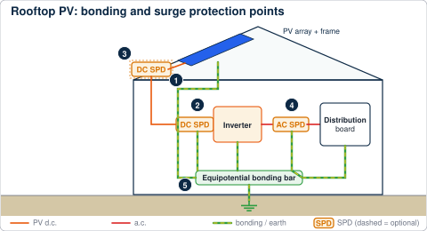

> Earthing, Bonding, Surge & Lightning Protection Library · **SHEET 10 · SOLAR PV** · content version 1.0

# Solar PV arrays, inverters and batteries

*Lightning exposure, frame bonding, d.c. and a.c. surge protection, inverter earthing and the hazards of the d.c. side of a rooftop PV system*

**Applies to:** Roof-mounted PV arrays and mounting rails, string and main d.c. cables, grid-tied and hybrid inverters (Sunsynk named where the statement is product-specific), battery banks, a.c. connection to the distribution board, inverter data lines

📄 **PDF:** [10_solar_pv_inverters_batteries.pdf](https://github.com/Skynet1971/earthing/raw/HEAD/docs/pdf/10_solar_pv_inverters_batteries.pdf)

> ℹ️ Information only. Every technical statement cites a source and PDF page; it does not replace the wiring code that applies at the site, the product manuals, or a qualified and registered person.

## 1  Does a PV array raise the lightning risk?

DEHN states that, according to the state of scientific and technical knowledge, installing PV modules does not increase the risk of a lightning strike.[R44 p.2](#sources-cited-on-this-page) The UK BRE guide accepts a very small increased risk for a typical roof-mounted system and lists situations where even that may not hold.[R49 p.14](#sources-cited-on-this-page)[R49 p.14](#sources-cited-on-this-page)

- DEHN rooftop-PV white paper (WPX029, 2022): according to the state of scientific and technical knowledge, installing PV modules does not increase the risk of a lightning strike, so the need for lightning protection cannot be derived from the mere existence of a PV system.[R44 p.2](#sources-cited-on-this-page)
- Installing PV modules on a roof does not in itself increase the risk of a lightning strike.[R6 p.364](#sources-cited-on-this-page)
- BRE PV guide (UK, 2nd ed. 2006): it is generally accepted that a typical roof-mounted PV system presents a very small increased risk of a direct lightning strike.[R49 p.14](#sources-cited-on-this-page)
- BRE PV guide (UK, 2nd ed. 2006): the very small increased strike risk may not hold where the PV system is particularly large, is on top of a tall building, becomes the tallest structure in the vicinity, or is in an open area such as a field.[R49 p.14](#sources-cited-on-this-page)
- BRE PV guide (UK, 2nd ed. 2006): lightning can cause damage by a direct strike or by surges from a nearby strike, and induced surges are the more likely cause of lightning damage in the majority of installations.[R49 p.14](#sources-cited-on-this-page)
- BRE PV guide (UK, 2nd ed. 2006): where the PV system is perceived to increase the risk of a direct strike, lightning protection specialists should be consulted with a view to installing a separate lightning protection system in accordance with BS 6651.[R49 p.14](#sources-cited-on-this-page)
- SMA technical information (Overvoltage Protection, v1.3): if a building already has a lightning protection system, appropriate measures must also be implemented for a PV system erected on it.[R45 p.3](#sources-cited-on-this-page)
- DEHN rooftop-PV white paper (WPX029, 2022): citing Supplement 5 of the German DIN EN 62305-3, a lightning protection system designed for class of LPS III (LPL III) meets the usual requirements for PV systems.[R44 p.2](#sources-cited-on-this-page)
- DEHN rooftop-PV white paper (WPX029, 2022): according to IEC 60364-4-44, surge protective devices must also be installed for buildings that have no external lightning protection system.[R44 p.2](#sources-cited-on-this-page)
- BRE PV guide (UK, 2nd ed. 2006): if the building is fitted with a lightning protection system (LPS), a lightning protection installer should be consulted on whether the array frame should be connected to the LPS and with what size of conductor.[R49 p.14](#sources-cited-on-this-page)
- SMA technical information (Overvoltage Protection, v1.3): an expert on lightning protection must determine for each PV system which lightning and overvoltage protection measures are necessary.[R45 p.1](#sources-cited-on-this-page)

> ℹ️ **NOTE** — **The sources differ on strike risk and on who decides**
>
> The DEHN and BRE positions are set side by side in the chapter on where the sources disagree. SMA leaves the choice of measures for each system to an expert on lightning protection[R45 p.1](#sources-cited-on-this-page); BRE refers the frame-to-LPS question to a lightning protection installer.[R49 p.14](#sources-cited-on-this-page)

## 2  PV array with and without an external LPS

DEHN distinguishes three cases: a building without external lightning protection, a building with external lightning protection where the separation distance s to the PV system is kept, and one where it cannot be kept. The type of d.c. surge protective device and its position follow from the case.[R44 p.6](#sources-cited-on-this-page)[R44 p.9](#sources-cited-on-this-page)[R44 p.9](#sources-cited-on-this-page)

| **10 m** | **10 m** | **0.9 m** |
|---|---|---|
| d.c. cable length beyond which DEHN requires a second d.c. SPD[R44 p.6](#sources-cited-on-this-page) | a.c. cable length beyond which DEHN requires an SPD at the inverter output[R44 p.6](#sources-cited-on-this-page) | separation distance in air that HVI insulated down conductors are equivalent to, up to[R44 p.9](#sources-cited-on-this-page) |

### Building without an external lightning protection system

- DEHN rooftop-PV white paper (WPX029, 2022): on a building without external LPS, the DC SPD goes at the DC input of the inverter, and if the DC cable length l1 to the PV generator exceeds 10 m an additional SPD is required at the PV generator.[R44 p.6](#sources-cited-on-this-page)
- DEHN rooftop-PV white paper (WPX029, 2022): every DC input (MPPT) of the inverter must be protected by its own surge protective device (type 2 in the case without external LPS).[R44 p.7](#sources-cited-on-this-page)
- Every d.c. (MPP) input of a PV inverter must be protected by a type 2 SPD.[R6 p.371](#sources-cited-on-this-page)
- DEHN rooftop-PV white paper (WPX029, 2022): an additional type 2 DC arrester is to be installed on the module side if the distance between the inverter input and the PV generator exceeds 10 m.[R44 p.7](#sources-cited-on-this-page)
- DEHN rooftop-PV white paper (WPX029, 2022): an SPD at the AC output of the inverter is required if the AC cable length l2 back to the protected low-voltage input exceeds 10 m.[R44 p.6](#sources-cited-on-this-page)
- DEHN rooftop-PV white paper (WPX029, 2022): PV inverters and other electronics such as AC-coupled battery storage are sufficiently protected if they are no further than 10 m from the arrester at the grid connection point; with greater cable lengths an additional type 2 SPD must be installed.[R44 p.7](#sources-cited-on-this-page)
- The a.c. output of a PV inverter is sufficiently protected by the type 2 arrester at the grid connection point if the cable distance between them is less than 10 m; beyond that an additional type 2 SPD is needed at the inverter.[R6 p.371](#sources-cited-on-this-page)
- DEHN rooftop-PV white paper (WPX029, 2022): if inverters are connected to data and sensor lines for yield monitoring, suitable surge protective devices are required on those lines.[R44 p.7](#sources-cited-on-this-page)

### External LPS, separation distance kept

- DEHN rooftop-PV white paper (WPX029, 2022): on a building with external LPS the PV system must itself be protected from direct strikes, meaning it must be installed within the protected volume of the external lightning protection system.[R44 p.7](#sources-cited-on-this-page)
- DEHN rooftop-PV white paper (WPX029, 2022): a separation distance s must be maintained between all conductive parts of the PV system and the lightning protection system.[R44 p.8](#sources-cited-on-this-page)
- DEHN rooftop-PV white paper (WPX029, 2022): the separation distance s between a lightning protection system and a PV system is the distance needed to avoid uncontrolled flashover to adjacent metal parts when lightning strikes the external lightning protection system.[R44 p.3](#sources-cited-on-this-page)
- Per IEC/BS EN 62305-3 as summarised by Furse, the separation distance is achieved by placing lightning conductors far enough from conductive parts leading into the structure that a strike to the lightning conductor cannot flash over to the adjacent metalwork.[R12 p.11](#sources-cited-on-this-page)
- DEHN rooftop-PV white paper (WPX029, 2022): lightning equipotential bonding must be implemented for all conductive systems and lines entering the building which may carry lightning currents.[R44 p.8](#sources-cited-on-this-page)
- DEHN rooftop-PV white paper (WPX029, 2022): lightning equipotential bonding is achieved by connecting all metal systems directly, and all energised systems indirectly via type 1 lightning current arresters, to the earth-termination system.[R44 p.8](#sources-cited-on-this-page)
- SMA technical information (Overvoltage Protection, v1.3): for internal lightning protection, metal and conductive parts such as water pipes are bonded directly to each other, while live cables such as the grid connection or telephone lines are connected indirectly to the grounding arrangement through an overvoltage protection device.[R45 p.2](#sources-cited-on-this-page)
- DEHN rooftop-PV white paper (WPX029, 2022): lightning equipotential bonding should be implemented as close as possible to the point of entry into the building, to keep partial lightning currents out of the building.[R44 p.8](#sources-cited-on-this-page)
- DEHN rooftop-PV white paper (WPX029, 2022): with external LPS and the separation distance kept, the DC side of the inverter must be protected by a type 2 PV arrester.[R44 p.9](#sources-cited-on-this-page)
- DEHN rooftop-PV white paper (WPX029, 2022): on a building with external LPS the grid connection point must be protected by a multipole type 1 SPD (for example a spark-gap-based combined arrester).[R44 p.9](#sources-cited-on-this-page)
- DEHN rooftop-PV white paper (WPX029, 2022): with external LPS, if the cable between the type 1 arrester at the grid connection point and the inverter or AC-coupled battery storage is less than 10 m, protection is sufficient; for longer cables additional type 2 SPDs must be installed upstream of the devices.[R44 p.9](#sources-cited-on-this-page)
- DEHN rooftop-PV white paper (WPX029, 2022): high-voltage-resistant insulated down conductors are an alternative way of keeping the separation distance, equivalent to a separation distance s of up to 0.9 m in air.[R44 p.9](#sources-cited-on-this-page)
- Per a South African trade article on SANS/IEC 62305, the required separation distance can be maintained by placing air terminals the required distance from conductive elements, by insulating material (GRP), or by High Voltage Impulse (HVI) conductors.[R14 p.3](#sources-cited-on-this-page)
- SMA technical information (Overvoltage Protection, v1.3): because lightning-current-capable DC SPDs are costly, adapting the lightning protection system to increase the separation distance is in many cases the most economical solution.[R45 p.3](#sources-cited-on-this-page)

### External LPS, separation distance not kept

- DEHN rooftop-PV white paper (WPX029, 2022): if the roofing is made of metal or is formed by the PV system itself, the separation distance s cannot be maintained.[R44 p.9](#sources-cited-on-this-page)
- DEHN rooftop-PV white paper (WPX029, 2022): when the separation distance cannot be kept, the metal components of the PV mounting system must be connected to the external LPS so that they can carry lightning currents, using a copper conductor of at least 16 mm2 or equivalent.[R44 p.9](#sources-cited-on-this-page)
- DEHN rooftop-PV white paper (WPX029, 2022): if the PV mounting system is connected directly to the external lightning protection system because the separation distance s cannot be maintained, its bonding conductors become part of the lightning equipotential bonding system.[R44 p.3](#sources-cited-on-this-page)
- DEHN rooftop-PV white paper (WPX029, 2022): bonding conductors of a mounting system that is connected to the lightning protection system must be capable of carrying lightning currents.[R44 p.3](#sources-cited-on-this-page)
- DEHN rooftop-PV white paper (WPX029, 2022): when the mounting system is connected to the LPS, lightning equipotential bonding must also be implemented for the PV lines entering the building from outside.[R44 p.9](#sources-cited-on-this-page)
- DEHN rooftop-PV white paper (WPX029, 2022): when the separation distance is not kept, IEC 61643-32 and IEC TR 63227 require the DC lines to be protected by a type 1 SPD for PV systems.[R44 p.9](#sources-cited-on-this-page)
- DEHN rooftop-PV white paper (WPX029, 2022): when the separation distance is not kept, the type 1 DC SPD for the PV generator is placed at the point where the PV lines enter the building, and if the DC cable length l1 exceeds 10 m an additional SPD must be installed at the inverter.[R44 p.11](#sources-cited-on-this-page)
- DEHN rooftop-PV white paper (WPX029, 2022): when the separation distance is not kept, if the inverter or battery storage system is more than 10 m from the type 1 SPD at the grid connection point, an additional type 1 SPD must be installed.[R44 p.9](#sources-cited-on-this-page)
- DEHN rooftop-PV white paper (WPX029, 2022): when the separation distance is not kept, suitable surge protective devices must also be installed on the data lines used for yield monitoring.[R44 p.9](#sources-cited-on-this-page)
- SMA technical information (Overvoltage Protection, v1.3): type I SPDs are needed where lightning or partial lightning currents can flow via electrical cables, for example if the protected system is directly connected to the external LPS or the distance between the DC cables and the external lightning protection is too small.[R45 p.3](#sources-cited-on-this-page)
- SMA technical information (Overvoltage Protection, v1.3): an SPD type II is sufficient to protect an SMA inverter against overvoltages; if partial lightning currents are expected, an SPD type I followed by an SPD type II should be used.[R45 p.4](#sources-cited-on-this-page)

| Case (DEHN WPX029) | d.c. side | a.c. side |
|---|---|---|
| No external LPS | Type 2 at each inverter d.c. input; an additional SPD at the PV generator if the d.c. cable exceeds the length threshold[R44 p.6](#sources-cited-on-this-page)[R44 p.7](#sources-cited-on-this-page) | SPD at the inverter a.c. output if the a.c. cable to the protected low-voltage input exceeds the length threshold[R44 p.6](#sources-cited-on-this-page) |
| External LPS, separation distance kept | Type 2 PV arrester at the inverter d.c. side[R44 p.9](#sources-cited-on-this-page) | Multipole type 1 at the grid connection point; additional type 2 upstream of the devices for longer cables[R44 p.9](#sources-cited-on-this-page)[R44 p.9](#sources-cited-on-this-page) |
| External LPS, separation distance not kept | Type 1 at the point where the PV lines enter the building; an additional SPD at the inverter if the d.c. cable exceeds the length threshold[R44 p.9](#sources-cited-on-this-page)[R44 p.11](#sources-cited-on-this-page) | Additional type 1 if the inverter or battery storage is beyond the distance threshold from the type 1 SPD at the grid connection point[R44 p.9](#sources-cited-on-this-page) |

*Summary of the DEHN rooftop-PV white paper; the length thresholds are given in the bullet lists above.*

### Minimum discharge capacity of a type 1 d.c. SPD

| Class of LPS (DEHN) | Fewer than four down conductors | Four or more down conductors |
|---|---|---|
| Class III and IV (100 kA, 10/350 µs) | 8.5 kA (8/20) / 5 kA (10/350) per path; 17 / 10 kA total[R44 p.4](#sources-cited-on-this-page) | 5 / 2.5 kA per path; 10 / 5 kA total[R44 p.4](#sources-cited-on-this-page) |
| Class I or unknown (200 kA, 10/350 µs) | 17 kA (8/20) / 10 kA (10/350) per path; 34 / 20 kA total[R44 p.4](#sources-cited-on-this-page) | 10 / 5 kA per path; 20 / 10 kA total[R44 p.4](#sources-cited-on-this-page) |

*Values for a voltage-limiting type 1 d.c. SPD as printed in the DEHN rooftop-PV white paper.[R44 p.4](#sources-cited-on-this-page)[R44 p.4](#sources-cited-on-this-page)*

### Air-termination rods and core shadows on the modules

| **1.08 m** | **106 × d** |
|---|---|
| DEHN: distance at which a rod of 10 mm diameter casts only a diffuse shadow[R44 p.3](#sources-cited-on-this-page) | SAPVIA (South Africa): minimum distance to avoid a core shadow, d = diameter of the shading object[R47 p.12](#sources-cited-on-this-page) |

- DEHN rooftop-PV white paper (WPX029, 2022): for a 10 mm diameter air-termination rod, only a diffuse shadow (no core shadow) falls on a module once the rod is 1.08 m away.[R44 p.3](#sources-cited-on-this-page)
- SAPVIA PV guidelines (South Africa, 2017): to avoid an umbra (core shadow) on the modules, the minimum distance must be 106 times the diameter of the shading object, which matters most for lightning rods and other roof structures.[R47 p.12](#sources-cited-on-this-page)
- SAPVIA PV guidelines (South Africa, 2017): the DC plan (module position, hook position, cable laying, inlets) should consider integration into the lightning protection where applicable.[R47 p.26](#sources-cited-on-this-page)

## 3  Bonding module frames and mounting rails

DEHN and SAPVIA require the mounting system to be connected with copper conductors; the UK BRE guide allows the array frame to be left floating in a defined case. The conflict is tabled at the end of this chapter.[R44 p.3](#sources-cited-on-this-page)[R47 p.31](#sources-cited-on-this-page)[R49 p.13](#sources-cited-on-this-page)

| **6 mm²** | **16 mm²** | **10 mm²** |
|---|---|---|
| copper, functional earthing of the mounting system (DEHN, citing IEC TR 63227)[R44 p.3](#sources-cited-on-this-page) | copper, mounting system tied into a class III LPS (DEHN)[R44 p.3](#sources-cited-on-this-page) | braid, array frame bond where the BRE decision tree requires one (UK)[R49 p.13](#sources-cited-on-this-page) |

### Functional earthing, no connection to an LPS (DEHN, SAPVIA)

- DEHN rooftop-PV white paper (WPX029, 2022): the insulation monitoring integrated in inverters is only permanently effective if the PV mounting system is connected to earth.[R44 p.2](#sources-cited-on-this-page)
- DEHN rooftop-PV white paper (WPX029, 2022): for functional earthing of the PV mounting system, Section 7 of IEC TR 63227 requires copper conductors of at least 6 mm2 cross-section or equivalent.[R44 p.3](#sources-cited-on-this-page)
- DEHN rooftop-PV white paper (WPX029, 2022): the PV mounting rails must also be permanently interconnected with conductors of the same cross-section as the functional earthing conductor (at least 6 mm2 copper).[R44 p.3](#sources-cited-on-this-page)
- Functional earthing of a PV mounting system requires copper conductors of at least 6 mm2 or equivalent (German DIN EN 62305-3 Supplement 5).[R6 p.365](#sources-cited-on-this-page)
- SAPVIA PV guidelines (South Africa, 2017): the metal substructure of the PV array must be bonded to potential equalisation with 6 mm2 copper (or comparable).[R47 p.31](#sources-cited-on-this-page)
- SAPVIA PV guidelines (South Africa, 2017): because of the anodised aluminium, the module frame cannot be used for equalisation, and the installer must ensure that all rails are correctly bonded.[R47 p.31](#sources-cited-on-this-page)

### Mounting system connected to the LPS (DEHN)

- DEHN rooftop-PV white paper (WPX029, 2022): if the PV mounting system is connected directly to the external lightning protection system because the separation distance s cannot be maintained, its bonding conductors become part of the lightning equipotential bonding system.[R44 p.3](#sources-cited-on-this-page)
- DEHN rooftop-PV white paper (WPX029, 2022): bonding conductors of a mounting system that is connected to the lightning protection system must be capable of carrying lightning currents.[R44 p.3](#sources-cited-on-this-page)
- DEHN rooftop-PV white paper (WPX029, 2022): where the mounting system is tied into a class III lightning protection system, the minimum is a 16 mm2 copper conductor or equivalent, and the mounting rails must again be permanently interconnected.[R44 p.3](#sources-cited-on-this-page)
- If the PV mounting system is connected directly to the external LPS because the separation distance cannot be kept, the bonding conductors must carry lightning current: at least 16 mm2 copper or equivalent for class of LPS III.[R6 p.365](#sources-cited-on-this-page)
- DEHN rooftop-PV white paper (WPX029, 2022): when the separation distance cannot be kept, the metal components of the PV mounting system must be connected to the external LPS so that they can carry lightning currents, using a copper conductor of at least 16 mm2 or equivalent.[R44 p.9](#sources-cited-on-this-page)

### UK practice: the BRE decision tree

- BRE PV guide (UK, 2nd ed. 2006): electrical separation of the mains from the d.c. side by an isolating transformer is the key determining factor when assessing whether the array frame needs earthing.[R49 p.13](#sources-cited-on-this-page)
- BRE PV guide (UK, 2nd ed. 2006): an installation using Class II modules, Class II d.c. cables and connectors and an inverter with an isolation transformer is the recommended approach and permits the array frame to be left floating (unearthed).[R49 p.13](#sources-cited-on-this-page)
- BRE PV guide (UK, 2nd ed. 2006): the array frame earthing decision tree has three outcomes: leave the frame floating, install and bond to an earth spike, or bond directly to the consumer earthing terminal.[R49 p.13](#sources-cited-on-this-page)
- BRE PV guide (UK, 2nd ed. 2006): where the decision tree requires the array frame to be bonded, the bond is to use 10 mm2 braid or equivalent, and a PME earth must not be taken out of the equipotential zone.[R49 p.13](#sources-cited-on-this-page)
- BRE PV guide (UK, 2nd ed. 2006): if an earth spike is already installed for lightning protection, it is to be bonded to the array frame bonding braid.[R49 p.13](#sources-cited-on-this-page)
- BRE PV guide (UK, 2nd ed. 2006): where the incoming supply is PME (the majority of UK domestic supplies), the PME earth cannot be taken outside the equipotential zone, to prevent a shock hazard should the supply neutral ever be lost.[R49 p.13](#sources-cited-on-this-page)
- BRE PV guide (UK, 2nd ed. 2006): an inverter with an isolating transformer removes the requirement to earth the array frame, but does not override any need to connect the frame to earth for lightning protection purposes.[R49 p.15](#sources-cited-on-this-page)
- BRE PV guide (UK, 2nd ed. 2006): if the building is fitted with a lightning protection system (LPS), a lightning protection installer should be consulted on whether the array frame should be connected to the LPS and with what size of conductor.[R49 p.14](#sources-cited-on-this-page)

| Question | BRE PV guide (UK, 2006) | DEHN WPX029 / SAPVIA (South Africa) |
|---|---|---|
| May the frame be left unearthed? | Yes, with Class II modules, Class II d.c. cables and connectors and an inverter with an isolation transformer; this is the recommended approach.[R49 p.13](#sources-cited-on-this-page) | DEHN: the inverter insulation monitoring is only permanently effective if the mounting system is connected to earth.[R44 p.2](#sources-cited-on-this-page) SAPVIA: the metal substructure must be bonded to potential equalisation.[R47 p.31](#sources-cited-on-this-page) |
| What decides? | Electrical separation by an isolating transformer is the key factor[R49 p.13](#sources-cited-on-this-page); it does not override a need to connect the frame to earth for lightning protection.[R49 p.15](#sources-cited-on-this-page) | DEHN: functional earthing of the mounting system, and a lightning-current-capable connection when the separation distance cannot be kept.[R44 p.3](#sources-cited-on-this-page)[R44 p.9](#sources-cited-on-this-page) |
| Conductor | 10 mm² braid or equivalent where a bond is required.[R49 p.13](#sources-cited-on-this-page) | At least 6 mm² copper or equivalent[R44 p.3](#sources-cited-on-this-page)[R47 p.31](#sources-cited-on-this-page); at least 16 mm² copper for a class III LPS connection.[R44 p.3](#sources-cited-on-this-page) |
| Where the bond goes | Floating, to an earth spike, or directly to the consumer earthing terminal; a PME earth must not leave the equipotential zone.[R49 p.13](#sources-cited-on-this-page)[R49 p.13](#sources-cited-on-this-page) | Rails permanently interconnected with conductors of the functional earthing cross-section[R44 p.3](#sources-cited-on-this-page); the module frame cannot be used for equalisation.[R47 p.31](#sources-cited-on-this-page) |

*The BRE guide is UK guidance and treats PME supplies specifically[R49 p.13](#sources-cited-on-this-page); DEHN cites IEC TR 63227[R44 p.3](#sources-cited-on-this-page); SAPVIA is South African. The wiring code that applies at the site decides.*

## 4  Surge protection on the d.c. side, the a.c. side and data lines

*Concept sketch, not a product wiring diagram. (1) mounting-rail bonding conductor, at least 6 mm² copper for functional earthing[R44 p.3](#sources-cited-on-this-page)[R44 p.3](#sources-cited-on-this-page) (2) d.c. SPD at the inverter d.c. input, one per MPP input[R44 p.6](#sources-cited-on-this-page)[R44 p.7](#sources-cited-on-this-page) (3) additional d.c. SPD at the PV generator when the d.c. cable is longer than the threshold[R44 p.6](#sources-cited-on-this-page)[R44 p.7](#sources-cited-on-this-page) (4) a.c. SPD at the inverter output when the a.c. cable to the protected input is longer than the threshold[R44 p.6](#sources-cited-on-this-page)[R44 p.7](#sources-cited-on-this-page) (5) equipotential bonding bar for the inverter, its SPDs and the board: Sunsynk makes an earth cable to the inverter grid-side earth plate mandatory; ABB keeps the a.c. SPD connections to the earthing bar and to the inverter ground short and straight.[R46 p.25](#sources-cited-on-this-page)[R51 p.5](#sources-cited-on-this-page)*

### Selecting the d.c. SPD

- DEHN rooftop-PV white paper (WPX029, 2022): IEC 61643-32 requires the SPD voltage protection level Up to be at least 20 % lower than the dielectric strength of the PV system.[R44 p.5](#sources-cited-on-this-page)
- ABB solar brochure (Lightning and surge protective devices, 2011): the example DC-side PV SPD for 600 V systems has Ucpv 670 V, Imax 40 kA, Up 1.4 kV and suits a PV short-circuit current Iscwpv up to 100 A (the 1000 V version has Up 3.8 kV).[R51 p.5](#sources-cited-on-this-page)
- DEHN rooftop-PV white paper (WPX029, 2022): a fault-resistant Y circuit in a PV SPD prevents damage to the surge protective device in the event of insulation faults in the generator circuit.[R44 p.15](#sources-cited-on-this-page)
- ABB solar brochure (Lightning and surge protective devices, 2011): every SPD using MOVs must have an internal thermal disconnection so that it can be disconnected at end of life.[R51 p.3](#sources-cited-on-this-page)
- SMA technical information (Overvoltage Protection, v1.3): an SPD type II is sufficient to protect an SMA inverter against overvoltages; if partial lightning currents are expected, an SPD type I followed by an SPD type II should be used.[R45 p.4](#sources-cited-on-this-page)
- SMA technical information (Overvoltage Protection, v1.3): type I SPDs are needed where lightning or partial lightning currents can flow via electrical cables, for example if the protected system is directly connected to the external LPS or the distance between the DC cables and the external lightning protection is too small.[R45 p.3](#sources-cited-on-this-page)

> ℹ️ **NOTE** — **No selection rule for the d.c. continuous operating voltage**
>
> No fact in this library states how the maximum continuous operating voltage of a PV SPD is to be chosen relative to the array open-circuit voltage. The only values available are those ABB prints for its own example device.[R51 p.5](#sources-cited-on-this-page)

### Where the d.c. SPDs go

The DEHN placement rules for each lightning protection case are listed in the chapter on PV arrays with and without an external LPS.[R44 p.6](#sources-cited-on-this-page)[R44 p.11](#sources-cited-on-this-page)

- ABB solar brochure (Lightning and surge protective devices, 2011): SPD location A (array end) protects the PV cells; if the array-to-inverter distance L1 is less than 10 m, a PV SPD at only A or B is recommended, and its connection to the module chassis should be as short and straight as possible.[R51 p.7](#sources-cited-on-this-page)
- BRE PV guide (UK, 2nd ed. 2006): to protect the d.c. system, surge suppression devices can be fitted at the inverter end of the d.c. cabling and at the array.[R49 p.14](#sources-cited-on-this-page)
- SMA technical information (Overvoltage Protection, v1.3): for inverters with multiple MPP trackers, an SPD or SPD combination should be planned for each input.[R45 p.5](#sources-cited-on-this-page)
- SMA technical information (Overvoltage Protection, v1.3): where string fuses are used, the SPD must be installed at the point of interconnection of the combined strings, after the fuses.[R45 p.6](#sources-cited-on-this-page)
- Sunsynk 8 kW hybrid inverter manual: a separate DC circuit breaker must be installed between the inverter and the PV modules, and users are requested to install PV junction boxes with surge protection to protect the system from lightning.[R46 p.29](#sources-cited-on-this-page)
- BRE PV guide (UK, 2nd ed. 2006): most grid-connect inverters have some form of in-built surge suppression, but discrete devices may also be specified.[R49 p.14](#sources-cited-on-this-page)

### The a.c. side

- SMA technical information (Overvoltage Protection, v1.3): if SPDs are deployed on the DC side, SPDs are also required on the AC side because of potential differences.[R45 p.5](#sources-cited-on-this-page)
- SMA technical information (Overvoltage Protection, v1.3): unlike the DC side, several inverters can be protected by a single SPD on the AC side because they are connected to the same grid voltage.[R45 p.5](#sources-cited-on-this-page)
- ABB solar brochure (Lightning and surge protective devices, 2011): for the AC-side SPD at the main board, a Type 1 SPD is mandatory when a lightning rod is present.[R51 p.2](#sources-cited-on-this-page)
- ABB solar brochure (Lightning and surge protective devices, 2011): AC head protection at the entrance of the building (location D) is a routine installation, and its connection to the earthing bar should be as short and straight as possible.[R51 p.5](#sources-cited-on-this-page)
- ABB solar brochure (Lightning and surge protective devices, 2011): an SPD protecting the inverter output on the AC side (location C) is a routine installation; its connections to the earthing bar and to the ground of the inverter on the AC side should be as short and straight as possible.[R51 p.5](#sources-cited-on-this-page)
- BRE PV guide (UK, 2nd ed. 2006): to protect the a.c. system, surge suppression devices may be fitted at the main incoming point of the a.c. supply (at the consumer's cut-out).[R49 p.14](#sources-cited-on-this-page)

### Data and sensor lines of the inverter

- SMA technical information (Overvoltage Protection, v1.3): wired communication connections of the inverter (e.g. RS485, Ethernet) must also be protected by overvoltage protection devices, otherwise potential differences can damage the inverter interfaces, the inverter and the connected communication device.[R45 p.6](#sources-cited-on-this-page)
- DEHN rooftop-PV white paper (WPX029, 2022): if inverters are connected to data and sensor lines for yield monitoring, suitable surge protective devices are required on those lines.[R44 p.7](#sources-cited-on-this-page)
- DEHN rooftop-PV white paper (WPX029, 2022): when the separation distance is not kept, suitable surge protective devices must also be installed on the data lines used for yield monitoring.[R44 p.9](#sources-cited-on-this-page)

## 5  Cable routing

> ✅ **DO** — **Keep loops small and run the bonding conductor with the cables**
>
> BRE asks for short d.c. runs with positive and negative of the same string bundled together, including the associated earth/bonding conductors[R49 p.14](#sources-cited-on-this-page)[R49 p.14](#sources-cited-on-this-page); DEHN asks for power and data lines to run with the equipotential bonding conductors along their entire route.[R44 p.2](#sources-cited-on-this-page)

- DEHN rooftop-PV white paper (WPX029, 2022): PV cables must be routed so that large conductor loops are avoided, both when forming a string and when interconnecting several strings.[R44 p.2](#sources-cited-on-this-page)
- PV cabling must be routed so that large conductor loops are avoided.[R6 p.364](#sources-cited-on-this-page)
- BRE PV guide (UK, 2nd ed. 2006): all d.c. cables should be installed in runs as short as possible, and the positive and negative cables of the same string or main d.c. supply should be bundled together.[R49 p.14](#sources-cited-on-this-page)
- BRE PV guide (UK, 2nd ed. 2006): bundling positive and negative d.c. cables avoids creating loops, and the requirement for short runs and bundling also includes any associated earth/bonding conductors.[R49 p.14](#sources-cited-on-this-page)
- DEHN rooftop-PV white paper (WPX029, 2022): power lines (DC and AC) and data lines (e.g. radiation sensor, yield monitoring) should be routed together with the equipotential bonding conductors along their entire route.[R44 p.2](#sources-cited-on-this-page)
- DEHN rooftop-PV white paper (WPX029, 2022): data or sensor lines must not be routed across several strings where they would form large conductor loops with the string lines.[R44 p.2](#sources-cited-on-this-page)
- BRE PV guide (UK, 2nd ed. 2006): long cables (e.g. PV main d.c. cables over about 50 m) should be installed in earthed metal conduit or trunking, or be screened cables such as mineral insulated or armoured.[R49 p.14](#sources-cited-on-this-page)
- BRE PV guide (UK, 2nd ed. 2006): an inverter should not be mounted on an inside wall that has an LPS down lead running just the other side of the brickwork on the outside of the building.[R49 p.14](#sources-cited-on-this-page)
- SAPVIA PV guidelines (South Africa, 2017): cables and especially plugs must not be in direct contact with the roofing, in order to avoid insulation faults.[R47 p.37](#sources-cited-on-this-page)

> ⚠️ **WARNING** — **Lead inductance adds to the protection level**
>
> SMA notes that during a surge voltage drops across the cable inductance, so a non-ideal SPD arrangement raises the protection level seen at the inverter[R45 p.7](#sources-cited-on-this-page); DEHN notes that the drop along SPD connecting leads is mainly inductive at high rates of current change.[R6 p.238](#sources-cited-on-this-page)

## 6  Inverter earthing, isolation, RCDs and batteries

Statements in this chapter that name Sunsynk come from the Sunsynk 8 kW hybrid inverter manual and apply to that product only.[R46 p.25](#sources-cited-on-this-page)

### Earth connection of the inverter

- Sunsynk 8 kW hybrid inverter manual: the earth connection is mandatory: an earth cable shall be connected to the inverter's earth plate on the grid side to prevent electric shock if the original protective conductor fails.[R46 p.25](#sources-cited-on-this-page)
- Sunsynk 8 kW hybrid inverter manual: the unit must be correctly grounded, and the supply line must be equipped with a suitable breaker and RCD to protect people.[R46 p.6](#sources-cited-on-this-page)
- Sunsynk 8 kW hybrid inverter manual: fault F24 (DC insulation impedance failure, PV isolation resistance too low) calls for checking that the earth bond cable on the inverter is connected to ground.[R46 p.66](#sources-cited-on-this-page)
- BRE PV guide (UK, 2nd ed. 2006): the inverter must be treated as standard electrical apparatus and (as the sentence continues) earthed as per BS 7671 if it is Class I.[R49 p.14](#sources-cited-on-this-page)

> ℹ️ **NOTE** — **Protective conductor size not covered**
>
> No fact in this library gives the cross-section of the protective earth conductor to the inverter. The Sunsynk manual gives the a.c. cable size[R46 p.21](#sources-cited-on-this-page) and requires wiring and cable sizes to comply with the country's wiring regulations.[R46 p.21](#sources-cited-on-this-page)

### Neutral-earth bond of a hybrid inverter (Sunsynk)

- Sunsynk 8 kW hybrid inverter manual: all neutrals can be linked together to maintain the neutral bond, and a neutral-earth bond that is required for off-grid operation has to be removed in grid-tied operation.[R46 p.25](#sources-cited-on-this-page)
- Sunsynk 8 kW hybrid inverter manual: because the inverter is a true hybrid, the neutral-earth bond must only be made when the inverter is operating in islanding mode.[R46 p.25](#sources-cited-on-this-page)
- Sunsynk 8 kW hybrid inverter manual: the inverter energises its A/T/S (ATS 240) output whenever it runs in island mode, so the coil of an AC relay connected there can make the neutral-earth bond only during islanding.[R46 p.25](#sources-cited-on-this-page)
- Sunsynk 8 kW hybrid inverter manual: for a hybrid system needing a neutral-earth bond, a permanent neutral-earth wire can cause faults with an RCD upstream of the inverter (the printed sentence reads 'you can have a permanent earth wire since this can cause faults', evidently meaning cannot).[R46 p.25](#sources-cited-on-this-page)

### Residual current devices

- Sunsynk 8 kW hybrid inverter manual: if an external RCD is used it should be of Type A/AC with a tripping current of 30 mA or higher.[R46 p.71](#sources-cited-on-this-page)
- Sunsynk 8 kW hybrid inverter manual: an RCD installed for the inverter must disconnect all live conductors, including both active and neutral conductors (the manual cites AS/NZS 3000).[R46 p.71](#sources-cited-on-this-page)
- Sunsynk 8 kW hybrid inverter manual: an RCD is recommended on all circuits and sub-circuits connected to the inverter.[R46 p.71](#sources-cited-on-this-page)
- Sunsynk 8 kW hybrid inverter manual: the recommended RCBO specification is earth-leakage class Type A, 30 mA sensitivity, curve C, AC network, 2-pole.[R46 p.71](#sources-cited-on-this-page)
- BRE PV guide (UK, 2nd ed. 2006): where a PV system has no at least simple separation between the a.c. and d.c. sides (transformerless inverter), an RCD installed for fault protection by automatic disconnection of supply must be a type B RCD.[R49 p.15](#sources-cited-on-this-page)
- In TN systems, type 1 and type 2 SPDs should be installed upstream of the RCD, because an RCD would see the discharged impulse current as residual current and could be mechanically damaged by partial lightning current.[R6 p.222](#sources-cited-on-this-page)
- In TT systems type 1 and type 2 SPDs must always be installed upstream of the RCD.[R6 p.229](#sources-cited-on-this-page)

> ⚠️ **WARNING** — **RCD type: BRE and the Sunsynk manual name different types**
>
> BRE (UK) requires a type B RCD for fault protection where there is no at least simple separation between the a.c. and d.c. sides[R49 p.15](#sources-cited-on-this-page); the Sunsynk manual specifies an external RCD of Type A/AC[R46 p.71](#sources-cited-on-this-page) and a Type A RCBO.[R46 p.71](#sources-cited-on-this-page) No fact in this library states whether the Sunsynk inverter provides simple separation, so the facts alone do not settle which statement applies to it.

### Isolators and breakers

- Sunsynk 8 kW hybrid inverter manual: the inverter must have an individual supply line protected by a circuit breaker operating on all wires with a contact separation of at least 3 mm.[R46 p.6](#sources-cited-on-this-page)
- Sunsynk 8 kW hybrid inverter manual: a separate AC breaker must be installed between the inverter and the grid, and an AC breaker between the backup load and the inverter is recommended.[R46 p.21](#sources-cited-on-this-page)
- Sunsynk 8 kW hybrid inverter manual: for the 8 kW model the recommended AC breaker is 63 A for the backup load and 63 A for the grid.[R46 p.21](#sources-cited-on-this-page)
- Sunsynk 8 kW hybrid inverter manual: the AC (grid/load/gen) cable for the 8 kW model is 10 AWG / 8 mm2, with terminals torqued to 1.2 N.m maximum.[R46 p.21](#sources-cited-on-this-page)
- Sunsynk 8 kW hybrid inverter manual: a separate DC circuit breaker must be installed between the inverter and the PV modules, and users are requested to install PV junction boxes with surge protection to protect the system from lightning.[R46 p.29](#sources-cited-on-this-page)
- BRE PV guide (UK, 2nd ed. 2006): the d.c. switch must be double pole so as to isolate both the PV array positive and the PV array negative.[R49 p.12](#sources-cited-on-this-page)
- SAPVIA PV guidelines (South Africa, 2017): surge-protection devices are among the DC-side balance-of-system components to be chosen and sized, together with DC isolators, DC fuses and junction boxes.[R47 p.26](#sources-cited-on-this-page)
- Sunsynk 8 kW hybrid inverter manual: CAUTION - wiring and cable sizes must comply with the country's wiring regulations, and suitable disconnection devices and RCDs must be fitted.[R46 p.21](#sources-cited-on-this-page)

### Battery wiring and fusing

- Sunsynk 8 kW hybrid inverter manual: a separate DC over-current protector or disconnect device is required between the battery and the inverter; even where a switching device is not required, over-current protection still is.[R46 p.17](#sources-cited-on-this-page)
- Sunsynk 8 kW hybrid inverter manual: the recommended DC battery protection diagram shows fuses and a two-pole DC isolator between the battery and the inverter.[R46 p.18](#sources-cited-on-this-page)
- Sunsynk 8 kW hybrid inverter manual: the battery cable for the 8 kW model is 2 AWG / 50 mm2, with terminals torqued to 5.2 N.m maximum.[R46 p.17](#sources-cited-on-this-page)
- Sunsynk 8 kW hybrid inverter manual: for paralleled inverters all batteries must be connected in parallel, with a recommended minimum cable size of 50 mm2 and fuse isolators to each inverter.[R46 p.58](#sources-cited-on-this-page)
- Sunsynk 8 kW hybrid inverter manual: in a parallel system each inverter requires a fuse isolator with surge protection and each group circuit requires an RCD.[R46 p.59](#sources-cited-on-this-page)
- BRE PV guide (UK, 2nd ed. 2006): in battery systems an over-current device must be installed in all active (non-earthed) conductors between the battery and the charge controller.[R49 p.17](#sources-cited-on-this-page)
- BRE PV guide (UK, 2nd ed. 2006): a means of manual isolation must be provided between the charge controller and the battery; the isolator must be double pole, d.c. rated and load-break.[R49 p.17](#sources-cited-on-this-page)

### Functional earthing of the array poles

- Sunsynk 8 kW hybrid inverter manual: WARNING - do not connect the PV array's positive or negative poles to ground, as this can seriously damage the inverter.[R46 p.29](#sources-cited-on-this-page)
- Sunsynk 8 kW hybrid inverter manual: PV modules with possible current leakage must not be connected to the inverter; grounded PV modules, for example, will cause current leakage to the inverter.[R46 p.29](#sources-cited-on-this-page)
- BRE PV guide (UK, 2nd ed. 2006): bonding any of the current-carrying d.c. conductors of the PV array to earth is not recommended.[R49 p.14](#sources-cited-on-this-page)
- BRE PV guide (UK, 2nd ed. 2006): earthing one of the live d.c. conductors is permitted only if there is at least simple separation between the a.c. side and the d.c. side, including in the inverter (i.e. not with a transformerless inverter).[R49 p.14](#sources-cited-on-this-page)

## 7  Inspection and testing, including after a strike

> ℹ️ **NOTE** — **No PV-specific post-strike procedure**
>
> None of the sources in this library gives an inspection procedure for a PV array or inverter after a lightning strike. The statements below are the general LPS and earthing inspection rules and the PV commissioning tests.

### After a strike

- A lightning protection system should also be inspected whenever it is known to have been struck by lightning, and after changes of use, modifications, extensions or repairs to the structure.[R6 p.57](#sources-cited-on-this-page)
- Inspection of a lightning protection system must be carried out by a lightning protection specialist.[R6 p.56](#sources-cited-on-this-page)
- Per the South African WAPA high-site guideline, immediately after lightning damage, all earthing points, earth straps and surge protection devices should be inspected and repaired.[R13 p.30](#sources-cited-on-this-page)
- In LPS inspections, the continuity of connections of air-terminations, down conductors, bonding conductors and shielding is measured; the recommended value is below 1 ohm.[R6 p.58](#sources-cited-on-this-page)

### Insulation and earth checks on the PV system

- SAPVIA PV guidelines (South Africa, 2017): according to IEC 62446, for each string the measurement of Voc and Isc and a polarity and isolation (insulation) check are mandatory before the PV array is connected to the inverter.[R47 p.34](#sources-cited-on-this-page)
- Sunsynk 8 kW hybrid inverter manual: before switching on, the installation engineer must have completed the earth bond, RCD and earth leakage tests, checked that the PV Voc does not exceed 480 V and checked the battery voltage.[R46 p.68](#sources-cited-on-this-page)
- Sunsynk 8 kW hybrid inverter manual: before connecting to the grid the inverter measures the impedance of PV+ to ground and PV- to ground, and if either is below 33 kOhm it will not connect and reports error F24.[R46 p.69](#sources-cited-on-this-page)
- Sunsynk 8 kW hybrid inverter manual: fault F24 (DC insulation impedance failure, PV isolation resistance too low) calls for checking that the earth bond cable on the inverter is connected to ground.[R46 p.66](#sources-cited-on-this-page)
- SAPVIA PV guidelines (South Africa, 2017): the inverter automatically performs insulation checks for ground faults and issues a warning message when insulation resistance is insufficient, which should be addressed as soon as possible.[R47 p.36](#sources-cited-on-this-page)
- BRE PV guide (UK, 2nd ed. 2006): the installation check list covers, under protection against overvoltage/electric shock: array frame equipotential bonding present, surge protection devices present, RCD provided (each only if required), and frame correctly integrated with the existing LPS installation.[R49 p.27](#sources-cited-on-this-page)
- BRE PV guide (UK, 2nd ed. 2006): one permitted array insulation test method is a test between array negative and earth followed by a test between array positive and earth (the other is between earth and the short-circuited array positive and negative).[R49 p.28](#sources-cited-on-this-page)
- BRE PV guide (UK, 2nd ed. 2006): before an array insulation resistance test, any equipment that could affect the measurement, i.e. overvoltage protection (SPDs) in the junction or combiner boxes, must be disconnected.[R49 p.28](#sources-cited-on-this-page)
- BRE PV guide (UK, 2nd ed. 2006): for an array insulation test with positive and negative shorted together on a 120 V system, the test voltage is 250 V and the minimum insulation resistance is 0.25 megohm.[R49 p.29](#sources-cited-on-this-page)
- BRE PV guide (UK, 2nd ed. 2006): for separate insulation tests to array positive and array negative on systems below 600 V, the test voltage is 500 V minus Voc(stc) and the minimum insulation resistance is 0.5 megohm.[R49 p.29](#sources-cited-on-this-page)

## 8  DANGER and WARNING statements

BRE notes that the supply from PV modules cannot be switched off, so special precautions are needed.[R49 p.5](#sources-cited-on-this-page)

> ⛔ **DO NOT** — **WARNING (Sunsynk): do not earth a PV pole**
>
> Do not connect the PV array's positive or negative poles to ground, as this can seriously damage the inverter.[R46 p.29](#sources-cited-on-this-page)

> ⛔ **DO NOT** — **WARNING (Sunsynk): not a DIY product**
>
> High life risk due to fire or electrocution; the inverter can only be installed by a qualified licensed electrical contractor.[R46 p.6](#sources-cited-on-this-page)

### Live d.c., shock and earthing cautions

- BRE PV guide (UK, 2nd ed. 2006): the supply from PV modules cannot be switched off, so special precautions are needed to ensure live parts are not accessible or cannot be touched during installation, use and maintenance.[R49 p.5](#sources-cited-on-this-page)
- BRE PV guide (UK, 2nd ed. 2006): PV modules are current-limiting devices, so fault protection needs a non-standard approach because fuses are not likely to blow under short-circuit conditions.[R49 p.5](#sources-cited-on-this-page)
- BRE PV guide (UK, 2nd ed. 2006): risk data recommends keeping the potential d.c. shock level below 120 V d.c. if practicable; a 120 V d.c. shock is unlikely to kill but could cause the victim to lose balance or concentration, e.g. on a roof.[R49 p.9](#sources-cited-on-this-page)
- The limit for permanently permissible touch voltage is typically 50 V a.c. and 120 V d.c.[R6 p.220](#sources-cited-on-this-page)
- BRE PV guide (UK, 2nd ed. 2006): double insulation, appropriate barriers and separation of parts must be applied to all PV systems with an open-circuit voltage above 120 V d.c.[R49 p.9](#sources-cited-on-this-page)
- BRE PV guide (UK, 2nd ed. 2006): always test for the presence of voltage on parts before touching any part of the PV system.[R49 p.21](#sources-cited-on-this-page)
- BRE PV guide (UK, 2nd ed. 2006): an electric shock may be experienced from a capacitive discharge, because a charge may build up in the PV system due to its distributed capacitance to ground (more prevalent with thin-film modules with metal frames or steel backing).[R49 p.21](#sources-cited-on-this-page)
- BRE PV guide (UK, 2nd ed. 2006): an installer in contact with earthed metal (e.g. seated on an earthed metal roof) can get a shock to earth from PV cabling; insulated tools and gloves together with insulating matting to stand or sit on can mitigate this hazard.[R49 p.21](#sources-cited-on-this-page)
- BRE PV guide (UK, 2nd ed. 2006): an electric shock may also be experienced due to the PV array developing a ground leakage path, which good wiring practice, double insulation and Class II modules reduce but do not eliminate.[R49 p.22](#sources-cited-on-this-page)
- Sunsynk 8 kW hybrid inverter manual: because the system can still hold residual energy, wait 5 minutes after turning off the power before touching electrical components.[R46 p.6](#sources-cited-on-this-page)
- BRE PV guide (UK, 2nd ed. 2006): where the incoming supply is PME (the majority of UK domestic supplies), the PME earth cannot be taken outside the equipotential zone, to prevent a shock hazard should the supply neutral ever be lost.[R49 p.13](#sources-cited-on-this-page)
- BRE PV guide (UK, 2nd ed. 2006): an inverter should not be mounted on an inside wall that has an LPS down lead running just the other side of the brickwork on the outside of the building.[R49 p.14](#sources-cited-on-this-page)
- A separate 'clean earth' for electronic equipment, kept apart from the lightning protection and protective earth, is extremely unfavourable and can be dangerous, because lightning can produce potential differences of up to some 100 kV in the earth-termination system.[R6 p.142](#sources-cited-on-this-page)

### Labels and signs

- BRE PV guide (UK, 2nd ed. 2006): where long d.c. cable runs are required it is good practice to label along the cables 'Danger solar PV array cable - high voltage d.c. - live during daylight'.[R49 p.9](#sources-cited-on-this-page)
- BRE PV guide (UK, 2nd ed. 2006): a sign 'Do not disconnect d.c. plugs and sockets under load - turn off a.c. supply first' must be fixed next to d.c. connectors that are accessible to untrained persons.[R49 p.11](#sources-cited-on-this-page)
- SAPVIA PV guidelines (South Africa, 2017): although not mandatory in South Africa, warning signs should be attached near the inverter and at the distribution board indicating that a PV installation is on the roof and that the DC cables are energised even when the inverter is isolated from the grid.[R47 p.33](#sources-cited-on-this-page)

### Arcing and fire

- SAPVIA PV guidelines (South Africa, 2017): incorrect plug assembly and the use of incompatible connectors from third-party manufacturers are the main reasons for arcing and therefore fire.[R47 p.31](#sources-cited-on-this-page)
- SAPVIA PV guidelines (South Africa, 2017): with earth faults or short circuits caused by insulation faults, arcing may occur, leading to a high risk of fire.[R47 p.37](#sources-cited-on-this-page)
- SAPVIA PV guidelines (South Africa, 2017): module interconnection with pre-fitted connectors can be done by a trained non-electrician under supervision of an electrically skilled person only while there are no exposed live parts; additional wiring and assembly of plugs must be performed by an electrician.[R47 p.28](#sources-cited-on-this-page)
- SAPVIA PV guidelines (South Africa, 2017): the DC string or main cables must not be connected to the inverter before commissioning.[R47 p.33](#sources-cited-on-this-page)

## 9  Where the sources disagree

The sources were written for different countries and dates: BRE for the UK, SAPVIA for South Africa, DEHN citing IEC and German supplements, and manufacturers for their own products. Where they conflict, the wiring code that applies at the site decides; this table shows the conflict rather than choosing for you.

| Question | One source says | Other sources say |
|---|---|---|
| Does PV raise the strike risk? | DEHN: installing PV modules does not increase the risk of a lightning strike.[R44 p.2](#sources-cited-on-this-page)[R6 p.364](#sources-cited-on-this-page) | BRE (UK): a typical roof-mounted system presents a very small increased risk, which may not hold for large, tall or exposed systems.[R49 p.14](#sources-cited-on-this-page)[R49 p.14](#sources-cited-on-this-page) |
| Earth the array frame? | BRE (UK): Class II modules and cabling with an isolating-transformer inverter permit a floating frame.[R49 p.13](#sources-cited-on-this-page) | DEHN: insulation monitoring is only permanently effective with an earthed mounting system.[R44 p.2](#sources-cited-on-this-page) SAPVIA (South Africa): the substructure must be bonded.[R47 p.31](#sources-cited-on-this-page) |
| Frame bonding conductor | BRE (UK): 10 mm² braid or equivalent.[R49 p.13](#sources-cited-on-this-page) | DEHN and SAPVIA: at least 6 mm² copper for functional earthing[R44 p.3](#sources-cited-on-this-page)[R47 p.31](#sources-cited-on-this-page); DEHN: at least 16 mm² copper when tied to a class III LPS.[R44 p.3](#sources-cited-on-this-page) |
| Separate earth for the array | BRE (UK): one outcome is bonding the frame to an earth spike, since a PME earth must not leave the equipotential zone.[R49 p.13](#sources-cited-on-this-page)[R49 p.13](#sources-cited-on-this-page) | IEC/BS EN 62305-3 as summarised by Furse recommends a single integrated earth termination system.[R12 p.11](#sources-cited-on-this-page) |
| Earthing a d.c. pole | BRE (UK): not recommended, permitted only with at least simple separation between the a.c. and d.c. sides.[R49 p.14](#sources-cited-on-this-page)[R49 p.14](#sources-cited-on-this-page) | Sunsynk: do not connect the positive or negative pole to ground.[R46 p.29](#sources-cited-on-this-page) |
| RCD type | BRE (UK): type B where there is no simple separation (transformerless inverter).[R49 p.15](#sources-cited-on-this-page) | Sunsynk: external RCD Type A/AC[R46 p.71](#sources-cited-on-this-page); RCBO Type A.[R46 p.71](#sources-cited-on-this-page) |
| Second d.c. SPD at the array | DEHN: required if the d.c. cable exceeds the length threshold[R44 p.6](#sources-cited-on-this-page)[R44 p.7](#sources-cited-on-this-page); ABB: if the array-to-inverter distance is less than 10 m, a PV SPD at only one end is recommended.[R51 p.7](#sources-cited-on-this-page) | BRE (UK): SPDs can be fitted at the inverter end and at the array, with no length threshold given.[R49 p.14](#sources-cited-on-this-page) |
| A.C. SPD | ABB: a Type 1 SPD at the main board is mandatory when a lightning rod is present[R51 p.2](#sources-cited-on-this-page); SMA: SPDs on the d.c. side mean SPDs are also required on the a.c. side.[R45 p.5](#sources-cited-on-this-page) | BRE (UK): surge suppression devices may be fitted at the main incoming point of the a.c. supply.[R49 p.14](#sources-cited-on-this-page) |
| Lightning protection standard named | BRE (UK, 2006): a separate LPS in accordance with BS 6651.[R49 p.14](#sources-cited-on-this-page) | DEHN: LPS class III per German DIN EN 62305-3 Supplement 5 meets the usual requirements for PV.[R44 p.2](#sources-cited-on-this-page) |
| Core shadow distance | DEHN: 1.08 m for a 10 mm rod.[R44 p.3](#sources-cited-on-this-page) | SAPVIA (South Africa): 106 times the diameter of the shading object.[R47 p.12](#sources-cited-on-this-page) |

*Figures are listed as printed by each source; jurisdiction and date are given where the source states them.*

## 10  Installation checklist

- [ ] Case identified: no external LPS, separation distance kept, or separation distance not kept.[R44 p.6](#sources-cited-on-this-page)[R44 p.9](#sources-cited-on-this-page)[R44 p.9](#sources-cited-on-this-page)
- [ ] Each inverter MPP input has its own d.c. SPD of the type the case requires.[R44 p.7](#sources-cited-on-this-page)[R45 p.5](#sources-cited-on-this-page)
- [ ] Second d.c. SPD at the generator end where the d.c. cable exceeds the DEHN length threshold.[R44 p.6](#sources-cited-on-this-page)[R44 p.7](#sources-cited-on-this-page)
- [ ] SPD voltage protection level at least 20 % below the dielectric strength of the PV system.[R44 p.5](#sources-cited-on-this-page)
- [ ] A.C. SPD at the grid connection point, plus one at the inverter output where the a.c. cable exceeds the length threshold.[R44 p.9](#sources-cited-on-this-page)[R44 p.6](#sources-cited-on-this-page)
- [ ] Wired communication lines of the inverter protected.[R45 p.6](#sources-cited-on-this-page)
- [ ] Mounting rails interconnected and bonded with the conductor size the applicable code requires.[R44 p.3](#sources-cited-on-this-page)[R47 p.31](#sources-cited-on-this-page)[R49 p.13](#sources-cited-on-this-page)
- [ ] Positive and negative cables bundled, with the bonding conductor, in short runs.[R49 p.14](#sources-cited-on-this-page)[R49 p.14](#sources-cited-on-this-page)
- [ ] Inverter earth connection made (Sunsynk: mandatory earth cable to the grid-side earth plate).[R46 p.25](#sources-cited-on-this-page)
- [ ] Neutral-earth bond made only in island mode on a hybrid inverter (Sunsynk).[R46 p.25](#sources-cited-on-this-page)
- [ ] Neither PV pole connected to earth on a Sunsynk inverter.[R46 p.29](#sources-cited-on-this-page)
- [ ] Battery over-current protection and isolation between battery and inverter.[R46 p.17](#sources-cited-on-this-page)[R46 p.18](#sources-cited-on-this-page)
- [ ] Voc, Isc, polarity and insulation checked per string before connection to the inverter.[R47 p.34](#sources-cited-on-this-page)
- [ ] Warning signs at the inverter and the distribution board.[R47 p.33](#sources-cited-on-this-page)

## Sources cited on this page

`[R18 p.12]` = reference 18 below, PDF page 12 (page index of the PDF file). Each cited statement was checked against a verbatim quote from that page.

| Ref | Document | PDF pages cited |
|---|---|---|
| R6 | **Lightning Protection Guide, 3rd updated edition** — DEHN + SÖHNE · 2014 · IEC / EN 62305 (Germany) · [link](https://www.dehn-international.com/sites/default/files/media/files/lpg_en_complete.pdf) | 56-58, 142, 220, 222, 229, 238, 364-365, 371 |
| R12 | **IEC/BS EN 62305 parts 1-4: technical reference (Furse)** — ABB Furse · not stated in document · IEC / BS EN 62305 (UK) · [link](https://library.e.abb.com/public/ee4d371685e544e09e8d9712fbd716c9/IEC%20BS%20EN%2062305%201%20-%204.pdf) | 11 |
| R13 | **Wireless High Site Engineering Guideline V1.0.0** — Wireless Access Providers' Association (South Africa) · V1.0.0, 2014-07-21 · South Africa · [link](https://wapa.org.za/sites/default/files/2018-08/WAPA%20Wireless%20High%20Site%20Engineering%20Guideline%20V1%200%200%2020140721.pdf) | 30 |
| R14 | **Lightning protection: 'Separation Distance' concept (Electricity+Control, January 2016)** — Crown Publications (South Africa); author Trevor Manas · January 2016 · IEC 62305 (South Africa) · [link](https://www.crown.co.za/images/magazines/electricity-control/FaceValue/Lightning_protection_Separation_Distance_concept.pdf) | 3 |
| R44 | **White paper WPX029: Lightning and surge protection for rooftop photovoltaic systems** — DEHN SE · WPX029/EN/0422 (April 2022) · IEC / EN (Germany) · [link](https://www.dehn-africa.com/sites/default/files/media/files/photovoltaic-wpx029-en.pdf) | 2-9, 11, 15 |
| R45 | **Technical Information: Overvoltage Protection. Lightning Protection and Overvoltage Protection for Sunny Boy and Sunny Tripower (U_Schutz-TI-en-13)** — SMA Solar Technology AG · version 1.3 · International · [link](https://files.sma.de/downloads/U_Schutz-TI-en-13.pdf) | 1-7 |
| R46 | **Hybrid Parity (Super) Inverter User Manual, SUNSYNK-8K-SG01LP1 / SUNSYNK-8K-SG03LP1** — Sunsynk (Global Tech China Ltd) · v.18 (12/09/22) · International · [link](https://cdn.shopify.com/s/files/1/0521/6006/9799/files/sunsynk_8kw_manual.pdf) | 6, 17-18, 21, 25, 29, 58-59, 66, 68-69, 71 |
| R47 | **Solar PV Installation Guidelines, Iteration 1.0 (PV GreenCard)** — South African Photovoltaic Industry Association (SAPVIA) · May 2017 · South Africa · [link](https://portal.segensolar.co.za/reseller/docs/SAPVIASolarPVGuidelines.pdf) | 12, 26, 28, 31, 33-34, 36-37 |
| R49 | **Photovoltaics in Buildings: Guide to the installation of PV systems, 2nd edition (DTI/Pub URN 06/1972)** — UK Department for Enterprise (DTI) / BRE · 2006 · UK · [link](https://files.bregroup.com/solar/Guide_to_the_installation_of_PV_systems_2nd_Edition.pdf) | 5, 9, 11-15, 17, 21-22, 27-29 |
| R51 | **Solar energy: lightning and surge protective devices (brochure 1TXH 000 118 B0201)** — ABB · 2011 · IEC · [link](https://library.e.abb.com/public/77266805bb3868adc12578f10033b12b/1TXH%20000%20118%20B0201_Solar%20energy%20Lightning%20and%20overvoltage%20protection_br.pdf) | 2-3, 5, 7 |

*Generated from `content/docs/10_solar_pv.yaml` on 2026-11-23. Do not edit this page in the wiki; edit the content file.*
