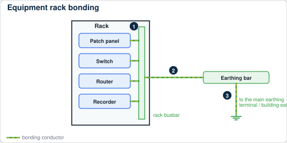

> Earthing, Bonding, Surge & Lightning Protection Library · **SHEET 11 · RACKS** · content version 1.0

# Equipment racks and cabinets

*Bonding networks, bonding busbars and conductors for equipment racks, cabinets and rack-mounted network equipment*

**Applies to:** Equipment racks and cabinets, rack-mounted switches, routers and patch panels, bonding busbars, cable trays and the bonding conductors between them

📄 **PDF:** [11_racks_cabinets_bonding.pdf](https://github.com/Skynet1971/earthing/raw/HEAD/docs/pdf/11_racks_cabinets_bonding.pdf)

> ℹ️ Information only. Every technical statement cites a source and PDF page; it does not replace the wiring code that applies at the site, the product manuals, or a qualified and registered person.

## 1  Bonding networks: CBN, mesh-BN and IBN

ITU-T K.27: in a telecommunication building the bonding and earthing network is the common bonding network (CBN), to which equipment is attached either by multiple connections (mesh-BN) or by a single point connection (IBN).[R24 p.6](#sources-cited-on-this-page)

| **2 m** | **No. 6 AWG** | **1 A** |
|---|---|---|
| typical maximum dimension of the SPC window between an IBN and the CBN, ITU-T K.27[R24 p.9](#sources-cited-on-this-page) | minimum rack bonding conductor, UFGS 27 05 26 (US)[R17 p.16](#sources-cited-on-this-page) | maximum acceptable AC ground-loop current in the bonding conductors, UFGS 27 05 26 (US)[R17 p.34](#sources-cited-on-this-page) |

### Definitions (ITU-T K.27)

- ITU-T K.27 defines the common bonding network (CBN) as the set of metallic components intentionally or incidentally interconnected to form the principal bonding network in a building.[R24 p.9](#sources-cited-on-this-page)
- ITU-T K.27: the CBN includes structural steel or reinforcing rods, metallic plumbing, AC power conduit, protective conductors, cable racks and bonding conductors; it always has a mesh topology and is connected to the earthing network.[R24 p.9](#sources-cited-on-this-page)
- ITU-T K.27 requires all elements of the CBN to be interconnected, with multiple interconnections forming a three-dimensional mesh being especially desirable.[R24 p.12](#sources-cited-on-this-page)
- ITU-T K.27 defines a mesh-BN as a bonding network in which all equipment frames, racks and cabinets (and usually the DC return) are bonded together and to the CBN at multiple points.[R24 p.9](#sources-cited-on-this-page)
- ITU-T K.27 defines an isolated bonding network (IBN) as a bonding network with a single point connection (SPC) to the CBN or to another IBN, through which it is earthed.[R24 p.9](#sources-cited-on-this-page)
- ITU-T K.27 defines the single point connection (SPC) as the unique location where an IBN connects to the CBN; it is usually a copper bus-bar rather than a literal point.[R24 p.9](#sources-cited-on-this-page)

### The same terms in the US guide specification

- Per US DoD guide spec UFGS 27 05 26, a mesh bonding network (mesh-BN) connects all associated equipment (cabinets, frames, racks, trays, pathways) to a bonding grid that is connected at multiple points to the common bonding network.[R17 p.7](#sources-cited-on-this-page)
- Per US DoD guide spec UFGS 27 05 26, a mesh-isolated bonding network (mesh-IBN) uses a bonding grid connected to the common bonding network at a single point only.[R17 p.7](#sources-cited-on-this-page)

### Mesh-BN

- ITU-T K.27: in a mesh-BN, equipment frames may be connected to the surrounding CBN without restriction, and cable shields or coaxial outer conductors may be connected to cabinet frames without restriction.[R24 p.17](#sources-cited-on-this-page)
- ITU-T K.27: the CBN makes it practical to bond cable shields and coaxial outer conductors at both ends, because the CBN's parallel low-impedance path carries most of the current driven by potential differences.[R24 p.13](#sources-cited-on-this-page)
- ITU-T K.27: surge coupling into indoor signal or power cabling is generally reduced by running the cables close to CBN elements.[R24 p.13](#sources-cited-on-this-page)
- An equipotential bonding network grid of around 5 m x 5 m is ideal and typically reduces the lightning electromagnetic field inside an LPZ by a factor of 2 (6 dB).[R6 p.201](#sources-cited-on-this-page)
- Enclosures and racks of electronic devices and systems should be tied into the equipotential bonding network by short connections.[R6 p.201](#sources-cited-on-this-page)

### Isolated bonding network (IBN)

- ITU-T K.27: the advantage of an IBN is a high level of shielding from DC up to tens or perhaps hundreds of kHz, depending on the size of the IBN.[R24 p.17](#sources-cited-on-this-page)
- ITU-T K.27: the disadvantages of an IBN are cable-routing restrictions and the extra cost of maintaining the isolation compared with a mesh-BN.[R24 p.17](#sources-cited-on-this-page)
- ITU-T K.27: IBN systems are harder to maintain because work on site tends to create inadvertent IBN-to-CBN connections that violate the single point connection and inject surge currents into the IBN.[R24 p.18](#sources-cited-on-this-page)
- ITU-T K.27: equipment framework and structural metal of the CBN within two metres of an IBN should be bonded to the single point connection bus-bar for personnel safety.[R24 p.27](#sources-cited-on-this-page)
- ITU-T K.27: a single point connection in an isolated DC return system can be verified with a DC clamp-on ammeter around the connecting conductor; zero current confirms the single point connection.[R24 p.18](#sources-cited-on-this-page)

> ℹ️ **NOTE** — **Equipotential bonding as TP-Link defines it**
>
> TP-Link defines equipotential bonding as intentionally connecting all earthed systems to the same grounding grid, or connecting their grounding grids together, to create an earthed equipotential zone.[R29 p.7](#sources-cited-on-this-page)

## 2  Bonding busbars and their names

PBB, SBB, RBB and MGB are US terms from the UFGS 27 05 26 guide specification and Motorola R56[R17 p.8](#sources-cited-on-this-page)[R5 p.203](#sources-cited-on-this-page); the ITU-T documents use main earthing terminal and single point connection.[R23 p.8](#sources-cited-on-this-page)[R24 p.9](#sources-cited-on-this-page)

| Term | Meaning or rule as published | Source |
|---|---|---|
| PBB (formerly TMGB) | Primary bonding busbar, formerly the telecommunications main grounding busbar; bonded by the telecommunications bonding conductor to the building's electrical service equipment ground.[R17 p.8](#sources-cited-on-this-page) | UFGS 27 05 26 (US) |
| SBB (formerly TGB) | Secondary bonding busbar, formerly the telecommunications grounding busbar; the common bonding point for telecommunications equipment in satellite telecommunications rooms.[R17 p.8](#sources-cited-on-this-page) | UFGS 27 05 26 (US) |
| RBB | Rack bonding busbar, installed in each telecommunications cabinet or rack.[R17 p.28](#sources-cited-on-this-page) | UFGS 27 05 26 (US) |
| MGB | Master ground bus bar: a single one installed for the communications system within a shelter, building, room or equipment area.[R5 p.203](#sources-cited-on-this-page) | Motorola R56 (US practice) |
| MET | Main earthing terminal, located as close as possible to the a.c. power and telecommunication cable entrance facilities.[R23 p.8](#sources-cited-on-this-page) | ITU-T K.73 |
| SPC bus-bar | The unique location where an IBN connects to the CBN; usually a copper bus-bar rather than a literal point.[R24 p.9](#sources-cited-on-this-page) | ITU-T K.27 |

- Per US DoD guide spec UFGS 27 05 26, the PBB and the electrical service ground bar serve separate purposes and must be two separate busbars even when they are in the same room.[R17 p.26](#sources-cited-on-this-page)
- Per US DoD guide spec UFGS 27 05 26, the PBB (and SBBs) must be at least 6 mm (0.25 in) thick by 100 mm (4 in) wide; one length option is the number of terminations plus 50 percent, with a 300 mm (12 in) minimum.[R17 p.18](#sources-cited-on-this-page)
- Per US DoD guide spec UFGS 27 05 26, the bond between the AC equipment ground (ACEG) and the PBB or SBB must be installed by a licensed electrician.[R17 p.10](#sources-cited-on-this-page)

## 3  Conductors and how they are installed

*Click the diagram to open it full size.* *Concept sketch, not a product wiring diagram. (1) rack-mounted equipment with metallic parts and patch panels for shielded cabling bonded to the rack bonding busbar with a unit bonding conductor (UFGS 27 05 26, US)[R17 p.29](#sources-cited-on-this-page) (2) each cabinet and rack bonded to the bonding network or busbar with its own dedicated conductor, not daisy-chained (UFGS 27 05 26, US)[R17 p.31](#sources-cited-on-this-page)[R17 p.31](#sources-cited-on-this-page) (3) the PBB bonded by the telecommunications bonding conductor to the building's electrical service equipment ground (UFGS 27 05 26, US)[R17 p.8](#sources-cited-on-this-page); Motorola R56 (US practice): conductor from the MGB to the grounding electrode system at least 35 mm² (#2 AWG) copper.[R5 p.207](#sources-cited-on-this-page)*

### Sizes as published

| Conductor | Size as published | Source |
|---|---|---|
| TBB / BBC by linear length | No. 6 AWG under 4 m, No. 4 AWG for 4-6 m, No. 3 AWG for 6-8 m[R17 p.15](#sources-cited-on-this-page) | UFGS 27 05 26 (US) |
| Telecommunications bonding backbone (TBB) | 2 kcmil per linear foot, minimum No. 6 AWG, maximum 750 kcmil[R17 p.16](#sources-cited-on-this-page) | UFGS 27 05 26 (US) |
| Rack bonding conductor (RBC) | at least No. 6 AWG; not a substitute for a rack bonding busbar[R17 p.16](#sources-cited-on-this-page) | UFGS 27 05 26 (US) |
| Telecommunications equipment bonding conductor (TEBC) | continuous, not smaller than No. 6 AWG or the largest equipment grounding conductor of the branch circuits serving the line-up[R17 p.17](#sources-cited-on-this-page) | UFGS 27 05 26 (US) |
| Cabinet or rack to the bonding network or busbar | selected minimum size, offered default No. 6 AWG[R17 p.31](#sources-cited-on-this-page) | UFGS 27 05 26 (US) |
| Jumper to a cabinet door or panel | at least No. 12 AWG stranded insulated copper, green or green/yellow jacket[R17 p.31](#sources-cited-on-this-page) | UFGS 27 05 26 (US) |
| MGB to the grounding electrode system | at least 35 mm² (#2 AWG) copper[R5 p.207](#sources-cited-on-this-page) | Motorola R56 (US) |
| Equipment grounding conductor for electronic equipment | 16 mm² (#6 AWG) or larger[R5 p.223](#sources-cited-on-this-page) | Motorola R56 (US) |
| Cable tray system back to the MGB | no smaller than 16 mm² (#6 AWG)[R5 p.239](#sources-cited-on-this-page) | Motorola R56 (US) |
| Equipotential bonding ground cable | 10 AWG or larger, as short as possible[R29 p.7](#sources-cited-on-this-page) | TP-Link |
| Earthing cable for individual equipment units | typically 16 mm² yellow/green[R13 p.28](#sources-cited-on-this-page) | WAPA (South Africa) |
| Internal metal installations to the equipotential bonding bar | 6 mm² copper or 10 mm² aluminium[R6 p.181](#sources-cited-on-this-page) | DEHN (IEC 62305-3 Table 9) |
| Between two equipotential bonding bars | 16 mm² copper[R6 p.111](#sources-cited-on-this-page) | DEHN (IEC 62305-3 Table 8) |
| Equipotential bonding conductor of SPDs | 16 mm² copper for power supply SPDs, 6 mm² for information technology SPDs[R6 p.288](#sources-cited-on-this-page)[R6 p.288](#sources-cited-on-this-page) | DEHN |

*AWG and kcmil are US sizes and are given here as each source prints them; each value applies to the scope its source states.*

### Installation rules

- Per US DoD guide spec UFGS 27 05 26, bonding conductors are to be installed as far as possible without splices and by the shortest possible straight-line route.[R17 p.23](#sources-cited-on-this-page)
- Per US DoD guide spec UFGS 27 05 26, cabinets, racks and other enclosures must not be bonded in series (daisy-chained); each needs its own dedicated bonding conductor.[R17 p.31](#sources-cited-on-this-page)
- Per the South African WAPA high-site guideline, all indoor and outdoor equipment, including antennas, must have individual earthing connections; daisy-chaining of earthing connections is not permitted.[R13 p.21](#sources-cited-on-this-page)
- Per US DoD guide spec UFGS 27 05 26, cable shields, metal conduit, cable runway or ladder and other metallic cable pathways may not be used in place of a TEBC.[R17 p.17](#sources-cited-on-this-page)
- Per Motorola R56 (2005, US practice), cable trays shall not be used as a ground bus conductor for equipment.[R5 p.239](#sources-cited-on-this-page)
- Per US DoD guide spec UFGS 27 05 26, cable-tray bonding jumpers or manufacturer-supplied mechanical bonds must give a bonding resistance of at most 1 milliohm.[R17 p.18](#sources-cited-on-this-page)
- Per Motorola R56 (2005, US practice), all ground conductors shall be kept at least 51 mm (2 in.) away from conductors of other cable groups.[R5 p.216](#sources-cited-on-this-page)
- Per Motorola R56 (2005, US practice), braided grounding conductors shall not be used under any circumstances.[R5 p.157](#sources-cited-on-this-page)
- Per Motorola R56 (2005, US practice), grounding conductors of all sizes shall keep a minimum bending radius of 203 mm (8 in.).[R5 p.123](#sources-cited-on-this-page)
- ITU-T K.27: safety requirements supersede all other requirements, and bonding conductors must use reliable connection methods such as crimping or welding.[R24 p.22](#sources-cited-on-this-page)

## 4  Earthing a rack-mounted switch

TP-Link's guide for rack-mountable devices: in an equipment room where a grounding bar is available, connecting the device's grounding terminal to the grounding bar is recommended.[R29 p.6](#sources-cited-on-this-page)

- TP-Link (Lightning Protection Guide for rack-mountable devices): in a normal environment the device can be grounded via the PE (protective earth) conductor of its AC power supply.[R29 p.5](#sources-cited-on-this-page)
- TP-Link (Lightning Protection Guide for rack-mountable devices): before relying on the power cord's PE conductor for grounding, make sure the PE in the electrical outlet is itself well grounded.[R29 p.6](#sources-cited-on-this-page)
- TP-Link (Lightning Protection Guide for rack-mountable devices): for equipotential bonding use a 10 AWG or larger ground cable, as short as possible, and a grounding bar to establish the equipotential bonding point.[R29 p.7](#sources-cited-on-this-page)
- TP-Link (Lightning Protection Guide for rack-mountable devices): a power lightning arrester should be used if an outdoor AC power cord is connected directly to the device.[R29 p.7](#sources-cited-on-this-page)
- Per US DoD guide spec UFGS 27 05 26, rack-mounted equipment with metallic parts and patch panels for shielded cabling must be bonded to the rack bonding busbar with a unit bonding conductor.[R17 p.29](#sources-cited-on-this-page)
- Per US DoD guide spec UFGS 27 05 26, plugging equipment in is not enough: earthing through the AC power cord does not meet the specification, and IT equipment must have a supplementary, dedicated ground path in addition to its power ground.[R17 p.22](#sources-cited-on-this-page)

### Switches that power cameras over PoE (Axis)

- Axis calls proper grounding of the PSE (PoE switch or midspan) imperative for the cable shield to protect the camera.[R20 p.3](#sources-cited-on-this-page)
- Axis notes that a desktop switch may have no ground connection through its power lead, in which case the switch must be grounded separately.[R20 p.3](#sources-cited-on-this-page)

## 5  Motorola R56 master ground bus bar (US practice)

Per Motorola R56 (2005, US practice), a single master ground bus bar (MGB) shall be installed for the communications system within a shelter, building, room or equipment area.[R5 p.203](#sources-cited-on-this-page)

- Per Motorola R56 (2005, US practice), the MGB should be located within 610 mm (24 in.) of the transmission line entry wherever practical.[R5 p.205](#sources-cited-on-this-page)
- Per Motorola R56 (2005, US practice), the conductor from the MGB to the grounding electrode system shall be at least 35 mm2 (#2 AWG) copper.[R5 p.207](#sources-cited-on-this-page)
- Per Motorola R56 (2005, US practice), the equipment grounding conductor for electronic equipment shall be 16 mm2 (#6 AWG) or larger.[R5 p.223](#sources-cited-on-this-page)
- Per Motorola R56 (2005, US practice), a cable tray system shall be bonded back to the master ground bus bar (MGB) with a grounding conductor no smaller than 16 mm2 (#6 AWG).[R5 p.239](#sources-cited-on-this-page)
- Per Motorola R56 (2005, US practice), the primary telephone/data SPD shall be installed at the point of entry into the building, close to the electrical service entrance and the master ground bus bar.[R5 p.345](#sources-cited-on-this-page)
- Per Motorola R56 (2005, US practice), the primary telephone/data SPD ground conductor shall be as short as possible, routed as directly as possible to the ground bus or MGB, and as free of bends as possible.[R5 p.345](#sources-cited-on-this-page)
- Per Motorola R56 (2005, US practice), no primary SPD is required for fibre circuits entering a building, but any metallic shield, jacket or drain conductor of the fibre cable shall be bonded to the master ground bus bar (MGB).[R5 p.346](#sources-cited-on-this-page)
- Per Motorola R56 (2005, US practice), the ground terminal of a CCTV/cable TV SPD shall be bonded to the MGB with 16 mm2 (#6 AWG) or coarser green-jacketed stranded copper.[R5 p.354](#sources-cited-on-this-page)
- Per Motorola R56 (2005, US practice, citing NFPA 70 Art. 250.64), grounding electrode conductors shall be one continuous length, spliced only with listed irreversible compression connectors or exothermic welds.[R5 p.123](#sources-cited-on-this-page)

## 6  Labelling, testing and inspection

| **25 Ω** | **100 mΩ** | **1 mΩ** |
|---|---|---|
| maximum building grounding electrode resistance before connection (5 Ω option), UFGS (US)[R17 p.33](#sources-cited-on-this-page) | recommended maximum from any point of the bonding system to the electrode system, UFGS (US)[R17 p.33](#sources-cited-on-this-page) | maximum bonding resistance of cable-tray bonding jumpers, UFGS (US)[R17 p.18](#sources-cited-on-this-page) |

### UFGS 27 05 26 (US)

- Per US DoD guide spec UFGS 27 05 26, cables terminated on the PBB (and SBBs) must carry brass "DO NOT DISCONNECT" tags at the termination point.[R17 p.32](#sources-cited-on-this-page)
- Per US DoD guide spec UFGS 27 05 26, the building grounding electrode system is tested by the three-point fall-of-potential method before the telecom bonding conductor is connected and must not exceed 25 ohms (5 ohms option), measured in dry weather not earlier than 48 hours after rain.[R17 p.33](#sources-cited-on-this-page)
- Per US DoD guide spec UFGS 27 05 26, the recommended maximum resistance between any point of the telecommunications bonding system and the building grounding electrode system is 100 milliohms (50 milliohms for critical facilities).[R17 p.33](#sources-cited-on-this-page)
- Per US DoD guide spec UFGS 27 05 26, ground-loop current is measured in the bonding conductors connected to the PBB/SBB with the grounding infrastructure complete and the electronics operating; the maximum acceptable AC current is 1 ampere.[R17 p.34](#sources-cited-on-this-page)

### IEC practice as summarised by DEHN

- A resistance of less than 1 ohm is considered sufficient for equipotential bonding connections when continuity is tested.[R6 p.180](#sources-cited-on-this-page)
- Continuity tests of bonding per IEC 60364-6 must use test equipment with a test current of 200 mA (IEC 61557-4).[R6 p.180](#sources-cited-on-this-page)
- In LPS inspections, the continuity of connections of air-terminations, down conductors, bonding conductors and shielding is measured; the recommended value is below 1 ohm.[R6 p.58](#sources-cited-on-this-page)

### WAPA (South Africa)

- Per the South African WAPA high-site guideline, the earthing system should be checked once a year to confirm it is intact and its earth impedance has not risen unreasonably.[R13 p.30](#sources-cited-on-this-page)
- Per the South African WAPA high-site guideline, all earthing points and earth straps should be inspected once a year for damage, arcing or corrosion and repaired.[R13 p.30](#sources-cited-on-this-page)
- Per the South African WAPA high-site guideline, immediately after lightning damage, all earthing points, earth straps and surge protection devices should be inspected and repaired.[R13 p.30](#sources-cited-on-this-page)

## 7  Where the sources disagree

The sources were written for different countries and kinds of site. Where they conflict, the wiring code that applies at the site decides; this table shows the conflict rather than choosing for you.

| Question | One source says | Other sources say |
|---|---|---|
| Is the power-cord PE enough to earth the equipment? | TP-Link: in a normal environment the device can be grounded via the PE conductor of its AC power supply[R29 p.5](#sources-cited-on-this-page), after making sure the PE in the outlet is well grounded.[R29 p.6](#sources-cited-on-this-page) | UFGS 27 05 26 (US): earthing through the AC power cord does not meet the specification; IT equipment must have a supplementary, dedicated ground path.[R17 p.22](#sources-cited-on-this-page) |
| One earthing bar or two? | UFGS 27 05 26 (US): the PBB and the electrical service ground bar must be two separate busbars even in the same room[R17 p.26](#sources-cited-on-this-page), the PBB being bonded to the electrical service equipment ground.[R17 p.8](#sources-cited-on-this-page) | ITU-T K.98, citing IEC 60364-4-44: all protective and functional earthing conductors connect to one single main earth terminal[R25 p.30](#sources-cited-on-this-page); ITU-T K.66: every earth point bonded to the main earth bar.[R18 p.18](#sources-cited-on-this-page) |
| Minimum equipment bonding conductor | TP-Link: 10 AWG or larger.[R29 p.7](#sources-cited-on-this-page) | UFGS 27 05 26 (US): offered default No. 6 AWG[R17 p.31](#sources-cited-on-this-page); Motorola R56 (US): 16 mm² (#6 AWG) or larger[R5 p.223](#sources-cited-on-this-page); WAPA: typically 16 mm².[R13 p.28](#sources-cited-on-this-page) |
| Acceptance value for bonding resistance | DEHN: less than 1 ohm is considered sufficient for equipotential bonding connections.[R6 p.180](#sources-cited-on-this-page) | UFGS 27 05 26 (US): recommended maximum of 100 milliohms between any point of the telecommunications bonding system and the building grounding electrode system.[R17 p.33](#sources-cited-on-this-page) |

## 8  Installation checklist

- [ ] Rack bonding busbar in each rack or cabinet; rack-mounted equipment and shielded patch panels bonded to it.[R17 p.28](#sources-cited-on-this-page)[R17 p.29](#sources-cited-on-this-page)
- [ ] Each rack and cabinet on its own bonding conductor, no daisy-chaining.[R17 p.31](#sources-cited-on-this-page)[R13 p.21](#sources-cited-on-this-page)
- [ ] Detachable doors and panels bonded with a jumper.[R17 p.31](#sources-cited-on-this-page)
- [ ] Bonding conductors without splices, by the shortest straight-line route.[R17 p.23](#sources-cited-on-this-page)
- [ ] Cable trays, cable shields and conduit not used in place of a bonding conductor.[R17 p.17](#sources-cited-on-this-page)[R5 p.239](#sources-cited-on-this-page)
- [ ] Rack-mounted switch grounding terminal connected to the grounding bar where one is available.[R29 p.6](#sources-cited-on-this-page)
- [ ] Bonding busbar bonded to the building's electrical service ground.[R17 p.8](#sources-cited-on-this-page)
- [ ] Terminations on the busbar tagged against disconnection.[R17 p.32](#sources-cited-on-this-page)
- [ ] Bonding continuity and ground-loop current measured and recorded.[R17 p.33](#sources-cited-on-this-page)[R17 p.34](#sources-cited-on-this-page)

## Sources cited on this page

`[R18 p.12]` = reference 18 below, PDF page 12 (page index of the PDF file). Each cited statement was checked against a verbatim quote from that page.

| Ref | Document | PDF pages cited |
|---|---|---|
| R5 | **Standards and Guidelines for Communication Sites (R56), 68P81089E50-B** — Motorola, Inc. · 9/1/05 (2005) · USA practice (AWG sizes) · [link](https://www.blm.gov/sites/blm.gov/files/Lands_ROW_Motorola_R56_2005_manual.pdf) | 123, 157, 203, 205, 207, 216, 223, 239, 345-346, 354 |
| R6 | **Lightning Protection Guide, 3rd updated edition** — DEHN + SÖHNE · 2014 · IEC / EN 62305 (Germany) · [link](https://www.dehn-international.com/sites/default/files/media/files/lpg_en_complete.pdf) | 58, 111, 180-181, 201, 288 |
| R13 | **Wireless High Site Engineering Guideline V1.0.0** — Wireless Access Providers' Association (South Africa) · V1.0.0, 2014-07-21 · South Africa · [link](https://wapa.org.za/sites/default/files/2018-08/WAPA%20Wireless%20High%20Site%20Engineering%20Guideline%20V1%200%200%2020140721.pdf) | 21, 28, 30 |
| R17 | **UFGS-27 05 26 Grounding and Bonding for Communications Systems** — USACE / NAVFAC / AFCEC (US Department of Defense) · November 2025 · USA (guide specification with designer-selectable options) · [link](https://www.wbdg.org/FFC/DOD/UFGS/UFGS%2027%2005%2026.pdf) | 7-8, 10, 15-18, 22-23, 26, 28-29, 31-34 |
| R18 | **Recommendation ITU-T K.66: Protection of customer premises from overvoltages** — International Telecommunication Union · 11/2019 · International · [link](https://www.itu.int/rec/T-REC-K.66-201911-I) | 18 |
| R20 | **Power surges (white paper, web page)** — Axis Communications · web page as fetched 2026-11-23 · International · [link](https://whitepapers.axis.com/en/power-surges) | 3 |
| R23 | **Recommendation ITU-T K.73: Shielding and bonding for cables between buildings** — International Telecommunication Union · 11/2019 · International · [link](https://www.itu.int/rec/T-REC-K.73-201911-I) | 8 |
| R24 | **Recommendation ITU-T K.27: Bonding configurations and earthing inside a telecommunication building** — International Telecommunication Union · 03/2015 · International · [link](https://www.itu.int/rec/T-REC-K.27-201503-I) | 6, 9, 12-13, 17-18, 22, 27 |
| R25 | **Recommendation ITU-T K.98: Overvoltage protection guide for telecommunication equipment installed in customer premises** — International Telecommunication Union · 08/2014 · International · [link](https://www.itu.int/rec/T-REC-K.98-201408-I) | 30 |
| R29 | **Lightning Protection Guide: Rack-mountable Devices, 1910012320 REV1.0.1** — TP-Link Technologies Co., Ltd. · December 2017 · International · [link](https://static.tp-link.com/configurationguide/lightning_protection_guide.pdf) | 5-7 |

*Generated from `content/docs/11_racks_cabinets.yaml` on 2026-11-23. Do not edit this page in the wiki; edit the content file.*
