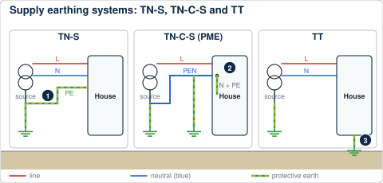

> Earthing, Bonding, Surge & Lightning Protection Library · **SHEET 13 · SOUTH AFRICA** · content version 1.0

# South Africa: supply earthing, Ekurhuleni rules and Gauteng lightning

*How house supplies are earthed, the neutral-earth rules for inverters, what the City of Ekurhuleni and Eskom require, and how often lightning strikes the Gauteng Highveld*

**Applies to:** Houses supplied by the City of Ekurhuleni or Eskom in Gauteng, including installations with inverters, batteries and solar PV

📄 **PDF:** [13_south_africa_ekurhuleni_gauteng.pdf](https://github.com/Skynet1971/earthing/raw/HEAD/docs/pdf/13_south_africa_ekurhuleni_gauteng.pdf)

> ℹ️ Information only. Every technical statement cites a source and PDF page; it does not replace the wiring code that applies at the site, the product manuals, or a qualified and registered person.

## 1  How South African house supplies are earthed

The published South African wiring code (SANS 10142-1) and the supply-earthing standard (SANS 10292) are not in this library. The statements below come from sources that describe or quote them.[R64 p.4](#sources-cited-on-this-page)[R69 p.2](#sources-cited-on-this-page)

- Louw and Bokoro (SAIEE Africa Research Journal, Dec 2019): LV earthing in South African networks follows IEC 60364 and SANS 10292, using TN-C and TN-C-S configurations; the PEN conductor provides the household earth and lets earth-fault (zero-sequence) current return to the distribution transformer star point, avoiding dependence on soil resistivity for the fault current needed to operate protection.[R64 p.4](#sources-cited-on-this-page)
- Louw and Bokoro (SAIEE ARJ 2019): the TN-C-S arrangement is used so that earth-fault current does not depend on soil resistivity for the fault impedance and fault current required to operate protection.[R64 p.4](#sources-cited-on-this-page)
- Louw and Bokoro (SAIEE ARJ 2019): at the supply point the neutral terminal and earth conductor are bonded together and the earth conductor is taken into the soil via an earthing arrangement, typically of less than 10 ohm.[R64 p.5](#sources-cited-on-this-page)
- ECA(SA) (2024) quoting SANS 10142-1 7.12.3.1.1 Note 1: in a TN system earthing of the electricity supply, an earth electrode is normally not required in an electrical installation.[R69 p.4](#sources-cited-on-this-page)
- City of Ekurhuleni EG application form (2026): the applicant must state the earthing arrangement, with TN-C-S given as the example.[R62 p.40](#sources-cited-on-this-page)

*Concept sketch. (2) TN-C-S: the PEN conductor of the supply provides the household earth, as Louw and Bokoro describe for South African networks.[R64 p.4](#sources-cited-on-this-page) (3) TT is shown for comparison only. Marker (1) is not described by a South African source in this library.*

> ℹ️ **NOTE** — **No earth electrode value is required by these sources for a TN supply**
>
> ECA(SA), quoting the wiring code, states that in a TN supply an earth electrode is normally not required in the installation.[R69 p.4](#sources-cited-on-this-page) Where one is installed, the bonding conductor size rule below applies.[R69 p.3](#sources-cited-on-this-page)

## 2  Neutral-earth bonding with inverters and generators

ECA(SA) published a clarification that quotes the relevant clauses of SANS 10142-1.[R69 p.2](#sources-cited-on-this-page)[R69 p.2](#sources-cited-on-this-page)

- ECA(SA) National Technical Committee (18 Jan 2024): there shall not be a permanently connected bond between earth and neutral downstream of the main switch (point of control).[R69 p.2](#sources-cited-on-this-page)
- ECA(SA) (2024) quoting SANS 10142-1 clause 6.1.6: the neutral conductor shall not be connected direct to earth or to the earth continuity conductor (the clause continues on the next printed page: on the load side of the point of control, except as allowed in 7.16.4).[R69 p.2](#sources-cited-on-this-page)
- ECA(SA) (2024) quoting SANS 10142-1 clause 6.12.4: with combined sources, the single neutral bar is the only point at which the installation neutral is connected to the consumer's earth terminal (except 7.12.3.1.3 or 7.16.4).[R69 p.3](#sources-cited-on-this-page)
- ECA(SA) (2024): there shall be an arrangement (device, switch, contact, relay or changeover switch) to bond neutral to earth while fed from an alternate supply, and this bond must be removed when the mains supply is connected.[R69 p.2](#sources-cited-on-this-page)
- ECA(SA) (2024): for inverters, when the grid is connected the installation relies on the supply authority's neutral-earth bond and the device's own bond must not be present; during islanding the device's bond must be present.[R69 p.2](#sources-cited-on-this-page)
- ECA(SA) (2024) quoting SANS 10142-1 7.12.3.1.1: where no earth electrode exists, one may be installed per SANS 10199 and bonded to the consumer's earth terminal and the alternate-supply earthing point with a conductor of at least half the phase-conductor cross-section but not less than 6 mm2 copper.[R69 p.3](#sources-cited-on-this-page)
- ECA(SA) (2024) quoting SANS 10142-1 7.12.3.1.2: any earth leakage device shall be positioned so as to avoid incorrect operation due to a parallel neutral/earth path.[R69 p.4](#sources-cited-on-this-page)
- ECA(SA) (2024) quoting SANS 10142-1 7.12.6.1 Note 1: suitable precautions against unintended parallel operation of an alternate supply include interlocks, a break-before-make changeover switch, or an inverter if it complies with IEC 62116.[R69 p.5](#sources-cited-on-this-page)

> ⚠️ **WARNING** — **One neutral-earth bond at a time**
>
> No permanent bond between earth and neutral may exist downstream of the main switch.[R69 p.2](#sources-cited-on-this-page) An inverter's own bond must be absent while the grid is connected and present while islanded.[R69 p.2](#sources-cited-on-this-page)

## 3  City of Ekurhuleni and Eskom requirements

### Electricity Supply By-Law (City of Ekurhuleni, 2023)

- City of Ekurhuleni Electricity Supply By-Law (revision of 11 August 2022, approved 28/09/2023): the point of supply is the point determined by the City at which electricity is supplied to the premises.[R65 p.10](#sources-cited-on-this-page)
- City of Ekurhuleni Electricity Supply By-Law (2023): the consumer's protection duty explicitly covers voltage swells and transients, undervoltages and overvoltages in the supply to the installation.[R65 p.12](#sources-cited-on-this-page)
- City of Ekurhuleni Electricity Supply By-Law (2023): the consumer must provide an approved cabinet for the meter board and space for the City's metering equipment, service apparatus, circuit breakers, surge arrestors and other protective devices.[R65 p.35](#sources-cited-on-this-page)
- City of Ekurhuleni Electricity Supply By-Law (2023): LV installation work must be signed off by a suitably qualified person, the certificate of compliance submitted to the City at least 3 business days before energizing, and the work must comply with SANS 10142-1.[R65 p.35](#sources-cited-on-this-page)
- City of Ekurhuleni Electricity Supply By-Law (2023): a consumer energy source run in parallel with the City network must have the safety isolation equipment required by the City to prevent back feed after the City supply has been isolated.[R65 p.38](#sources-cited-on-this-page)
- City of Ekurhuleni Electricity Supply By-Law (2023): no embedded generator may be connected to the City's grid without written consent of the Head of Department: Energy.[R65 p.39](#sources-cited-on-this-page)
- City of Ekurhuleni Electricity Supply By-Law (2023): if a fault in the installation is a hazard to persons, livestock or property, the consumer must immediately disconnect the supply.[R65 p.39](#sources-cited-on-this-page)
- City of Ekurhuleni Electricity Supply By-Law (2023): no rebate is given for metered electricity wasted owing to leakage or any other fault in the consumer's installation.[R65 p.28](#sources-cited-on-this-page)
- City of Ekurhuleni Electricity Supply By-Law (2023): the City does not attend to failures in the consumer's installation except when caused by operation of a City service protective device.[R65 p.28](#sources-cited-on-this-page)

### Policy for Embedded Generation (Annexure E25, City of Ekurhuleni, 2026)

- City of Ekurhuleni Policy for Embedded Generation (Annexure E25, council 23/06/2026): the Electricity Supply By-Law states that no generation equipment may be connected to the municipal grid without the express consent of the HOD: Energy; failure is an offence which could lead to a fine and/or disconnection.[R62 p.13](#sources-cited-on-this-page)
- City of Ekurhuleni EG policy (2026): a copy of the Certificate of Compliance (for LV installations) and supporting test reports must be provided to the municipality upon commissioning and testing.[R62 p.15](#sources-cited-on-this-page)
- City of Ekurhuleni EG policy (2026): all SSEG designs and projects above 18 kVA must be signed off on commissioning by a registered professional (Pr Eng, Pr Cert Eng, Pr Tech Eng or Pr Techni Eng).[R62 p.15](#sources-cited-on-this-page)
- City of Ekurhuleni EG policy (2026): inverters must carry third-party type-test certificates of compliance with NRS 097-2-1; inverters without such certification are not permitted in new or existing installations.[R62 p.15](#sources-cited-on-this-page)
- City of Ekurhuleni EG policy (2026): consumers inside the municipal boundary but supplied by Eskom must apply to Eskom for consent to connect EG; the City is not involved.[R62 p.16](#sources-cited-on-this-page)
- City of Ekurhuleni EG policy (2026): a new CoC is required if the current one is more than two years old or if the installation was changed within the two-year period.[R62 p.16](#sources-cited-on-this-page)
- City of Ekurhuleni EG policy (2026): grid-tied inverters must have an anti-islanding function (immediate disconnection during a general power outage) as stipulated in NRS 097-2-1.[R62 p.16](#sources-cited-on-this-page)
- City of Ekurhuleni EG policy (2026): an EG installation that operates in islanded mode must be effectively isolated from the municipal grid during that operation, as required of any standby generator, and the SANS 10142-1 alternative-supplies requirements apply.[R62 p.16](#sources-cited-on-this-page)
- City of Ekurhuleni EG policy (2026): the NRS 097-2 series and the Renewable Power Plant Grid Code cover, among other aspects, isolation, earthing, short-circuit protection and labelling of EG systems (the policy itself does not restate the earthing rules).[R62 p.17](#sources-cited-on-this-page)
- City of Ekurhuleni EG policy (2026): EG installations must also comply with SANS 10142 Parts 1 and 2 (wiring of premises) and the City of Ekurhuleni Electricity Supply By-law, among others.[R62 p.18](#sources-cited-on-this-page)
- City of Ekurhuleni EG policy (2026), change-over switch for hybrid EG / passive standby UPS: the switch must feed back its position to the inverter/charger so that inverter mode is impossible if the contacts fail (e.g. fused closed).[R62 p.36](#sources-cited-on-this-page)
- City of Ekurhuleni EG policy (2026): the change-over switch must have a rated lightning impulse withstand voltage (BIL) of 4 kV at 1,2/50 us per SANS/IEC 60947-1.[R62 p.36](#sources-cited-on-this-page)
- City of Ekurhuleni EG policy (2026): the change-over transfer must be break-before-make (open transition) with a transfer time of at least 20 ms.[R62 p.36](#sources-cited-on-this-page)
- City of Ekurhuleni EG policy (2026): the change-over switch contact gap must exceed 4 mm (SANS 60950-1, fixed installation, overvoltage category 2).[R62 p.36](#sources-cited-on-this-page)

### Eskom

- Eskom Distribution EGI compliance report 240-153339608 Rev 1: applies to all low-voltage SSEG installations below 1 MVA total capacity operating in parallel with the Eskom network.[R63 p.1](#sources-cited-on-this-page)
- Eskom EGI report 240-153339608 Rev 1: a valid Certificate of Compliance must be issued for every SSEG installation by a Registered Person as defined in the Electrical Installation Regulations.[R63 p.2](#sources-cited-on-this-page)
- Eskom EGI report 240-153339608 Rev 1: for installations up to 1 kV a.c. / 1.5 kV d.c. the sign-off must be by a Department of Labour registered Installation Electrician or Master Electrician.[R63 p.2](#sources-cited-on-this-page)
- Eskom EGI report 240-153339608 Rev 1, Part C checklist for non-inverter generators: anti-islanding protection must be verified to operate in under 2 seconds and the reconnection delay set and verified at 60 seconds or more (quote is the checklist text including its Y/N/N/A tick columns).[R63 p.6](#sources-cited-on-this-page)

> ℹ️ **NOTE** — **Who supplies the house decides whose rules apply**
>
> Consumers inside the City's boundary who are supplied by Eskom apply to Eskom, not to the City, for consent to connect embedded generation.[R62 p.16](#sources-cited-on-this-page)

## 4  Surge protection in South African practice

A Sparks Electrical News article (Crown Publications, 2023, enquiries to DEHN Africa) summarises how the wiring code describes SPDs.[R70 p.3](#sources-cited-on-this-page)[R70 p.3](#sources-cited-on-this-page)

- Sparks Electrical News (Crown Publications, 1 March 2023, DEHN Africa): surge current is an induced, secondary effect of a nearby lightning strike up to 2 km away from a structure.[R70 p.2](#sources-cited-on-this-page)
- Sparks Electrical News (2023): impulse (direct lightning) current is described by the 10/350 us test waveshape and surge current by the 8/20 us waveshape.[R70 p.2](#sources-cited-on-this-page)
- Sparks Electrical News (2023): the likelihood of direct strikes and induced surges for a structure is determined by a lightning risk analysis per SANS 62305-2; the latest wiring code uses a simplified method.[R70 p.2](#sources-cited-on-this-page)
- Sparks Electrical News (2023): an external lightning protection system must be connected to the electrical system's main earth bar with at least 16 mm2 copper.[R70 p.2](#sources-cited-on-this-page)
- Sparks Electrical News (2023): a Type 1+2 SPD is required if the structure has an external lightning protection system; otherwise at least a Type 2 device is recommended.[R70 p.3](#sources-cited-on-this-page)
- Sparks Electrical News (2023): per SANS 10142-1 the SPD must be installed on both conductors (live-to-earth and neutral-to-earth), not only live-to-earth.[R70 p.3](#sources-cited-on-this-page)
- Sparks Electrical News (2023): SPD connection conductors start at a minimum of 6 mm2 copper for Type 2 and 16 mm2 copper for Type 1+2 devices (SANS 10142-1 via SANS 62305-4).[R70 p.3](#sources-cited-on-this-page)
- Sparks Electrical News (2023): the total SPD connecting-lead length (live + earth, or neutral + earth) should not exceed 0.5 m to the earth bar; some manufacturers allow 1 m.[R70 p.3](#sources-cited-on-this-page)
- Sparks Electrical News (2023): load-shedding supply switching causes switching surges resembling the 8/20 us waveshape, which Type 2 devices can partly mitigate.[R70 p.3](#sources-cited-on-this-page)

> ℹ️ **NOTE** — **Secondary source**
>
> These are a trade article's statements about the wiring code, not the code itself. Check the current edition of SANS 10142-1 before relying on them.[R70 p.3](#sources-cited-on-this-page)

## 5  Lightning exposure of Gauteng and the Highveld

The South African Weather Service lightning detection network (SALDN) started in 2006.[R61 p.1](#sources-cited-on-this-page) The ground flash density values below are averages over the periods stated.

| **10-15** | **15-20** | **1.5-1.7** |
|---|---|---|
| flashes per km² per year, band that includes the southern parts of Gauteng (SALDN 2006-2010)[R60 p.8](#sources-cited-on-this-page)[R60 p.8](#sources-cited-on-this-page) | flashes per km² per year stated for Johannesburg (no data period stated)[R67 p.1](#sources-cited-on-this-page) | ground strike points per flash on average (Poelman et al. 2021)[R68 p.2](#sources-cited-on-this-page) |

### Flash density maps

- Gijben (S Afr J Sci 2012): the ground flash density map in this paper is based on the flashes recorded by the SALDN over the 5-year period 2006-2010 (averaged to flashes per km2 per year).[R60 p.4](#sources-cited-on-this-page)
- Gijben (S Afr J Sci 2012), 2006-2010 SALDN map: flash densities of between 10/km2 and 15/km2 per year are seen in a band that the paper describes in one sentence (this fragment holds the numeric range; the next fact holds the Gauteng part of the same sentence).[R60 p.8](#sources-cited-on-this-page)
- Gijben (S Afr J Sci 2012), 2006-2010 SALDN map: the southern parts of Gauteng are among the areas listed in the 10/km2 to 15/km2 (average annual) ground flash density band; the paper gives no separate value for Ekurhuleni or Kempton Park.[R60 p.8](#sources-cited-on-this-page)
- Gijben (S Afr J Sci 2012), 2006-2010 SALDN map: most of the central interior of South Africa receives between 5 and 10 flashes/km2 per year, decreasing towards the west.[R60 p.8](#sources-cited-on-this-page)
- Gijben (S Afr J Sci 2012): areas over Gauteng receive fewer flashes on the older CSIR (1990s flash-counter) map than on the 2006-2010 SALDN map, i.e. the older map under-represents Gauteng.[R60 p.8](#sources-cited-on-this-page)
- Gijben (S Afr J Sci 2012): the highest concentrations of lightning are found over the central to northern interior of South Africa.[R60 p.9](#sources-cited-on-this-page)
- Gijben (SAWS extended abstract): the ground flash density map counts flashes over the 6-year period 2006-2011 per 0.1 deg grid box, divided by area and by six to give average annual flashes per km2.[R66 p.2](#sources-cited-on-this-page)
- Gijben (SAWS extended abstract, 2006-2011 map): the southern parts of Gauteng are listed in the 10-15 flashes per km2 per year band; no value is given for Ekurhuleni or Kempton Park specifically.[R66 p.3](#sources-cited-on-this-page)
- Gijben (SAWS extended abstract, 2006-2011 map): the central interior of the country receives between 5 and 10 flashes per km2 (per year).[R66 p.3](#sources-cited-on-this-page)
- Gijben (SAWS extended abstract, 2006-2011): on the total lightning risk map the central to northern interior of South Africa is at extreme risk from lightning.[R66 p.3](#sources-cited-on-this-page)
- Hunt, Schumann (Wits), Saba (INPE) and Warner (ZT Research), Johannesburg Lightning Laboratory abstract (Vaisala-hosted, circa 2020): Johannesburg has a lightning flash density between 15 and 20 flashes/km2/year; the abstract states no data period or source map for this range.[R67 p.1](#sources-cited-on-this-page)
- JLL abstract (Wits): the Johannesburg Lightning Laboratory project started measuring in the summer thunderstorm season of 2019-2020.[R67 p.2](#sources-cited-on-this-page)

> 📍 **CHECK ON SITE** — **No value for Ekurhuleni or Kempton Park**
>
> None of the sources gives a ground flash density for Ekurhuleni or Kempton Park; the maps name the southern parts of Gauteng within a band.[R60 p.8](#sources-cited-on-this-page)[R66 p.3](#sources-cited-on-this-page) Do not interpolate a single value from them.

### Storm character

- Gijben (South African Weather Service), S Afr J Sci 2012: the summer (October to March) rainfall region of South Africa is dominated by convective storms, a large portion of it receives more than 60 thunderstorm days a year, and areas over the Highveld and the eastern escarpment record on average between 10 and 15 lightning flashes/km2/year (no specific measurement period is given in this sentence).[R60 p.1](#sources-cited-on-this-page)
- Gill (SAWS, data 2006-2007): flash densities exceed 5 flashes per square kilometre (per year) over most of the central and eastern plateau, decreasing towards the west as elevation decreases.[R61 p.3](#sources-cited-on-this-page)
- Gill (SAWS, data 2006-2007): heat-generated isolated or scattered thunderstorm activity is common over the interior plateau, especially in the late afternoon.[R61 p.3](#sources-cited-on-this-page)
- Gill (SAWS): of the flashes recorded in 2006-2007, only 9.7% were of positive polarity.[R61 p.4](#sources-cited-on-this-page)
- Gill (SAWS), citing Preston-Whyte and Tyson (1988): scattered thunderstorms occur on about 54% of storm days over the Highveld (the high-lying interior).[R61 p.4](#sources-cited-on-this-page)
- Gill (SAWS), citing Preston-Whyte and Tyson (1988): isolated thunderstorms occur on a further 39% of storm days over the Highveld.[R61 p.4](#sources-cited-on-this-page)
- Gill (SAWS): more than 90% of all thunderstorm activity over the Highveld is of the scattered/isolated type dominated by negative cloud-to-ground discharges (the quote holds the 90% figure; the sentence continues over the next lines).[R61 p.4](#sources-cited-on-this-page)
- Gijben (S Afr J Sci 2012): positive-polarity lightning typically results in more severe damage (it discharges more energy and its channel stays conductive longer).[R60 p.9](#sources-cited-on-this-page)
- Gijben (S Afr J Sci 2012): almost the entire country is at severe risk from both positive-polarity lightning and lightning in general (2006-2010 risk maps).[R60 p.9](#sources-cited-on-this-page)

### Flash density versus strike points

- Poelman et al. (NHESS 2021): it is known that lightning flashes tend to have more than one ground termination point on average (the abstract concludes that ground strike point densities are more appropriate than flash densities for risk assessment).[R68 p.1](#sources-cited-on-this-page)
- Poelman et al. (NHESS 2021): roughly half of downward negative CG multiple-stroke flashes show more than one ground strike point, averaging around 1.5 to 1.7 ground strike points per flash.[R68 p.2](#sources-cited-on-this-page)
- Poelman et al. (NHESS 2021): using the flash density NG in lightning-protection risk calculations underestimates the hazard, so NG should be replaced by the lightning strike point density.[R68 p.2](#sources-cited-on-this-page)

### Network accuracy

- Gijben (S Afr J Sci 2012): the SAWS sensor distribution makes it possible to detect lightning flashes with a 90% predicted detection efficiency (over most of the country).[R60 p.2](#sources-cited-on-this-page)
- Gijben (S Afr J Sci 2012): the stated median location accuracy of the SALDN is 0.5 km (paired with 90% predicted detection efficiency).[R60 p.2](#sources-cited-on-this-page)
- Gijben (S Afr J Sci 2012): it is recommended that a lightning climatology be produced over a period of at least 11 years (about one solar cycle); the 2012 climatology covers only 5 years (2006-2010).[R60 p.2](#sources-cited-on-this-page)
- Gijben (SAWS extended abstract): the 19-sensor SAWS lightning detection network installed in 2005 was upgraded to a 23-sensor network in 2010.[R66 p.1](#sources-cited-on-this-page)
- Poelman et al. (NHESS 2021): the SALDN, installed by SAWS in 2006 with 19 Vaisala LS7000 sensors, has since been upgraded to 24 sensors.[R68 p.3](#sources-cited-on-this-page)
- Poelman et al. (NHESS 2021): SALDN self-evaluation estimates flash detection efficiencies above 90% and location accuracies within 500 m for the whole country, dropping only at the borders.[R68 p.3](#sources-cited-on-this-page)

### Losses

- Gijben (S Afr J Sci 2012), citing earlier literature: lightning-related deaths in South Africa average between 1.5 and 8.8 per million of the population per year, said to be about four times the global average.[R60 p.1](#sources-cited-on-this-page)
- Gill (South African Weather Service), climatology for 2006-2007: citing Blumenthal (2005), the average number of lightning-related deaths in South Africa is 6.3 per million of the population.[R61 p.1](#sources-cited-on-this-page)
- Gill (SAWS, 2006-2007 climatology): this South African lightning death rate is more than 15 times the global average (given as about 0.4 deaths per million).[R61 p.1](#sources-cited-on-this-page)
- Gijben (S Afr J Sci 2012): insurance claims in South Africa as a result of lightning amount to more than R500 million per year.[R60 p.1](#sources-cited-on-this-page)
- Gijben (S Afr J Sci 2012): during the 2010/2011 financial year the South African Weather Service received 2103 insurance queries for lightning verification.[R60 p.1](#sources-cited-on-this-page)
- Gijben (S Afr J Sci 2012): these lightning insurance queries made up 72% of all commercial enquiries received by the SAWS Climate Information section.[R60 p.2](#sources-cited-on-this-page)

## 6  Where the sources disagree

| Question | One source | Another source |
|---|---|---|
| Flash density, Johannesburg area | Wits laboratory abstract: 15-20 flashes/km² per year for Johannesburg.[R67 p.1](#sources-cited-on-this-page) | SAWS 2006-2010 and 2006-2011 maps: southern Gauteng in the 10-15 band.[R60 p.8](#sources-cited-on-this-page)[R66 p.3](#sources-cited-on-this-page) Different areas and periods. |
| Lightning deaths | Gijben, citing earlier literature: 1.5-8.8 per million per year, about four times the global average.[R60 p.1](#sources-cited-on-this-page) | Gill, citing Blumenthal: 6.3 per million, more than 15 times the global average.[R61 p.1](#sources-cited-on-this-page)[R61 p.1](#sources-cited-on-this-page) |
| Number of SALDN sensors | 19 sensors (network at installation).[R61 p.1](#sources-cited-on-this-page) | 23 by 2010 and 24 later; the network was upgraded over time.[R66 p.1](#sources-cited-on-this-page)[R68 p.3](#sources-cited-on-this-page) |
| SPD connecting lead length | Sparks: total should not exceed 0.5 m; some manufacturers allow 1 m.[R70 p.3](#sources-cited-on-this-page) | BEAMA (UK) and IEC 60364-5-53 via DEHN: see Sheet 03. |

## 7  Checklist for a house in Ekurhuleni

- [ ] Confirm who supplies the house (City or Eskom); embedded-generation applications go to that utility.[R62 p.16](#sources-cited-on-this-page)[R65 p.39](#sources-cited-on-this-page)
- [ ] Record the earthing arrangement (the City's form asks for it, giving TN-C-S as the example).[R62 p.40](#sources-cited-on-this-page)
- [ ] Check there is no permanent neutral-earth bond downstream of the main switch.[R69 p.2](#sources-cited-on-this-page)
- [ ] Check that the inverter's neutral-earth bond is present only while islanded.[R69 p.2](#sources-cited-on-this-page)
- [ ] Place earth leakage devices so a parallel neutral/earth path cannot cause incorrect operation.[R69 p.4](#sources-cited-on-this-page)
- [ ] Use a change-over switch that meets the City's 4 kV impulse, 20 ms break-before-make and 4 mm contact-gap requirements.[R62 p.36](#sources-cited-on-this-page)[R62 p.36](#sources-cited-on-this-page)[R62 p.36](#sources-cited-on-this-page)
- [ ] Keep a current certificate of compliance (a new one is required if the old one is more than two years old or the installation changed).[R62 p.16](#sources-cited-on-this-page)
- [ ] Protect the installation against transients and overvoltages; the by-law puts this on the consumer.[R65 p.12](#sources-cited-on-this-page)

## Sources cited on this page

`[R18 p.12]` = reference 18 below, PDF page 12 (page index of the PDF file). Each cited statement was checked against a verbatim quote from that page.

| Ref | Document | PDF pages cited |
|---|---|---|
| R60 | **The lightning climatology of South Africa** — South African Journal of Science (AOSIS OpenJournals); author Morné Gijben, South African Weather Service · S Afr J Sci 2012; 108(3/4) · South Africa · [link](https://sajs.co.za/article/view/9888/12996) | 1-2, 4, 8-9 |
| R61 | **A Lightning Climatology of South Africa for the First Two Years of Operation of the South African Weather Service Lightning Detection Network: 2006-2007** — South African Weather Service (author Tracey Gill); hosted by Vaisala · not stated in document · South Africa · [link](https://vaisala.com/sites/default/files/documents/Lightning%20Climatology%20of%20South%20Africa%20-%20First%20Two%20Years%20of%20Operation.PDF) | 1, 3-4 |
| R62 | **Annexure E25 Policy for Embedded Generation Ekurhuleni (Reviewed)** — City of Ekurhuleni Metropolitan Municipality · Council item A - F (32 – 2026), CM 23/06/2026 (MTREF 2026/27 to 2028/29) · City of Ekurhuleni, Gauteng, South Africa · [link](https://www.ekurhuleni.gov.za/wp-content/uploads/2026/07/Annexure-E25-Guideline-for-Embedded-Generation.pdf) | 13, 15-18, 36, 40 |
| R63 | **Compliance Report for Low Voltage SSEG's Operating in Parallel with the Eskom Network (EGI Report) - Embedded Generator Installation Compliance Test Report** — Eskom Holdings SOC Ltd, Distribution · Unique Identifier 240-153339608, Revision 1 · South Africa (Eskom-supplied customers) · [link](https://www.eskom.co.za/distribution/wp-content/uploads/2026/04/EMBEDDED-GENERATOR-INSTALLATION-EGI-REPORT-240-153339608-REV-1.pdf) | 1-2, 6 |
| R64 | **An Alternative technique for the detection and mitigation of electricity theft in South Africa** — SAIEE Africa Research Journal (South African Institute of Electrical Engineers); authors Quentin Louw and Pitshou Bokoro · Vol.110 (4) December 2019 · South Africa · [link](https://scielo.org.za/pdf/arj/v110n4/03.pdf) | 4-5 |
| R65 | **City of Ekurhuleni Energy Department Electricity Supply By-Laws (Annexure A to report A-WE (02-2023) WSE)** — City of Ekurhuleni Metropolitan Municipality · Revision of 11 August 2022; committee resolution 28/09/2023 · City of Ekurhuleni, Gauteng, South Africa · [link](https://www.ekurhuleni.gov.za/wp-content/uploads/2023/11/Electricity-Supply-By-Law.pdf) | 10, 12, 28, 35, 38-39 |
| R66 | **Lightning Climatology of South Africa with a Special Focus on Lightning Risk Maps** — South African Weather Service (author Morné Gijben); hosted by Vaisala · not stated in document (extended abstract based on S Afr J Sci 2012;108(3/4); data 2006-2011) · South Africa · [link](https://www.vaisala.com/sites/default/files/documents/Lightning%20Climatology%20of%20South%20Africa%20with%20a%20Special%20Focus%20on%20Lightning%20Risk%20Maps.pdf) | 1-3 |
| R67 | **The Johannesburg Lightning Laboratory (JLL)** — University of the Witwatersrand (Hunt, Schumann), INPE (Saba), ZT Research (Warner); hosted by Vaisala · not stated in document · South Africa (Johannesburg) · [link](https://www.vaisala.com/sites/default/files/documents/The%20Johannesburg%20Lightning%20Laboratory%20.pdf) | 1-2 |
| R68 | **Global ground strike point characteristics in negative downward lightning flashes – Part 2: Algorithm validation** — Natural Hazards and Earth System Sciences (Copernicus/EGU); Poelman et al. · Nat. Hazards Earth Syst. Sci., 21, 1921–1933, 2021 (published 18 June 2021) · International (includes South African data) · [link](https://nhess.copernicus.org/articles/21/1921/2021/nhess-21-1921-2021.pdf) | 1-3 |
| R69 | **Neutral Earth Bonding Clarified** — Electrical Contractors' Association (South Africa), ECA(SA); author Nicholas McDiarmid · 18 January 2024 · South Africa · [link](https://ecasa.co.za/technical/neutral-earth-bonding-clarified/) | 2-5 |
| R70 | **Using surge protection and how it is described in the wiring code (SANS 10142-1)** — Crown Publications, Sparks Electrical News (enquiries: DEHN Africa) · 01 March 2023 · South Africa · [link](https://www.crown.co.za/latest-news/sparks-electrical-news-latest-news/23866-using-surge-protection-and-how-it-is-described-in-the-wiring-code-sans-10142-1) | 2-3 |

*Generated from `content/docs/13_south_africa_ekurhuleni.yaml` on 2026-11-23. Do not edit this page in the wiki; edit the content file.*
