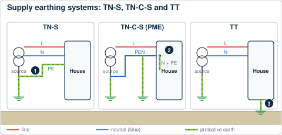

 

> Earthing, Bonding, Surge & Lightning Protection Library · **VISUAL GUIDE 1 · EARTHING** · content version 1.0

# Visual guide 1: how earthing and bonding work

*Animated pictures of the fault path, the supply earthing systems and why every earth must meet at one point*

**Applies to:** Anyone who wants to see how the earth connection of a house works before reading the reference sheets

> ℹ️ Information only. Every technical statement cites a source and PDF page; it does not replace the wiring code that applies at the site, the product manuals, or a qualified and registered person.

## 1  The earth path makes a fault switch itself off

In a TN-C-S supply the PEN conductor provides the household earth and carries the earth-fault current back to the distribution transformer.[R64 p.4](#sources-cited-on-this-page)

*Animated: the steps play in a loop. Click to open full size.* (1) In normal use the current returns on the neutral. (2) When a live conductor touches an earthed metal case, the fault current returns on the protective earth and the PEN to the transformer.[R64 p.4](#sources-cited-on-this-page) TN-C-S is used so that this fault current does not depend on soil resistivity.[R64 p.4](#sources-cited-on-this-page) (3) In TN systems, fault touch voltages in circuits with socket outlets must be disconnected automatically within 0.4 s.[R6 p.220](#sources-cited-on-this-page)

| **0.4 s** | **0.35 Ω** | **0.8 Ω** |
|---|---|---|
| maximum disconnection time, socket-outlet circuits, TN systems[R6 p.220](#sources-cited-on-this-page) | maximum Ze for TN-C-S (PME) supplies, UK distributor figure[R8 p.5](#sources-cited-on-this-page) | maximum Ze for TN-S supplies, UK distributor figure[R8 p.5](#sources-cited-on-this-page) |

## 2  Supply earthing systems at a glance

*Click the diagram to open it full size.* *Concept sketch. (2) TN-C-S: the PEN conductor of the supply provides the household earth, as Louw and Bokoro describe for South African networks.[R64 p.4](#sources-cited-on-this-page) (3) TT: the consumer must provide their own connection to earth with a local earth electrode (UK guidance)[R8 p.8](#sources-cited-on-this-page); the electrode resistance multiplied by the rated residual operating current of the protective device must not exceed 50 V (UK, BS 7671:2001).[R9 p.5](#sources-cited-on-this-page)*

- BS 7671 (UK) lists five types of earthing system: TN-S, TN-C-S, TT, TN-C and IT.[R8 p.2](#sources-cited-on-this-page)
- Louw and Bokoro (SAIEE Africa Research Journal, Dec 2019): LV earthing in South African networks follows IEC 60364 and SANS 10292, using TN-C and TN-C-S configurations; the PEN conductor provides the household earth and lets earth-fault (zero-sequence) current return to the distribution transformer star point, avoiding dependence on soil resistivity for the fault current needed to operate protection.[R64 p.4](#sources-cited-on-this-page)
- ECA(SA) (2024) quoting SANS 10142-1 7.12.3.1.1 Note 1: in a TN system earthing of the electricity supply, an earth electrode is normally not required in an electrical installation.[R69 p.4](#sources-cited-on-this-page)
- BS 7671:2001 Regulation 413-02-20 (UK) states that for TT systems the earth electrode resistance RA multiplied by the operating current of the protective device (rated residual operating current) must not exceed 50 V.[R9 p.5](#sources-cited-on-this-page)
- Per UK guidance (IEE Wiring Matters), for an RCD rated at 30 mA the 50 V rule equates to an earth electrode resistance limit of approximately 1666 Ω.[R9 p.5](#sources-cited-on-this-page)

## 3  Every earth meets at one point

For electronic equipment the sources ask for one bonding point, short conductors, and no separate earth that is not bonded to it.[R18 p.18](#sources-cited-on-this-page)[R6 p.142](#sources-cited-on-this-page)[R18 p.19](#sources-cited-on-this-page)

*Click the diagram to open it full size.* *Concept sketch, not a wiring diagram. (1) all services connected with low-impedance bonding conductors to the main earth terminal, low impedance being obtained by keeping them shorter than 1.5 m (ITU-T K.66)[R18 p.19](#sources-cited-on-this-page) (2) earthing connects the earth bar to earth, usually via an installed electrode (ITU-T K.98)[R25 p.27](#sources-cited-on-this-page) (3) every earth point bonded to the main earth bar, with nothing connected to a separate electrode that is not bonded to it (ITU-T K.66).[R18 p.18](#sources-cited-on-this-page)*

*Animated: the steps play in a loop. Click to open full size.* ITU-T K.66 example: without a common bonding point, a 50 A surge from the telecom line through a 300 Ω earth electrode raises the telecom equipment 15 kV above the power network.[R18 p.58](#sources-cited-on-this-page) Of the customer earthing practices K.66 examined, only the common earth bar with short bond wires protects equipment from surges entering on external cables without additional protection.[R18 p.56](#sources-cited-on-this-page)

> [!CAUTION]
> **DO NOT: No separate 'clean earth'**
>
> DEHN calls a separate clean earth for electronic equipment, kept apart from the lightning protection and protective earth, extremely unfavourable and potentially dangerous.[R6 p.142](#sources-cited-on-this-page)

## 4  Earth electrodes

| **15 mm** | **2.5 m** | **90 %** |
|---|---|---|
| minimum diameter, solid round copper earth rod (IEC 62305-3 Table 7)[R6 p.149](#sources-cited-on-this-page) | one permitted antenna earth electrode: a vertical rod this long (IEC 60728-11)[R6 p.292](#sources-cited-on-this-page) | of the resistance lies within 5 m of a 20 cm sphere electrode (DEHN example)[R6 p.121](#sources-cited-on-this-page) |

- Per UK guidance (IET), earth rods should be driven into virgin ground, not disturbed (backfilled) ground.[R8 p.3](#sources-cited-on-this-page)
- Per UK guidance (IET, 2011), where two or more earth rods are driven and connected together, the separation between rods should be at least equal to their combined driven depth to obtain maximum advantage from each rod.[R8 p.3](#sources-cited-on-this-page)
- Per UK guidance (IEE Wiring Matters), with multiple earth rods in parallel the overall resistance is virtually proportional to the reciprocal of the number of rods, provided each rod is outside the resistance area (sphere of influence) of any other.[R9 p.3](#sources-cited-on-this-page)
- Per UK guidance (IET), whatever form an earth electrode takes, the possibility of soil drying and freezing, and of corrosion, must be taken into account.[R8 p.3](#sources-cited-on-this-page)
- InstMC Tech Talk 12 (UK, 2017): a soil resistivity test is the main factor in determining the type and extent of the earth electrode(s) required.[R43 p.3](#sources-cited-on-this-page)

## 5  Where the house earth comes from, and what joins it

In a TN-C-S supply the earth arrives on the supply cable: the PEN conductor provides the household earth[R64 p.4](#sources-cited-on-this-page), and at the supply point the neutral and earth are joined and taken into the soil through an earthing arrangement, typically below 10 Ω.[R64 p.5](#sources-cited-on-this-page)[R64 p.5](#sources-cited-on-this-page)

*Animated: the steps play in a loop. Click to open full size.* (1) At the supply point the neutral terminal and earth conductor are bonded together and earthed, typically below 10 Ω.[R64 p.5](#sources-cited-on-this-page)[R64 p.5](#sources-cited-on-this-page) (2) The PEN conductor provides the household earth and carries earth-fault current back to the transformer.[R64 p.4](#sources-cited-on-this-page) (3) All earth electrodes associated with a building should be interconnected[R25 p.30](#sources-cited-on-this-page), including those of external equipment such as camera masts[R6 p.428](#sources-cited-on-this-page) and an existing earth spike at a PV array.[R49 p.13](#sources-cited-on-this-page) (4) Exception: a security-fence earth stays at least 2 m from any other earth system.[R30 p.12](#sources-cited-on-this-page)

### Do all earths connect to the supply earth?

- Louw and Bokoro (SAIEE Africa Research Journal, Dec 2019): LV earthing in South African networks follows IEC 60364 and SANS 10292, using TN-C and TN-C-S configurations; the PEN conductor provides the household earth and lets earth-fault (zero-sequence) current return to the distribution transformer star point, avoiding dependence on soil resistivity for the fault current needed to operate protection.[R64 p.4](#sources-cited-on-this-page)
- ECA(SA) (2024) quoting SANS 10142-1 7.12.3.1.1: where no earth electrode exists, one may be installed per SANS 10199 and bonded to the consumer's earth terminal and the alternate-supply earthing point with a conductor of at least half the phase-conductor cross-section but not less than 6 mm2 copper.[R69 p.3](#sources-cited-on-this-page)
- ECA(SA) (2024) quoting SANS 10142-1 7.12.3.1.1 Note 1: in a TN system earthing of the electricity supply, an earth electrode is normally not required in an electrical installation.[R69 p.4](#sources-cited-on-this-page)
- ITU-T K.98 cites IEC 60364-4-44 section 444.5 as recommending that all protective and functional earthing conductors connect to one single main earth terminal and that all earth electrodes associated with a building be interconnected.[R25 p.30](#sources-cited-on-this-page)
- One earth-termination system must serve all earthing tasks of a structure (protective, lightning protection and functional earthing); otherwise potential differences can arise between installations earthed on different earth-termination systems.[R6 p.142](#sources-cited-on-this-page)
- The earth electrodes of such external equipment must be interconnected (with the building's earth-termination system).[R6 p.428](#sources-cited-on-this-page)
- ITU-T K.85 notes that if two separate earth electrodes are not bonded together, a potential difference may arise between them and damage the ports of the equipment connected to each; a ring earth is offered as a solution.[R19 p.18](#sources-cited-on-this-page)

> [!CAUTION]
> **DO NOT: Only one neutral-earth link**
>
> No permanent neutral-earth bond downstream of the main switch.[R69 p.2](#sources-cited-on-this-page) An inverter relies on the supply's neutral-earth bond while the grid is connected; its own bond may be present only while it runs islanded.[R69 p.2](#sources-cited-on-this-page)

> [!WARNING]
> **WARNING: The electric-fence earth is the exception**
>
> Keep the energizer's earth electrode at least 2 m from any other earth system for a security fence, 10 m for an agricultural fence.[R30 p.12](#sources-cited-on-this-page)

### Added earth bars

ITU-T K.66: bond all earth points to the main earth bar, which may be via added earth bars.[R18 p.18](#sources-cited-on-this-page) An added earth bar is any intermediate earth bar or terminal that is itself bonded back to the main earth bar, such as the earth bar of each sub-distribution board. Where services enter at different points, each bonding bar is connected to the earthing system and the bars are bonded together.[R18 p.19](#sources-cited-on-this-page)

### Wire sizes stated in the public sources

| Connection | Smallest copper size | Source |
|---|---|---|
| Antenna system to the main earth terminal, against mains contact | 2.5 mm² in most cases[R22 p.21](#sources-cited-on-this-page) | ITU-T K.71 |
| Internal metal installations to the equipotential bonding bar (with LPS) | 6 mm²[R6 p.181](#sources-cited-on-this-page) | IEC 62305-3 via DEHN |
| Between two equipotential bonding bars (with LPS) | 16 mm²[R6 p.111](#sources-cited-on-this-page) | IEC 62305-3 via DEHN |
| Camera earth wire | 6 mm², insulated[R41 p.4](#sources-cited-on-this-page) | TP-Link |
| Antenna bond carrying partial lightning current | 5 mm²[R22 p.21](#sources-cited-on-this-page) | ITU-T K.71 |
| Added earth electrode to the consumer's earth terminal | at least half the phase-conductor size, not less than 6 mm²[R69 p.3](#sources-cited-on-this-page) | ECA(SA) quoting SANS 10142-1 |
| PV mounting rails / substructure | 6 mm²[R47 p.31](#sources-cited-on-this-page)[R6 p.365](#sources-cited-on-this-page) | SAPVIA, DEHN |
| Type 2 SPD connecting cables | 4 mm² (advised)[R48 p.48](#sources-cited-on-this-page); 6 mm²[R70 p.3](#sources-cited-on-this-page) | BEAMA (UK); Sparks (SA) |

*The size of the earth conductor between distribution boards follows the protective-conductor table of the wiring code that applies at the site; that table is not in the public library.*

## Sources cited on this page

`[R18 p.12]` = reference 18 below, PDF page 12 (page index of the PDF file). Each cited statement was checked against a verbatim quote from that page.

| Ref | Document | PDF pages cited |
|---|---|---|
| R6 | **Lightning Protection Guide, 3rd updated edition** — DEHN + SÖHNE · 2014 · IEC / EN 62305 (Germany) · [link](https://www.dehn-international.com/sites/default/files/media/files/lpg_en_complete.pdf) | 111, 121, 142, 149, 181, 220, 292, 365, 428 |
| R8 | **Earthing: your questions answered (IET Wiring Matters, Autumn 2011)** — The Institution of Engineering and Technology (UK) · Autumn 2011 · UK (BS 7671) · [link](https://electrical.theiet.org/media/1549/earthing.pdf) | 2-3, 5, 8 |
| R9 | **Multiple earth electrodes in a TT system for a dwelling (IET Wiring Matters, Winter 2006)** — The Institution of Engineering and Technology (UK) · Winter 2006 · UK (BS 7671) · [link](https://electrical.theiet.org/media/1659/multiple-earth-electrodes-in-a-tt-system-for-a-dwelling.pdf) | 3, 5 |
| R18 | **Recommendation ITU-T K.66: Protection of customer premises from overvoltages** — International Telecommunication Union · 11/2019 · International · [link](https://www.itu.int/rec/T-REC-K.66-201911-I) | 18-19, 56, 58 |
| R19 | **Recommendation ITU-T K.85: Requirements for the mitigation of lightning effects on home networks installed in customer premises** — International Telecommunication Union · 11/2011 · International · [link](https://www.itu.int/rec/T-REC-K.85-201111-I) | 18 |
| R22 | **Recommendation ITU-T K.71: Protection of customer antenna installations** — International Telecommunication Union · 06/2011 · International · [link](https://www.itu.int/rec/T-REC-K.71-201106-I) | 21 |
| R25 | **Recommendation ITU-T K.98: Overvoltage protection guide for telecommunication equipment installed in customer premises** — International Telecommunication Union · 08/2014 · International · [link](https://www.itu.int/rec/T-REC-K.98-201408-I) | 27, 30 |
| R30 | **DRUID LCD 2x Electric Fence Energizer: Installer Manual, Revision 1.2** — Nemtek Group · 25 September 2013 · South Africa · [link](https://nemtek.co.za/wp-content/uploads/2021/11/installer-manual-druid-2.pdf) | 12 |
| R41 | **Waterproof and Lightning Protection Installation Guide for Omada Security Devices** — TP-Link (Omada Network Support) · web page as fetched 2026-11-23 · International · [link](https://support.omadanetworks.com/za/document/44713/) | 4 |
| R43 | **Tech Talk (12) Down to Earth: A Discussion of the General Requirements for the Earthing of Control and Instrumentation Systems** — Institute of Measurement and Control; Measurement and Control 2017, Vol. 50(2) 39-44 · 2017 · UK · [link](https://www.instmc.org/_userfiles/pages/files/technical/tech_talk_12_down_to_earth.pdf) | 3 |
| R47 | **Solar PV Installation Guidelines, Iteration 1.0 (PV GreenCard)** — South African Photovoltaic Industry Association (SAPVIA) · May 2017 · South Africa · [link](https://portal.segensolar.co.za/reseller/docs/SAPVIASolarPVGuidelines.pdf) | 31 |
| R48 | **BEAMA Guide to Surge Protection Devices (SPDs): selection, application and theory** — BEAMA Ltd (UK) · July 2018 · UK (BS 7671:2018) · [link](https://www.beama.org.uk/static/uploaded/0125b82e-8c76-4106-88bedb0f4fc85d52.pdf) | 48 |
| R49 | **Photovoltaics in Buildings: Guide to the installation of PV systems, 2nd edition (DTI/Pub URN 06/1972)** — UK Department for Enterprise (DTI) / BRE · 2006 · UK · [link](https://files.bregroup.com/solar/Guide_to_the_installation_of_PV_systems_2nd_Edition.pdf) | 13 |
| R64 | **An Alternative technique for the detection and mitigation of electricity theft in South Africa** — SAIEE Africa Research Journal (South African Institute of Electrical Engineers); authors Quentin Louw and Pitshou Bokoro · Vol.110 (4) December 2019 · South Africa · [link](https://scielo.org.za/pdf/arj/v110n4/03.pdf) | 4-5 |
| R69 | **Neutral Earth Bonding Clarified** — Electrical Contractors' Association (South Africa), ECA(SA); author Nicholas McDiarmid · 18 January 2024 · South Africa · [link](https://ecasa.co.za/technical/neutral-earth-bonding-clarified/) | 2-4 |
| R70 | **Using surge protection and how it is described in the wiring code (SANS 10142-1)** — Crown Publications, Sparks Electrical News (enquiries: DEHN Africa) · 01 March 2023 · South Africa · [link](https://www.crown.co.za/latest-news/sparks-electrical-news-latest-news/23866-using-surge-protection-and-how-it-is-described-in-the-wiring-code-sans-10142-1) | 3 |

*Generated from `content/docs/14_visual_guide_earthing.yaml` on 2026-11-25. Do not edit this page in the wiki; edit the content file.*
