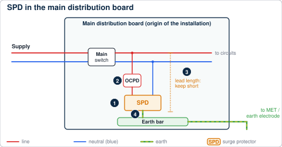

> Earthing, Bonding, Surge & Lightning Protection Library · **VISUAL GUIDE 2 · SURGES** · content version 1.0

# Visual guide 2: lightning, surges and surge protectors

*Animated pictures of lightning protection zones and of why surge-protector wires must be short*

**Applies to:** Anyone choosing or checking surge protective devices in a house distribution board

📄 **PDF:** [15_visual_guide_lightning_surges_spds.pdf](https://github.com/Skynet1971/earthing/raw/HEAD/docs/pdf/15_visual_guide_lightning_surges_spds.pdf)

> ℹ️ Information only. Every technical statement cites a source and PDF page; it does not replace the wiring code that applies at the site, the product manuals, or a qualified and registered person.

## 1  Zones: each boundary takes energy out

*Animated: the steps play in a loop. Click to open full size.* LPZ 0 is exposed to direct strokes and may carry the full lightning current[R12 p.14](#sources-cited-on-this-page); LPZ 1 is subject to partial lightning currents[R12 p.14](#sources-cited-on-this-page); LPZ 2 sees only remnants of the impulse currents.[R12 p.14](#sources-cited-on-this-page) The SPD at the LPZ 0/1 boundary provides lightning current protection, the SPD at the LPZ 1/2 boundary overvoltage protection[R12 p.14](#sources-cited-on-this-page), and the zones combine bonding, shielding and coordinated SPDs.[R12 p.14](#sources-cited-on-this-page)

| **25 kA** | **40 kA** |
|---|---|
| typical Type 1 test current per mode (10/350) at the main board, LPZ 0/1[R48 p.29](#sources-cited-on-this-page) | typical Type 2 test current (8/20) at sub-distribution, LPZ 1/2[R48 p.29](#sources-cited-on-this-page) |

- BEAMA SPD guide (UK, 2018) Table 2: typical mains SPD test currents per mode are 25 kA 10/350 at the service entrance / main distribution board (LPZ 0/1, Type 1), 40 kA 8/20 at sub-distribution (LPZ 1/2, Type 2) and 3 kA with 6 kV combination wave at terminal equipment such as socket outlets (LPZ 2/3, Type 3).[R48 p.29](#sources-cited-on-this-page)
- Information technology lines entering from LPZ 0A must be protected by lightning current arresters as close as possible to the point of entry, with a general discharge capacity of up to 2.5 kA (10/350) per core.[R6 p.206](#sources-cited-on-this-page)
- For lines passing from LPZ 0B to LPZ 1 (no direct-strike exposure), SPDs with an impulse discharge capacity of up to 20 kA (8/20) are sufficient because no galvanically coupled partial lightning current flows through them.[R6 p.206](#sources-cited-on-this-page)

## 2  Surge-protector wires must be short

*Animated: the steps play in a loop. Click to open full size.* BEAMA takes lead inductance as 1 µH/m, so an impulse rising at 1 kA/µs adds about 1 kV per metre of connecting lead[R48 p.40](#sources-cited-on-this-page); leads should be as short as possible, preferably not over 0.5 m in total[R48 p.40](#sources-cited-on-this-page), and bound together.[R48 p.40](#sources-cited-on-this-page) In BEAMA's test an SPD with Up 600 V gave 630 V with 25 cm of bound lead[R48 p.41](#sources-cited-on-this-page), 810 V with 25 cm unbound and 2,300 V with 2 m unbound.[R48 p.41](#sources-cited-on-this-page) Category I equipment at 230/240 V is rated 1.5 kV.[R48 p.36](#sources-cited-on-this-page) In the same test, 2 m of bound lead gave 1,200 V[R48 p.41](#sources-cited-on-this-page); the equipment in that test had an immunity level of 700 V.[R48 p.41](#sources-cited-on-this-page)

> [!TIP]
> **DO: Short, straight, tied together**
>
> Keep the total lead length as short as possible, preferably under 0.5 m[R48 p.40](#sources-cited-on-this-page), and tie the two leads together along their length.[R48 p.40](#sources-cited-on-this-page)

## 3  'Bound' and 'unbound (loose)' wires: what they mean and where

Both words describe the two connecting wires of a surge protector in the board: l1 from the line connection to the SPD, and l2 from the SPD to the earth bar.[R48 p.40](#sources-cited-on-this-page) 'Bound' means these two wires are tied tightly together; 'unbound' (we also say 'loose') means they run apart.[R48 p.40](#sources-cited-on-this-page)

*Animated: the steps play in a loop. Click to open full size.* (1) The surge current goes into a parallel (shunt) SPD on one lead and out on the other, in opposite directions, so the two leads carry opposing magnetic fields.[R48 p.41](#sources-cited-on-this-page) (2) Unbound: the leads run apart and their fields do not cancel. (3) Bound: with the conductors close together, by twisting or binding[R48 p.41](#sources-cited-on-this-page), the opposing fields cancel and so does the inductance.[R48 p.41](#sources-cited-on-this-page) With 25 cm leads BEAMA measured 630 V bound and 810 V unbound.[R48 p.41](#sources-cited-on-this-page)[R48 p.41](#sources-cited-on-this-page)

| Word | What it means | Where |
|---|---|---|
| l1 | Connecting lead between the line connection (point A) and the SPD.[R48 p.40](#sources-cited-on-this-page) | Line (and neutral) connection side of the SPD.[R48 p.40](#sources-cited-on-this-page)[R48 p.42](#sources-cited-on-this-page) |
| l2 | Connecting lead between the SPD and earth (point B). BEAMA notes the earth lead often has to be longer than the line and neutral connections.[R48 p.42](#sources-cited-on-this-page) | From the SPD earth terminal to the earth bar.[R48 p.42](#sources-cited-on-this-page) |
| Bound | l1 and l2 tightly bound together over as much of their length as possible, using cable ties or spiral wrap.[R48 p.40](#sources-cited-on-this-page) BEAMA also names twisting them together.[R48 p.41](#sources-cited-on-this-page) | Along the whole run of the two leads.[R48 p.40](#sources-cited-on-this-page) |
| Unbound (loose) | BEAMA's word for leads that are not bound together; 'loose' in these pages means the same. With 25 cm leads the voltage rose from 630 V (bound) to 810 V (unbound).[R48 p.41](#sources-cited-on-this-page)[R48 p.41](#sources-cited-on-this-page) | Anywhere the two leads take separate routes. |
| Long earth lead | In a metal enclosure: one conductor to the metalwork and one to the earth bar.[R48 p.42](#sources-cited-on-this-page) Otherwise: two connections to the earth bar, one inside the bound set and one separate.[R48 p.42](#sources-cited-on-this-page) | Earth side of the SPD.[R48 p.42](#sources-cited-on-this-page) |

| **630 V** | **810 V** | **1 200 V** | **2 300 V** |
|---|---|---|---|
| 25 cm leads, bound[R48 p.41](#sources-cited-on-this-page) | 25 cm leads, unbound[R48 p.41](#sources-cited-on-this-page) | 2 m leads, bound[R48 p.41](#sources-cited-on-this-page) | 2 m leads, unbound[R48 p.41](#sources-cited-on-this-page) |

> [!TIP]
> **DO: Keep the SPD wires short and tie them together**
>
> Connecting leads as short as possible, preferably not over 0.5 m in total[R48 p.40](#sources-cited-on-this-page), and tightly bound together over as much of their length as possible with cable ties or spiral wrap.[R48 p.40](#sources-cited-on-this-page)

> [!NOTE]
> **NOTE: In-line protectors are different**
>
> In-line (series) SPDs, used for low-current power (typically 16 A or less), telecom, data and signal lines, are not affected by connecting lead length, but their earthing conductor must be kept as short as possible.[R48 p.42](#sources-cited-on-this-page)

- BEAMA SPD guide (UK, 2018): the voltage passed to the protected equipment (UAB) is the sum of the SPD voltage protection level Up and the inductive voltage drop along the connecting leads (Ul1 + Ul2).[R48 p.40](#sources-cited-on-this-page)
- BEAMA SPD guide (UK, 2018): binding the leads together is very effective in cancelling inductance and hence the inductive voltage dropped on the connecting leads.[R48 p.40](#sources-cited-on-this-page)
- BEAMA SPD guide (UK, 2018): the lead-length test applied a 6 kV/3 kA combination wave (Class III test to BS EN 61643-11) to a parallel installed SPD for a 230 V mains supply.[R48 p.41](#sources-cited-on-this-page)
- BEAMA SPD guide (UK, 2018): in the lead-length test example the equipment to be protected has a susceptibility (immunity) level of 700 V.[R48 p.41](#sources-cited-on-this-page)

## 4  Where the SPD goes in the board

*Click the diagram to open it full size.* *Concept sketch. (1) where the structure has an external LPS, Type 1 SPDs as close as possible to the origin (UK)[R48 p.68](#sources-cited-on-this-page), usually at the main distribution board[R48 p.39](#sources-cited-on-this-page) (2) a backup overcurrent protective device in series[R48 p.48](#sources-cited-on-this-page) (3) short connecting leads[R48 p.40](#sources-cited-on-this-page) (4) SPD earth to the earth bar.[R18 p.33](#sources-cited-on-this-page)*

- In TN systems, type 1 and type 2 SPDs should be installed upstream of the RCD, because an RCD would see the discharged impulse current as residual current and could be mechanically damaged by partial lightning current.[R6 p.222](#sources-cited-on-this-page)
- In TT systems type 1 and type 2 SPDs must always be installed upstream of the RCD.[R6 p.229](#sources-cited-on-this-page)
- BEAMA SPD guide (UK, 2018): the maximum OCPD rating declared by the SPD manufacturer must never be exceeded.[R48 p.49](#sources-cited-on-this-page)
- ITU-T K.66 Annex A notes that a mains SPD may be installed before or after the earth leakage breaker, but installing it after may cause nuisance tripping, particularly if the breaker contains an RCD.[R18 p.33](#sources-cited-on-this-page)

## Sources cited on this page

`[R18 p.12]` = reference 18 below, PDF page 12 (page index of the PDF file). Each cited statement was checked against a verbatim quote from that page.

| Ref | Document | PDF pages cited |
|---|---|---|
| R6 | **Lightning Protection Guide, 3rd updated edition** — DEHN + SÖHNE · 2014 · IEC / EN 62305 (Germany) · [link](https://www.dehn-international.com/sites/default/files/media/files/lpg_en_complete.pdf) | 206, 222, 229 |
| R12 | **IEC/BS EN 62305 parts 1-4: technical reference (Furse)** — ABB Furse · not stated in document · IEC / BS EN 62305 (UK) · [link](https://library.e.abb.com/public/ee4d371685e544e09e8d9712fbd716c9/IEC%20BS%20EN%2062305%201%20-%204.pdf) | 14 |
| R18 | **Recommendation ITU-T K.66: Protection of customer premises from overvoltages** — International Telecommunication Union · 11/2019 · International · [link](https://www.itu.int/rec/T-REC-K.66-201911-I) | 33 |
| R48 | **BEAMA Guide to Surge Protection Devices (SPDs): selection, application and theory** — BEAMA Ltd (UK) · July 2018 · UK (BS 7671:2018) · [link](https://www.beama.org.uk/static/uploaded/0125b82e-8c76-4106-88bedb0f4fc85d52.pdf) | 29, 36, 39-42, 48-49, 68 |

*Generated from `content/docs/15_visual_guide_surges.yaml` on 2026-11-25. Do not edit this page in the wiki; edit the content file.*
