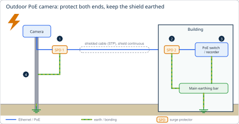

> Earthing, Bonding, Surge & Lightning Protection Library · **VISUAL GUIDE 3 · POE CAMERAS** · content version 1.0

# Visual guide 3: protecting PoE CCTV cameras

*Animated pictures of how a surge reaches a PoE camera, where the protectors divert it, and why the pole earth must be bonded*

**Applies to:** IP / PoE cameras on poles and walls, their cables, PoE switches and recorders

📄 **PDF:** [16_visual_guide_poe_cctv_cameras.pdf](https://github.com/Skynet1971/earthing/raw/HEAD/docs/pdf/16_visual_guide_poe_cctv_cameras.pdf)

> ℹ️ Information only. Every technical statement cites a source and PDF page; it does not replace the wiring code that applies at the site, the product manuals, or a qualified and registered person.

## 1  How a surge reaches the camera, and where it goes

*Animated: the steps play in a loop. Click to open full size.* (1) The cable between camera and switch picks up strong nearby fields, producing transients that travel along it.[R20 p.2](#sources-cited-on-this-page) (2)-(3) PoE surge protectors divert surges to ground while passing data and power[R20 p.3](#sources-cited-on-this-page); one goes near the outdoor device and one at the building entry.[R34 p.2](#sources-cited-on-this-page)[R20 p.3](#sources-cited-on-this-page) (4) With shielded cable the shield captures induced energy and diverts it to ground[R20 p.2](#sources-cited-on-this-page), but only with an unbroken path to ground through an earthed PoE switch or midspan.[R20 p.2](#sources-cited-on-this-page)[R20 p.3](#sources-cited-on-this-page)

## 2  The complete protection layout

*Click the diagram to open it full size.* *Concept sketch, not a product wiring diagram. (1) protector near the camera[R34 p.2](#sources-cited-on-this-page)[R10 p.1](#sources-cited-on-this-page) (2) protector at the building entry, bonded to the main earthing bar with a short conductor[R10 p.1](#sources-cited-on-this-page)[R18 p.22](#sources-cited-on-this-page) (3) the PoE switch or recorder is earthed so that the cable shield has a path to earth[R20 p.2](#sources-cited-on-this-page)[R20 p.3](#sources-cited-on-this-page) (4) the camera pole or pipe is earthed and the camera is bonded to it.[R41 p.4](#sources-cited-on-this-page)*

| **2** | **≤ 0.91 m** | **≥ 6 mm²** |
|---|---|---|
| protectors per outdoor Ethernet run: device end and building entry[R34 p.2](#sources-cited-on-this-page) | outdoor PoE suppressor from the device (Southwest Microwave)[R10 p.1](#sources-cited-on-this-page) | copper camera earth conductor (TP-Link Omada)[R41 p.4](#sources-cited-on-this-page) |

## 3  Why the pole earth must be bonded to the house earth

*Animated: the steps play in a loop. Click to open full size.* The same principle as a camera pole with its own electrode: ITU-T K.66 shows 15 kV between equipment and the power network when a 50 A surge flows through a separate 300 Ω electrode[R18 p.58](#sources-cited-on-this-page), and only a common earth bar with short bonds protects without further measures.[R18 p.56](#sources-cited-on-this-page) i-PRO names a potential difference in a separated earth line as a cause of equipment breakdown.[R39 p.2](#sources-cited-on-this-page)

> [!WARNING]
> **WARNING: The sources disagree on separate earths for CCTV**
>
> TP-Link Omada says the surveillance earth should be separate from other electrical earths[R41 p.3](#sources-cited-on-this-page); DEHN and ITU-T K.66 say every earth should be bonded to one point.[R6 p.142](#sources-cited-on-this-page)[R18 p.18](#sources-cited-on-this-page) See Sheet 04.

## 4  Checklist

- [ ] Surge protector near each outdoor camera, earthed to the pole, pipe or building metalwork.[R34 p.2](#sources-cited-on-this-page)[R34 p.2](#sources-cited-on-this-page)[R41 p.6](#sources-cited-on-this-page)
- [ ] Second protector where the cable enters the building, bonded with a short conductor to the main earthing bar.[R10 p.1](#sources-cited-on-this-page)[R18 p.22](#sources-cited-on-this-page)
- [ ] Shielded cable and shielded connectors along the whole path.[R20 p.1](#sources-cited-on-this-page)[R20 p.3](#sources-cited-on-this-page)
- [ ] PoE switch or midspan earthed.[R20 p.3](#sources-cited-on-this-page)[R20 p.3](#sources-cited-on-this-page)
- [ ] Camera pole earthed and bonded to the house earth.[R41 p.4](#sources-cited-on-this-page)[R18 p.18](#sources-cited-on-this-page)

## Sources cited on this page

`[R18 p.12]` = reference 18 below, PDF page 12 (page index of the PDF file). Each cited statement was checked against a verbatim quote from that page.

| Ref | Document | PDF pages cited |
|---|---|---|
| R6 | **Lightning Protection Guide, 3rd updated edition** — DEHN + SÖHNE · 2014 · IEC / EN 62305 (Germany) · [link](https://www.dehn-international.com/sites/default/files/media/files/lpg_en_complete.pdf) | 142 |
| R10 | **Technical Note #1003: Best Practices for Surge and Lightning Suppression of POE Devices** — Southwest Microwave, Inc. · not stated in document · USA · [link](https://southwestmicrowave.com/pdfs/1003-Best-Practices-for-Surge-and-Lightning-Suppression.pdf) | 1 |
| R18 | **Recommendation ITU-T K.66: Protection of customer premises from overvoltages** — International Telecommunication Union · 11/2019 · International · [link](https://www.itu.int/rec/T-REC-K.66-201911-I) | 18, 22, 56, 58 |
| R20 | **Power surges (white paper, web page)** — Axis Communications · web page as fetched 2026-11-23 · International · [link](https://whitepapers.axis.com/en/power-surges) | 1-3 |
| R34 | **Ethernet Surge Protector ETH-SP-G2: datasheet** — Ubiquiti Networks, Inc. · 2017 · International · [link](https://dl.ubnt.com/datasheets/ETH-SP/ETH-SP-G2_DS.pdf) | 2 |
| R39 | **Countermeasure for lightning surge (knowledge base article)** — i-PRO Co., Ltd. · updated May 2025 · International · [link](https://i-pro.com/products_and_solutions/en/surveillance/learning-and-support/knowledge-base/technical-information/surge-protection) | 2 |
| R41 | **Waterproof and Lightning Protection Installation Guide for Omada Security Devices** — TP-Link (Omada Network Support) · web page as fetched 2026-11-23 · International · [link](https://support.omadanetworks.com/za/document/44713/) | 3-4, 6 |

*Generated from `content/docs/16_visual_guide_poe_cameras.yaml` on 2026-11-24. Do not edit this page in the wiki; edit the content file.*
