<a href="Sources">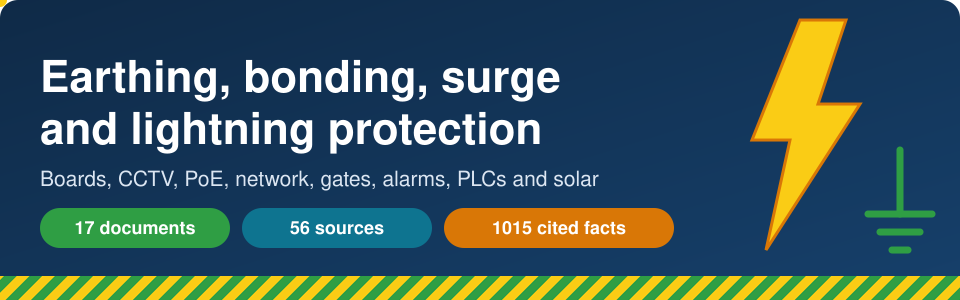</a>

> [!TIP]
> **New here? Start with the three animated visual guides.** They show how earthing works, how a surge reaches a PoE camera and why surge-protector wires must be short. Every picture carries citations to its sources.

## ▶ Animated visual guides

<table>
<tr><td width="33%"><a href="14-Visual-guide-1-how-earthing-and-bonding-work">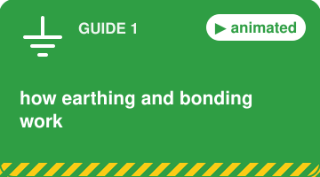</a></td><td width="33%"><a href="15-Visual-guide-2-lightning,-surges-and-surge-protectors">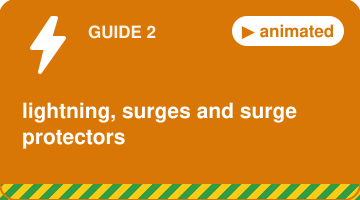</a></td><td width="33%"><a href="16-Visual-guide-3-protecting-PoE-CCTV-cameras">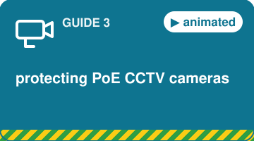</a></td></tr>
</table>

## 📚 Reference sheets

<table>
<tr><td width="33%"><a href="00-Earthing,-bonding,-surge-and-lightning-protection-library-index">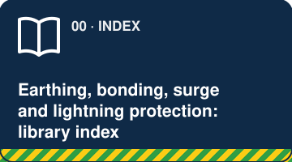</a></td><td width="33%"><a href="01-Earthing-and-bonding-fundamentals">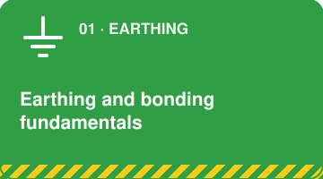</a></td><td width="33%"><a href="02-Lightning-and-surge-protection-basics">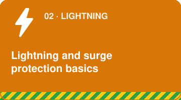</a></td></tr>
<tr><td width="33%"><a href="03-Surge-protective-devices-in-the-distribution-board">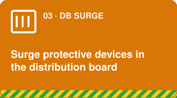</a></td><td width="33%"><a href="04-CCTV-cameras,-recorders-and-PoE-switches">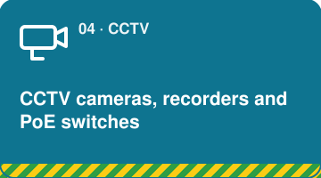</a></td><td width="33%"><a href="05-Data-networks,-telecom-entry-and-PoE">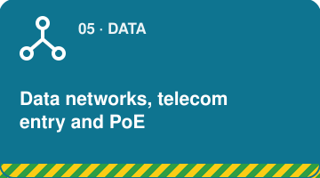</a></td></tr>
<tr><td width="33%"><a href="06-Antennas,-masts-and-dishes">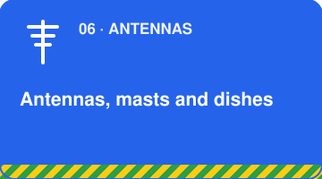</a></td><td width="33%"><a href="07-Gate-motors,-intercoms-and-public-address-lines">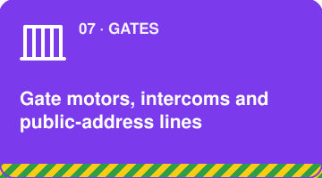</a></td><td width="33%"><a href="08-Electric-fences-and-intruder-alarms">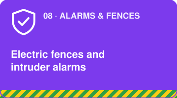</a></td></tr>
<tr><td width="33%"><a href="09-PLCs,-instrumentation-and-control-cabling">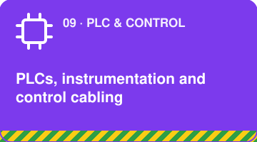</a></td><td width="33%"><a href="10-Solar-PV-arrays,-inverters-and-batteries">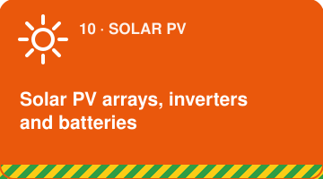</a></td><td width="33%"><a href="11-Equipment-racks-and-cabinets">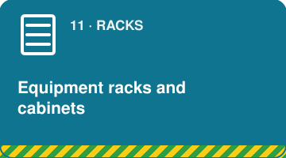</a></td></tr>
<tr><td width="33%"><a href="12-Inspection,-testing-and-maintenance">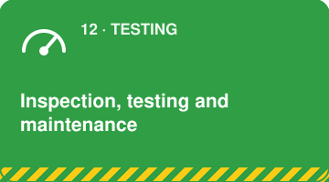</a></td><td width="33%"><a href="13-South-Africa-supply-earthing,-Ekurhuleni-rules-and-Gauteng-lightning">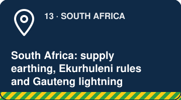</a></td></tr>
</table>

## How to read these pages

> [!NOTE]
> Every technical statement ends with a small citation such as R18 p.19: reference 18 on the [Sources](Sources) page, PDF page 19. Each cited statement was checked against a verbatim quote from that page and reviewed independently.

> [!WARNING]
> These pages summarise published guidance. They do not replace the wiring code that applies at the site, the product manuals, or a qualified and registered person. Where sources from different countries disagree, each page shows both sides.

| Colour in the pictures | Meaning |
|---|---|
| 🔴 red line | power (line conductor) |
| 🔵 blue line | neutral, data or signal |
| 🟠 orange line | photovoltaic d.c. |
| 🟢🟡 green with yellow stripes | protective earth and bonding conductors |
| 🟧 amber box | surge protective device (SPD) |

[All 56 source documents](Sources) · 1026 verified facts · generated 2026-11-25
